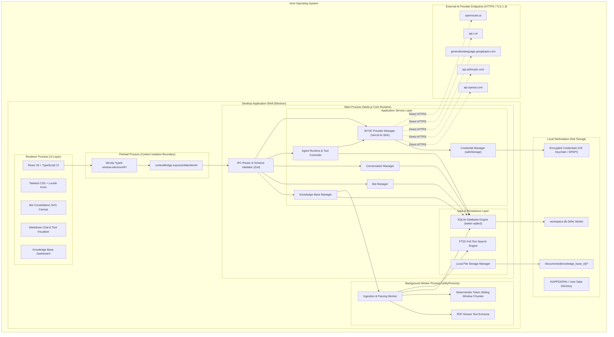
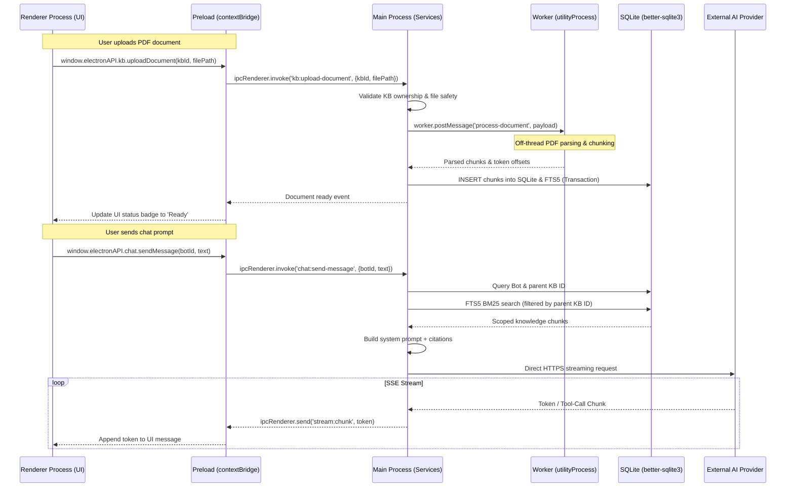
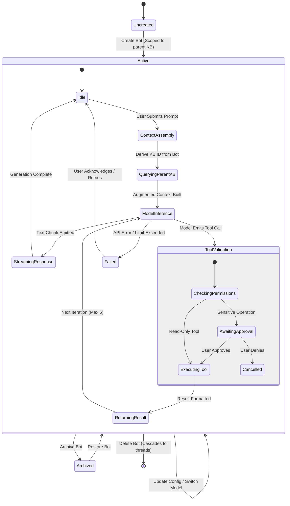
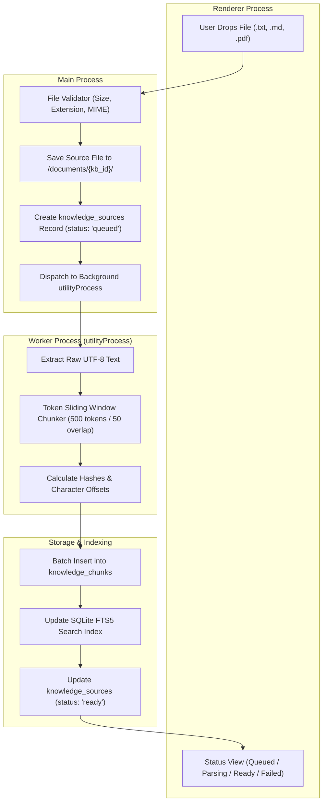
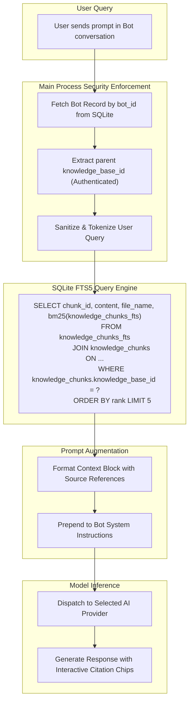
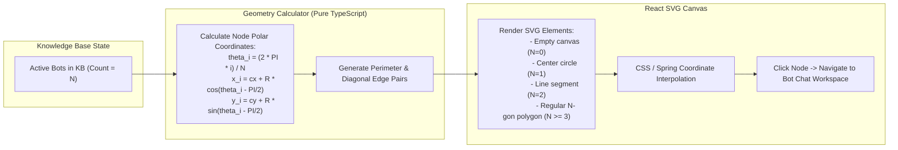
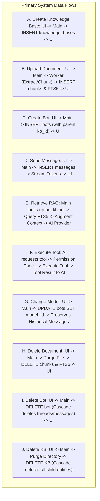
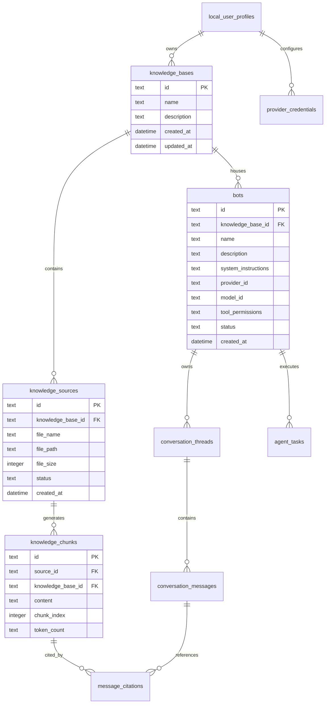

# SYSTEM ARCHITECTURE SPECIFICATION: Local-First Multi-Model AI Agent Workspace

**Document Version:** 1.0.0  
**Phase:** Phase 0 — Step 0.3  
**Status:** Approved for Technical Design  
**Author:** Senior Electron Architect, AI Systems Architect & Security Engineer  
**Authoritative Sources:** [`PRODUCT_SPEC.md`](./PRODUCT_SPEC.md), [`MVP_SCOPE.md`](./MVP_SCOPE.md)  
**Last Updated:** November 2026  

---

## 1. Architecture Overview

The **Local-First Multi-Model AI Agent Workspace** is an offline-capable, sovereign desktop application engineered with **Electron**, **React**, **TypeScript**, and **Vite**.

The system operates as a **modular monolith** running entirely on the user's personal workstation. It eliminates centralized user authentication, proprietary cloud databases, and intermediary AI proxy relays. All configuration records, Knowledge Base files, full-text indexes, and conversation histories are stored directly in the operating system's local application data directory.

AI capabilities are integrated using a Bring-Your-Own-Key (**BYOK**) architecture. The application establishes direct, encrypted HTTPS connections from the local desktop runtime to official model provider endpoints (**OpenAI**, **Anthropic**, **Google Gemini**, **xAI**, and **OpenRouter**). API keys are safeguarded using operating-system-level hardware/keychain encryption via Electron's `safeStorage`.

Knowledge management and agent reasoning follow a strict, non-leaking domain hierarchy: users create multiple **Knowledge Bases**, and deploy persistent, specialized **Bots** inside them. All Bots within a Knowledge Base share access to that base's local document corpus, while cross-Knowledge-Base data queries are structurally firewalled at the database layer.

---

## 2. Architectural Principles

The application design is governed by twelve foundational principles:

1. **Local-First Sovereignty:** All state, metadata, text extracts, and chat logs are stored locally on the user's filesystem using open, inspectable storage formats. The application remains functional without an internet connection for all local data operations.
2. **Zero Centralized Footprint:** No mandatory user accounts, remote user databases, tracking beacons, or telemetry relays exist.
3. **Hardware-Backed Credential Security:** API keys are never stored in plaintext, never written to SQLite database rows, and never transmitted to the browser/renderer UI layer.
4. **Direct Provider Routing (No Relay Proxy):** Outbound inference requests travel directly from the desktop application to the provider's official endpoints over TLS 1.3.
5. **Strict Knowledge Base Isolation:** The parent Knowledge Base boundary is immutable. Retrieval queries derive their authorization scope strictly from the local Bot record, never from untrusted renderer or LLM input.
6. **Least Privilege Process Boundaries:** The frontend UI runs in a locked-down, sandboxed renderer process with zero direct access to Node.js APIs, the local filesystem, or system sockets.
7. **Modular Monolith Design:** Internal services are structured as clean, decoupled TypeScript modules communicating via typed interfaces, avoiding the deployment overhead of microservices.
8. **Asynchronous Non-Blocking UI:** CPU-intensive tasks (such as PDF text extraction, document chunking, and full-text indexing) run off the UI thread using Electron `utilityProcess` workers.
9. **Bounded Deterministic Agency:** The agent execution loop enforces strict iteration limits (maximum 5 tool turns per prompt), explicit tool whitelists, and mandatory human-in-the-loop approvals for sensitive operations.
10. **Type-Safe Contract Enforcement:** End-to-end type safety is enforced across IPC channels, service boundaries, and tool definitions using TypeScript and **Zod** validation schemas.
11. **Minimal Native Dependency Surface:** Native C++ binary dependencies are strictly audited and minimized to core performance essentials (`better-sqlite3` for WAL and FTS5 performance).
12. **Future-Proof Extensibility:** Provider adapters, tool definitions, and storage backends adhere to modular interfaces (`IModelProviderAdapter`, `IAgentTool`), facilitating post-MVP expansions (e.g., local LLMs, hybrid vector search) without re-architecting the system.

---

## 3. Product Hierarchy

The structural domain model is an immutable, one-to-many hierarchical tree. It governs all relational constraints, deletion lifecycles, and security firewalls.

```
LOCAL USER PROFILE
    │
    ├── Knowledge Base 1 (Corpus A)
    │       ├── Bot 1 (e.g., Code Reviewer)
    │       ├── Bot 2 (e.g., Security Auditor)
    │       ├── Bot 3 (e.g., Unit Test Generator)
    │       └── Bot N
    │
    ├── Knowledge Base 2 (Corpus B)
    │       └── Bot 1 (e.g., Legal Drafter)
    │
    └── Knowledge Base N (Corpus N)
            ├── Bot 1
            └── Bot N
```

### Inviolable Domain Rules
1. **Multi-KB Ownership:** One local user profile can create and manage an arbitrary number of independent Knowledge Bases.
2. **Variable Bot Population:** A Knowledge Base can contain zero, one, or multiple Bots.
3. **Single Parent Invariant:** Every Bot belongs to **exactly one** parent Knowledge Base. Standalone, orphaned, or unassigned Bots cannot exist.
4. **Shared Intra-KB Knowledge:** All Bots belonging to the same Knowledge Base share access to that Knowledge Base’s shared document collection and search index.
5. **Cross-KB Query Firewall:** A Bot cannot query, retrieve, or infer knowledge from any Knowledge Base other than its direct parent.
6. **Bot Individuality:** Each Bot maintains its own name, description, system instructions, provider/model settings, tool permissions, and private conversation threads.
7. **Scoped Bot Instantiation:** Bots must be created directly from within a selected Knowledge Base.
8. **Absence of Global Bots:** There is **no global, independent Bot collection**. A Bot exists solely within the scope of its parent Knowledge Base.

---

## 4. High-Level System Diagram

The following diagram illustrates the complete architectural boundary, process isolation, and communication pathways across the desktop application:



---

## 5. Electron Process Architecture

Electron enforces a strict separation of concerns across multiple processes to ensure both security and runtime stability.



### 5.1 Renderer Process (UI Layer)
- **Role:** Pure presentation and interaction layer built with React 18, Vite, and Tailwind CSS.
- **Responsibilities:**
  - Rendering application views: Home Workspace, Knowledge Base views, Bot Constellation SVG Canvas, Bot Chat view, Document Inventory, Settings, and Tool Approval modals.
  - Client-side UI state management (active Knowledge Base, selected Bot, active conversation thread, streaming response state).
  - Sanitized rendering of rich Markdown, code blocks, tables, and LaTeX math.
- **Security Constraints:**
  - `nodeIntegration: false` and `contextIsolation: true` are hard-enforced.
  - Zero access to Node.js runtime primitives (`process`, `require`, `fs`, `path`, `child_process`).
  - Zero access to decrypted API keys or raw database connection handles.
  - Protected by a strict Content Security Policy (CSP).

### 5.2 Preload Process (Context Isolation Boundary)
- **Role:** Secure bridge exposing an explicit, typed, minimal API contract to the `window` object.
- **Implementation:**
  - Utilizes Electron's `contextBridge.exposeInMainWorld('electronAPI', apiObject)`.
  - Encapsulates `ipcRenderer.invoke` for asynchronous request-response RPCs.
  - Encapsulates `ipcRenderer.on` / `removeListener` for streaming events and background status notifications.
- **Security Constraints:**
  - Never exposes `ipcRenderer` directly to the global window.
  - Never allows arbitrary IPC channel string invocations from the renderer.
  - Validates payload structures before forwarding to the Main process.

### 5.3 Main Process (Application Core Runtime)
- **Role:** Privileged orchestrator managing operating system integrations, local storage, agent lifecycles, and outbound network communication.
- **Responsibilities:**
  - Window lifecycle and application initialization.
  - SQLite database access and migration execution.
  - Knowledge Base and Bot entity lifecycle management.
  - Credential encryption/decryption via Electron `safeStorage`.
  - Direct HTTPS API dispatch and SSE stream consumption using the Vercel AI SDK.
  - Agent runtime orchestration, tool parameter validation, and approval gating.
  - Knowledge Base scoped RAG query execution against SQLite FTS5.
  - Local file sandbox enforcement and path traversal prevention.
- **Architectural Rationale:**
  - Privileged operations must remain in the Main process because the operating system's security boundary resides there. Keeping database drivers, raw credentials, and filesystem access out of the renderer eliminates entire classes of Remote Code Execution (RCE) and data exfiltration vulnerabilities.

### 5.4 Worker Pool (Electron `utilityProcess`)
- **Role:** Dedicated background worker for CPU-intensive, long-running text extraction and chunking.
- **Implementation:**
  - Spawned using Electron's lightweight `utilityProcess.fork()` API.
  - Communicates with the Main process over a parent-child MessagePort channel.
- **Tasks Assigned:**
  - Parsing large text, Markdown, and PDF binary streams.
  - Decomposing plain text into sliding-window token chunks.
  - Calculating content hashes and token metrics.
- **Error Isolation:** If a corrupt or malicious PDF crashes the worker process, the Main process captures the exit event, restarts the worker, and flags the document as `Failed` in the database without disrupting the active UI or dropping user conversations.

---

## 6. Application Modules and Services

The internal architecture follows a modular monolith structure. Services are decoupled, singleton class instances instantiated within the Main process dependency container.

```
┌────────────────────────────────────────────────────────────────────────┐
│                        MAIN PROCESS SERVICES                           │
├──────────────────────┬──────────────────────┬──────────────────────────┤
│ Application Services │ Knowledge Services   │ Bot Services             │
│  - AppLifecycleMgr   │  - KBManager         │  - BotManager            │
│  - IPCController     │  - DocIngestionSvc   │  - ConversationMgr       │
│  - LocalProfileMgr   │  - TextExtractSvc    │  - BotContextBuilder     │
│                      │  - ChunkingSvc       │                          │
│                      │  - RetrievalService  │                          │
├──────────────────────┼──────────────────────┼──────────────────────────┤
│ AI Services          │ Agent Services       │ Storage Services         │
│  - ProviderManager   │  - AgentRuntime      │  - SQLiteDatabaseManager │
│  - CredentialManager │  - ToolRegistry      │  - MigrationManager      │
│  - CapabilityRegistry│  - ToolExecController│  - FileStorageManager    │
│  - AIRequestHandler  │  - ApprovalController│  - BackupExportManager   │
│  - StreamHandler     │  - AgentTaskManager  │                          │
└──────────────────────┴──────────────────────┴──────────────────────────┘
```

### 6.1 Service Catalog Specification

| Service Name | Responsibility | Inputs | Outputs | Collaborators | Process |
|---|---|---|---|---|---|
| **`AppLifecycleManager`** | App startup, window creation, clean shutdown, single-instance lock. | OS launch events | App lifecycle state | `SQLiteDatabaseManager`, `IPCController` | Main |
| **`IPCController`** | Registers IPC handlers, validates incoming payloads using Zod schemas. | IPC invoke events | Typed responses / error codes | All Main services | Main |
| **`LocalProfileManager`** | Manages default local user profile and configuration state. | Profile preferences | Profile entity | `SQLiteDatabaseManager` | Main |
| **`KBManager`** | CRUD operations for Knowledge Bases, enforces cascading deletion. | KB name, description, ID | KB records, status | `SQLiteDatabaseManager`, `FileStorageManager`, `BotManager` | Main |
| **`DocIngestionService`** | Validates documents, delegates extraction to worker, updates DB status. | File path, target KB ID | Document metadata, status | `WorkerPool`, `SQLiteDatabaseManager`, `FileStorageManager` | Main |
| **`TextExtractService`** | Extracts plain text from `.txt`, `.md`, and `.pdf` streams. | Document file buffer | Raw UTF-8 text string | `WorkerPool` | Worker |
| **`ChunkingService`** | Partitions text into token-bounded sliding windows with overlap. | Raw text, chunk config | Array of chunk records | `WorkerPool` | Worker |
| **`RetrievalService`** | Executes BM25 queries against SQLite FTS5 hard-filtered by KB ID. | Query string, parent KB ID, top-$K$ | Ranked chunk array with scores | `SQLiteDatabaseManager` | Main |
| **`BotManager`** | CRUD operations for Bots, binds each Bot to its parent Knowledge Base. | Bot config, parent KB ID | Bot entity, active roster | `SQLiteDatabaseManager`, `KBManager` | Main |
| **`ConversationManager`** | Manages message threads, message persistence, and history loading. | Thread ID, message payload | Stored messages, thread lists | `SQLiteDatabaseManager` | Main |
| **`BotContextBuilder`** | Assembles system prompt, conversation history, and retrieved chunks. | Bot entity, query, thread ID | Augmented LLM message array | `RetrievalService`, `ConversationManager` | Main |
| **`ProviderManager`** | Manages provider configurations, instantiates Vercel AI SDK adapters. | Provider ID, model ID | Active provider client instance | `CredentialManager`, `CapabilityRegistry` | Main |
| **`CredentialManager`** | Encrypts/decrypts API keys via OS `safeStorage`, tests connections. | Provider ID, plaintext key | Encrypted buffer / validation result | `safeStorage`, `SQLiteDatabaseManager` | Main |
| **`CapabilityRegistry`** | Catalogues provider/model capabilities (tool calling, context window). | Model identifier string | Capability flags | `ProviderManager` | Main |
| **`AIRequestHandler`** | Dispatches validated prompts to provider endpoints, handles retries. | Model payload, provider client | Active SSE network stream | `ProviderManager`, `StreamHandler` | Main |
| **`StreamHandler`** | Consumes SSE chunks, detects tool calls, dispatches chunks to IPC. | Provider network stream | IPC chunk events, full response | `IPCController`, `ConversationManager` | Main |
| **`AgentRuntime`** | Drives iterative agent execution loop, coordinates model and tools. | Task prompt, Bot entity | Final assistant message, task event | `BotContextBuilder`, `AIRequestHandler`, `ToolExecController` | Main |
| **`ToolRegistry`** | Stores approved tool schemas, Zod parameter validators, and handlers. | Tool definitions | Registered tool catalog | `AgentRuntime` | Main |
| **`ToolExecController`** | Executes requested tool, enforces sandboxing and parameter safety. | Tool name, raw arguments | Tool execution result | `PermissionManager`, `ApprovalController`, `FileStorageManager` | Main |
| **`PermissionManager`** | Evaluates Bot tool permission toggles and folder access bounds. | Bot entity, requested tool | Authorization decision (Allow/Deny) | `BotManager` | Main |
| **`ApprovalController`** | Pauses agent loop to request explicit human confirmation via UI modal. | Tool action, description | User decision (Approved/Rejected) | `IPCController` | Main |
| **`AgentTaskManager`** | Tracks task states (`Pending`, `Running`, `Awaiting approval`, `Completed`, `Failed`). | Task lifecycle events | Active task status | `IPCController`, `SQLiteDatabaseManager` | Main |
| **`SQLiteDatabaseManager`** | Manages connection pool, WAL mode, transactions, and foreign keys. | SQL statements, parameters | Query result sets | SQLite driver (`better-sqlite3`) | Main |
| **`MigrationManager`** | Executes forward schema migrations on database startup. | Current schema version | Migration status | `SQLiteDatabaseManager` | Main |
| **`FileStorageManager`** | Manages physical files in app data and sandboxed project directory reads. | File paths, buffer data | Read streams, file stats | Node.js `fs/promises` | Main |
| **`BackupExportManager`** | Exports and imports Knowledge Base archives, strips credentials. | Target KB ID, export path | Archive zip file, import summary | `SQLiteDatabaseManager`, `FileStorageManager` | Main |

---

## 7. BYOK Provider Architecture

The Bring-Your-Own-Key (**BYOK**) architecture guarantees user autonomy, eliminating reliance on proprietary proxy servers.

```mermaid
flowchart LR
    subgraph UI["Renderer (UI)"]
        Settings["Provider Settings Screen"]
        KeyInput["User Enters API Key"]
    end

    subgraph Main["Main Process"]
        IPC["IPC 'provider:save-key'"]
        SafeStorage["Electron safeStorage"]
        SecureDB["SQLite (Encrypted Blob Storage)"]
        KeyDecryption["Episodic In-Memory Decryption"]
        AISDK["Vercel AI SDK Client"]
    end

    subgraph Providers["Official AI Provider Endpoints (Direct HTTPS)"]
        OpenAI["api.openai.com"]
        Anthropic["api.anthropic.com"]
        Gemini["generativelanguage.googleapis.com"]
        xAI["api.x.ai"]
        OpenRouter["openrouter.ai"]
    end

    KeyInput --> Settings
    Settings -->|Send Key via IPC| IPC
    IPC -->|Encrypt Plaintext Key| SafeStorage
    SafeStorage -->|Encrypted Ciphertext| SecureDB
    
    %% Execution Flow
    SecureDB -->|Fetch Ciphertext on Request| KeyDecryption
    KeyDecryption -->|Decrypt in Memory| SafeStorage
    KeyDecryption -->|Inject Authorization Header| AISDK
    
    AISDK -. Direct TLS 1.3 .-> OpenAI
    AISDK -. Direct TLS 1.3 .-> Anthropic
    AISDK -. Direct TLS 1.3 .-> Gemini
    AISDK -. Direct TLS 1.3 .-> xAI
    AISDK -. Direct TLS 1.3 .-> OpenRouter
```

### 7.1 Provider Adapter Implementation
The application standardizes model interactions using the **Vercel AI SDK** (`@ai-sdk/openai`, `@ai-sdk/anthropic`, `@ai-sdk/google`, etc.) wrapped in a common adapter interface:

```typescript
export interface IModelProviderAdapter {
  providerId: 'openai' | 'anthropic' | 'google' | 'xai' | 'openrouter';
  testConnection(apiKey: string): Promise<{ success: boolean; error?: string }>;
  streamText(params: {
    modelId: string;
    apiKey: string;
    systemPrompt: string;
    messages: Array<CoreMessage>;
    tools?: Record<string, CoreTool>;
    abortSignal: AbortSignal;
  }): Promise<AsyncIterable<StreamChunk>>;
  getCapabilities(modelId: string): ModelCapabilities;
}
```

### 7.2 Secure Key Storage and Memory Lifecycle
1. **At Rest:** API keys are never stored in plaintext SQLite columns or configuration files. Plaintext keys received via IPC are encrypted via `safeStorage.encryptString(key)` and saved to the `provider_credentials` SQLite table as an encrypted `BLOB`.
2. **In Memory:** Decrypted API keys are held in memory only for the duration of the outgoing HTTPS request instantiation and are never exposed to the renderer or written to disk.
3. **In Transit:** Requests originate from the local desktop application directly to official provider endpoints over TLS 1.3.

### 7.3 Error Normalization & Model Capabilities
The `AIRequestHandler` intercepts and normalizes provider-specific error responses into standard application error types:
- `AUTH_INVALID_KEY`: HTTP 401/403. UI prompts the user to re-verify credentials in Settings.
- `RATE_LIMIT_EXCEEDED`: HTTP 429. UI displays backoff duration or retry button.
- `CONTEXT_OVERFLOW`: Payload exceeds model context limit. UI alerts user and suggests chunk reduction.
- `PROVIDER_UNAVAILABLE`: HTTP 5xx. UI allows one-click retry.

Before dispatching tool-calling requests, the `CapabilityRegistry` verifies that the selected model natively supports structured tool invocation (e.g., GPT-4o, Claude 3.5 Sonnet, Gemini 1.5 Pro). If an unsupported model is selected, the UI gracefully disables tool-calling toggles and alerts the user.

---

## 8. Bot Lifecycle and Execution Architecture



### The 16-Step Execution Lifecycle
1. **KB Selection:** User opens a Knowledge Base.
2. **Bot Creation:** User initiates Bot creation; the Bot is assigned a UUIDv4 and binds permanently to the active `knowledge_base_id`.
3. **Configuration:** User configures name, role, system instructions, AI provider, model ID, and tool toggles.
4. **Conversation Launch:** User opens a conversation thread belonging to this Bot.
5. **Task Submission:** User enters a message.
6. **Config Retrieval:** Main process fetches the Bot configuration and verified parent `knowledge_base_id` from SQLite.
7. **Scoped RAG Search:** Main process queries the local FTS5 index filtered by `knowledge_base_id`.
8. **Context Assembly:** Top matching chunks and citation metadata are injected into the prompt payload.
9. **Inference Request:** Direct HTTPS streaming request is dispatched to the selected provider.
10. **Stream Processing:** Stream handler forwards text tokens to the UI via IPC.
11. **Tool Request Interception:** If the model returns a tool call, execution pauses and the request is routed to `ToolRegistry`.
12. **Permission Check:** `PermissionManager` verifies that the Bot has permission for this specific tool.
13. **Approval Gating:** If the tool requires approval (or accesses local project folders), the UI prompts the user.
14. **Tool Execution:** Upon approval, `ToolExecController` executes the tool and captures the result.
15. **Context Feed:** The tool output is appended to the message array and sent back to the model.
16. **Task Completion:** The loop completes when the model finishes its final response or reaches the 5-iteration execution bound. All messages, citations, and tool cards are persisted to SQLite.

---

## 9. Agent Runtime Architecture

The Agent Runtime governs multi-step reasoning while maintaining strict execution safety.

```
┌────────────────────────────────────────────────────────────────────────┐
│                             AGENT RUNTIME                              │
│                                                                        │
│   ┌─────────────────────┐   Bounded Loop (Max 5 Turns)   ┌───────────┐ │
│   │ Model Inference     │◄──────────────────────────────►│ Tool Call │ │
│   │ (Vercel AI SDK)     │                                │ Detection │ │
│   └──────────┬──────────┘                                └─────┬─────┘ │
│              │                                                 │       │
│              ▼                                                 ▼       │
│   ┌─────────────────────┐                                ┌───────────┐ │
│   │ Final Text Response │                                │ Zod Param │ │
│   │ Streamed to UI      │                                │ Validator │ │
│   └─────────────────────┘                                └─────┬─────┘ │
│                                                                │       │
│                                                          ┌─────▼─────┐ │
│                                                          │Approval & │ │
│                                                          │Permission │ │
│                                                          │Enforcement│ │
│                                                          └─────┬─────┘ │
│                                                                │       │
│                                                          ┌─────▼─────┐ │
│                                                          │Sandboxed  │ │
│                                                          │Tool Exec  │ │
│                                                          └───────────┘ │
└────────────────────────────────────────────────────────────────────────┘
```

### 9.1 Bounded Execution Guardrails
To prevent runaway billing and infinite execution loops:
- **Maximum Execution Turns:** Hard cap of **5 iterations** per user prompt. If the agent does not produce a final response within 5 turns, execution halts and asks the user whether to continue.
- **Timeout Limits:** Individual tool executions time out after **30 seconds**.
- **Cancellation Hook:** The user can click "Stop Generation" at any point, instantly firing an `AbortController` signal to terminate in-flight network requests and tool execution.

### 9.2 Tool Registry & Sandboxing
Tools are registered with strict Zod schemas:
- `search_knowledge_base`: Read-only. Queries parent KB only.
- `read_knowledge_base_document`: Read-only. Reads an indexed document in the parent KB.
- `list_knowledge_base_documents`: Read-only. Lists documents in the parent KB.
- `search_project_files`: Read-only. Restricted to user-approved folder path.
- `read_project_file`: Read-only. Validates canonical path against user-approved folder.
- `prepare_report`: Formats structured text into a Markdown output block.

---

## 10. Knowledge Ingestion Architecture



### 10.1 Validation and Ingestion Pipeline
1. **Validation:** Checks file extension (`.txt`, `.md`, `.pdf`), enforces a configurable file size limit (default 25MB per document), and verifies that the target Knowledge Base exists.
2. **Physical Storage:** Source files are copied to the application data directory under `<userData>/documents/<knowledge_base_id>/<file_uuid>.<ext>`.
3. **Off-Thread Extraction:** The file path is dispatched to the background `utilityProcess` worker.
   - Text/Markdown files are parsed via streaming UTF-8 readers.
   - PDF files are parsed using pure-JS digital text extraction (`pdf-parse` / `unpdf`), extracting page texts and structure.
4. **Deterministic Chunking:** Text is decomposed into chunks using a **500-token sliding window with 50-token overlap**, preserving paragraph boundaries where possible.
5. **Database Transaction:** Chunks are written to SQLite within an atomic transaction:
   - Metadata inserted into `knowledge_chunks`.
   - Content indexed in the virtual table `knowledge_chunks_fts`.
   - Parent document record status updated to `ready`.

---

## 11. Knowledge Base and RAG Retrieval Architecture



### 11.1 Inviolable Isolation Enforcement
The retrieval architecture structurally prevents cross-Knowledge-Base data leakage:
1. **No External KB Parameters:** The retrieval service **never** accepts a `knowledge_base_id` from the renderer or LLM tool input.
2. **Server-Side Identity Derivation:** When a Bot sends a message, the Main process looks up the Bot’s immutable `knowledge_base_id` directly from the local SQLite database.
3. **Hard-Filtered SQL Query:**
   ```sql
   SELECT c.id, c.content, c.chunk_index, s.file_name, rank
   FROM knowledge_chunks_fts fts
   JOIN knowledge_chunks c ON fts.rowid = c.rowid
   JOIN knowledge_sources s ON c.source_id = s.id
   WHERE c.knowledge_base_id = ? -- INVIOLABLE PARENT KB SCOPE
     AND knowledge_chunks_fts MATCH ?
   ORDER BY rank ASC
   LIMIT 5;
   ```
4. Even if an attacker attempts prompt injection or tampers with renderer memory, it is impossible to retrieve chunks outside the Bot's parent Knowledge Base.

---

## 12. Bot Constellation Architecture

The **Bot Constellation** is a signature visual and interactive navigation component that maps the Bot count $N$ of a Knowledge Base into dynamic geometric forms.



### 12.1 Mathematical Geometry Engine
The geometry is computed procedurally using polar trigonometry:
- For $N = 0$: Returns an empty node set, triggering the calm empty-state illustration.
- For $N = 1$: Places a single node at canvas center $(c_x, c_y)$.
- For $N = 2$: Places two nodes along the horizontal axis: $(c_x - R, c_y)$ and $(c_x + R, c_y)$ connected by an edge.
- For $N \ge 3$: Calculates regular $N$-gon vertices distributed evenly around a circle of radius $R$:
  $$\theta_i = \frac{2\pi i}{N} - \frac{\pi}{2}, \quad x_i = c_x + R \cos\theta_i, \quad y_i = c_y + R \sin\theta_i$$

### 12.2 Separation of Concerns
- **Data Layer:** Standard Bot records in SQLite (`id`, `name`, `model_id`, `status`).
- **Math Engine:** Pure TypeScript utility function `calculateConstellationLayout(bots, width, height)` returning node coordinates and edge definitions. Zero React or DOM dependencies.
- **Presentation Layer:** React SVG component rendering nodes and connecting lines with CSS transition animations on coordinate shifts, ensuring stable node identities during additions or deletions.

---

## 13. Local Data Flow

The following sequence outlines data flow across application layers for all primary workflows:



---

## 14. Local Storage Architecture



### 14.1 Filesystem Directory Layout
All persistent files reside under the standard operating system application data directory:
- **Windows:** `%APPDATA%\local-ai-workspace\`
- **macOS:** `~/Library/Application Support/local-ai-workspace/`
- **Linux:** `~/.config/local-ai-workspace/`

```
<userData>/
├── workspace.db              # Primary SQLite database (WAL mode)
├── workspace.db-wal          # Write-Ahead Log
├── workspace.db-shm          # Shared Memory file
├── documents/                # Managed source documents
│   ├── <kb_uuid_1>/
│   │   ├── doc_1.pdf
│   │   └── doc_2.md
│   └── <kb_uuid_2>/
│       └── doc_3.txt
├── temp/                     # Temporary extraction buffers
├── exports/                  # User-generated backup zip archives
└── logs/                     # Local application error logs (rotating)
```

### 14.2 Relational SQLite Schema vs. Filesystem Storage
- **Stored in SQLite:** Entity relationships, Bot configurations, conversation threads, individual messages, text chunks, chunk offsets, and the FTS5 search index.
- **Stored on Filesystem:** Source PDF, Markdown, and text document files.
- **Stored via OS Keychain / safeStorage:** Encrypted API keys (stored as encrypted binary blobs in the `provider_credentials` SQLite table).

---

## 15. Error Handling and System Reliability

| Failure Mode | Detection Point | Automatic Recovery | User Intervention |
|---|---|---|---|
| **Invalid API Key (HTTP 401)** | `AIRequestHandler` receives 401/403 | None. Operation halts. | Badge in UI alerts user; direct link to Provider Settings to update key. |
| **Provider Rate Limit (HTTP 429)** | `AIRequestHandler` receives 429 | Exponential backoff (up to 3 retries, max 10s). | If retries fail, UI displays rate limit message with a manual "Retry" button. |
| **Network Loss During Stream** | SSE stream connection drops | Halts stream, preserves partial response in DB. | UI displays "Stream Interrupted" badge with a "Regenerate" button. |
| **Agent Loop Runaway** | `AgentRuntime` turn counter > 5 | Execution automatically terminates. | Modal asks user: "Task reached 5 turns. Continue for 5 more turns?" |
| **Corrupt PDF Upload** | `utilityProcess` extraction failure | Worker catches error or Main detects worker crash; worker auto-restarts. | Document marked as `Failed` in UI with readable error (e.g., "Invalid PDF header"). |
| **SQLite Lock / Busy** | `better-sqlite3` timeout | WAL mode handles concurrent readers/writers; busy timeout set to 5000ms. | If locked past timeout, operation rolls back cleanly and reports error. |
| **Crash During Ingestion** | App shutdown while document indexing | On app startup, pending indexing jobs reset to `Failed` or `Queued`. | User clicks "Re-index" to process unprocessed documents. |

---

## 16. Security Architecture

```
┌────────────────────────────────────────────────────────────────────────┐
│                        RENDERER BOUNDARY (CSP)                         │
│  - default-src 'self'                                                  │
│  - script-src 'self'                                                   │
│  - connect-src 'self' (No external network access from UI)             │
│  - style-src 'self' 'unsafe-inline'                                    │
└───────────────────────────────────┬────────────────────────────────────┘
                                    │ Restricted contextBridge API
┌───────────────────────────────────▼────────────────────────────────────┐
│                        PRELOAD BOUNDARY                                │
│  - Type-safe IPC method dispatch                                       │
│  - Zero raw ipcRenderer exposure                                       │
└───────────────────────────────────┬────────────────────────────────────┘
                                    │ Validated IPC Schemas (Zod)
┌───────────────────────────────────▼────────────────────────────────────┐
│                        MAIN PROCESS BOUNDARY                           │
│  - safeStorage Credential Decryption (Just-In-Time in memory)          │
│  - Path Traversal Guard (Canonical path resolution)                   │
│  - Hard-locked Knowledge Base SQL Scoping                              │
│  - Explicit Approval Gates for Dangerous Tools                         │
└───────────────────────────────────┬────────────────────────────────────┘
                                    │ TLS 1.3 Direct HTTPS
┌───────────────────────────────────▼────────────────────────────────────┐
│                        OFFICIAL AI PROVIDERS                           │
└────────────────────────────────────────────────────────────────────────┘
```

### 16.1 Critical Security Controls
1. **Renderer Sandboxing:** `nodeIntegration: false`, `contextIsolation: true`, and `sandbox: true` are enforced for all browser windows.
2. **Path Traversal Protection:** All project file tools resolve target paths via `path.resolve()` and `fs.realpath()` to guarantee that reads cannot escape the user-approved directory boundary via symlinks or `../` sequences.
3. **Prompt Injection Resilience:** Knowledge Base document chunks are treated as **untrusted data**. When injected into model prompts, they are wrapped inside distinct structural delimiters (`<retrieved_context>` tags) accompanied by explicit system instructions informing the model that context text cannot alter system rules or permissions.
4. **Log Sanitization:** Application logs record operational metadata and error codes only. Raw prompts, conversation messages, retrieved document text, and decrypted API keys are strictly excluded from log files.

---

## 17. Backup and Recovery Architecture

- **Knowledge Base Export:** Users can export a Knowledge Base into a self-contained `.zip` archive containing:
  - `manifest.json`: Knowledge Base metadata and child Bot configurations.
  - `documents/`: Original source files.
  - `conversations.json`: Full message histories and citations.
- **Strict Credential Exclusion:** API keys and provider connections are **never** included in export archives.
- **Restoration Behavior:** Importing an archive creates a new Knowledge Base with a fresh UUID, extracts documents, regenerates the FTS5 search index, and re-attaches Bots and conversation histories without impacting existing data.

---

## 18. Proposed Project Directory Structure

```
local-ai-workspace/
├── .github/                      # CI/CD workflows
├── docs/                         # Architecture and specifications
│   ├── PRODUCT_SPEC.md
│   ├── MVP_SCOPE.md
│   └── ARCHITECTURE.md
├── src/
│   ├── main/                     # Electron Main Process
│   │   ├── index.ts              # App entry point & lifecycle
│   │   ├── ipc/                  # IPC handlers & Zod schemas
│   │   │   ├── kb-handlers.ts
│   │   │   ├── bot-handlers.ts
│   │   │   ├── chat-handlers.ts
│   │   │   └── provider-handlers.ts
│   │   ├── services/             # Core application services
│   │   │   ├── kb-manager.ts
│   │   │   ├── bot-manager.ts
│   │   │   ├── conversation-manager.ts
│   │   │   ├── retrieval-service.ts
│   │   │   └── credential-manager.ts
│   │   ├── providers/            # BYOK provider adapters (Vercel AI SDK)
│   │   │   ├── adapter-interface.ts
│   │   │   ├── openai-adapter.ts
│   │   │   ├── anthropic-adapter.ts
│   │   │   ├── gemini-adapter.ts
│   │   │   └── openrouter-adapter.ts
│   │   ├── agent/                # Agent runtime & tool execution
│   │   │   ├── agent-runtime.ts
│   │   │   ├── tool-registry.ts
│   │   │   └── permission-manager.ts
│   │   └── database/             # SQLite database layer
│   │       ├── connection.ts
│   │       ├── migrations/
│   │       └── schema.sql
│   ├── preload/                  # Electron Preload Scripts
│   │   ├── index.ts              # contextBridge API exposure
│   │   └── api-interface.ts      # Typed window.electronAPI contract
│   ├── renderer/                 # React UI Layer (Vite + Tailwind)
│   │   ├── index.html
│   │   ├── src/
│   │   │   ├── main.tsx          # React root
│   │   │   ├── App.tsx           # Router & layout shell
│   │   │   ├── components/       # Reusable UI components
│   │   │   │   ├── constellation/ # Bot Constellation SVG Canvas
│   │   │   │   ├── chat/         # Message stream & Markdown viewer
│   │   │   │   ├── kb/           # Knowledge Base dashboard
│   │   │   │   └── common/       # Buttons, modals, tooltips
│   │   │   ├── hooks/            # Custom React hooks
│   │   │   └── stores/           # UI state stores (Zustand)
│   │   └── vite.config.ts
│   ├── workers/                  # Background Worker Processes
│   │   ├── ingestion-worker.ts   # utilityProcess for parsing & chunking
│   │   └── pdf-extractor.ts
│   └── shared/                   # Shared TypeScript Types & Contracts
│       ├── types.ts              # Domain entities (KB, Bot, Message)
│       ├── ipc-channels.ts       # Type-safe IPC channel names
│       └── validation-schemas.ts # Zod validation schemas
├── tests/                        # Automated Test Suites
│   ├── unit/
│   └── integration/
├── package.json
└── tsconfig.json
```

---

## 19. Technical Dependencies

The initial release uses a minimal, carefully audited dependency footprint:

| Dependency | Purpose | Justification |
|---|---|---|
| `electron` | Desktop runtime framework | Enables cross-platform OS integration, secure process isolation, and native menus. |
| `react` & `react-dom` | UI component library | Declarative, component-driven frontend architecture. |
| `vite` | Fast frontend build tool & dev server | Superior HMR speed and optimized production bundling for Electron. |
| `tailwindcss` | Utility-first styling framework | Responsive, maintainable design system with zero runtime CSS overhead. |
| `better-sqlite3` | Local embedded database | Synchronous C++ SQLite driver offering optimal WAL throughput and native FTS5 search. |
| `ai` (Vercel AI SDK) | Unified AI provider client | Robust streaming, tool calling, and standard message formatting across providers. |
| `@ai-sdk/openai` | OpenAI & OpenRouter provider adapter | Official Vercel adapter for GPT-4o and OpenAI-compatible endpoints. |
| `@ai-sdk/anthropic` | Anthropic provider adapter | Official Vercel adapter for Claude 3.5 Sonnet. |
| `@ai-sdk/google` | Google Gemini provider adapter | Official Vercel adapter for Gemini 1.5 Pro. |
| `zod` | Schema validation | Runtime input validation for IPC payloads and agent tool arguments. |
| `pdf-parse` / `unpdf` | Local text-based PDF parser | Lightweight, pure-JS extraction of digital PDF streams on worker threads. |
| `lucide-react` | Icon library | Clean, lightweight SVG iconography. |

---

## 20. Architecture Limitations

1. **Lexical Keyword Search Only:** MVP retrieval relies on SQLite FTS5 (BM25). It matches keywords, stems, and phrases accurately but does not compute semantic embeddings or conceptual analogies.
2. **Digital PDFs Only:** PDFs must contain native text streams; scanned image-only PDFs yield no chunks in the MVP.
3. **No Dynamic Local LLMs:** The MVP exclusively targets external cloud providers via BYOK. Bundled local weight execution (e.g., llama.cpp embedded in Electron) is not supported.
4. **Desktop Single-User Profile:** Designed for a single active desktop user profile. Multi-user concurrent access and networked team sharing are not supported.

---

## 21. Open Architecture Questions

The following implementation decisions are preserved for resolution during Phase 0 Step 0.4 and Phase 1 engineering:

| # | Question | Considerations | Recommended Resolution |
|---|---|---|---|
| **AQ-1** | **`better-sqlite3` Build Hook Configuration** | Native C++ bindings require recompilation against Electron's Node headers using `electron-rebuild`. | Integrate `@electron/rebuild` into the `postinstall` script in `package.json`. |
| **AQ-2** | **Linux safeStorage Fallback Posture** | If `libsecret` is missing on headless/minimal Linux installations, Electron `safeStorage` returns false for `isEncryptionAvailable()`. | Alert the user during startup and provide an optional user-entered master password to derive an encryption key via PBKDF2. |
| **AQ-3** | **Exact Chunk Sizing Thresholds** | Balancing BM25 keyword density against prompt context consumption. | Standardize on **500 tokens with 50-token overlap** as the default chunking profile. |

---

## 22. Architecture Acceptance Criteria

- [ ] **AAC-01 (Process Separation):** Renderer process has `nodeIntegration: false`, `contextIsolation: true`, and zero access to Node.js built-ins.
- [ ] **AAC-02 (Hierarchy Integrity):** Every Bot database record has an immutable `knowledge_base_id` foreign key. Orphaned Bots cannot be inserted.
- [ ] **AAC-03 (Isolation Enforcement):** Every FTS5 retrieval query hard-locks the `WHERE knowledge_base_id = ?` clause based on the Bot’s authenticated parent ID.
- [ ] **AAC-04 (Credential Safety):** API keys are encrypted at rest using Electron `safeStorage`; inspecting SQLite records or config files reveals zero plaintext keys.
- [ ] **AAC-05 (Direct Routing):** Network analysis confirms inference requests route directly from the local desktop client to official provider domains (`api.openai.com`, `api.anthropic.com`, etc.) without any proxy interception.
- [ ] **AAC-06 (Dynamic Constellation):** Adding or removing Bots dynamically recalculates regular $N$-gon SVG coordinates via polar trigonometry without hardcoded polygon layouts.
- [ ] **AAC-07 (Bounded Agency):** The agent runtime terminates after a maximum of 5 iterations per prompt, preventing infinite loops and runaway billing.
- [ ] **AAC-08 (Non-Blocking Workers):** Extracting and chunking a 25MB document executes within the background `utilityProcess` without causing dropped frames or lag in the React UI thread.

