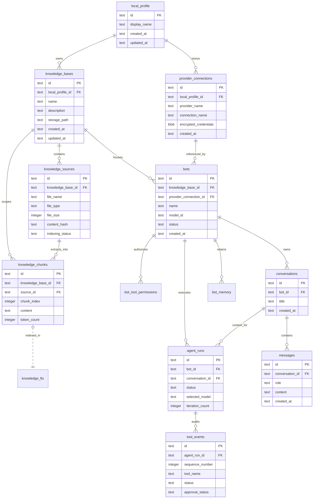

# DATABASE DATA MODEL SPECIFICATION: Local-First Multi-Model AI Agent Workspace

**Document Version:** 1.0.0  
**Phase:** Phase 0 — Step 0.4  
**Status:** Approved for Technical Design  
**Author:** Senior Database Architect, Local-First AI Systems  
**Authoritative Sources:** [`PRODUCT_SPEC.md`](./PRODUCT_SPEC.md), [`MVP_SCOPE.md`](./MVP_SCOPE.md), [`ARCHITECTURE.md`](./ARCHITECTURE.md)  
**Last Updated:** November 2026  

---

## 1. Purpose

The purpose of this document is to establish the authoritative database schema and data management architecture for the **Local-First Multi-Model AI Agent Workspace**. 

This document defines all relational tables, virtual full-text search tables, foreign key constraints, indexes, cascade deletion behaviors, transactional synchronization strategies, and SQL-level security controls. It strictly operationalizes the one-to-many domain hierarchy (`Local User Profile` $\rightarrow$ `Knowledge Bases` $\rightarrow$ `Bots`) and provides database-level enforcement of **Knowledge Base isolation**, ensuring that no Bot can retrieve or infer knowledge from any Knowledge Base other than its direct parent.

---

## 2. Database Design Principles

The database design adheres to nine core principles:

1. **Embedded Single-File Simplicity:** The entire relational workspace is persisted in a single SQLite database file (`workspace.db`) powered by `better-sqlite3`. There is no client-server database overhead, no remote database dependencies, and no cloud-synchronized backend.
2. **Strict Foreign-Key Integrity:** Foreign key enforcement is mandatory (`PRAGMA foreign_keys = ON;`). Unassigned or orphaned entities (such as Bots without a parent Knowledge Base, or chunks without a source document) are strictly prohibited by the engine.
3. **Database-Enforced Knowledge Base Isolation:** Foreign key definitions utilize composite constraints (`(source_id, knowledge_base_id)`) so that chunks cannot be misattributed to a different Knowledge Base than their source document.
4. **Hardware-Backed Credential Security:** API keys are never stored in plaintext within SQLite tables or columns. Only encrypted binary payloads or secure key identifiers produced by Electron `safeStorage` reside at rest.
5. **Decoupled Physical Storage:** Large document files (`.pdf`, `.md`, `.txt`) reside in dedicated directories on the host filesystem. SQLite stores document metadata, extraction metrics, chunk text, token counts, and full-text index tokens.
6. **High-Performance Concurrent Reads (WAL Mode):** The database operates in Write-Ahead Logging mode (`PRAGMA journal_mode = WAL;`) with a 5000ms busy timeout, enabling concurrent non-blocking reads during background ingestion and agent execution.
7. **Synchronized Lexical Retrieval:** Document chunk text is indexed into an SQLite FTS5 virtual table (`knowledge_fts`) with transactional synchronization, delivering sub-millisecond BM25 keyword retrieval scoped strictly by `knowledge_base_id`.
8. **Stable Universal Identifiers:** All primary keys use immutable Universally Unique Identifiers (UUIDv4 strings), preventing ID collisions during export, backup, or future peer migration.
9. **Forward-Migrating Schema:** Schema migrations are strictly versioned, tracked in a dedicated `schema_migrations` table, and executed inside atomic transactions.

---

## 3. Product Hierarchy

The relational schema strictly maps the immutable domain hierarchy:

```
LOCAL USER PROFILE (1)
    │
    └── owns ──► KNOWLEDGE BASES (Many)
                     │
                     ├── contains ──► KNOWLEDGE SOURCES (Many)
                     │                    │
                     │                    └── generates ──► KNOWLEDGE CHUNKS (Many)
                     │                                          │
                     │                                          └── indexed in ──► KNOWLEDGE FTS (FTS5)
                     │
                     └── houses ────► BOTS (Many)
                                        │
                                        ├── owns ──► CONVERSATIONS (Many)
                                        │                │
                                        │                └── contains ──► MESSAGES (Many)
                                        │
                                        ├── configures ──► BOT TOOL PERMISSIONS (Many)
                                        │
                                        └── executes ────► AGENT RUNS (Many)
                                                              │
                                                              └── logs ──► TOOL EVENTS (Many)
```

### Inviolable Invariants
- Every Bot record **must** possess a valid, non-null `knowledge_base_id`.
- Every Knowledge Source and Knowledge Chunk **must** belong to a parent Knowledge Base.
- There is **no global, independent Bot table or orphaned Bot collection**.
- Sibling Bots residing in the same Knowledge Base access the identical `knowledge_sources` and `knowledge_chunks` records.
- Cross-Knowledge-Base data queries are structurally blocked by SQL constraints and query boundaries.

---

## 4. Entity Overview

| Entity Name | Table Name | Purpose | Owning Parent |
|---|---|---|---|
| **Local Profile** | `local_profile` | Singleton identity representing the local machine user. | Root |
| **Knowledge Base** | `knowledge_bases` | Isolated knowledge domain and document workspace. | `local_profile` |
| **Bot** | `bots` | Persistent AI reasoning persona configured within a KB. | `knowledge_bases` |
| **Bot Tool Permission**| `bot_tool_permissions` | Explicit tool authorization toggles per Bot. | `bots` |
| **Provider Connection**| `provider_connections` | Reusable BYOK AI provider connection (encrypted key ref).| `local_profile` |
| **Knowledge Source** | `knowledge_sources` | Original ingested document metadata. | `knowledge_bases` |
| **Knowledge Chunk** | `knowledge_chunks` | Token-bounded extracted text section. | `knowledge_sources` & `knowledge_bases` |
| **Knowledge FTS** | `knowledge_fts` | SQLite FTS5 virtual table for BM25 lexical search. | `knowledge_chunks` |
| **Conversation** | `conversations` | Dedicated conversation thread belonging to a Bot. | `bots` |
| **Message** | `messages` | Individual chat message (user, assistant, tool). | `conversations` |
| **Agent Run** | `agent_runs` | Execution task instance for an agent reasoning turn. | `bots` & `conversations` |
| **Tool Event** | `tool_events` | Granular log of a single tool execution or approval. | `agent_runs` |
| **Bot Memory** | `bot_memory` | User-approved persistent reference notes for a Bot. | `bots` |
| **Schema Migration** | `schema_migrations` | Version tracking for database migrations. | System |

---

## 5. Table Specifications

### 5.1 `local_profile`
Represents the local desktop user. For the MVP, this table enforces a **singleton pattern** (exactly one record with `id = 'usr_local_default'`), avoiding unnecessary multi-tenant complexity while establishing a clean foundation for future profile switching.

```sql
CREATE TABLE local_profile (
    id TEXT PRIMARY KEY NOT NULL CHECK (id = 'usr_local_default'),
    display_name TEXT NOT NULL DEFAULT 'Local User',
    created_at TEXT NOT NULL DEFAULT (strftime('%Y-%m-%dT%H:%M:%fZ', 'now')),
    updated_at TEXT NOT NULL DEFAULT (strftime('%Y-%m-%dT%H:%M:%fZ', 'now'))
);
```

### 5.2 `knowledge_bases`
Represents independent knowledge containers. Each Knowledge Base owns its documents, search index, and Bots.

```sql
CREATE TABLE knowledge_bases (
    id TEXT PRIMARY KEY NOT NULL,
    local_profile_id TEXT NOT NULL DEFAULT 'usr_local_default',
    name TEXT NOT NULL CHECK (length(trim(name)) > 0),
    description TEXT NOT NULL DEFAULT '',
    storage_path TEXT NOT NULL UNIQUE,
    created_at TEXT NOT NULL DEFAULT (strftime('%Y-%m-%dT%H:%M:%fZ', 'now')),
    updated_at TEXT NOT NULL DEFAULT (strftime('%Y-%m-%dT%H:%M:%fZ', 'now')),
    archived_at TEXT,
    FOREIGN KEY (local_profile_id) REFERENCES local_profile(id) ON DELETE RESTRICT
);
```

### 5.3 `provider_connections`
Stores encrypted API provider connections managed at the user profile level. A single provider connection (e.g., "Personal OpenAI Key") can be referenced by multiple Bots across different Knowledge Bases.

```sql
CREATE TABLE provider_connections (
    id TEXT PRIMARY KEY NOT NULL,
    local_profile_id TEXT NOT NULL DEFAULT 'usr_local_default',
    provider_name TEXT NOT NULL CHECK (provider_name IN ('openai', 'anthropic', 'google', 'xai', 'openrouter')),
    connection_name TEXT NOT NULL CHECK (length(trim(connection_name)) > 0),
    encrypted_credentials BLOB NOT NULL,
    created_at TEXT NOT NULL DEFAULT (strftime('%Y-%m-%dT%H:%M:%fZ', 'now')),
    updated_at TEXT NOT NULL DEFAULT (strftime('%Y-%m-%dT%H:%M:%fZ', 'now')),
    FOREIGN KEY (local_profile_id) REFERENCES local_profile(id) ON DELETE CASCADE
);
```

### 5.4 `bots`
Represents a specialized AI persona. Every Bot has an immutable foreign key `knowledge_base_id`.

```sql
CREATE TABLE bots (
    id TEXT PRIMARY KEY NOT NULL,
    knowledge_base_id TEXT NOT NULL,
    provider_connection_id TEXT,
    name TEXT NOT NULL CHECK (length(trim(name)) > 0),
    description TEXT NOT NULL DEFAULT '',
    system_prompt TEXT NOT NULL DEFAULT '',
    model_id TEXT NOT NULL CHECK (length(trim(model_id)) > 0),
    status TEXT NOT NULL DEFAULT 'active' CHECK (status IN ('active', 'archived')),
    created_at TEXT NOT NULL DEFAULT (strftime('%Y-%m-%dT%H:%M:%fZ', 'now')),
    updated_at TEXT NOT NULL DEFAULT (strftime('%Y-%m-%dT%H:%M:%fZ', 'now')),
    FOREIGN KEY (knowledge_base_id) REFERENCES knowledge_bases(id) ON DELETE CASCADE,
    FOREIGN KEY (provider_connection_id) REFERENCES provider_connections(id) ON DELETE RESTRICT
);
```

### 5.5 `bot_tool_permissions`
Stores explicit tool permissions for each Bot. This normalized relational structure permits granular auditing and toggling of individual tools.

```sql
CREATE TABLE bot_tool_permissions (
    id TEXT PRIMARY KEY NOT NULL,
    bot_id TEXT NOT NULL,
    tool_name TEXT NOT NULL CHECK (tool_name IN (
        'search_knowledge_base',
        'read_knowledge_base_document',
        'list_knowledge_base_documents',
        'search_project_files',
        'read_project_file',
        'prepare_report'
    )),
    permission_status TEXT NOT NULL DEFAULT 'granted' CHECK (permission_status IN ('granted', 'denied')),
    created_at TEXT NOT NULL DEFAULT (strftime('%Y-%m-%dT%H:%M:%fZ', 'now')),
    updated_at TEXT NOT NULL DEFAULT (strftime('%Y-%m-%dT%H:%M:%fZ', 'now')),
    UNIQUE (bot_id, tool_name),
    FOREIGN KEY (bot_id) REFERENCES bots(id) ON DELETE CASCADE
);
```

### 5.6 `knowledge_sources`
Represents physical source files (`.txt`, `.md`, `.pdf`) ingested into a Knowledge Base.

```sql
CREATE TABLE knowledge_sources (
    id TEXT PRIMARY KEY NOT NULL,
    knowledge_base_id TEXT NOT NULL,
    file_name TEXT NOT NULL,
    original_file_name TEXT NOT NULL,
    relative_file_path TEXT NOT NULL,
    file_type TEXT NOT NULL CHECK (file_type IN ('txt', 'md', 'pdf')),
    mime_type TEXT NOT NULL,
    file_size INTEGER NOT NULL CHECK (file_size >= 0),
    content_hash TEXT NOT NULL,
    indexing_status TEXT NOT NULL DEFAULT 'queued' CHECK (indexing_status IN ('queued', 'processing', 'completed', 'ready', 'failed', 'needs_reindex')),
    error_message TEXT,
    created_at TEXT NOT NULL DEFAULT (strftime('%Y-%m-%dT%H:%M:%fZ', 'now')),
    updated_at TEXT NOT NULL DEFAULT (strftime('%Y-%m-%dT%H:%M:%fZ', 'now')),
    indexed_at TEXT,
    UNIQUE (id, knowledge_base_id),
    FOREIGN KEY (knowledge_base_id) REFERENCES knowledge_bases(id) ON DELETE CASCADE
);
```

### 5.7 `knowledge_chunks`
Stores parsed, token-bounded sections of text extracted from knowledge sources.

```sql
CREATE TABLE knowledge_chunks (
    id TEXT PRIMARY KEY NOT NULL,
    knowledge_base_id TEXT NOT NULL,
    source_id TEXT NOT NULL,
    chunk_index INTEGER NOT NULL CHECK (chunk_index >= 0),
    content TEXT NOT NULL CHECK (length(trim(content)) > 0),
    page_number INTEGER,
    token_count INTEGER NOT NULL CHECK (token_count >= 0),
    metadata_json TEXT NOT NULL DEFAULT '{}',
    created_at TEXT NOT NULL DEFAULT (strftime('%Y-%m-%dT%H:%M:%fZ', 'now')),
    UNIQUE (source_id, chunk_index),
    FOREIGN KEY (knowledge_base_id) REFERENCES knowledge_bases(id) ON DELETE CASCADE,
    FOREIGN KEY (source_id, knowledge_base_id) REFERENCES knowledge_sources(id, knowledge_base_id) ON DELETE CASCADE
);
```

> **Architectural Guardrail:** Notice the composite foreign key:  
> `FOREIGN KEY (source_id, knowledge_base_id) REFERENCES knowledge_sources(id, knowledge_base_id) ON DELETE CASCADE`  
> This ensures that a chunk cannot point to a `source_id` belonging to Knowledge Base A while carrying a `knowledge_base_id` belonging to Knowledge Base B. The database engine rejects any cross-KB inconsistency at insert time.

### 5.8 `knowledge_fts` (SQLite FTS5 Virtual Table)
Provides high-speed lexical search using the Porter stemming tokenizer.

```sql
CREATE VIRTUAL TABLE knowledge_fts USING fts5 (
    content,
    chunk_id UNINDEXED,
    knowledge_base_id UNINDEXED,
    source_id UNINDEXED,
    tokenize = 'porter unicode61'
);
```

#### FTS5 Synchronization Strategy
Because SQLite virtual tables do not support standard foreign key cascade triggers directly, synchronization between `knowledge_chunks` and `knowledge_fts` is maintained through three atomic database triggers:

```sql
-- 1. Insert Trigger: Index newly created chunks
CREATE TRIGGER trg_knowledge_chunks_ai AFTER INSERT ON knowledge_chunks BEGIN
    INSERT INTO knowledge_fts (rowid, content, chunk_id, knowledge_base_id, source_id)
    VALUES (new.rowid, new.content, new.id, new.knowledge_base_id, new.source_id);
END;

-- 2. Delete Trigger: Remove deleted chunks from FTS index
CREATE TRIGGER trg_knowledge_chunks_ad AFTER DELETE ON knowledge_chunks BEGIN
    DELETE FROM knowledge_fts WHERE rowid = old.rowid;
END;

-- 3. Update Trigger: Re-index updated chunks
CREATE TRIGGER trg_knowledge_chunks_au AFTER UPDATE ON knowledge_chunks BEGIN
    DELETE FROM knowledge_fts WHERE rowid = old.rowid;
    INSERT INTO knowledge_fts (rowid, content, chunk_id, knowledge_base_id, source_id)
    VALUES (new.rowid, new.content, new.id, new.knowledge_base_id, new.source_id);
END;
```

### 5.9 `conversations`
Represents an isolated chat session. A conversation belongs to **exactly one** Bot.

```sql
CREATE TABLE conversations (
    id TEXT PRIMARY KEY NOT NULL,
    bot_id TEXT NOT NULL,
    title TEXT NOT NULL DEFAULT 'New Conversation',
    created_at TEXT NOT NULL DEFAULT (strftime('%Y-%m-%dT%H:%M:%fZ', 'now')),
    updated_at TEXT NOT NULL DEFAULT (strftime('%Y-%m-%dT%H:%M:%fZ', 'now')),
    archived_at TEXT,
    FOREIGN KEY (bot_id) REFERENCES bots(id) ON DELETE CASCADE
);
```

### 5.10 `messages`
Represents an individual message in a conversation thread. Supports `user`, `assistant`, `system`, and `tool` roles.

```sql
CREATE TABLE messages (
    id TEXT PRIMARY KEY NOT NULL,
    conversation_id TEXT NOT NULL,
    role TEXT NOT NULL CHECK (role IN ('user', 'assistant', 'system', 'tool')),
    content TEXT NOT NULL DEFAULT '',
    content_format TEXT NOT NULL DEFAULT 'markdown' CHECK (content_format IN ('text', 'markdown', 'json')),
    metadata_json TEXT NOT NULL DEFAULT '{}',
    token_usage_json TEXT NOT NULL DEFAULT '{}',
    created_at TEXT NOT NULL DEFAULT (strftime('%Y-%m-%dT%H:%M:%fZ', 'now')),
    FOREIGN KEY (conversation_id) REFERENCES conversations(id) ON DELETE CASCADE
);
```

### 5.11 `agent_runs`
Tracks autonomous or multi-step execution tasks assigned to a Bot.

```sql
CREATE TABLE agent_runs (
    id TEXT PRIMARY KEY NOT NULL,
    bot_id TEXT NOT NULL,
    conversation_id TEXT NOT NULL,
    status TEXT NOT NULL DEFAULT 'pending' CHECK (status IN (
        'pending',
        'running',
        'awaiting_approval',
        'completed',
        'failed',
        'cancelled'
    )),
    selected_model TEXT NOT NULL,
    iteration_count INTEGER NOT NULL DEFAULT 0 CHECK (iteration_count <= 5),
    error_summary TEXT,
    started_at TEXT NOT NULL DEFAULT (strftime('%Y-%m-%dT%H:%M:%fZ', 'now')),
    completed_at TEXT,
    FOREIGN KEY (bot_id) REFERENCES bots(id) ON DELETE CASCADE,
    FOREIGN KEY (conversation_id) REFERENCES conversations(id) ON DELETE CASCADE
);
```

### 5.12 `tool_events`
Maintains an immutable, chronologically ordered audit log of all tool calls executed or requested by an agent.

```sql
CREATE TABLE tool_events (
    id TEXT PRIMARY KEY NOT NULL,
    agent_run_id TEXT NOT NULL,
    sequence_number INTEGER NOT NULL CHECK (sequence_number >= 1),
    tool_name TEXT NOT NULL,
    status TEXT NOT NULL DEFAULT 'pending' CHECK (status IN ('pending', 'running', 'completed', 'failed', 'cancelled')),
    approval_status TEXT NOT NULL DEFAULT 'auto_approved' CHECK (approval_status IN (
        'not_required',
        'auto_approved',
        'pending_approval',
        'user_approved',
        'user_rejected'
    )),
    arguments_summary TEXT NOT NULL DEFAULT '{}',
    result_summary TEXT NOT NULL DEFAULT '',
    error_message TEXT,
    started_at TEXT NOT NULL DEFAULT (strftime('%Y-%m-%dT%H:%M:%fZ', 'now')),
    completed_at TEXT,
    UNIQUE (agent_run_id, sequence_number),
    FOREIGN KEY (agent_run_id) REFERENCES agent_runs(id) ON DELETE CASCADE
);
```

### 5.13 `bot_memory` (User-Approved Notes Store)
Stores persistent, explicit reference notes approved by the user for a Bot (e.g., custom user instructions or pinned facts). Autonomous cross-session episodic memory extraction is deferred post-MVP.

```sql
CREATE TABLE bot_memory (
    id TEXT PRIMARY KEY NOT NULL,
    bot_id TEXT NOT NULL,
    memory_type TEXT NOT NULL DEFAULT 'user_note' CHECK (memory_type IN ('user_note', 'pinned_instruction')),
    content TEXT NOT NULL CHECK (length(trim(content)) > 0),
    created_at TEXT NOT NULL DEFAULT (strftime('%Y-%m-%dT%H:%M:%fZ', 'now')),
    updated_at TEXT NOT NULL DEFAULT (strftime('%Y-%m-%dT%H:%M:%fZ', 'now')),
    FOREIGN KEY (bot_id) REFERENCES bots(id) ON DELETE CASCADE
);
```

### 5.14 `schema_migrations`
Tracks forward database migrations applied to `workspace.db`.

```sql
CREATE TABLE schema_migrations (
    version INTEGER PRIMARY KEY NOT NULL,
    migration_name TEXT NOT NULL,
    applied_at TEXT NOT NULL DEFAULT (strftime('%Y-%m-%dT%H:%M:%fZ', 'now'))
);
```

---

## 6. Column Definitions and Data Types

| Concept | SQLite Column Type | Format / Representation | Rationale |
|---|---|---|---|
| **Primary Keys (UUIDs)** | `TEXT` | RFC 4122 canonical UUIDv4 string (e.g., `550e8400-e29b-41d4-a716-446655440000`) | Globally unique across export/import archives without collision; inspectable in debugging. |
| **Timestamps** | `TEXT` | ISO-8601 UTC formatted strings (`YYYY-MM-DDTHH:MM:SS.SSSZ`) via `strftime('%Y-%m-%dT%H:%M:%fZ', 'now')` | Standardized, lexicographically sortable, human-readable across all time zones. |
| **Booleans** | `TEXT` or `INTEGER` | Discrete `CHECK (col IN ('granted', 'denied'))` or `INTEGER CHECK (col IN (0, 1))` | SQLite lacks native boolean; explicit check constraints prevent ambiguous truthy values. |
| **JSON Payloads** | `TEXT` | Serialized JSON strings validated via `json_valid(col)` check constraints | Accommodates flexible tool arguments, citation arrays, and token telemetry cleanly. |
| **Encrypted Keys** | `BLOB` | Binary ciphertext buffer produced by Electron `safeStorage.encryptString()` | Prevents accidental string decoding or log leakage of encrypted memory bytes. |
| **File Sizes & Counts** | `INTEGER` | 64-bit signed integer | Standard byte sizes and zero-indexed chunk counters. |

---

## 7. Primary and Foreign Keys

| Child Table | Foreign Key Column(s) | Parent Table & Target Column(s) | Delete Action | Update Action |
|---|---|---|---|---|
| `knowledge_bases` | `local_profile_id` | `local_profile(id)` | `RESTRICT` | `CASCADE` |
| `provider_connections` | `local_profile_id` | `local_profile(id)` | `CASCADE` | `CASCADE` |
| `bots` | `knowledge_base_id` | `knowledge_bases(id)` | `CASCADE` | `CASCADE` |
| `bots` | `provider_connection_id` | `provider_connections(id)` | `RESTRICT` | `CASCADE` |
| `bot_tool_permissions`| `bot_id` | `bots(id)` | `CASCADE` | `CASCADE` |
| `knowledge_sources` | `knowledge_base_id` | `knowledge_bases(id)` | `CASCADE` | `CASCADE` |
| `knowledge_chunks` | `knowledge_base_id` | `knowledge_bases(id)` | `CASCADE` | `CASCADE` |
| `knowledge_chunks` | `(source_id, knowledge_base_id)` | `knowledge_sources(id, knowledge_base_id)` | `CASCADE` | `CASCADE` |
| `conversations` | `bot_id` | `bots(id)` | `CASCADE` | `CASCADE` |
| `messages` | `conversation_id` | `conversations(id)` | `CASCADE` | `CASCADE` |
| `agent_runs` | `bot_id` | `bots(id)` | `CASCADE` | `CASCADE` |
| `agent_runs` | `conversation_id` | `conversations(id)` | `CASCADE` | `CASCADE` |
| `tool_events` | `agent_run_id` | `agent_runs(id)` | `CASCADE` | `CASCADE` |
| `bot_memory` | `bot_id` | `bots(id)` | `CASCADE` | `CASCADE` |

> **Deletion Policy for Provider Connections (`ON DELETE RESTRICT`):**  
> If a user attempts to delete a provider connection that is currently configured on one or more Bots, SQLite rejects the deletion. The UI alerts the user: *"This provider connection is actively used by N bots. Reassign those bots before removing this key."* This prevents leaving Bots in an orphaned, broken state.

---

## 8. Entity Relationship Diagram



---

## 9. Indexing and Uniqueness Strategy

To ensure sub-millisecond query execution on desktop hardware, explicit B-tree indexes are established for all relational foreign keys and high-frequency filtering columns:

```sql
-- Knowledge Bases
CREATE INDEX idx_knowledge_bases_profile ON knowledge_bases(local_profile_id);

-- Bots
CREATE INDEX idx_bots_kb ON bots(knowledge_base_id);
CREATE INDEX idx_bots_provider ON bots(provider_connection_id);

-- Tool Permissions
CREATE INDEX idx_bot_tool_perms_bot ON bot_tool_permissions(bot_id);

-- Knowledge Sources & Chunks
CREATE INDEX idx_knowledge_sources_kb ON knowledge_sources(knowledge_base_id);
CREATE INDEX idx_knowledge_sources_status ON knowledge_sources(knowledge_base_id, indexing_status);
CREATE INDEX idx_knowledge_chunks_kb ON knowledge_chunks(knowledge_base_id);
CREATE INDEX idx_knowledge_chunks_source ON knowledge_chunks(source_id);

-- Conversations & Messages
CREATE INDEX idx_conversations_bot ON conversations(bot_id);
CREATE INDEX idx_messages_conversation ON messages(conversation_id, created_at ASC);

-- Agent Runs & Audit Logs
CREATE INDEX idx_agent_runs_bot ON agent_runs(bot_id);
CREATE INDEX idx_agent_runs_conversation ON agent_runs(conversation_id);
CREATE INDEX idx_tool_events_run ON tool_events(agent_run_id, sequence_number ASC);

-- Bot Memory
CREATE INDEX idx_bot_memory_bot ON bot_memory(bot_id);
```

### Uniqueness Constraints
1. `knowledge_bases.storage_path`: Guarantees physical directory isolation per Knowledge Base.
2. `knowledge_sources(id, knowledge_base_id)`: Enables composite foreign key targeting.
3. `knowledge_chunks(source_id, chunk_index)`: Prevents duplicate chunk sequences per source document.
4. `bot_tool_permissions(bot_id, tool_name)`: Enforces a single permission status per tool for each Bot.
5. `tool_events(agent_run_id, sequence_number)`: Enforces strictly ordered audit sequences per run.

---

## 10. Knowledge Base Isolation Architecture

### The Threat Model
In multi-agent systems, cross-domain context contamination can occur if:
- An AI model hallucinates or maliciously injects a `knowledge_base_id` parameter during tool calling.
- A compromised renderer process passes an arbitrary `knowledge_base_id` via IPC.
- A search query performs a global scan without hard-filtering on the parent Knowledge Base ID.

### The Six-Step Mandatory Retrieval Pipeline
To achieve absolute isolation, retrieval **never** trusts client-supplied or LLM-supplied Knowledge Base IDs:

```
[User submits prompt to Bot B]
         │
         ▼
1. Main Process receives { bot_id, prompt } (NO kb_id accepted)
         │
         ▼
2. Main Process queries SQLite:
   SELECT knowledge_base_id FROM bots WHERE id = ?;
         │
         ▼
3. Authoritative knowledge_base_id is extracted server-side.
         │
         ▼
4. RetrievalService queries SQLite FTS5 hard-filtered by authoritative KB ID:
   WHERE c.knowledge_base_id = :authoritative_kb_id
         │
         ▼
5. Database engine restricts scan strictly to chunks matching that KB ID.
         │
         ▼
6. Retrieved passages and citations are returned to the model context.
```

---

## 11. Safe Retrieval SQL Examples

### 11.1 The Authoritative Safe Retrieval Query
```sql
-- STEP 1: Authenticate parent Knowledge Base ID from Bot record
-- (Executed programmatically in Main Process)
-- const { knowledge_base_id } = db.prepare('SELECT knowledge_base_id FROM bots WHERE id = ?').get(botId);

-- STEP 2: Execute scoped BM25 retrieval joining chunks and sources
SELECT 
    c.id AS chunk_id,
    c.content,
    c.chunk_index,
    c.page_number,
    s.id AS source_id,
    s.file_name,
    bm25(knowledge_fts) AS relevance_rank
FROM knowledge_fts fts
JOIN knowledge_chunks c ON fts.rowid = c.rowid
JOIN knowledge_sources s ON c.source_id = s.id AND c.knowledge_base_id = s.knowledge_base_id
WHERE c.knowledge_base_id = :authoritative_kb_id -- INVIOLABLE FIREWALL
  AND knowledge_fts MATCH :sanitized_query
ORDER BY relevance_rank ASC
LIMIT 5;
```

### 11.2 The Forbidden Unrestricted Query (Negative Pattern)
> [!CAUTION]
> The following query pattern is **strictly prohibited** in the codebase:
> ```sql
> -- FORBIDDEN: Lacks KB scoping, searches global chunk index, leaks all private workspaces!
> SELECT c.content, s.file_name 
> FROM knowledge_fts fts
> JOIN knowledge_chunks c ON fts.rowid = c.rowid
> JOIN knowledge_sources s ON c.source_id = s.id
> WHERE knowledge_fts MATCH :query
> LIMIT 5;
> ```
> Executing an unscoped query allows Bot A in Knowledge Base "Marketing" to view patient records or financial ledgers residing in Knowledge Base "Compliance".

---

## 12. Deletion and Cascade Behavior

| Operation | SQLite Relational Cascade Action | Physical Storage Action | Invariant Preserved |
|---|---|---|---|
| **Delete Document** | `DELETE FROM knowledge_sources WHERE id = ?` $\rightarrow$ Triggers delete chunks in `knowledge_chunks` $\rightarrow$ Triggers purge entries in `knowledge_fts`. | Physical source file deleted from `<userData>/documents/<kb_id>/<file>`. | All chunk texts and search tokens for that document vanish immediately. |
| **Delete Bot** | `DELETE FROM bots WHERE id = ?` $\rightarrow$ Cascades to `conversations`, `messages`, `agent_runs`, `tool_events`, `bot_tool_permissions`, `bot_memory`. | None (Bots hold no dedicated disk files). | Shared Knowledge Base documents and sibling Bots remain 100% unaffected. |
| **Delete Knowledge Base** | `DELETE FROM knowledge_bases WHERE id = ?` $\rightarrow$ Cascades to all child `bots`, `knowledge_sources`, `knowledge_chunks`, and `knowledge_fts`. | Entire directory `<userData>/documents/<kb_id>/` is recursively deleted from disk. | Complete eradication of that KB's data; all other Knowledge Bases remain untouched. |
| **Delete Provider Connection** | `DELETE FROM provider_connections WHERE id = ?` | Encrypted blob purged from SQLite. | `ON DELETE RESTRICT` prevents deletion if any Bot references the key, avoiding broken states. |

---

## 13. Local File Lifecycle and Recovery

A critical challenge in local-first systems is maintaining consistency between the relational database (`workspace.db`) and the physical filesystem (`documents/`).

### Failure Modes & Mitigations
1. **Database Commits, Disk File Deletion Fails:** If an OS error (e.g., file lock by anti-virus) prevents file deletion after an SQLite `DELETE` commits:
   - The file is orphaned on disk but inaccessible to the app (since its database record is gone).
   - **Resolution:** A startup background job (`OrphanFileSweeper`) inspects `<userData>/documents/<kb_id>/` and deletes any physical file whose UUID does not exist in `knowledge_sources`.
2. **File Copied to Disk, Database Commit Fails:**
   - The file exists on disk but has no database row.
   - **Resolution:** On startup, `OrphanFileSweeper` purges untracked files older than 1 hour.
3. **Database Rolls Back on Ingestion Crash:**
   - Because document status defaults to `queued` and only transitions to `ready` upon complete chunk insertion, an interrupted ingestion leaves the status as `parsing` or `failed`.
   - **Resolution:** On application boot, any document with status `parsing` or `indexing` is automatically reset to `failed` with error message `"Ingestion interrupted by application shutdown"`, allowing one-click re-indexing.

---

## 14. Migration Strategy

The database maintains schema versioning via the `schema_migrations` table and SQLite's built-in `PRAGMA user_version`:

```sql
-- Migration 001: Initial MVP Schema
BEGIN TRANSACTION;

-- Create schema_migrations table
CREATE TABLE IF NOT EXISTS schema_migrations (
    version INTEGER PRIMARY KEY NOT NULL,
    migration_name TEXT NOT NULL,
    applied_at TEXT NOT NULL DEFAULT (strftime('%Y-%m-%dT%H:%M:%fZ', 'now'))
);

-- Execute table creation scripts (Section 5)
-- ...

-- Record migration
INSERT INTO schema_migrations (version, migration_name) VALUES (1, '001_initial_schema');
PRAGMA user_version = 1;

COMMIT;
```

### Migration Safety Rules
1. **Atomic Transactions:** Every migration script runs inside an explicit `BEGIN TRANSACTION ... COMMIT`. If any statement fails, the entire migration rolls back cleanly.
2. **Pre-Migration Snapshot:** Before executing a migration, the application creates a backup copy of `workspace.db` (`workspace.db.bak_v{prev}`).
3. **Integrity Verification:** Following migration completion, the application runs `PRAGMA integrity_check;` to verify B-tree and index consistency before opening window interfaces.

---

## 15. Example Dataset

To validate schema queries, the following canonical records illustrate multi-KB isolation and multi-Bot configurations:

```sql
-- Local User Profile (Singleton)
INSERT INTO local_profile (id, display_name) 
VALUES ('usr_local_default', 'Jane Architect');

-- Provider Connections (Reused BYOK connections)
INSERT INTO provider_connections (id, provider_name, connection_name, encrypted_credentials)
VALUES 
('prov_anthropic_prod', 'anthropic', 'Anthropic Claude Work Key', X'7365637265745f636970686572'),
('prov_openai_prod', 'openai', 'OpenAI Personal Key', X'6f70656e61695f636970686572');

-- Knowledge Base 1: Voyaro
INSERT INTO knowledge_bases (id, name, description, storage_path)
VALUES ('kb_voyaro_01', 'Voyaro', 'Autonomous mobility and routing engine', 'documents/kb_voyaro_01');

-- Bots in Voyaro (3 Bots sharing Voyaro knowledge)
INSERT INTO bots (id, knowledge_base_id, provider_connection_id, name, model_id, system_prompt)
VALUES 
('bot_voyaro_dev', 'kb_voyaro_01', 'prov_anthropic_prod', 'Developer Bot', 'claude-3-5-sonnet-20241022', 'You are a senior routing systems developer.'),
('bot_voyaro_ux', 'kb_voyaro_01', 'prov_openai_prod', 'UI/UX Bot', 'gpt-4o', 'You are an interface designer for mobility maps.'),
('bot_voyaro_res', 'kb_voyaro_01', 'prov_anthropic_prod', 'Research Bot', 'claude-3-5-sonnet-20241022', 'You analyze pathfinding academic research.');

-- Documents in Voyaro
INSERT INTO knowledge_sources (id, knowledge_base_id, file_name, original_file_name, relative_file_path, file_type, mime_type, file_size, content_hash, indexing_status)
VALUES 
('src_voyaro_reqs', 'kb_voyaro_01', 'voyaro-reqs.md', 'Voyaro Requirements.md', 'kb_voyaro_01/voyaro-reqs.md', 'md', 'text/markdown', 48200, 'hash_reqs_123', 'ready'),
('src_voyaro_api', 'kb_voyaro_01', 'voyaro-api.txt', 'API Documentation.txt', 'kb_voyaro_01/voyaro-api.txt', 'txt', 'text/plain', 95100, 'hash_api_456', 'ready');

-- Chunks in Voyaro (Inherit parent KB ID)
INSERT INTO knowledge_chunks (id, knowledge_base_id, source_id, chunk_index, content, token_count)
VALUES 
('chk_v_01', 'kb_voyaro_01', 'src_voyaro_reqs', 0, 'Voyaro core routing requires Dijkstra with bidirectional A* fallback.', 14),
('chk_v_02', 'kb_voyaro_01', 'src_voyaro_api', 0, 'POST /v1/route calculates fastest multi-modal transit path.', 12);

-- Knowledge Base 2: Dispatcher
INSERT INTO knowledge_bases (id, name, description, storage_path)
VALUES ('kb_dispatch_02', 'Dispatcher', 'Fleet dispatch and logistics coordination', 'documents/kb_dispatch_02');

-- Bots in Dispatcher (2 Bots sharing Dispatcher knowledge)
INSERT INTO bots (id, knowledge_base_id, provider_connection_id, name, model_id, system_prompt)
VALUES 
('bot_disp_dev', 'kb_dispatch_02', 'prov_anthropic_prod', 'Developer Bot', 'claude-3-5-sonnet-20241022', 'You build dispatch socket servers.'),
('bot_disp_pm', 'kb_dispatch_02', 'prov_openai_prod', 'Product Manager Bot', 'gpt-4o', 'You define dispatch delivery SLAs.');

-- Documents in Dispatcher
INSERT INTO knowledge_sources (id, knowledge_base_id, file_name, original_file_name, relative_file_path, file_type, mime_type, file_size, content_hash, indexing_status)
VALUES 
('src_disp_spec', 'kb_dispatch_02', 'dispatch-spec.pdf', 'Dispatcher Spec.pdf', 'kb_dispatch_02/dispatch-spec.pdf', 'pdf', 'application/pdf', 312000, 'hash_spec_789', 'ready');

INSERT INTO knowledge_chunks (id, knowledge_base_id, source_id, chunk_index, content, token_count)
VALUES 
('chk_d_01', 'kb_dispatch_02', 'src_disp_spec', 0, 'Dispatcher fleet assignments must resolve in under 200ms.', 11);

-- Knowledge Base 3: Marketing
INSERT INTO knowledge_bases (id, name, description, storage_path)
VALUES ('kb_mktg_03', 'Marketing', 'Brand and public relations assets', 'documents/kb_mktg_03');

INSERT INTO bots (id, knowledge_base_id, provider_connection_id, name, model_id, system_prompt)
VALUES ('bot_mktg_asst', 'kb_mktg_03', 'prov_openai_prod', 'Marketing Assistant', 'gpt-4o', 'You draft press releases.');

INSERT INTO knowledge_sources (id, knowledge_base_id, file_name, original_file_name, relative_file_path, file_type, mime_type, file_size, content_hash, indexing_status)
VALUES ('src_mktg_brand', 'kb_mktg_03', 'brand.md', 'Brand Guidelines.md', 'kb_mktg_03/brand.md', 'md', 'text/markdown', 12500, 'hash_brand_012', 'ready');

INSERT INTO knowledge_chunks (id, knowledge_base_id, source_id, chunk_index, content, token_count)
VALUES ('chk_m_01', 'kb_mktg_03', 'src_mktg_brand', 0, 'Voyaro brand color palette uses Deep Indigo #1E1B4B.', 12);
```

---

## 16. Acceptance Tests

The database schema and synchronization logic must pass the following 15 automated test suites:

| Test ID | Test Title | Execution & Assertion |
|---|---|---|
| **DAT-01** | Multiple KBs for Profile | Insert 3 Knowledge Bases under `usr_local_default`. Assert count is 3. |
| **DAT-02** | Single Bot in KB | Insert 1 Bot in `kb_voyaro_01`. Assert foreign key resolves. |
| **DAT-03** | Multiple Bots in KB | Insert 6 Bots in `kb_dispatch_02`. Assert all 6 reference `kb_dispatch_02`. |
| **DAT-04** | Single Parent Invariant | Attempt to insert Bot with `NULL` or non-existent `knowledge_base_id`. Assert foreign key violation error. |
| **DAT-05** | Intra-KB Shared Knowledge | Query chunks for `bot_voyaro_dev` and `bot_voyaro_ux`. Assert both access `chk_v_01` and `chk_v_02`. |
| **DAT-06** | Cross-KB Isolation | Query BM25 search for `bot_disp_dev` with term `"Dijkstra"`. Assert zero rows returned (Dijkstra exists only in Voyaro). |
| **DAT-07** | Composite Key Cross-KB Guard | Attempt to insert chunk with `source_id = 'src_voyaro_reqs'` and `knowledge_base_id = 'kb_dispatch_02'`. Assert foreign key constraint failure. |
| **DAT-08** | Conversation Bot Ownership | Insert conversation for `bot_voyaro_dev`. Attempt query from `bot_voyaro_ux`. Assert conversation belongs strictly to Bot 1. |
| **DAT-09** | Bot Deletion Preserves KB | Delete `bot_voyaro_dev`. Query `knowledge_sources` in `kb_voyaro_01`. Assert documents remain intact. |
| **DAT-10** | Document Deletion Purges FTS | Delete `src_voyaro_reqs`. Query `knowledge_fts` for `"Dijkstra"`. Assert zero matches in FTS index. |
| **DAT-11** | KB Deletion Isolation | Delete `kb_voyaro_01`. Query `knowledge_bases` for `kb_dispatch_02`. Assert Dispatcher and its bots are completely untouched. |
| **DAT-12** | Key Reuse Without Duplication | Assert `prov_anthropic_prod` is referenced by both `bot_voyaro_dev` and `bot_disp_dev`. Verify raw key is stored only once as ciphertext. |
| **DAT-13** | Provider Deletion Restrict | Attempt to delete `prov_anthropic_prod` while active bots reference it. Assert SQLite raises `SQLITE_CONSTRAINT: FOREIGN KEY constraint failed`. |
| **DAT-14** | Foreign Key Enforcement Check | Verify `PRAGMA foreign_keys` returns `1`. |
| **DAT-15** | FTS5 Trigger Integrity | Update chunk text in `knowledge_chunks`. Query FTS5 for old text (0 hits) and new text (1 hit). |

---

## 17. Database Limitations

1. **Embedded Single-Node Storage:** Designed strictly for single-user desktop execution. Concurrency is limited by SQLite's single-writer model (WAL mode enables infinite concurrent readers, but serializes writes).
2. **Lexical Full-Text Search Only:** FTS5 performs lexical keyword, phrase, and prefix matching using BM25 ranking. It does not perform vector cosine similarity or semantic embedding searches in this release.
3. **No Automatic Database Encryption:** `workspace.db` itself is not encrypted at the page level (SQLCipher is deferred post-MVP). Credentials are encrypted at the column/blob level via Electron `safeStorage`.
4. **Memory-Mapped Limit:** SQLite memory-mapped I/O (`PRAGMA mmap_size`) is capped at 256MB to balance query speed with desktop memory consumption.

---

## 18. Open Database Decisions

| # | Topic | Context & Considerations | Recommended Resolution |
|---|---|---|---|
| **OD-1** | **SQLCipher Database Encryption Post-MVP** | Full-database encryption at rest protects against offline disk forensic analysis, but requires custom OpenSSL compilation and slows down FTS5 indexing. | Defer to post-MVP. Protect API keys via `safeStorage` in MVP. |
| **OD-2** | **FTS5 External Content vs. Internal Content** | External content FTS tables save disk space by referencing `knowledge_chunks.content` directly, but require complex manual re-indexing if out-of-sync triggers fail. | Standard FTS5 content table (as specified in Section 5.8) is recommended for robustness in MVP. |
| **OD-3** | **Soft Deletion (`deleted_at`) vs. Hard Deletion** | Soft deletion allows "Trash" recovery for Knowledge Bases, but leaves orphaned chunk files and complicates FTS5 queries. | Enforce **hard cascading deletion** for MVP. |

