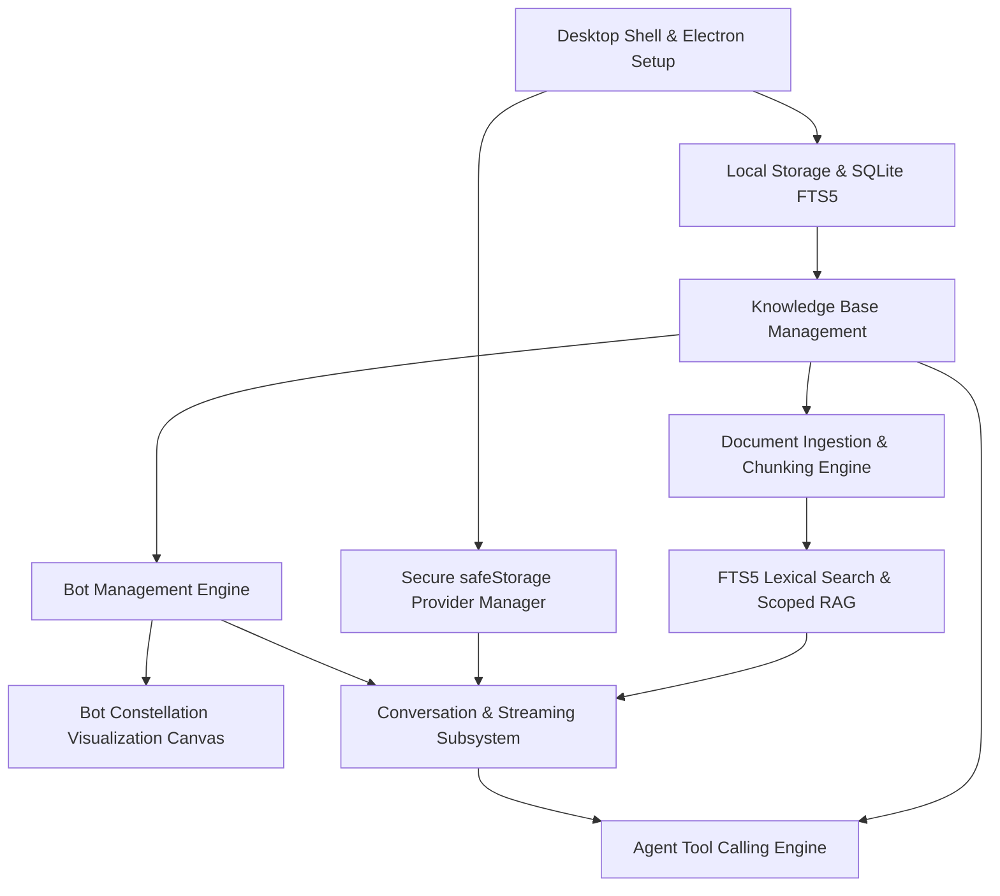

# MVP SCOPE SPECIFICATION: Local-First Multi-Model AI Agent Workspace

**Document Version:** 1.0.0  
**Phase:** Phase 0 — Step 0.2  
**Status:** Approved for Architectural Design  
**Author:** Senior Software Architect & Technical Lead  
**Primary Source of Truth:** [`PRODUCT_SPEC.md`](./PRODUCT_SPEC.md)  
**Last Updated:** November 2026  

---

## 1. Purpose of This Document

The purpose of this document is to establish a rigorous, unambiguous boundary between what **must** be implemented in the initial Minimal Viable Product (MVP), what features exist in a **deliberately constrained or simplified form**, and what features are **strictly deferred** to subsequent development cycles.

This scope specification operationalizes the high-level vision and requirements detailed in [`PRODUCT_SPEC.md`](./PRODUCT_SPEC.md). It protects the development team against scope creep, prevents architectural over-engineering, establishes non-functional boundaries, and defines the explicit acceptance criteria necessary to declare the MVP complete and ready for real-world usage.

---

## 2. Product Architecture Summary

The structural domain model of the application is strictly hierarchical, local-first, and immutable.

```
Local User Profile
  │
  └── Multiple Knowledge Bases (KBs)
        │
        ├── Knowledge Base A (Domain Corpus A)
        │     ├── Bot 1 (e.g., Code Reviewer)
        │     ├── Bot 2 (e.g., Security Auditor)
        │     └── Bot N
        │
        └── Knowledge Base B (Domain Corpus B)
              └── Bot 1 (e.g., Legal Counsel)
```

### 2.1 Foundational Architecture Rules
1. **Multi-KB Capability:** A single local user profile can create and manage multiple independent Knowledge Bases.
2. **Variable Bot Population:** A Knowledge Base can contain zero, one, or multiple Bots.
3. **Single Parent Invariant:** Every Bot belongs to **exactly one** parent Knowledge Base. Orphaned, global, or unassigned Bots cannot exist.
4. **Shared Intra-KB Corpus:** All Bots residing within the same Knowledge Base share access to that Knowledge Base's entire document collection and search index.
5. **Strict Cross-KB Firewall:** Cross-Knowledge-Base data queries or retrieval operations are forbidden at the architectural and query layers.
6. **Bot Individuality:** Each Bot maintains its own name, description, system instructions, provider/model settings, conversation threads, and tool permissions.
7. **Scoped Creation:** Bots must be created directly from within a selected Knowledge Base.
8. **Absence of Global Bots:** There is **no global, independent Bot collection**. A Bot exists solely within the lifecycle and boundary of its parent Knowledge Base.

---

## 3. Category A: Must-Have Features

Category A represents the non-negotiable core capabilities required for a stable, secure, and functional first release. Each feature includes its explicit boundary definitions.

```
┌────────────────────────────────────────────────────────────────────────┐
│                        CATEGORY A: MUST-HAVE                           │
├──────────────────────────┬──────────────────────────┬──────────────────┤
│ Desktop Foundation       │ Knowledge Base Mgmt      │ Bot Management   │
├──────────────────────────┼──────────────────────────┼──────────────────┤
│ Bot Constellation Canvas │ BYOK Provider Mgmt       │ Conversations    │
├──────────────────────────┼──────────────────────────┼──────────────────┤
│ Knowledge Ingestion      │ Scoped RAG (SQLite FTS5) │ Agent Tool Loop  │
└──────────────────────────┴──────────────────────────┴──────────────────┘
```

---

### 3.1 Desktop Foundation & Application Shell
- **Included Functionality:**
  - Electron-based cross-platform desktop wrapper (Windows, macOS, Linux).
  - React + TypeScript user interface running in a strictly isolated renderer process.
  - Three-tier process architecture: Main process (Node.js runtime, OS integrations), Preload script (`contextBridge` exposure), and Renderer process (Pure UI).
  - Secure Inter-Process Communication (IPC) layer using strictly typed request-response and push channels.
  - Local User Profile initialized automatically on first launch without registration screens or account prompts.
  - Application navigation framework supporting routing between Workspace views, Bot views, and Settings.
  - Persistent local storage directory management inside the OS-standard app data path (`userData`).
- **Excluded Functionality:**
  - Cloud user accounts, OAuth login portals, or federated authentication.
  - Multi-user tenant switching or profile sharing.
  - Automatic cloud syncing of application configurations.
- **Simplifications:**
  - Single active local user profile per machine installation.
- **Dependencies:**
  - Electron runtime, Node.js filesystem APIs, React DOM.
- **Acceptance Criteria:**
  - Launches into a usable UI without requesting an email, phone number, or cloud account.
  - Renderer has zero access to Node.js built-ins (`process`, `require`, `fs`) verified via DevTools audit.
  - Application state persists across clean restarts.

---

### 3.2 Knowledge Base Management
- **Included Functionality:**
  - Create a new Knowledge Base with a unique name and optional description.
  - Display all existing Knowledge Bases in an intuitive workspace switcher/sidebar.
  - Switch active Knowledge Base, instantaneously loading its documents, Bots, and search indexes.
  - Edit Knowledge Base name and description.
  - Delete a Knowledge Base with a two-step destructive confirmation dialog (e.g., typing the Knowledge Base name).
  - Full cascading deletion of associated Bots, conversation histories, source documents, and search index entries upon Knowledge Base deletion.
  - Structural isolation ensuring that deleting or modifying Knowledge Base A has zero effect on Knowledge Base B.
- **Excluded Functionality:**
  - Nested or hierarchical Knowledge Bases (sub-KBs).
  - Moving documents or Bots directly between different Knowledge Bases.
  - Merging two Knowledge Bases into one.
- **Simplifications:**
  - Flat collection of Knowledge Bases stored as distinct records in the local database.
- **Dependencies:**
  - Local database engine, filesystem management.
- **Acceptance Criteria:**
  - User can create Knowledge Base A and Knowledge Base B independently.
  - Deleting Knowledge Base A completely removes its files and database rows, leaving Knowledge Base B completely unaffected.

---

### 3.3 Bot Management
- **Included Functionality:**
  - Deploy a new Bot exclusively from inside an active Knowledge Base.
  - Support $N=0$, $N=1$, and $N > 1$ Bots per Knowledge Base.
  - Configure Bot attributes: unique ID (UUIDv4), name, description, system prompt instructions, assigned AI provider, assigned model ID, and tool permission toggles.
  - Edit existing Bot configurations with immediate persistence.
  - Archive or delete a Bot. Deleting a Bot cascades to its private conversation threads and execution logs.
  - Clear UI indicator showing the parent Knowledge Base name and ID on all Bot views.
- **Excluded Functionality:**
  - Global Bots unattached to a Knowledge Base.
  - Duplicating or copying Bots across different Knowledge Bases.
  - Sharing conversation threads between sibling Bots.
- **Simplifications:**
  - Tool permissions managed as coarse-grained feature toggles per Bot.
- **Dependencies:**
  - Knowledge Base management module, local database.
- **Acceptance Criteria:**
  - Bot creation modal requires parent `knowledge_base_id`.
  - A Bot displays its parent KB context at all times.
  - Deleting a Bot deletes only that Bot's private threads, preserving sibling Bots and parent documents.

---

### 3.4 Bot Constellation Visualization
- **Included Functionality:**
  - Dynamic mathematical rendering of the Knowledge Base's Bot topology based on count $N$:
    - $N = 0$: Empty state canvas with an interactive "Deploy Bot" action.
    - $N = 1$: Single centered celestial node.
    - $N = 2$: Linear dyad (straight line segment connecting two endpoints).
    - $N = 3$: Regular equilateral triangle.
    - $N = 4$: Regular square.
    - $N = 5$: Regular pentagon.
    - $N = 6$: Regular hexagon.
    - $N \ge 7$: Regular $N$-gon calculated dynamically using polar coordinates ($\theta_i = \frac{2\pi i}{N}$).
  - Smooth visual transitions (CSS / SVG interpolation) when nodes are added or removed.
  - Interactive clickable nodes: clicking a vertex node opens that specific Bot's conversation workspace.
  - Node hover cards showing Bot name, role, and assigned model.
  - Stable node identity during re-renders (vertices do not shuffle identities randomly).
- **Excluded Functionality:**
  - Manual drag-and-drop node repositioning or custom spatial topologies.
  - Complex physics-based force-directed clustering or multi-group gravitational orbits.
  - Inter-bot communication lines or visual message passing packets.
- **Simplifications:**
  - Deterministic 2D SVG canvas rendering centered on the active viewport.
- **Dependencies:**
  - React SVG component layer, Bot management state.
- **Acceptance Criteria:**
  - Knowledge Base with 0 Bots shows empty state; adding 1 Bot displays 1 point; adding a 2nd displays a line; adding a 3rd displays a triangle; adding a 4th displays a square.
  - Clicking any node navigates directly to that Bot's chat view.

---

### 3.5 BYOK Provider Management
- **Included Functionality:**
  - Dedicated Provider Settings interface supporting:
    - **OpenAI** (Official REST API)
    - **Anthropic** (Official Messages API)
    - **Google Gemini** (Official Generative Language API)
    - **xAI** (Official REST API)
    - **OpenRouter** (Unified OpenAI-compatible API)
  - Add, test, update, and remove API keys.
  - Hardware/OS-level encryption of stored API keys using Electron `safeStorage`.
  - Non-streaming "Test Connection" handshake to validate key permissions before saving.
  - Dynamic model selection dropdown populated with verified model IDs, plus custom text override for newly released models.
  - Independent model assignment per Bot (e.g., Bot A uses Claude 3.5 Sonnet, Bot B uses GPT-4o).
  - Comprehensive error handling: clear visual badges for HTTP 401 (Invalid Key), HTTP 429 (Rate Limit Exceeded), and HTTP 5xx (Provider Downtime).
  - Detection and UI warning when a selected model lacks native tool-calling capabilities.
- **Excluded Functionality:**
  - Embedded local LLM execution (e.g., llama.cpp / Ollama) in the first release.
  - Proxying API requests through any external relay server.
  - Shared pooling or automated load-balancing across multiple keys for the same provider.
- **Simplifications:**
  - One active API key per supported provider at the user profile level.
- **Dependencies:**
  - Electron `safeStorage` API, Node.js HTTPS client module.
- **Acceptance Criteria:**
  - Stored API keys are encrypted on disk; inspecting SQLite or config JSON reveals no plaintext keys.
  - Invalid keys fail the connection test with human-readable error feedback.
  - Switching a Bot's model preserves historical chat messages.

---

### 3.6 Conversation System
- **Included Functionality:**
  - Multi-threaded conversation management per Bot.
  - Create new conversation, rename conversation title, delete conversation.
  - Low-latency real-time response streaming using Server-Sent Events (SSE).
  - Explicit "Stop Generation" button that immediately aborts the active HTTP request and preserves partial tokens.
  - "Retry / Regenerate" action for failed or incomplete responses.
  - Rich Markdown rendering: headers, lists, syntax-highlighted code blocks with copy-to-clipboard buttons, tables, and LaTeX formulas.
  - Tool execution cards showing tool name, input arguments, execution duration, and output preview.
  - Interactive source citation chips referencing Knowledge Base documents.
  - Automatic implicit binding to the Bot's parent Knowledge Base (no manual KB selector in chat).
- **Excluded Functionality:**
  - Branching conversation trees (forking messages into alternate realities).
  - Audio voice transcription / speech output.
  - Shared conversation threads between multiple Bots.
- **Simplifications:**
  - Linear message sequence per conversation thread (User $\rightarrow$ Tool Call $\rightarrow$ Tool Output $\rightarrow$ Assistant).
- **Dependencies:**
  - Provider adapters, local storage, Markdown renderer.
- **Acceptance Criteria:**
  - Streaming renders smoothly without freezing the UI.
  - Aborting generation halts token receipt immediately and retains partial response.
  - Conversation histories remain strictly separated between different Bots.

---

### 3.7 Knowledge Management & Document Ingestion
- **Included Functionality:**
  - Document import via drag-and-drop or system file picker.
  - Supported formats: Plain text (`.txt`), Markdown (`.md`), and digital text-based PDF (`.pdf`).
  - Local text extraction running entirely on the user's machine.
  - Deterministic text chunking (paragraph and token-bounded windowing with configurable overlap).
  - Storage of document metadata: file name, file size, hash, ingestion date, chunk count.
  - Document management UI: list documents, search document inventory, view indexing status (`Queued`, `Parsing`, `Indexing`, `Ready`, `Failed`), and delete documents.
  - Manual "Refresh / Re-index" action to re-parse documents.
  - Deleting a document purges its file and immediately deletes all associated text chunks from the search index.
- **Excluded Functionality:**
  - Optical Character Recognition (OCR) for scanned images or image-only PDFs.
  - Proprietary binary office formats (`.docx`, `.pptx`, `.xlsx`).
  - Remote cloud drive connectors (Google Drive, Dropbox, OneDrive).
- **Simplifications:**
  - Ingestion queue processes documents sequentially on a dedicated background worker to preserve UI responsiveness.
- **Dependencies:**
  - Local PDF parsing library (`pdf-parse` or equivalent pure-JS extractor), filesystem access.
- **Acceptance Criteria:**
  - Uploading `.txt`, `.md`, and digital `.pdf` extracts text and generates searchable chunks.
  - Corrupt or password-protected PDFs fail gracefully, marking the status as `Failed` with a readable error message.
  - Deleting a document removes its chunks from subsequent search queries.

---

### 3.8 Knowledge Retrieval (RAG) via SQLite FTS5
- **Included Functionality:**
  - Scoped lexical search powered by SQLite Full-Text Search 5 (FTS5) using BM25 ranking.
  - Strict query filtering: searches are hard-locked to the active Bot's parent `knowledge_base_id`.
  - Retrieval of top-$K$ matching chunks based on query relevance scores.
  - Context augmentation: dynamic formatting of retrieved passages and source identifiers into the system prompt payload.
  - Source citation generation: every retrieved excerpt fed into the model is mapped to an interactive UI citation badge.
  - Absolute prohibition of cross-KB retrieval: the SQL query structure guarantees that chunks from other Knowledge Bases are never scanned or returned.
- **Excluded Functionality:**
  - Dense vector embeddings, cosine similarity searches, or vector databases.
  - Re-ranking models (e.g., Cohere Rerank) requiring external network requests.
  - Cross-KB federated search.
- **Simplifications:**
  - BM25 keyword matching with tokenized stemming and prefix matching.
- **Dependencies:**
  - SQLite3 with FTS5 module enabled.
- **Acceptance Criteria:**
  - Asking a question about terms present in Knowledge Base A retrieves matching chunks.
  - Asking a Bot in Knowledge Base B about unique terms in Knowledge Base A returns zero results and exposes no data.
  - Assistant answers display clickable citation tags linking to source documents.

---

### 3.9 Basic Agent Capabilities & Tool Execution
- **Included Functionality:**
  - Structured tool calling using provider function-calling APIs.
  - Curated initial read-only tool suite:
    1. `search_knowledge_base`: Queries parent Knowledge Base index and returns ranked passages.
    2. `read_knowledge_base_document`: Reads sections or full content of an indexed document.
    3. `list_knowledge_base_documents`: Lists documents available in the parent Knowledge Base.
    4. `search_project_files`: Searches text within a user-approved local folder.
    5. `read_project_file`: Reads a specified file inside an approved local folder.
    6. `prepare_report`: Formats structured analysis into a downloadable Markdown file.
  - Sandboxed folder scoping: local file tools can only read files within paths explicitly granted by the user via an OS folder picker.
  - Transparent execution: tool invocations, parameters, and results are visible in the chat thread.
- **Excluded Functionality:**
  - Arbitrary bash/terminal command execution.
  - Autonomous write operations modifying user source code without explicit prompt approval.
  - Unbounded autonomous loops or recursive agent spawning.
- **Simplifications:**
  - Single-turn or bounded multi-turn tool calling (maximum 5 execution steps per user message to prevent runaway token spend).
- **Dependencies:**
  - Provider tool-calling schemas, Node.js filesystem access.
- **Acceptance Criteria:**
  - Bots invoke `search_knowledge_base` to answer questions about indexed documents.
  - Local file tools reject attempts to traverse outside the user-approved root directory (path traversal protection).

---

## 4. Category B: Limited MVP Features

Category B features are included in the MVP release, but their implementation is deliberately constrained to reduce technical risk, avoid dependency bloat, and ensure high operational reliability.

| # | Feature Area | MVP Implementation Boundary | Explicit MVP Simplification & Limitation |
|---|---|---|---|
| **B-1** | **Document Formats** | Plain Text (`.txt`), Markdown (`.md`), Digital PDF (`.pdf`). | Scanned PDFs, `.docx`, `.epub`, spreadsheets, and images are rejected with an unsupported format message. |
| **B-2** | **Search Engine** | SQLite FTS5 (BM25 keyword search). | No vector databases (Chroma, Pinecone, LanceDB). No semantic similarity; searches rely on exact tokens, stems, and synonyms. |
| **B-3** | **Memory System** | Thread conversation history + explicit system instructions. | No automated cross-conversation long-term memory extraction or autonomous profile updates. |
| **B-4** | **Agent Execution Loop** | Bounded step-by-step tool invocation (maximum 5 tool turns). | Execution automatically halts if the agent fails to reach a final answer in 5 iterations. Prevents infinite loops and runaway billing. |
| **B-5** | **Local File Access** | Read-only access to a single user-selected directory. | The application cannot write to, delete, or rename files in the user's project directory. |
| **B-6** | **Report Generation** | In-app Markdown generation with "Save to File" dialog. | Outputs formatted text/markdown. No native PDF compilation or docx styling engines. |
| **B-7** | **Browser Automation** | **Not implemented.** | Bots cannot browse the live web, click web links, or scrape live web pages in the MVP. |
| **B-8** | **Terminal Execution** | **Not implemented.** | Bots cannot spawn shell processes (`bash`, `sh`, `cmd.exe`, `powershell`). |
| **B-9** | **Routines / Macros** | Manually triggered user prompt templates. | No background cron jobs, scheduled tasks, or headless automation triggers. |
| **B-10** | **Backup & Migration** | Manual "Export Workspace" / "Import Workspace" archive. | Generates a standard zip/tarball of the local data directory. No cloud backup sync. |
| **B-11** | **User Interface Theme** | Professional dark/light modern system theme. | Highly refined single-mode UI. No dynamic custom theme builder or arbitrary CSS theming. |
| **B-12** | **Bot Constellation Engine** | Procedural SVG regular $N$-gon geometry generator. | Generates regular polygon coordinates on the fly. No manual 3D shaders or physics simulations. |

---

## 5. Category C: Deferred Features

The following features are **explicitly excluded** from the MVP scope. Implementing any of these features during the MVP phases constitutes unauthorized scope expansion.

1. **Third-Party Cloud App Integrations:** Google Drive, Notion, Slack, GitHub, Jira, Confluence, Dropbox, OneDrive.
2. **Autonomous Inter-Bot Collaboration:** Bots automatically talking to each other, delegating tasks, or holding autonomous panel discussions without user prompts.
3. **Bot-to-Bot Delegation Networks:** Dynamic routing of subtasks from Bot 1 to Bot 2.
4. **Cloud Computer Hosting & Remote Execution:** Running the agent or its tools on remote cloud VMs or headless servers.
5. **Cloud Synchronization:** Syncing workspaces, conversations, or keys across multiple devices via a cloud service.
6. **Semantic Vector Search:** Deep embedding generation, neural vector databases, hybrid vector-lexical re-ranking.
7. **OCR Processing:** Tesseract or cloud-based optical character recognition for scanned document images.
8. **Autonomous Browser Automation:** Headless Chrome, Playwright, or Puppeteer automation for web navigation and form filling.
9. **Unrestricted Terminal Execution:** Running arbitrary shell commands on the user's host OS.
10. **Plugin & Extension Marketplace:** Public or private plugin store for third-party extensions.
11. **Team & Multi-Tenant Collaboration:** Real-time multi-user editing, shared team workspaces, or role-based access control (RBAC).
12. **Voice & Multimodal Audio/Video:** Real-time speech-to-text, text-to-speech, or camera streaming.
13. **Visual Workflow / Node Builder:** Drag-and-drop flowchart builder for chaining agent pipelines (e.g., Langflow / Flowise style).
14. **Scheduled Autonomous Routines:** Cron-based background agents running while the user is away.
15. **Cross-Device Sync:** Local peer-to-peer or LAN synchronization.
16. **Fine-Tuning & Model Training:** Capabilities to fine-tune custom LLM weights.
17. **Code Execution Sandbox:** Isolated Docker or WASM container for running untrusted Python/JS code generated by the agent.
18. **Mobile Companion Application:** iOS or Android companion apps.

---

## 6. Non-Functional Requirements

### 6.1 Security Requirements
- **NFR-SEC-01 (Credential Encryption):** API keys must **never** be stored in plaintext in SQLite, JSON files, or log streams. All credentials must be encrypted using Electron `safeStorage` (backed by Windows DPAPI, macOS Keychain, or Linux libsecret).
- **NFR-SEC-02 (IPC Isolation):** Node.js integration must be disabled in all renderer windows (`nodeIntegration: false`, `contextIsolation: true`). The preload script must expose only an explicitly typed, audited whitelist of functions via `contextBridge`.
- **NFR-SEC-03 (Path Traversal Protection):** All file-reading operations must validate that target paths resolve within the explicitly approved directory boundaries, strictly forbidding `../` directory escapes.
- **NFR-SEC-04 (Input Sanitization):** User inputs, document extracts, and model outputs rendered in the UI must be sanitized against Cross-Site Scripting (XSS) attacks.

### 6.2 Privacy Requirements
- **NFR-PRV-01 (Zero Mandatory Accounts):** The software must be fully operable from first boot without providing an email address, username, phone number, or payment card.
- **NFR-PRV-02 (No Central Telemetry):** Zero tracking pings, usage telemetry, event beacons, or analytics payloads shall be dispatched to any application-owned servers.
- **NFR-PRV-03 (Direct Provider Routing):** In-flight AI requests must travel directly from the user's desktop to the provider's official HTTPS domain. No custom intermediary proxy server is permitted.
- **NFR-PRV-04 (Transparent Disclosure):** The UI must display an unambiguous data transmission disclaimer informing the user that prompts, conversation snippets, and retrieved document chunks are sent to the external provider whenever cloud-hosted models are queried.

### 6.3 Reliability Requirements
- **NFR-REL-01 (Crash Resilience):** If an external API call disconnects, rate-limits, or errors out, the desktop application must remain responsive, preserve previously received tokens, and display an actionable error banner.
- **NFR-REL-02 (Data Persistence):** All conversation messages and database transactions must be committed immediately using Write-Ahead Logging (WAL) in SQLite, preventing data corruption on unexpected power loss or app termination.
- **NFR-REL-03 (Database Migrations):** The persistence layer must use versioned, forward-migrating database schemas to allow seamless updates without data loss.
- **NFR-REL-04 (Safe Deletion):** Deleting a Knowledge Base requires an explicit modal verification step, preventing accidental loss of data.

### 6.4 Performance Requirements
- **NFR-PRF-01 (Non-Blocking UI):** Long-running operations (document text extraction, chunking, and SQLite indexing) must execute on background worker threads (Node.js Worker Threads or Electron Utility Processes) to ensure the UI thread maintains 60 FPS responsiveness.
- **NFR-PRF-02 (Bounded Context Injection):** RAG context injection must enforce a maximum chunk limit (e.g., top 5 chunks or 2,000 tokens) to avoid overwhelming model context windows and inflating API costs.
- **NFR-PRF-03 (Instant Startup):** Cold application startup time to an interactive dashboard must be under 2.5 seconds on standard SSD hardware.

---

## 7. Security Boundaries

```
┌────────────────────────────────────────────────────────────────────────┐
│                        ELECTRON RENDERER (UI)                          │
│  - Pure React + TypeScript                                             │
│  - Zero Node.js access (nodeIntegration: false, contextIsolation: true)│
│  - DOMPurify protection against XSS                                    │
└───────────────────────────────────┬────────────────────────────────────┘
                                    │ contextBridge IPC
┌───────────────────────────────────▼────────────────────────────────────┐
│                        MAIN PROCESS / PRELOAD                          │
│  - Strictly validated IPC message schemas                              │
│  - Electron safeStorage (OS Keychain / DPAPI)                          │
│  - Path traversal validator for local file tools                       │
└───────────────────┬────────────────────────────────┬───────────────────┘
                    │                                │
┌───────────────────▼─────────────────┐   ┌──────────▼───────────────────┐
│     LOCAL STORAGE & SQLITE FTS5     │   │      DIRECT HTTPS CLIENT     │
│  - Strict KB-scoped SQL queries     │   │  - Direct to official APIs   │
│  - Encrypted credentials at rest    │   │  - Zero proxy interception   │
│  - Sandboxed local project reads    │   │  - Encrypted TLS in flight   │
└─────────────────────────────────────┘   └──────────────────────────────┘
```

1. **Renderer-to-Main Boundary:** The UI cannot make arbitrary filesystem calls, spawn child processes, or inspect memory. Every action passes through a validated IPC channel with parameter type-checking.
2. **Knowledge Base Retrieval Boundary:** Every search query executed by the RAG subsystem enforces a mandatory SQL `WHERE knowledge_base_id = ?` clause. The database schema enforces foreign keys with `ON DELETE CASCADE`.
3. **File Access Boundary:** Project file tools can only read files within user-authorized directories selected via native system dialogs (`dialog.showOpenDialog`). Any attempt to access system files (`C:\Windows`, `/etc/passwd`, root directories) is immediately rejected.
4. **Credential Boundary:** Memory holding decrypted API keys exists only for the duration of the outgoing HTTPS request and is never logged or passed to the renderer process.

---

## 8. Privacy Boundaries

1. **Local-Only Storage:** 100% of Knowledge Base documents, chunks, Bot configurations, and chat messages are persisted exclusively on the user's local disk drive.
2. **Transparent Cloud Outbound Boundary:** The application establishes outbound HTTPS connections **only** to:
   - `api.openai.com` (OpenAI)
   - `api.anthropic.com` (Anthropic)
   - `generativelanguage.googleapis.com` (Google Gemini)
   - `api.x.ai` (xAI)
   - `openrouter.ai` (OpenRouter)
3. **No Phantom Sync:** No background data synchronization, telemetry pinging, or silent cloud backups occur.
4. **Complete Data Eradication:** When a user deletes a Knowledge Base, Bot, document, or conversation, the corresponding files and database records are removed from local disk immediately.

---

## 9. Feature Dependencies



- **Core Prerequisites:**
  - `Desktop Shell` must exist before any UI or windowing can occur.
  - `Local Storage & SQLite FTS5` is required before Knowledge Bases, documents, or conversations can be persisted.
  - `Knowledge Base Management` must precede both `Document Ingestion` and `Bot Management`.
  - `Bot Management` must precede `Bot Constellation` and `Conversations`.
  - `Scoped RAG` and `Provider Manager` must precede `Conversations & Tool Calling`.

---

## 10. Acceptance Test Matrix

| Test ID | Test Scenario | Preconditions | Execution Steps | Expected Outcome | Pass/Fail Criteria |
|---|---|---|---|---|---|
| **ATM-01** | **Knowledge Base Creation & Deletion** | Clean app launch. | 1. Create KB "Alpha".<br>2. Create KB "Beta".<br>3. Delete KB "Alpha". | KB "Alpha" and all its data are erased. KB "Beta" remains active and intact. | Pass if KB Beta remains fully functional and KB Alpha records are deleted. |
| **ATM-02** | **Single Bot in Knowledge Base** | KB "Alpha" exists. | 1. Open KB "Alpha".<br>2. Deploy Bot "Solo". | Constellation renders 1 central node ($N=1$). Bot settings reflect parent KB "Alpha". | Pass if $N=1$ node renders and navigates to Solo's chat. |
| **ATM-03** | **Four Bots Sharing Corpus** | KB "Docs" has 3 uploaded files. | 1. Deploy 4 Bots in KB "Docs".<br>2. Query each Bot about document contents. | All 4 Bots successfully retrieve passages from the same 3 files. Constellation renders a square ($N=4$). | Pass if all 4 Bots retrieve the documents and square geometry renders. |
| **ATM-04** | **Two Independent Knowledge Bases** | KB 1 and KB 2 exist. | 1. Deploy Bot A in KB 1.<br>2. Deploy Bot B in KB 2.<br>3. Switch between KBs. | UI displays Bot A only in KB 1, Bot B only in KB 2. Constellations update independently. | Pass if Bot listings and constellations remain completely separated. |
| **ATM-05** | **Cross-KB Isolation Verification** | KB 1 has `secret.txt`. KB 2 has no documents. | 1. Open Bot B in KB 2.<br>2. Query: "What is in secret.txt?" | Bot B returns zero retrieved passages and reports no information found. | Pass if zero data from KB 1 leaks to Bot B. |
| **ATM-06** | **Multi-Provider Key Setup** | Valid OpenAI & Anthropic keys. | 1. Save both keys in Settings.<br>2. Assign OpenAI to Bot 1, Anthropic to Bot 2.<br>3. Send prompts to both. | Both Bots stream responses from their respective provider endpoints. | Pass if network calls route to correct provider domains. |
| **ATM-07** | **Model Switch History Preservation** | Bot 1 has 10 chat messages on GPT-4o. | 1. Change Bot 1 model to Claude 3.5 Sonnet.<br>2. Open existing chat and send follow-up. | Previous 10 messages remain visible; new message streams from Anthropic. | Pass if 100% of historical messages remain intact. |
| **ATM-08** | **Document Upload, Indexing & Search** | Active KB with 0 documents. | 1. Upload `test.md` and `test.pdf`.<br>2. Observe status.<br>3. Query search tool. | Status transitions `Queued` $\rightarrow$ `Ready`. Search returns ranked chunks. | Pass if documents reach `Ready` and chunks are retrievable. |
| **ATM-09** | **Source Citation Verification** | Document indexed in KB. | 1. Ask Bot a question answered by doc.<br>2. Observe assistant response. | Assistant response includes interactive citation badge referencing document name and section. | Pass if citation badge appears and displays matching source chunk. |
| **ATM-10** | **Dynamic Constellation Morphing** | Active KB with 0 Bots. | 1. Add Bot 1 ($N=1$).<br>2. Add Bot 2 ($N=2$).<br>3. Add Bot 3 ($N=3$).<br>4. Delete Bot 2. | Renders: Point $\rightarrow$ Line $\rightarrow$ Triangle $\rightarrow$ Line. Node identities remain consistent. | Pass if geometry updates accurately to match active Bot count. |
| **ATM-11** | **Cold Restart Persistence** | App has 2 KBs, 4 Bots, 3 chats. | 1. Completely terminate app process.<br>2. Relaunch app. | All KBs, Bots, documents, and chat messages load with zero data loss. | Pass if complete state is restored from local disk. |
| **ATM-12** | **Encrypted Credential Audit** | API keys saved in Settings. | 1. Inspect SQLite DB file.<br>2. Inspect all config JSON files.<br>3. Inspect console logs. | API keys appear only in encrypted binary form or are absent; zero plaintext occurrences. | Pass if plaintext search of app directory returns zero matches for raw key string. |

---

## 11. MVP Completion Definition (Definition of Done)

The Minimum Viable Product shall be considered **Feature Complete** and ready for release when and only when all of the following conditions are satisfied:

1. **Zero High-Severity Security Defects:** No plaintext credentials on disk, zero unauthorized path traversal vulnerabilities, and no Node.js access in renderer contexts.
2. **100% Pass Rate on Acceptance Test Matrix:** All 12 acceptance test suites (ATM-01 through ATM-12) pass reliably across Windows, macOS, and Linux test environments.
3. **Mandatory Invariants Preserved:**
   - The hierarchy `User Profile` $\rightarrow$ `Knowledge Bases` $\rightarrow$ `Bots` is strictly maintained.
   - Every Bot has exactly one parent Knowledge Base.
   - Sibling Bots share parent documents without cross-KB leakage.
   - No global Bot collection exists.
4. **Offline Resilience:** Document browsing, workspace configuration, and local search function without an active internet connection (inference gracefully reports network loss).
5. **No Scope Creep:** Zero Category C (Deferred) features have been introduced into the codebase.

---

## 12. Scope Questions and Unresolved Decisions

The following technical questions were identified during the specification analysis and are preserved for resolution in the subsequent Architecture phase (Step 0.3):

| # | Question | Context & Trade-Offs | Proposed Architectural Path |
|---|---|---|---|
| **SQ-1** | **Native SQLite Binary vs. Pure-JS SQLite** | `better-sqlite3` provides maximum FTS5 performance and WAL reliability but requires native C++ compilation per platform. `sql.js` (WASM) avoids native bindings but writes entire DB memory to disk on change. | Recommend `better-sqlite3` using Electron forge/builder rebuild hooks to guarantee FTS5 speed and indexing throughput. |
| **SQ-2** | **SVG vs. HTML Canvas for Constellation** | SVG allows declarative React rendering, CSS transitions, and screen-reader accessibility for $N \le 20$ nodes. Canvas/WebGL is faster for $N > 100$ nodes. | Standard Knowledge Bases contain 1 to 10 Bots. Recommend pure **React SVG** for crisp vector scaling, accessible tooltips, and simplified DOM event handling. |
| **SQ-3** | **Optimal Chunk Size for Lexical BM25** | Smaller chunks (256 tokens) yield precise keyword hits but lack context; larger chunks (1024 tokens) provide rich context but lower BM25 density. | Recommend a default of **500 tokens with 50-token sliding window overlap** as the baseline for Markdown/PDF text. |
| **SQ-4** | **PDF Parser Selection** | Some Node.js PDF extractors bundle heavy binary dependencies or fail on newer PDF versions. | Recommend evaluating a lightweight, pure-JavaScript PDF stream extractor (such as `unpdf` or `pdf-parse`) running on a background worker thread. |
| **SQ-5** | **Linux safeStorage Fallback Behavior** | If `libsecret` is missing on minimal Linux distributions, Electron `safeStorage` returns false for `isEncryptionAvailable()`. | Implement a secure prompt alerting the user that OS-level encryption is unavailable on their desktop environment, offering an optional user master password. |

