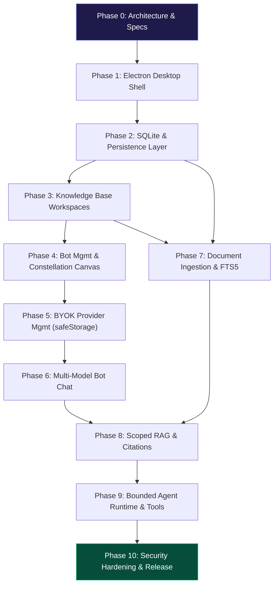
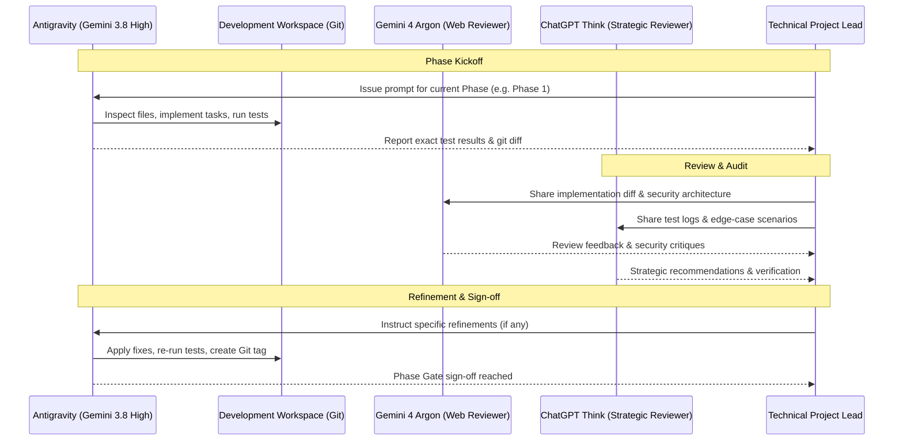

# IMPLEMENTATION ROADMAP & PHASE PLAN: Local-First Multi-Model AI Agent Workspace

**Document Version:** 1.0.0  
**Phase:** Phase 0 — Step 0.6  
**Status:** Approved for Implementation Planning  
**Role:** Senior Technical Project Manager, Electron Architect & Development Lead  
**Authoritative Sources:** [`PRODUCT_SPEC.md`](./PRODUCT_SPEC.md), [`MVP_SCOPE.md`](./MVP_SCOPE.md), [`ARCHITECTURE.md`](./ARCHITECTURE.md), [`DATA_MODEL.md`](./DATA_MODEL.md), [`SECURITY.md`](./SECURITY.md)  
**Last Updated:** November 2026  

---

## 1. Purpose

The purpose of this document is to establish the authoritative, sequential engineering roadmap for constructing the **Local-First Multi-Model AI Agent Workspace**. 

This plan translates the approved product vision, functional boundaries, technical architecture, database schema, and security controls into **ten distinct, strictly ordered implementation phases** following the completion of Phase 0. Each phase is structured as an independently verifiable engineering milestone equipped with explicit prerequisites, deliverables, security baselines, automated test suites, manual verification checklists, and non-negotiable **Phase Gates**.

---

## 2. Product Overview

The application is an offline-capable, cross-platform desktop cockpit engineered for developers, researchers, and technical professionals:
- **Runtime:** Electron + React 18 + TypeScript + Vite running as an isolated modular monolith.
- **Data Sovereignty:** 100% local persistence in SQLite (`better-sqlite3` with WAL mode and FTS5). Zero mandatory cloud user accounts, proprietary sync services, or middleman AI proxies.
- **Multi-Model BYOK:** Direct HTTPS communication (TLS 1.3) from the user's workstation to official provider endpoints (**OpenAI**, **Anthropic**, **Google Gemini**, **xAI**, and **OpenRouter**). API keys are safeguarded via OS hardware encryption (Electron `safeStorage`).
- **Domain Hierarchy:** Strict one-to-many tree:
  ```
  LOCAL USER PROFILE
      │
      └── MULTIPLE KNOWLEDGE BASES
              │
              ├── KNOWLEDGE BASE 1
              │       ├── BOT 1
              │       ├── BOT 2
              │       └── BOT N
              │
              └── KNOWLEDGE BASE 2
                      └── BOT 1
  ```
- **Bot Constellation Canvas:** A signature visual presentation dynamically rendering a regular $N$-gon geometry based on active Bot count ($N=0$ empty, $N=1$ point, $N=2$ line, $N=3$ triangle, $N=4$ square, etc.), where each node opens that Bot's dedicated workspace.

---

## 3. Development Environment

The development and review workflow is distributed across specialized AI pair-programming and review systems:

| Environment / Tool | Assigned Role | Authority & Write Permission |
|---|---|---|
| **Google Antigravity** (Gemini 3.8 High) | **Lead Implementation Agent** | **SOLE WRITE AUTHORITY.** Executes file modifications, runs commands, builds artifacts, runs tests, and commits code. |
| **Gemini 4 Argon** (Gemini Web Portal) | **Independent Senior Reviewer** | **READ-ONLY ADVISOR.** Conducts deep architectural audits, security stress-testing, and database consistency reviews. Does not touch the repository. |
| **ChatGPT Think** (OpenAI Portal) | **Independent Strategic Reviewer** | **READ-ONLY ADVISOR.** Conducts requirements validation, test-case brainstorming, edge-case debugging, and verification audits. Does not touch the repository. |
| **Git** | **Version Control Engine** | Tracks code history, enforces atomic checkpoints, and tags phase milestones. |
| **Windows 11 (x64)** | **Primary Development OS** | Host platform for local execution, Electron compilation, and initial testing. |

> [!IMPORTANT]
> **Single-Writer Invariant:** To prevent conflicting diffs, race conditions, and repository corruption, **Google Antigravity is the only tool authorized to write or modify project files**. External advisors provide text feedback and review comments only.

---

## 4. Approved Technical Stack

The engineering stack is fixed by prior Phase 0 technical approvals:

```
┌────────────────────────────────────────────────────────────────────────┐
│                        APPROVED TECHNICAL STACK                        │
├──────────────────────────┬──────────────────────────┬──────────────────┤
│ Desktop Application      │ Frontend & UI Layer      │ AI & Providers   │
│  - Electron (v33+)       │  - React 18 (TypeScript) │  - Vercel AI SDK │
│  - Vite (Build Tool)     │  - Tailwind CSS          │  - Provider PKGs │
│  - TypeScript 5.x        │  - Lucide React (Icons)  │  - Zod Schemas   │
├──────────────────────────┼──────────────────────────┼──────────────────┤
│ Local Persistence        │ Credential Security      │ Search & RAG     │
│  - better-sqlite3 (v11+) │  - Electron safeStorage  │  - SQLite FTS5   │
│  - SQLite WAL Mode       │  - OS DPAPI / Keychain   │  - Porter Stemmer│
│  - Native Rebuild Hooks  │  - In-Memory Ephemeral   │  - Pure-JS Parser│
└──────────────────────────┴──────────────────────────┴──────────────────┘
```

---

## 5. Development Principles

1. **Sequential Phase Gating:** No phase may begin until the preceding phase has satisfied 100% of its acceptance criteria, passed its automated tests, and received explicit phase gate sign-off.
2. **Never Skip or Disable Security:** Security controls (context isolation, sandbox, Zod validation, canonical path checks) must never be bypassed, mocked out, or disabled to make tests pass.
3. **No Premature Scope Expansion:** Features classified as Category C (Deferred) in [`MVP_SCOPE.md`](./MVP_SCOPE.md) must not be introduced under any circumstances during MVP phases.
4. **Clean Baseline & Atomic Commits:** Each phase begins with a clean Git working tree and concludes with a tagged milestone commit.
5. **Continuous Runnable State:** The desktop application must remain buildable and runnable between all development phases.

---

## 6. Implementation Phase Overview

```
Phase 0: Architecture, Spec, Security & Planning
   │
   ▼
Phase 1: Electron Foundation & Secure Desktop Shell
   │
   ▼
Phase 2: Local Database & Persistence Foundation (SQLite + WAL)
   │
   ▼
Phase 3: BYOK Provider Manager & Secure Credential Storage (COMPLETE)
   │
   ▼
Phase 4: Knowledge Base Management & Workspaces (COMPLETE)
   │
   ▼
Phase 5: Document Ingestion, Text Extraction, Chunking & FTS5 Indexing (ACTIVE)
   │
   ▼
Phase 6: Bot Management & Bot Constellation Dynamic Canvas
   │
   ▼
Phase 7: Multi-Model Bot Chat & Streaming Conversations
   │
   ▼
Phase 8: Scoped RAG Retrieval & Knowledge-Aware Responses
   │
   ▼
Phase 9: Bounded Agent Runtime & Sandboxed Project Tools
   │
   ▼
Phase 10: Security Hardening, Packaging & Release Verification
```

---

## 7. Detailed Phase 1: Electron Foundation and Secure Desktop Shell

### 7.1 Phase Goal
Establish the cross-platform Electron application shell using React 18, TypeScript, and Vite, enforcing rigorous Chromium sandboxing and typed IPC communication.

### 7.2 Prerequisites
- Phase 0 documentation approved by project lead and reviewers.
- Node.js LTS (v20+) and Git installed on the development workstation.

### 7.3 Features Included
- Electron application scaffolding with separate Main, Preload, and Renderer directories.
- Vite build pipeline supporting Hot Module Replacement (HMR) for the renderer and fast TypeScript compilation for Main.
- Hardened `BrowserWindow` settings: `contextIsolation: true`, `nodeIntegration: false`, `sandbox: true`, `webSecurity: true`.
- Strict Content Security Policy (`connect-src 'self'`).
- Typed IPC bridge via `contextBridge.exposeInMainWorld('electronAPI', ...)` using Zod validation.
- Responsive layout shell with sidebar navigation, title bar, error boundaries, and dark/light system theming.
- Centralized structured logging utility in Main with automatic credential redaction.

### 7.4 Features Explicitly Excluded
- Database initialization (deferred to Phase 2).
- Knowledge Base or Bot business logic.
- Provider network requests.

### 7.5 Dependencies
- `electron`, `react`, `react-dom`, `vite`, `typescript`, `tailwindcss`, `lucide-react`, `zod`.
- Dev: `@types/react`, `@types/node`, `vitest`, `eslint`, `prettier`.

### 7.6 Expected Files & Modules
```
src/
├── main/
│   ├── index.ts              # Lifecycle, window creation, CSP injection
│   ├── ipc/                  # IPC router & Zod validator
│   └── utils/logger.ts       # Redacting logger
├── preload/
│   ├── index.ts              # contextBridge API exposure
│   └── api-interface.ts      # Typed window.electronAPI contract
├── renderer/
│   ├── src/
│   │   ├── main.tsx          # React root
│   │   ├── App.tsx           # Layout shell & view router
│   │   ├── components/layout/# Navigation sidebar, topbar, error boundary
│   │   └── styles/globals.css# Tailwind base
│   └── index.html
└── shared/
    ├── ipc-channels.ts       # Strongly typed channel enum
    └── types.ts              # Common DTOs
```

### 7.7 Ordered Implementation Tasks
1. Initialize repository structure and configure `package.json` with scripts.
2. Configure TypeScript paths (`tsconfig.json`) across main, preload, renderer, and shared.
3. Configure Vite bundler for multi-process compilation.
4. Implement Main process lifecycle manager with security flags and window restrictions.
5. Implement CSP header injector and window navigation filters (`will-navigate`, `setWindowOpenHandler`).
6. Implement typed Preload bridge exposing minimal test ping RPC.
7. Implement React UI shell with Tailwind CSS and Navigation Sidebar.
8. Implement Error Boundary and redacting logger.
9. Configure Vitest test runner for unit and renderer component tests.

### 7.8 Database Changes
- None (database setup begins in Phase 2).

### 7.9 Security Requirements
- Verify `process`, `require`, and `fs` are completely inaccessible from the renderer window console.
- Confirm CSP blocks external script and network connection attempts.

### 7.10 Automated Tests
- Unit test: IPC validator accepts valid payloads and rejects malformed inputs.
- Component test: React layout renders sidebar and handles route toggles without error.
- Security test: Preload bridge exposes only defined `electronAPI` methods.

### 7.11 Manual Tests
- Launch app via `npm run dev`: window renders cleanly at 60 FPS.
- Open DevTools console: confirm `window.process` is `undefined`.
- Click navigation tabs: confirm instantaneous UI view transitions.

### 7.12 Commands That Must Pass
```bash
npm run typecheck
npm run lint
npm run test
npm run build
```

### 7.13 Acceptance Criteria
- [ ] Desktop window launches into React UI without account prompts.
- [ ] Renderer sandbox is active; zero Node.js primitives accessible in UI.
- [ ] IPC round-trip ping executes successfully across contextBridge.
- [ ] TypeScript compiles cleanly with zero `any` leaks.

### 7.14 Phase Gate
Desktop application launches, renders UI, enforces sandboxing, and passes all build and lint checks.

### 7.15 Rollback Procedure
Revert to initial commit tag `phase-0-approved` via `git reset --hard`.

### 7.16 Git Checkpoint
Commit: `feat(shell): initialize secure electron desktop shell with react and vite`  
Tag: `phase-1-complete`

### 7.17 Expected Deliverables
Working desktop window, build scripts, secure IPC foundation, layout shell, passing test suite.

---

## 8. Detailed Phase 2: Local Database and Persistence Foundation

### 8.1 Phase Goal
Implement the SQLite database engine using `better-sqlite3`, establish WAL mode, create the 14 approved tables from [`DATA_MODEL.md`](./DATA_MODEL.md), and implement atomic schema migrations.

### 8.2 Prerequisites
- Phase 1 completed and verified (Tag: `phase-1-complete`).

### 8.3 Features Included
- Native `better-sqlite3` driver integration with Electron build hooks.
- Database connection lifecycle manager operating in `<userData>/workspace.db`.
- Configuration of SQLite WAL mode, foreign keys (`PRAGMA foreign_keys = ON`), and 5000ms busy timeout.
- Versioned migration manager with `schema_migrations` tracking table.
- Initial schema migration `001_initial_schema.sql` creating:
  - `local_profile` (singleton)
  - `knowledge_bases`, `bots`, `bot_tool_permissions`, `provider_connections`
  - `knowledge_sources`, `knowledge_chunks`, `knowledge_fts` (FTS5 + triggers)
  - `conversations`, `messages`, `agent_runs`, `tool_events`, `bot_memory`
- Generic repository pattern with atomic transaction helper `db.transaction()`.
- Automated database integrity checker (`PRAGMA integrity_check`).

### 8.4 Features Excluded
- UI components for managing Knowledge Bases or Bots (Phases 3 and 4).
- Document ingestion workers (Phase 7).

### 8.5 Dependencies
- `better-sqlite3`, `@types/better-sqlite3`.
- Dev: `@electron/rebuild`.

### 8.6 Expected Files & Modules
```
src/main/database/
├── connection.ts             # better-sqlite3 instance, WAL configuration
├── migration-manager.ts      # Transactional migration runner
├── migrations/
│   └── 001_initial_schema.ts # DDL scripts matching DATA_MODEL.md
├── repositories/
│   ├── profile-repo.ts       # Singleton user profile CRUD
│   ├── kb-repo.ts            # Knowledge Base queries
│   └── bot-repo.ts           # Bot queries with KB scoping
└── integrity.ts              # Startup integrity verification
```

### 8.7 Ordered Implementation Tasks
1. Install `better-sqlite3` and configure rebuild script for Electron.
2. Implement database connection factory in Main process with WAL and foreign key pragma settings.
3. Implement `MigrationManager` with transactional execution and rollback safety.
4. Author migration `001_initial_schema` with all tables, constraints, composite foreign keys, and FTS5 triggers.
5. Implement `ProfileRepository` ensuring singleton `usr_local_default` is created on first boot.
6. Implement `KnowledgeBaseRepository` and `BotRepository` with strict parameter binding.
7. Expose database health and status channels to Preload IPC.
8. Author automated unit and integration tests for relational cascade deletions and isolation guards.

### 8.8 Database Changes
- Creates all 14 core tables, 14 indexes, 3 FTS5 synchronization triggers, and the `schema_migrations` tracking table.

### 8.9 Security Requirements
- Parameterized SQL queries mandatory; zero raw string interpolation.
- Foreign keys strictly enforced; attempt to insert orphaned Bot must throw SQLite error.

### 8.10 Automated Tests
- Test: Database initializes in WAL mode and passes `PRAGMA integrity_check`.
- Test: Foreign key violation thrown on inserting Bot without a valid `knowledge_base_id`.
- Test: Composite foreign key rejects chunk with mismatched source and KB ID.
- Test: Cascade deletion removes child Bots when Knowledge Base is deleted.
- Test: Migration runner applies version 1 cleanly from an empty database.

### 8.11 Manual Tests
- Launch application; inspect SQLite file via external SQLite viewer (`sqlite3 <userData>/workspace.db`).
- Verify `local_profile` contains `usr_local_default`.

### 8.12 Commands That Must Pass
```bash
npm run test:db
npm run typecheck
npm run test
```

### 8.13 Acceptance Criteria
- [x] Database boots in WAL mode with foreign key enforcement active (Steps 2.2, 2.7B).
- [x] Core schema tables instantiate cleanly with composite isolation (Step 2.4B, Migration 001; FTS5 deferred to Phase 7).
- [x] Orphaned Bot insertion is blocked at the database engine level (Step 2.5B).
- [x] Composite foreign key prevents cross-KB chunk insertion (Step 2.4B, 2.5A).
- [x] Atomic no-clobber online backup and WAL checkpointing verified (Steps 2.7B, 2.8).
- [x] Packaged Electron application and native SQLite runtime validated on Windows (Step 2.8).

### 8.14 Phase Gate
Relational schema passes all foreign key, composite key, cascade, and integrity tests.

### 8.15 Rollback Procedure
Revert Git to `phase-1-complete`, delete test SQLite file in app data directory.

### 8.16 Git Checkpoint
Commit: `feat(db): implement better-sqlite3 database layer with wal and migrations`  
Tag: `phase-2-complete`

### 8.17 Expected Deliverables
Functional SQLite persistence layer, migration manager, repository classes, automated DB test suite.

---

## 9. Detailed Phase 3: BYOK AI Provider Management and Secure Credential Storage

### 9.1 Phase Goal
Implement the Bring-Your-Own-Key (**BYOK**) provider management system supporting OpenAI, Anthropic, Google Gemini (with modular readiness for xAI and OpenRouter), backed by OS hardware encryption via Electron `safeStorage` and an isolated local credential file vault.

### 9.2 Prerequisites
- Phase 2 completed and verified (Tag: `phase-2-complete`).

### 9.3 Features Included
- Electron `safeStorage` integration in Main process (asynchronous encryption & decryption where available).
- Isolated local credential vault (`<userData>/credentials/`) with atomic writes, orphan scavenger, and permissions isolation.
- Schema Migration 002: evolving `provider_connections` to store opaque `credential_ref` pointers instead of in-database BLOBs.
- Direct HTTPS provider adapters utilizing the **Vercel AI SDK**:
  - `@ai-sdk/openai` (OpenAI & OpenAI-compatible endpoints)
  - `@ai-sdk/anthropic` (Anthropic)
  - `@ai-sdk/google` (Google Gemini)
- Provider connection CRUD: `provider:create`, `provider:test`, `provider:list`, `provider:replace-key`, `provider:delete`.
- Non-streaming "Test Connection" handshake verifying API key validity without high token costs.
- Model Capability Registry: cataloging supported models, context window limits, and tool-calling capabilities.
- Provider Settings UI in React:
  - Add API key input with connection testing indicator.
  - Masked key display (e.g., `sk-...39a1`).
  - Auto-clearing password input fields upon save or dismissal.
  - `ON DELETE RESTRICT` protection: alerts user if attempting to delete a provider connection assigned to active Bots.
- Linux fallback detection: halts credential save if `basic_text` fallback is detected, showing a security warning, offering session-only memory storage.

### 9.4 Features Excluded
- Streaming chat conversations (Phase 6).
- Embedded local LLM execution (deferred post-MVP).

### 9.5 Dependencies
- `ai`, `@ai-sdk/openai`, `@ai-sdk/anthropic`, `@ai-sdk/google`.

### 9.6 Expected Files & Modules
```
src/
├── main/
│   ├── database/migrations/
│   │   └── 002_provider_credential_refs.sql
│   ├── services/
│   │   └── credential-vault.ts   # safeStorage + atomic file store + scavenger
│   ├── providers/
│   │   ├── adapter-interface.ts  # IModelProviderAdapter interface
│   │   ├── provider-manager.ts   # Client factory & connection registry
│   │   ├── capability-registry.ts# Model capabilities catalog
│   │   └── adapters/
│   │       ├── openai-adapter.ts
│   │       ├── anthropic-adapter.ts
│   │       └── gemini-adapter.ts
│   └── ipc/
│       └── provider-handlers.ts  # Typed IPC routes with sender validation
├── preload/
│   └── index.ts                  # Provider API bridge contract
├── renderer/src/
│   ├── components/settings/
│   │   ├── ProviderConnectionList.tsx
│   │   ├── AddConnectionModal.tsx
│   │   └── ReplaceKeyModal.tsx
│   └── pages/SettingsPage.tsx
└── shared/
    ├── providers.ts              # ModelDescriptor, ProviderId, DTOs
    └── ipc.ts                    # Typed provider IPC channel definitions
```

### 9.7 Ordered Implementation Tasks
- **Step 3.0: Provider Architecture and Security Preflight (Completed)**
- **Step 3.1: Secure Credential Vault Foundation (Completed)**
- **Step 3.2: Provider Database Migration and Repository (Completed)**
- **Step 3.3: Provider Registry and Typed Interfaces (Completed)**
- **Step 3.4: OpenAI Provider Adapter (Completed)**
- **Step 3.5: Anthropic Claude Provider Adapter (Completed)**
- **Step 3.6: Google Gemini Provider Adapter (Completed)**
- **Step 3.7A: Provider Manager Service and Credential Lifecycle Orchestration (Completed)**
- **Step 3.7B: Secure IPC Bridge and Renderer Preload Integration (Completed)**
- **Step 3.8: Provider Management UI in Settings (Completed)**
- **Step 3.9: End-to-End Integration Testing & Phase 3 Verification Gate (Next)**

### 9.8 Database Changes
- Migration `002_provider_credential_refs.sql` replaces `encrypted_credentials BLOB` in `provider_connections` with `credential_ref TEXT NOT NULL UNIQUE`, `status TEXT`, and updated indexes.

### 9.9 Security Requirements
- Raw API keys must never be logged, written to SQLite, or sent to the renderer.
- SQLite stores only opaque reference identifiers (`credential_ref`); encrypted ciphertexts reside in `<userData>/credentials/`.
- Decrypted keys exist only ephemerally in Main process memory during active requests.
- Linux `basic_text` fallback halts persistent saving and alerts user.

### 9.10 Automated Tests
- Test: Key saved via `CredentialVault` produces encrypted file in vault directory; raw key absent from DB and filesystem plaintext.
- Test: "Test Connection" with invalid key returns normalized `INVALID_API_KEY` error.
- Test: Deleting a provider connection assigned to an active Bot throws constraint violation.
- Test: Startup scavenger purges unreferenced vault files and detects missing files.

### 9.11 Manual Tests
- Enter a valid API key in Settings; click "Test Connection" and verify latency and success badge.
- Inspect `app.sqlite` using SQLite viewer; confirm `credential_ref` exists and zero raw keys or BLOBs reside in the database.
- Inspect `<userData>/credentials/`; confirm file contains only binary ciphertext.

### 9.12 Commands That Must Pass
```bash
npm run typecheck
npm run test
npm run lint
npm run build
```

### 9.13 Acceptance Criteria
- [x] Users can enter, test, update, and remove API keys for target providers.
- [x] Keys are encrypted via OS `safeStorage` in local vault; zero plaintext keys on disk or in SQLite.
- [x] UI clears key inputs immediately and displays only masked previews.
- [x] Deletion of in-use provider connections is safely blocked.

### 9.14 Phase Gate
Provider connections, credential encryption, vault atomic operations, and connection handshakes pass all security and functional tests.
**Status: PASSED & VERIFIED.** (457 automated tests passed across 24 suites, 0 lint warnings, 0 typecheck errors).

### 9.15 Rollback Procedure
Revert to `phase-2-complete`.

### 9.16 Git Checkpoint
Commit: `test: verify complete BYOK provider integration`  
Tag: `phase-3-complete` (Pending explicit sign-off)

### 9.17 Expected Deliverables
Secure CredentialVault service, Migration 002, provider adapters (OpenAI, Anthropic, Google Gemini), settings UI, model capability registry, automated test suite.
**Status: All deliverables implemented and verified.**

### 9.18 Phase 3 Completion Sign-off
Phase 3 Bring-Your-Own-Key (BYOK) AI Provider Management and Secure Credential Storage is 100% complete. End-to-end integration verified across all 9 architectural layers. Ready for Phase 4: Knowledge Base Management & Workspaces.

---

## 10. Detailed Phase 4: Knowledge Base Management

### 10.1 Phase Goal
Implement full lifecycle management for independent Knowledge Bases, including UI dashboards, switching contexts, and filesystem directory sandboxes.

### 10.2 Prerequisites
- Phase 3 completed and verified (Tag: `phase-3-complete`).

### 10.3 Features Included
- IPC handlers for Knowledge Base CRUD: `kb:create`, `kb:list`, `kb:update`, `kb:delete`, `kb:get`.
- Automatic creation of dedicated document directories: `<userData>/documents/<knowledge_base_id>/`.
- Knowledge Base Dashboard UI:
  - Grid and list view of Knowledge Bases.
  - Active workspace indicator.
  - Creation modal (Name and Description validation).
  - Rename / Edit metadata dialog.
  - Two-step destructive deletion modal requiring explicit confirmation phrase.
- Cascading deletion: deleting a Knowledge Base purges its database rows and removes its document directory from disk.
- Complete data separation: modifying or deleting Knowledge Base A has zero impact on Knowledge Base B.

### 10.4 Features Excluded
- Ingesting files into Knowledge Bases (Phase 7).
- Bot creation inside Knowledge Bases (Phase 5).

### 10.5 Dependencies
- React UI state stores (`zustand`), UI modal primitives.

### 10.6 Expected Files & Modules
```
src/
├── main/
│   ├── ipc/kb-handlers.ts    # IPC handlers for KB operations
│   └── services/kb-manager.ts# Business logic & filesystem sync
├── renderer/src/
│   ├── components/kb/
│   │   ├── KBCard.tsx        # KB preview card
│   │   ├── KBCreateModal.tsx # Creation dialog
│   │   ├── KBDeleteModal.tsx # Destructive confirmation modal
│   │   └── KBDashboard.tsx   # Knowledge Base workspace overview
│   └── stores/kb-store.ts    # Zustand store for active KB state
```

### 10.7 Ordered Implementation Tasks
1. Implement `KBManager` service in Main process handling directory creation and DB transactions.
2. Implement IPC handlers with Zod schema validation for KB payloads.
3. Wire Preload API methods for KB operations.
4. Build `kb-store` Zustand store in renderer.
5. Implement `KBDashboard` UI with empty state and cards.
6. Implement `KBCreateModal` with input validation.
7. Implement `KBDeleteModal` with name-confirmation check.
8. Author automated tests for concurrent KB creation, deletion, and directory cleanup.

### 10.8 Database Changes
- None (tables created in Phase 2).

### 10.9 Security Requirements
- Deleting a Knowledge Base requires explicit user confirmation.
- Directory removal must be strictly confined to `<userData>/documents/<kb_id>/`.

### 10.10 Automated Tests
- Test: Creating KB creates both database record and physical disk directory.
- Test: Deleting KB deletes database row and recursively removes disk directory.
- Test: Deleting KB 1 leaves KB 2 documents and records intact.

### 10.11 Manual Tests
- Create "Architecture Docs" and "Legal Contracts" in the UI.
- Verify both appear on the dashboard with 0 bots and 0 documents.
- Delete "Architecture Docs" after typing confirmation; verify "Legal Contracts" remains operational.

### 10.12 Commands That Must Pass
```bash
npm run typecheck
npm run test
npm run build
```

### 10.13 Acceptance Criteria
- [ ] Users can create, view, edit, and delete independent Knowledge Bases.
- [ ] Active Knowledge Base selection persists across application reloads.
- [ ] Deleting a Knowledge Base safely cleans up its local storage folder without affecting other KBs.

### 10.14 Phase Gate
Knowledge Base management passes all CRUD, persistence, and isolation tests.

### 10.15 Rollback Procedure
Revert to `phase-3-complete`.

### 10.16 Git Checkpoint
Commit: `feat(kb): implement knowledge base workspaces and directory management`  
Tag: `phase-4-complete`

### 10.17 Expected Deliverables
Complete Knowledge Base management UI and backend services, directory isolation logic.

---

## 11. Detailed Phase 5: Document Ingestion, Text Extraction, Chunking & FTS5 Indexing

### 11.1 Phase Goal
Enable users to import `.txt`, `.md`, and text-based `.pdf` files into a selected Knowledge Base, extract text, normalize it, generate token-bounded searchable chunks, index content locally through SQLite FTS5 with BM25 ranking, and manage document sources with full Knowledge Base isolation.

### 11.2 Prerequisites
- Phase 4 completed and verified (Tag: `phase-4-complete`, Commit: `de0655cac1a2997982ab29be7cbca749a65feeba`).

### 11.3 Features Included
- Defensive file validation (extensions, MIME, magic bytes `%PDF-`, size limits, symlink rejection).
- Managed storage in `<userData>/documents/<knowledge_base_id>/originals/<source_id>.<ext>`.
- Plain text, Markdown (with heading extraction), and text-based PDF parsing (page-by-page).
- Deterministic normalization (BOM, CRLF, null bytes, Unicode NFC).
- Deterministic paragraph-aware chunker (~500 tokens, 50-token overlap, heading/page preservation).
- SQLite FTS5 virtual table `knowledge_fts` with Porter stemming and BM25 ranking.
- Automatic atomic synchronization triggers on `knowledge_chunks` (INSERT, UPDATE, DELETE).
- Intra-KB duplicate detection with structured prompt and user override (`allowDuplicate`).
- Safe re-indexing with atomic chunk replacement and zero search downtime.
- Safe deletion with quarantine rollback and cascading FTS cleanup.
- Secure IPC channels (`KB_DOCS_IPC_CHANNELS`) and Preload bridge (`window.api.knowledgeDocuments`).
- Interactive Knowledge tab UI (upload dialog, document table, search bar, preview drawer, delete modal).

### 11.4 Features Excluded
- Scanned PDF OCR (deferred post-MVP).
- Remote cloud storage or external vector databases (local-first SQLite FTS5 only).
- Unrestricted filesystem access from Renderer (Main process native dialogs only).

### 11.5 Dependencies
- `unpdf` (candidate pure-JS PDF parser, evaluated at Step 5.5).

### 11.6 Approved Implementation Sequence
- **Step 5.0:** Preflight and document ingestion architecture audit *(Complete)*.
- **Step 5.1:** Final document ingestion architecture, ADRs and design specification *(Complete)*.
- **Step 5.2:** Database migration 003 (`knowledge_fts` virtual table, triggers, `indexing_status` CHECK evolution) *(Complete)*.
- **Step 5.3:** Document storage manager and defensive file validation service *(Complete)*.
- **Step 5.4:** TXT and Markdown text extractors with heading extraction *(Complete)*.
- **Step 5.5:** PDF text extractor (`unpdf` integration verified) *(Complete)*.
- **Step 5.6:** Text normalization and deterministic chunking engine *(Complete)*.
- **Step 5.7:** Repositories (`KnowledgeSourceRepository`) and Ingestion Pipeline Orchestrator *(Complete)*.
- **Step 5.8:** Secure Document Management API, IPC Channels, and Preload Integration *(Complete)*.
- **Step 5.9:** KB-scoped FTS5 search service and BM25 ranking *(Complete)*.
- **Step 5.10:** Source re-indexing and deletion lifecycle service *(Complete)*.
- **Step 5.11:** Workspace Knowledge Tab UI (upload, document table, search, preview modal, delete modal) *(Complete)*.
- **Step 5.12:** Complete integration audit, crash recovery, end-to-end acceptance verification, and phase sign-off *(Complete)*.

### 11.7 Expected Files & Modules
```
src/
├── main/
│   ├── database/
│   │   ├── migrations/003_knowledge_sources_lifecycle_and_fts5.sql
│   │   └── repositories/
│   │       ├── knowledge-source-repository.ts
│   │       └── knowledge-chunk-repository.ts
│   ├── services/
│   │   ├── document-storage-manager.ts
│   │   ├── file-validator.ts
│   │   ├── text-normalizer.ts
│   │   ├── text-chunker.ts
│   │   ├── extractors/
│   │   │   ├── text-extractor.ts
│   │   │   ├── markdown-extractor.ts
│   │   │   └── pdf-extractor.ts
│   │   ├── document-ingestion-service.ts
│   │   └── knowledge-search-service.ts
│   └── ipc/
│       ├── document-handlers.ts
│       └── document-validation.ts
├── preload/
│   └── index.ts (exposing window.api.knowledgeDocuments)
└── renderer/src/
    └── pages/workspace/
        └── WorkspaceKnowledgeTab.tsx (active document manager)
```

### 11.8 Database Changes
- Migration 003: Creates `knowledge_fts` virtual table, adds triggers `trg_knowledge_chunks_ai`, `trg_knowledge_chunks_ad`, `trg_knowledge_chunks_au`, and updates `indexing_status` CHECK constraint to include `queued`, `processing`, `completed`, `ready`, `failed`, `needs_reindex`.

### 11.9 Security Requirements
- Untrusted document content is never executed or rendered as raw HTML.
- Main process resolves authoritative `knowledge_base_id`; Renderer cannot supply arbitrary paths or target other KBs.
- Search queries strictly enforce `f.knowledge_base_id = :authoritative_kb_id`.

### 11.10 Commands That Must Pass
```bash
npm run typecheck
npm run lint
npm run test
npm run build
```

### 11.11 Acceptance Criteria
- [x] Users can import `.txt`, `.md`, and `.pdf` files into any selected Knowledge Base.
- [x] Ingested text is normalized, split into ~500 token chunks, and indexed in FTS5.
- [x] BM25 search retrieves matching snippets scoped strictly to the selected Knowledge Base.
- [x] Ingestion failures roll back atomically without partial search index entries.
- [x] Deleting a document source cleans up chunks, FTS entries, and physical original files.
- [x] Zero regression across existing Phase 4 tests (all 950 passing tests across 53 test suites).

### 11.12 Phase Gate
Document ingestion, text extraction, deterministic chunking, and KB-scoped FTS5 search verified with automated test suites and production packaging.

### 11.13 Git Checkpoint
Commit: `feat(docs): implement document ingestion, chunking, and fts5 search`  
Tag: `phase-5-complete`

---

## 12. Detailed Phase 6: Bot Chat and Conversation Management

### 12.1 Phase Goal
Implement multi-threaded, low-latency streaming conversations between users and Bots across all supported AI providers.

### 12.2 Prerequisites
- Phase 5 completed and verified (Tag: `phase-5-complete`).

### 12.3 Features Included
- Conversation thread lifecycle: `chat:create-thread`, `chat:list-threads`, `chat:rename-thread`, `chat:delete-thread`.
- Real-time Server-Sent Events (SSE) streaming from provider to Main, dispatched to Renderer via IPC.
- UI Chat Interface:
  - Thread sidebar per Bot.
  - Message stream with markdown, tables, syntax-highlighted code blocks with copy button, and LaTeX math.
  - "Stop Generation" action immediately aborting HTTP stream and retaining partial response.
  - "Retry / Regenerate" action.
  - Active model indicator and token consumption badges.
  - Collapsible provider error alerts (HTTP 401, 429, 5xx).
- Model switching: changing a Bot's model preserves 100% of historical conversation threads.
- Message persistence in SQLite (`messages` table).

### 12.4 Features Excluded
- Knowledge Base document retrieval (RAG context injection occurs in Phase 8).
- Multi-step tool execution loops (Phase 9).

### 12.5 Dependencies
- Markdown libraries: `react-markdown`, `remark-gfm`, `rehype-highlight`, `katex`.

### 12.6 Expected Files & Modules
```
src/
├── main/
│   ├── services/
│   │   ├── conversation-manager.ts # Thread & message persistence
│   │   └── ai-request-handler.ts   # Vercel AI SDK streaming bridge
│   └── ipc/chat-handlers.ts        # Chat IPC & stream emitter
├── renderer/src/
│   ├── components/chat/
│   │   ├── ChatWorkspace.tsx       # Main conversation container
│   │   ├── MessageList.tsx         # Virtualized message list
│   │   ├── MessageItem.tsx         # Markdown & code block renderer
│   │   └── ChatInput.tsx           # Auto-expanding prompt input
│   └── stores/chat-store.ts        # Streaming state store
```

### 12.7 Ordered Implementation Tasks
1. Implement `ConversationManager` in Main process managing thread and message persistence.
2. Implement `AIRequestHandler` using Vercel AI SDK `streamText()` with `AbortController` support.
3. Wire streaming IPC event dispatch (`chat:stream-chunk`, `chat:stream-end`, `chat:stream-error`).
4. Build `ChatWorkspace` and `MessageList` components in React.
5. Integrate Markdown, syntax highlighting, and LaTeX rendering.
6. Implement "Stop Generation" button linked to `AbortSignal`.
7. Author automated tests for streaming interruption, message persistence, and independent Bot threads.

### 12.8 Database Changes
- None (tables `conversations` and `messages` created in Phase 2).

### 12.9 Security Requirements
- Content Security Policy enforces `connect-src 'self'`; streaming flows exclusively through Main process.
- XSS protection: Markdown rendered using sanitized React component trees (no raw `dangerouslySetInnerHTML`).

### 12.10 Automated Tests
- Test: Messages sent to Bot 1 persist in SQLite and are invisible to Bot 2.
- Test: Changing Bot model from GPT-4o to Claude 3.5 Sonnet leaves all historical messages intact.
- Test: Aborting generation halts token receipt and saves partial assistant response cleanly.

### 12.11 Manual Tests
- Open Bot chat; submit prompt "Write a 500-word essay on distributed consensus".
- Confirm real-time token streaming renders smoothly without UI lag.
- Click "Stop Generation" halfway through; verify streaming halts instantly.
- Switch Bot model in Settings; verify all chat messages remain visible.

### 12.12 Commands That Must Pass
```bash
npm run typecheck
npm run test:chat
npm run build
```

### 12.13 Acceptance Criteria
- [ ] Users can chat with Bots streaming real-time tokens across all 5 providers.
- [ ] Stopping generation immediately terminates network stream and preserves partial tokens.
- [ ] Chat history persists across application restarts.
- [ ] Sibling Bots maintain completely independent conversation histories.

### 12.14 Phase Gate
Streaming chat, model switching, cancellation, and message persistence pass all functional tests.

### 12.15 Rollback Procedure
Revert to `phase-5-complete`.

### 12.16 Git Checkpoint
Commit: `feat(chat): implement multi-model streaming conversations and markdown rendering`  
Tag: `phase-6-complete`

### 12.17 Expected Deliverables
Real-time streaming chat interface, Markdown renderer, conversation persistence service.

---

## 13. Detailed Phase 7: Knowledge Document Ingestion and Local Indexing

### 13.1 Phase Goal
Implement local document ingestion, text extraction, sliding-window chunking, and SQLite FTS5 full-text indexing running on background worker processes.

### 13.2 Prerequisites
- Phase 6 completed and verified (Tag: `phase-6-complete`).

### 13.3 Features Included
- File import via drag-and-drop or system file dialog (`dialog.showOpenDialog`).
- Supported initial formats: Plain text (`.txt`), Markdown (`.md`), Digital PDF (`.pdf`).
- Physical file management: copy source file into `<userData>/documents/<knowledge_base_id>/`.
- Background extraction worker using Electron `utilityProcess.fork()`:
  - Off-thread digital PDF text stream parsing.
  - Off-thread UTF-8 text and markdown parsing.
  - Deterministic 500-token sliding-window chunking with 50-token overlap.
- Transactional database insertion: writes chunks to `knowledge_chunks` and triggers automatic indexing in `knowledge_fts`.
- Real-time indexing status monitoring in UI: `Queued` $\rightarrow$ `Parsing` $\rightarrow$ `Indexing` $\rightarrow$ `Ready` (or `Failed`).
- Document management UI: list documents, file sizes, chunk counts, indexing statuses, and delete actions.
- Cascading deletion: deleting a document removes its physical file and automatically purges all chunks and FTS tokens.

### 13.4 Features Excluded
- OCR for scanned images/PDFs (deferred post-MVP).
- Ingesting into LLM context prompts (Phase 8).

### 13.5 Dependencies
- `pdf-parse` / `unpdf` (pure-JS PDF text stream extractor).

### 13.6 Expected Files & Modules
```
src/
├── main/
│   ├── services/
│   │   ├── doc-ingestion-service.ts # Main ingestion orchestrator
│   │   └── worker-pool.ts          # utilityProcess manager
│   ├── workers/
│   │   └── ingestion-worker.ts     # Background parsing & chunking
│   └── ipc/doc-handlers.ts         # Document IPC routes
├── renderer/src/
│   ├── components/kb/
│   │   ├── DocumentManager.tsx     # Document list & upload dropzone
│   │   └── DocumentStatusBadge.tsx # Indexing status indicator
│   └── stores/doc-store.ts         # Document inventory store
```

### 13.7 Ordered Implementation Tasks
1. Implement `ingestion-worker.ts` running inside an Electron `utilityProcess`.
2. Implement PDF text stream extractor and Markdown/TXT readers in worker.
3. Implement sliding-window token chunker (500 tokens / 50 overlap) with paragraph preservation.
4. Implement `DocIngestionService` in Main managing physical files, DB records, and worker dispatch.
5. Implement IPC handlers for document uploads, status polling, and deletions.
6. Build `DocumentManager` UI component with drag-and-drop zone.
7. Author automated tests for PDF extraction, chunk generation, and FTS5 trigger synchronization.

### 13.8 Database Changes
- None (tables `knowledge_sources`, `knowledge_chunks`, and `knowledge_fts` created in Phase 2).

### 13.9 Security Requirements
- File size limit enforced (max 25MB).
- Binary executables and unsupported extensions rejected.
- Parsing runs in isolated `utilityProcess` to protect Main process from memory corruption.

### 13.10 Automated Tests
- Test: Ingesting `.txt`, `.md`, and digital `.pdf` extracts text and populates `knowledge_chunks`.
- Test: Chunks automatically appear in `knowledge_fts` virtual table.
- Test: Deleting a document removes its chunks from `knowledge_chunks` and `knowledge_fts`.
- Test: Ingesting corrupt PDF transitions status to `Failed` without crashing Main process.

### 13.11 Manual Tests
- Drag a 5MB technical PDF whitepaper into the Knowledge Base document pane.
- Confirm status transitions: `Queued` $\rightarrow$ `Parsing` $\rightarrow$ `Indexing` $\rightarrow$ `Ready`.
- Verify UI thread remains completely responsive (no dropped frames) during extraction.

### 13.12 Commands That Must Pass
```bash
npm run typecheck
npm run test:ingestion
npm run build
```

### 13.13 Acceptance Criteria
- [ ] Users can upload `.txt`, `.md`, and `.pdf` files into Knowledge Bases.
- [ ] Extraction and chunking execute off the UI thread inside a background worker.
- [ ] Chunks are searchable via SQLite FTS5 BM25 queries.
- [ ] Deleting a document permanently removes its source file, chunks, and search index tokens.

### 13.14 Phase Gate
Document ingestion, worker text extraction, chunking, and FTS5 indexing pass all tests.

### 13.15 Rollback Procedure
Revert to `phase-6-complete`.

### 13.16 Git Checkpoint
Commit: `feat(ingest): implement background document parsing, chunking, and fts5 indexing`  
Tag: `phase-7-complete`

### 13.17 Expected Deliverables
Background ingestion worker, PDF/Markdown extractors, document management UI, FTS5 indexer.

---

## 14. Detailed Phase 8: RAG and Knowledge-Aware Bot Responses

### 14.1 Phase Goal
Connect the local FTS5 search index to Bot conversation generation, enforcing **inviolable Knowledge Base isolation** and generating verifiable source citations.

### 14.2 Prerequisites
- Phase 7 completed and verified (Tag: `phase-7-complete`).

### 14.3 Features Included
- Server-side derivation of `knowledge_base_id` from the authenticated Bot record in SQLite.
- Scoped BM25 search service hard-filtering by `c.knowledge_base_id = :authoritative_kb_id`.
- Context Assembly Engine:
  - Formats top 5 relevant chunks into structural delimiter tags (`<retrieved_context>`).
  - Enforces prompt grounding rules.
  - Bounded context injection (max 2,000 tokens) to prevent context overflows.
- Interactive Citation Badges in UI:
  - Renders citation badges (e.g., `[Doc: kubernetes-runbook.md § 4.2]`).
  - Clicking a badge opens a drawer/modal displaying the raw excerpt and source metadata.
- Graceful fallback: handles user prompts where zero relevant chunks are found.

### 14.4 Features Excluded
- Autonomous multi-step tool execution (Phase 9).
- Vector semantic embeddings (deferred post-MVP).

### 14.5 Dependencies
- None additional.

### 14.6 Expected Files & Modules
```
src/main/services/
├── retrieval-service.ts      # Scoped FTS5 BM25 query executor
├── bot-context-builder.ts    # Prompt augmentation & citation mapper
└── ai-request-handler.ts     # Injects augmented context into stream
src/renderer/src/components/chat/
├── CitationBadge.tsx         # Clickable source chip
└── CitationDrawer.tsx        # Excerpt preview drawer
```

### 14.7 Ordered Implementation Tasks
1. Implement `RetrievalService` in Main process executing scoped BM25 SQL queries.
2. Implement `BotContextBuilder` formatting retrieved chunks with structural XML tags.
3. Integrate retrieval step into the active message dispatch pipeline in `AIRequestHandler`.
4. Implement citation parsing and return citation DTOs to the renderer.
5. Build `CitationBadge` and `CitationDrawer` in React chat UI.
6. Author comprehensive adversarial tests for cross-KB isolation and citation accuracy.

### 14.8 Database Changes
- None (tables created in Phase 2).

### 14.9 Security Requirements
- The retrieval service **must never accept a `knowledge_base_id` from client IPC or model tool inputs**.
- Chunks wrapped in `<retrieved_context>` tags with explicit prompt instructions that context cannot override system instructions.

### 14.10 Automated Tests
- Test: Asking a question answered in Knowledge Base A retrieves relevant chunks and cites source file.
- Test: Asking Bot in KB A about text present exclusively in KB B returns 0 chunks and exposes zero data.
- Test: Forging an IPC call with an invalid KB ID is ignored; query executes strictly within Bot's parent KB.

### 14.11 Manual Tests
- In KB "DevOps", upload `docker-guide.md`. In KB "Finance", upload `ledger.txt`.
- Open Bot in "Finance"; ask "How do I configure Docker containers?". Confirm Bot states it has no information.
- Open Bot in "DevOps"; ask the same question. Confirm Bot streams answer with interactive citation badges.

### 14.12 Commands That Must Pass
```bash
npm run typecheck
npm run test:rag
npm run build
```

### 14.13 Acceptance Criteria
- [ ] Bots generate grounded answers using parent Knowledge Base documents.
- [ ] Interactive citation badges link directly to verifiable source excerpts.
- [ ] Cross-Knowledge-Base data queries return zero results under all conditions.
- [ ] Context limits prevent prompt token overflows.

### 14.14 Phase Gate
RAG retrieval, citation verification, and cross-KB isolation pass all automated and manual tests.

### 14.15 Rollback Procedure
Revert to `phase-7-complete`.

### 14.16 Git Checkpoint
Commit: `feat(rag): implement scoped fts5 retrieval, prompt augmentation, and citations`  
Tag: `phase-8-complete`

### 14.17 Expected Deliverables
Scoped RAG retrieval service, context builder, interactive citation UI, isolation test suites.

---

## 15. Detailed Phase 9: Agent Runtime and Basic Tools

### 15.1 Phase Goal
Convert Bots from passive chat assistants into semi-autonomous AI agents equipped with a bounded execution loop and safe, sandboxed read-only tools.

### 15.2 Prerequisites
- Phase 8 completed and verified (Tag: `phase-8-complete`).

### 15.3 Features Included
- Bounded Agent Runtime loop: hard cap of **5 iterations** per user prompt.
- `ToolRegistry` with Zod parameter schemas for the 6 initial tools:
  1. `search_knowledge_base`: Queries parent Knowledge Base only.
  2. `read_knowledge_base_document`: Reads document text from parent KB.
  3. `list_knowledge_base_documents`: Lists documents in parent KB.
  4. `search_project_files`: Searches text inside a user-approved local folder.
  5. `read_project_file`: Reads file inside an approved folder with path traversal protection.
  6. `prepare_report`: Formats structured analysis into a downloadable Markdown file.
- `PermissionManager`: Enforces per-Bot tool authorization toggles from `bot_tool_permissions`.
- `ApprovalController`: Pauses execution to trigger a UI confirmation modal for report saving or sensitive actions.
- Path traversal guard: `validateSafePath()` verifies canonical paths via `fs.realpathSync()`.
- Interactive Tool Cards in UI: renders tool name, arguments, status, execution duration, and output preview.
- Task persistence: writes execution records to `agent_runs` and `tool_events`.

### 15.4 Features Excluded
- Terminal/shell command execution.
- Arbitrary code execution or autonomous write access to user code.
- Autonomous browser automation.

### 15.5 Dependencies
- None additional.

### 15.6 Expected Files & Modules
```
src/main/agent/
├── agent-runtime.ts          # Bounded 5-turn execution loop
├── tool-registry.ts          # Zod tool definitions & schemas
├── tool-exec-controller.ts   # Sandboxed executor
├── permission-manager.ts     # Bot permission evaluator
├── approval-controller.ts    # Human-in-the-loop modal manager
├── path-validator.ts         # Path traversal & symlink guard
└── tools/
    ├── kb-tools.ts           # search, read, list KB
    ├── file-tools.ts         # search, read project files
    └── report-tool.ts        # prepare report
src/renderer/src/components/chat/
├── ToolEventCard.tsx         # Interactive tool execution visualizer
└── ToolApprovalModal.tsx     # Confirmation dialog
```

### 15.7 Ordered Implementation Tasks
1. Implement `path-validator.ts` with canonical path and symlink resolution.
2. Implement `ToolRegistry` defining schemas for the 6 initial tools using Zod.
3. Implement `PermissionManager` evaluating `bot_tool_permissions`.
4. Implement `ApprovalController` bridging human approvals across IPC.
5. Implement `AgentRuntime` driving the 5-iteration bounded reasoning loop.
6. Implement `ToolEventCard` component in React chat UI.
7. Author automated tests for path traversal prevention, iteration caps, and tool event logging.

### 15.8 Database Changes
- None (tables `agent_runs`, `tool_events`, and `bot_tool_permissions` created in Phase 2).

### 15.9 Security Requirements
- Hard cap of 5 turns enforced by runtime code.
- Tool arguments must pass Zod validation; invalid types rejected.
- Path traversal (`../`) and sensitive files (`.env`, `.git`) strictly blocked.

### 15.10 Automated Tests
- Test: Model calls `search_knowledge_base`; tool executes and feeds results back into reasoning loop.
- Test: Attempt to call `read_project_file` with `../../Windows/System32` throws path traversal error.
- Test: Calling a tool disabled in `bot_tool_permissions` is rejected by runtime.
- Test: Loop halts automatically after 5 iterations without hanging.

### 15.11 Manual Tests
- Approve local folder `D:\sample-project` via folder picker.
- Prompt Bot: "Inspect the project files and summarize our API structure".
- Confirm Bot calls `search_project_files`, renders tool cards in chat, and provides final cited answer.

### 15.12 Commands That Must Pass
```bash
npm run typecheck
npm run test:agent
npm run build
```

### 15.13 Acceptance Criteria
- [ ] Bots execute approved read-only tools in a bounded multi-step loop.
- [ ] Tool parameters and canonical file paths are strictly validated.
- [ ] Tool invocations render interactive status cards in the conversation thread.
- [ ] Execution halts cleanly at the 5-turn limit.

### 15.14 Phase Gate
Agent runtime, tool sandboxing, path traversal guards, and bounded iteration limits pass all tests.

### 15.15 Rollback Procedure
Revert to `phase-8-complete`.

### 15.16 Git Checkpoint
Commit: `feat(agent): implement bounded agent runtime, tool registry, and path sandboxing`  
Tag: `phase-9-complete`

### 15.17 Expected Deliverables
Agent runtime loop, 6 sandboxed tools, path validator, tool UI cards, approval modal.

---

## 16. Detailed Phase 10: Security Hardening, Backup and MVP Release

### 16.1 Phase Goal
Conduct comprehensive security verification, implement local Knowledge Base backup/export, package the production Windows application, and complete the MVP release readiness checklist.

### 16.2 Prerequisites
- Phase 9 completed and verified (Tag: `phase-9-complete`).

### 16.3 Features Included
- **Security Audit:** Execution of all 20 Security Acceptance Criteria tests (**SAC-01** to **SAC-20**).
- **Backup & Export Subsystem:**
  - Export Knowledge Base to `.zip` containing documents and conversations.
  - Strict credential exclusion: zero API keys or provider configs exported.
  - Import archive creating a new Knowledge Base with fresh UUIDs and re-indexing.
- **Production Packaging:**
  - Electron Builder configuration for Windows x64 (`.exe` NSIS installer and portable executable).
  - Code-signing preparation.
  - Production asset bundling via Vite.
- **Reliability & Recovery:**
  - Startup `OrphanFileSweeper` reconciles disk files with SQLite records.
  - Rotating local error logs with automatic credential and prompt scrubbing.
- **Documentation & User Notices:**
  - Clear in-app privacy disclosures regarding external cloud model transmission.
  - Finalized `README.md` and user setup guide.

### 16.4 Features Excluded
- Cloud-hosted auto-updates (manual installer for MVP).
- Cloud sync or multi-device sync.

### 16.5 Dependencies
- `archiver`, `unzipper`, `electron-builder`.

### 16.6 Expected Files & Modules
```
src/main/
├── services/
│   ├── backup-manager.ts     # Zip export/import pipeline
│   └── orphan-sweeper.ts     # File-to-DB reconciliation
└── packaging/
    └── electron-builder.yml  # Windows installer configuration
```

### 16.7 Ordered Implementation Tasks
1. Implement `BackupManager` for zip export and import, guaranteeing credential exclusion.
2. Implement `OrphanFileSweeper` running on application boot.
3. Configure `electron-builder` for Windows installer generation.
4. Execute full automated test suite covering all Acceptance Test Matrix scenarios (ATM-01 to ATM-12).
5. Execute all 20 Security Acceptance Criteria tests (SAC-01 to SAC-20).
6. Build production Windows installer (`npm run package:win`).
7. Perform clean-machine installation and verification testing on Windows.

### 16.8 Database Changes
- None.

### 16.9 Security Requirements
- Exported zip archives must be audited to verify zero API keys or decrypted secrets exist within them.
- Production installer must install cleanly into standard per-user directories (`%LOCALAPPDATA%`).

### 16.10 Automated Tests
- Test: Full test suite passes: `npm run test:all`.
- Test: Exported zip archive contains documents and JSON, zero occurrences of API keys.
- Test: Importing backup creates independent Knowledge Base with working search index.

### 16.11 Manual Tests
- Install production build on clean Windows machine without Node.js or development tools.
- Launch application; verify zero account prompts appear.
- Connect API key, create Knowledge Base, deploy 3 Bots, upload PDF, ask question, and verify citation.
- Export Knowledge Base to desktop; delete Knowledge Base; re-import archive; verify complete restoration.

### 16.12 Commands That Must Pass
```bash
npm run typecheck
npm run lint
npm run test:all
npm run build
npm run package:win
```

### 16.13 Acceptance Criteria
- [ ] 100% of Acceptance Test Matrix (ATM-01 to ATM-12) pass.
- [ ] 100% of Security Acceptance Criteria (SAC-01 to SAC-20) pass.
- [ ] Windows installer generates cleanly and installs without runtime errors.
- [ ] Backups export and restore cleanly without credential leakage.

### 16.14 Phase Gate
All MVP acceptance criteria satisfied, zero open high-severity security issues, production build verified.

### 16.15 Rollback Procedure
Revert to `phase-9-complete`.

### 16.16 Git Checkpoint
Commit: `chore(release): finalize mvp security hardening, backup engine, and windows packaging`  
Tag: `v1.0.0-mvp`

### 16.17 Expected Deliverables
Installable Windows application package, backup/export engine, security verification audit, release notes.

---

## 17. Phase Dependency Diagram



---

## 18. Testing and Verification Strategy

| Test Level | Technology | Scope | Execution Frequency |
|---|---|---|---|
| **Unit Tests** | `vitest` | Pure math functions (Constellation polar layout), Zod schemas, path validators, chunkers. | Pre-commit / continuous |
| **Database Tests** | `better-sqlite3` in-memory / temp DB | Relational cascades, composite foreign keys, FTS5 sync triggers, migrations. | Every database change |
| **Component Tests** | `@testing-library/react` | React UI components, navigation, modals, Markdown rendering. | Pre-commit |
| **Integration Tests** | `vitest` + Electron mock harness | IPC communication, streaming chunk dispatch, provider adapter normalization. | Phase gate checkpoints |
| **Security Tests** | Custom automated security suite | Credential scrubbing, path traversal guards, cross-KB isolation queries, CSP checks. | Mandatory at Phases 5, 8, 9, 10 |
| **End-to-End Tests** | Manual scripted test scenarios | Clean installation, multi-model chat, document ingestion, backup export/import. | Phase gate checkpoints |

---

## 19. Command Requirements

During Phase 1, the following standard scripts will be defined in `package.json`:

```json
{
  "scripts": {
    "dev": "vite",
    "build": "vite build && electron-builder --dir",
    "typecheck": "tsc --noEmit",
    "lint": "eslint . --ext .ts,.tsx",
    "format:check": "prettier --check .",
    "format:write": "prettier --write .",
    "test": "vitest run",
    "test:db": "vitest run tests/db",
    "test:providers": "vitest run tests/providers",
    "test:chat": "vitest run tests/chat",
    "test:ingestion": "vitest run tests/ingestion",
    "test:rag": "vitest run tests/rag",
    "test:agent": "vitest run tests/agent",
    "test:all": "vitest run",
    "package:win": "electron-builder --win"
  }
}
```

*Rule:* Commands must not be reported as passing unless actually executed and verified with exit code 0.

---

## 20. Git and Checkpoint Strategy

### 20.1 Branching & Baseline
- Default branch: `main`.
- Clean baseline mandatory: working tree must be clean before starting any implementation phase.
- No direct pushes without running tests and linting.

### 20.2 Commit Message Standard
Commits must follow Conventional Commits format:
- `feat(scope): description`
- `fix(scope): description`
- `test(scope): description`
- `refactor(scope): description`
- `docs(scope): description`
- `chore(scope): description`

### 20.3 Milestone Tags
Every phase conclusion is marked with an immutable Git tag:
- `phase-1-complete`
- `phase-2-complete`
- ...
- `phase-10-complete` / `v1.0.0-mvp`

---

## 21. AI-Assisted Development Workflow



---

## 22. Phase Gate Rules

A Phase Gate is an absolute stop-and-review checkpoint:
1. **Zero Failing Tests:** All unit, integration, and security tests for that phase must exit with code 0.
2. **Zero TypeScript or Lint Errors:** `npm run typecheck` and `npm run lint` must be completely clean.
3. **No Unapproved Dependencies:** Only approved stack libraries may be present in `package.json`.
4. **Git Checkpoint Tagged:** Milestone commit and tag must be created.
5. **Human Lead Sign-Off:** The project lead must review and explicitly approve advancing to the subsequent phase.

---

## 23. Phase 0 Approval Requirements

Before Phase 1 implementation begins, all Phase 0 documents must be complete, internally consistent, and approved:

- [x] **`PRODUCT_SPEC.md`** created and verified.
- [x] **`MVP_SCOPE.md`** created and verified.
- [x] **`ARCHITECTURE.md`** created and verified.
- [x] **`DATA_MODEL.md`** created and verified.
- [x] **`SECURITY.md`** created and verified.
- [x] **`PHASE_PLAN.md`** created and verified.
- [ ] **`AGENTS.md`** created and approved (Step 0.7).
- [ ] **Phase 0 ADRs** documented and recorded.
- [ ] Review completed by independent advisors (ChatGPT Think & Gemini 4 Argon).
- [ ] Explicit human lead sign-off on Phase 0 completion.

---

## 24. Open Planning Decisions

| # | Topic | Considerations | Recommended Resolution |
|---|---|---|---|
| **PD-1** | **Packaging Format for Linux/macOS Post-MVP** | While Windows NSIS is the primary target for Phase 10, cross-platform packaging requires macOS signing certificates and Linux AppImage/deb configs. | Prioritize Windows x64 for Phase 10 MVP; add macOS/Linux CI builds in Phase 11. |
| **PD-2** | **Test Framework Selection** | `vitest` provides native Vite integration, fast TypeScript execution, and modern mocking, superior to Jest in Vite projects. | Adopt **Vitest** as the official test runner in Phase 1. |
| **PD-3** | **State Management Selection** | Evaluating `zustand` vs React Context. Zustand avoids unnecessary re-renders in desktop streaming UI and offers clean outside-React store access. | Standardize on **Zustand** for UI stores in Phase 1. |

