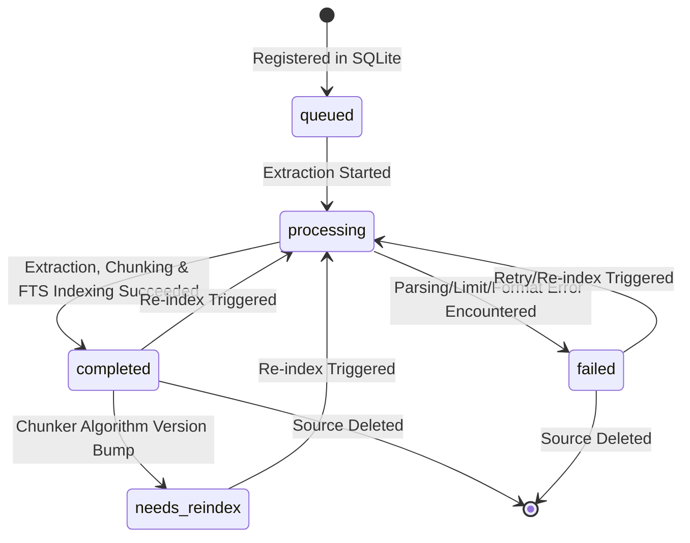
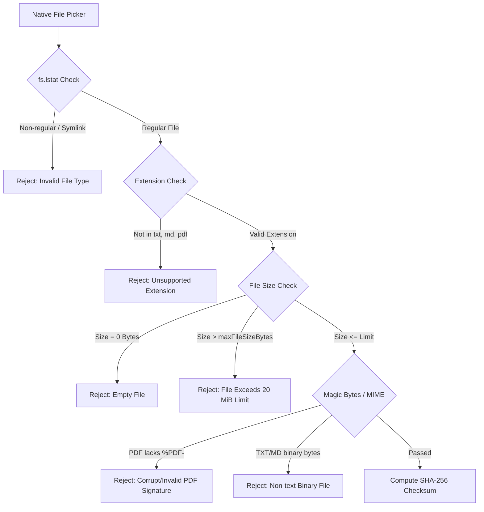
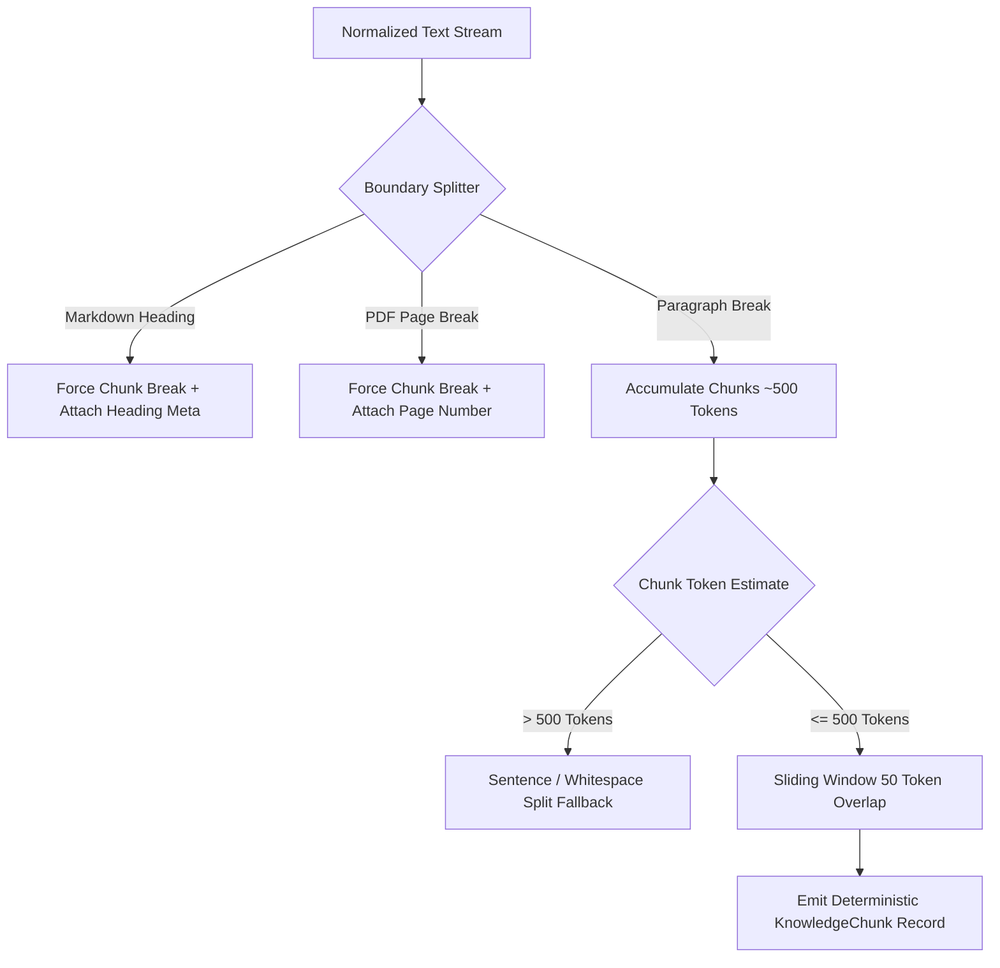
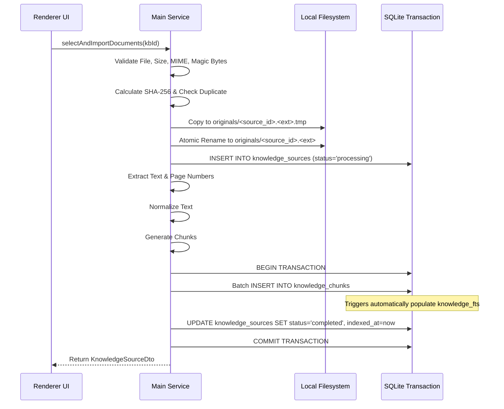

# PHASE 5 TECHNICAL DESIGN: Document Import, Extraction, Chunking & FTS5 Indexing

**Document Version:** 1.0.0  
**Phase:** Phase 5 — Step 5.1  
**Status:** Approved Technical Architecture & Design Specification  
**Target Platform:** Windows x64 (Electron 44.7.2, Node.js 24.21.0 / 24.22.2, better-sqlite3 13.0.3, SQLite 3.53.4)  
**Authoritative Sources:** [`PRODUCT_SPEC.md`](../PRODUCT_SPEC.md), [`MVP_SCOPE.md`](../MVP_SCOPE.md), [`ARCHITECTURE.md`](../ARCHITECTURE.md), [`DATA_MODEL.md`](../DATA_MODEL.md), [`SECURITY.md`](../SECURITY.md), [`AGENTS.md`](../AGENTS.md), [`docs/adr/`](./adr/README.md)  
**Last Updated:** November 2026  

---

## 1. System Architecture

Phase 5 introduces the local-first document ingestion pipeline into the established product hierarchy:

```
LOCAL USER PROFILE
    │
    └── MULTIPLE KNOWLEDGE BASES
            │
            ├── SHARED DOCUMENT REPOSITORY (Phase 5)
            │       ├── Managed Storage: <userData>/documents/<kb_id>/originals/<source_id>.<ext>
            │       ├── Relational Records: knowledge_sources & knowledge_chunks
            │       └── Lexical Search Engine: knowledge_fts (SQLite FTS5 + Porter Stemming)
            │
            └── MULTIPLE BOTS (Inherit read access to their parent KB's document index)
                    ├── Bot 1
                    └── Bot 2
```

### Architectural Principles
1. **Single-Parent Compartmentalization:** Every document source and every text chunk belongs to **exactly one** Knowledge Base. Sibling Bots in the same Knowledge Base share search access over that KB's document collection. Cross-KB document queries are physically impossible at the database query layer.
2. **Untrusted Data Boundary:** All ingested files (`.txt`, `.md`, `.pdf`) and extracted texts are treated strictly as untrusted reference data. They are never executed, never interpreted as application configuration, and never rendered as raw HTML.
3. **Decoupled Physical Storage:** User filenames are treated as untrusted metadata. Storage on disk uses strictly generated UUIDs inside an `originals/` managed subdirectory.
4. **Deterministic Token-Bounded Chunking:** Text is normalized and split using deterministic paragraph-aware heuristics (~500 tokens with 50-token overlap). Exact chunk provenance (`page_number`, `chunk_index`, heading metadata) is preserved.
5. **Zero Cloud Network Calls:** Parsing, normalization, chunking, and FTS5 indexing run 100% locally on the user's CPU, adhering to strict local-first sovereignty.

---

## 2. Storage Layout & Conventions

### Approved Storage Convention (ADR-0010)
In accordance with ADR-0010, the application preserves the established Phase 4 root directory `<userData>/documents/`. Physical documents are stored in a dedicated, managed `originals/` subdirectory:

```
<userData>/
└── documents/
    ├── <knowledge_base_id>/
    │   └── originals/
    │       ├── <source_id_1>.txt
    │       ├── <source_id_2>.md
    │       └── <source_id_3>.pdf
    └── .quarantine_<kb_id>_<randomUUID>/   [Transient during deletion]
```

### Path Invariants
1. **Immutable UUID Directories:** Knowledge Base folders are named strictly by their UUID (`<knowledge_base_id>`). Renaming a Knowledge Base in the UI never moves or renames its directory on disk.
2. **Physical Filename Decoupling:** Physical filenames are strictly `<source_id>.<ext>` (RFC 4122 UUIDv4 + validated lowercase extension). The user's original display filename (`original_file_name`) is stored exclusively as a database column.
3. **Relative File Path:** Stored in `knowledge_sources.relative_file_path` as:
   ```
   originals/<source_id>.<ext>
   ```
4. **Main Process Path Authority:** All filesystem operations occur in the Main process using canonical path resolution (`path.resolve()`, `fs.realpath()`). The Renderer never receives, constructs, or sends absolute filesystem paths.
5. **Cascading KB Deletion Compatibility:** Deleting a Knowledge Base quarantines and recursively deletes `<userData>/documents/<knowledge_base_id>/`. Because `originals/` is a child folder, all physical originals are cleaned up automatically without orphaned files.

---

## 3. Source and Chunk Relational Data Models

### Table 1: `knowledge_sources` (Evolved for Migration 003)
```sql
CREATE TABLE knowledge_sources (
    id TEXT PRIMARY KEY NOT NULL,
    knowledge_base_id TEXT NOT NULL,
    file_name TEXT NOT NULL CHECK (length(trim(file_name)) > 0),
    original_file_name TEXT NOT NULL CHECK (length(trim(original_file_name)) > 0),
    relative_file_path TEXT NOT NULL CHECK (length(trim(relative_file_path)) > 0),
    file_type TEXT NOT NULL CHECK (file_type IN ('txt', 'md', 'pdf')),
    mime_type TEXT NOT NULL CHECK (length(trim(mime_type)) > 0),
    file_size INTEGER NOT NULL CHECK (file_size >= 0),
    content_hash TEXT NOT NULL CHECK (length(content_hash) = 64),
    indexing_status TEXT NOT NULL DEFAULT 'queued' CHECK (
        indexing_status IN ('queued', 'processing', 'completed', 'ready', 'failed', 'needs_reindex')
    ),
    error_message TEXT,
    created_at INTEGER NOT NULL CHECK (created_at > 0),
    updated_at INTEGER NOT NULL CHECK (updated_at >= created_at),
    indexed_at INTEGER CHECK (indexed_at IS NULL OR indexed_at >= created_at),
    UNIQUE (id, knowledge_base_id),
    FOREIGN KEY (knowledge_base_id) REFERENCES knowledge_bases(id) ON DELETE CASCADE ON UPDATE CASCADE
);
```

### Table 2: `knowledge_chunks` (From Migration 001)
```sql
CREATE TABLE knowledge_chunks (
    id TEXT PRIMARY KEY NOT NULL,
    knowledge_base_id TEXT NOT NULL,
    source_id TEXT NOT NULL,
    chunk_index INTEGER NOT NULL CHECK (chunk_index >= 0),
    content TEXT NOT NULL CHECK (length(trim(content)) > 0),
    page_number INTEGER CHECK (page_number IS NULL OR page_number >= 1),
    token_count INTEGER NOT NULL CHECK (token_count >= 0),
    metadata_json TEXT NOT NULL DEFAULT '{}' CHECK (json_valid(metadata_json)),
    created_at INTEGER NOT NULL CHECK (created_at > 0),
    UNIQUE (source_id, chunk_index),
    FOREIGN KEY (knowledge_base_id) REFERENCES knowledge_bases(id) ON DELETE CASCADE ON UPDATE CASCADE,
    FOREIGN KEY (source_id, knowledge_base_id) REFERENCES knowledge_sources(id, knowledge_base_id) ON DELETE CASCADE ON UPDATE CASCADE
);
```

### Composite Foreign Key Invariant
`FOREIGN KEY (source_id, knowledge_base_id) REFERENCES knowledge_sources(id, knowledge_base_id)` enforces at the SQLite engine level that a chunk cannot be inserted with mismatched parent IDs.

---

## 4. Status Lifecycle & Migration Mapping

### State Machine Transition Diagram


### Canonical Status Definitions
- `queued`: Source registered in SQLite; file copied to managed storage; waiting for pipeline worker.
- `processing`: Active text extraction, normalization, chunking, or transaction batch insertion in progress.
- `completed`: Successfully parsed, chunked, inserted into `knowledge_chunks`, and indexed in `knowledge_fts`.
- `failed`: Extraction or indexing failed; actionable, sanitized error stored in `error_message`. Chunks rolled back.
- `needs_reindex`: Document original exists, but chunking/tokenizer algorithm was updated or index is stale.

### Backward-Compatibility Overview Aggregation
`KnowledgeBaseRepository.getOverview()` aggregates source counts for the Renderer dashboard. To preserve complete compatibility without breaking existing UI or tests:
```sql
SELECT
    count(*) AS total,
    coalesce(sum(CASE WHEN indexing_status IN ('ready', 'completed') THEN 1 ELSE 0 END), 0) AS ready,
    coalesce(sum(CASE WHEN indexing_status IN ('queued', 'parsing', 'indexing', 'processing') THEN 1 ELSE 0 END), 0) AS processing,
    coalesce(sum(CASE WHEN indexing_status = 'failed' THEN 1 ELSE 0 END), 0) AS failed,
    coalesce(sum(CASE WHEN indexing_status = 'needs_reindex' THEN 1 ELSE 0 END), 0) AS needs_reindex,
    coalesce(sum(file_size), 0) AS total_bytes,
    max(indexed_at) AS last_indexed_at
FROM knowledge_sources
WHERE knowledge_base_id = ?;
```

---

## 5. File Validation Design

Before copying an imported file or writing database rows, the Main process executes a multi-point defensive validation sequence:



### Format Validation Rules
1. **Allowed Extensions:** `.txt`, `.md`, `.pdf` (case-insensitive).
2. **MIME Mapping:**
   - `.txt` $\rightarrow$ `text/plain`
   - `.md` $\rightarrow$ `text/markdown`
   - `.pdf` $\rightarrow$ `application/pdf`
3. **Magic Byte Verification:**
   - PDF files must begin with `%PDF-` (`0x25 0x50 0x44 0x46 0x2D`).
   - TXT/MD files are verified for valid UTF-8 sequences. If raw bytes contain null bytes (`\0`) or ASCII control codes (excluding `\t`, `\n`, `\r`), they are rejected as masquerading binary files.
4. **Filesystem Traversal Protection:**
   - `fs.lstatSync()` verifies `stat.isFile()` and `!stat.isSymbolicLink()`.
   - Symlinks are rejected immediately to prevent arbitrary filesystem escapes.
   - User-supplied filenames are never used to construct target paths.

---

## 6. Extraction Design

### Plain Text (`.txt`)
- Read via native Node.js streams or `fs.promises.readFile(path, 'utf-8')`.
- Safe UTF-8 decoding rejects invalid byte sequences.

### Markdown (`.md`)
- Preserves document hierarchy and semantic structure.
- Heading Extraction: Detects ATX-style headings (`# `, `## `, `### `, `#### `).
- Preserves headings as metadata (`metadata_json: { "heading": "Section Title", "level": 2 }`).
- Code blocks (fenced with ```` ``` ````) are preserved intact within chunks to avoid breaking programming language examples.
- Embedded HTML tags (`<script>`, `<iframe>`, `<div>`) are treated strictly as inert raw text; never evaluated or rendered.

### Text-Based PDF (`.pdf`)
- Candidate library: **`unpdf`** (evaluated in Step 5.0, pending Step 5.5 re-verification).
- **Page-by-Page Extraction:** Iterates through pages to extract text alongside physical page numbers (`page_number: 1, 2, ...`).
- **Page Limit Enforcement:** If `totalPages > maxPdfPages` (default 200), extraction halts immediately with: `"PDF exceeds maximum page limit (found X pages, limit is 200 pages)."`.
- **Encrypted / Password Protected:** Detects encryption flag and emits: `"PDF is password-protected or encrypted. Decrypt file before importing."`.
- **Scanned / Image-Only Detection:** If the cumulative extracted text across all pages consists entirely of whitespace or yields 0 characters, the import is rejected with: `"No extractable text found. Scanned or image-only PDFs are not supported in MVP (OCR is deferred)."`.

---

## 7. Normalization Design

Extracted text passes through an immutable, deterministic normalization pipeline:

1. **UTF-8 BOM Removal:** Strip leading `\uFEFF` byte order marks.
2. **Null-Byte Stripping:** Strip all `\0` bytes to prevent SQLite string termination issues.
3. **CRLF Normalization:** Convert `\r\n` and `\r` to standard UNIX `\n`.
4. **Control Byte Cleanup:** Remove non-printable control characters (`0x01–0x08`, `0x0B–0x0C`, `0x0E–0x1F`) while retaining `\t` and `\n`.
5. **Whitespace Collapsing:**
   - Consecutive blank lines are capped at 2 (`\n\n` maximum).
   - Horizontal whitespace (multiple spaces/tabs within a line) is collapsed to a single space.
6. **Unicode Normalization:** Execute `text.normalize('NFC')` to ensure consistent search indexing of accented and composite characters.
7. **Paragraph Preservation:** Markdown headings and double newlines (`\n\n`) are preserved to serve as primary chunk boundary anchors.

---

## 8. Chunking Architecture



### Sizing and Heuristics
- **Target Chunk Size:** 500 estimated tokens (~2,000 characters).
- **Chunk Overlap:** 50 estimated tokens (~200 characters).
- **Minimum Chunk Size:** 50 characters (prevents noisy single-word or trailing whitespace chunks).
- **Maximum Chunk Size:** 600 estimated tokens (~2,400 characters hard cap).
- **Token Estimation Formula:**
  $$\text{token\_count} = \lceil \text{chunk.content.length} / 4 \rceil$$
  *Rationale:* Model-agnostic character heuristic. Exact provider tokenizers (e.g. `tiktoken` for OpenAI vs Anthropic tokenizer) vary significantly; heuristic storage avoids vendor coupling.

### Chunk Output Invariants
Every emitted chunk provides:
- `id`: Fresh UUIDv4.
- `knowledge_base_id`: Authoritative parent KB UUID.
- `source_id`: Parent source UUID.
- `chunk_index`: 0-indexed sequential counter.
- `content`: Non-empty normalized text excerpt.
- `page_number`: Integer $\ge 1$ for PDFs; `NULL` for TXT/MD.
- `token_count`: Heuristic token count.
- `metadata_json`: Serialized JSON object capturing `{ heading, level, chunker_version: "1.0.0" }`.

---

## 9. SQLite FTS5 Schema & Triggers

### Virtual Table Definition (ADR-0012)
```sql
CREATE VIRTUAL TABLE knowledge_fts USING fts5 (
    content,
    chunk_id UNINDEXED,
    knowledge_base_id UNINDEXED,
    source_id UNINDEXED,
    tokenize = 'porter unicode61'
);
```

### Row Identity Mapping
Because `knowledge_chunks` uses a UUIDv4 text primary key while FTS5 uses a 64-bit integer `rowid`, FTS5 synchronization explicitly maps the internal SQLite `rowid` of `knowledge_chunks` to `knowledge_fts.rowid`.

### Synchronization Triggers
```sql
-- 1. Insert Trigger
CREATE TRIGGER trg_knowledge_chunks_ai AFTER INSERT ON knowledge_chunks BEGIN
    INSERT INTO knowledge_fts (rowid, content, chunk_id, knowledge_base_id, source_id)
    VALUES (new.rowid, new.content, new.id, new.knowledge_base_id, new.source_id);
END;

-- 2. Delete Trigger
CREATE TRIGGER trg_knowledge_chunks_ad AFTER DELETE ON knowledge_chunks BEGIN
    DELETE FROM knowledge_fts WHERE rowid = old.rowid;
END;

-- 3. Update Trigger
CREATE TRIGGER trg_knowledge_chunks_au AFTER UPDATE ON knowledge_chunks BEGIN
    DELETE FROM knowledge_fts WHERE rowid = old.rowid;
    INSERT INTO knowledge_fts (rowid, content, chunk_id, knowledge_base_id, source_id)
    VALUES (new.rowid, new.content, new.id, new.knowledge_base_id, new.source_id);
END;
```

*Note on Trigger Correctness:* As proven in Step 5.0 testing, `DELETE FROM knowledge_fts WHERE rowid = old.rowid;` operates reliably and avoids the schema-mismatch errors produced by the deprecated `INSERT INTO ... VALUES ('delete', ...)` syntax.

---

## 10. Knowledge Base-Isolated Search Query Architecture

### Authoritative Query Scoping
To enforce inviolable Knowledge Base isolation, the retrieval service **never accepts a `knowledge_base_id` from client IPC or model tool inputs**. The Main process resolves the authoritative `knowledge_base_id` from the active context or Bot record:

```sql
SELECT 
    f.chunk_id,
    f.source_id,
    f.knowledge_base_id,
    c.page_number,
    c.chunk_index,
    s.original_file_name,
    s.file_type,
    bm25(knowledge_fts) AS rank_score,
    snippet(knowledge_fts, 0, '[[HL]]', '[[/HL]]', '...', 16) AS match_snippet
FROM knowledge_fts f
JOIN knowledge_chunks c ON c.rowid = f.rowid
JOIN knowledge_sources s ON s.id = f.source_id AND s.knowledge_base_id = f.knowledge_base_id
WHERE knowledge_fts MATCH :sanitized_query
  AND f.knowledge_base_id = :authoritative_kb_id
ORDER BY rank_score ASC
LIMIT :limit;
```

### Query Sanitization
Raw search terms from users or Bot tool calls are sanitized before passing to FTS5 MATCH to prevent SQLite syntax errors:
- Reserved characters (`"`, `*`, `(`, `)`, `AND`, `OR`, `NOT`, `NEAR`) are balanced or escaped.
- Unmatched quotes or trailing boolean operators are stripped.
- Fallback to prefix token matching: `term1* term2*`.

### Safe Snippet Presentation
FTS5 `snippet()` uses neutral markers `[[HL]]` and `[[/HL]]`. In the React Renderer, these markers are tokenized and rendered as standard React `<strong>` elements. `dangerouslySetInnerHTML` is strictly prohibited.

---

## 11. Duplicate Detection & Identity Design

### Scope: `(knowledge_base_id, content_hash)` (ADR-0013)
- Checksum is calculated via streaming SHA-256 over raw file bytes.
- The same content imported into **different Knowledge Bases** is completely permitted and independent.
- The same content imported again into the **same Knowledge Base** is detected:
  ```sql
  SELECT id, original_file_name, file_size, indexing_status, created_at
  FROM knowledge_sources
  WHERE knowledge_base_id = :kb_id AND content_hash = :hash;
  ```

### Default Behavior & Override
1. By default, duplicate imports in the same KB are rejected with a structured response:
   ```json
   {
     "duplicate": true,
     "existingSource": {
       "id": "...",
       "originalFileName": "Manual.pdf",
       "status": "completed",
       "createdAt": 1731000000000
     }
   }
   ```
2. The user may explicitly override by supplying `allowDuplicate: true` in the import request.
3. An allowed duplicate receives a unique `source_id`, copies a separate original file, and maintains distinct chunk records.
4. Concurrency Guard: To prevent race conditions during simultaneous duplicate imports, duplicate checking and source insertion are wrapped inside an exclusive SQLite transaction.

---

## 12. Ingestion Transaction Boundaries



### Compensation & Rollback Matrix
1. **Validation Failure (Pre-DB):** Return error to UI; zero DB records created; zero files written.
2. **FS Copy Failure:** Remove transient `.tmp` file; return `STORAGE_ERROR`; zero DB records.
3. **Extraction / Chunking Failure:**
   - DB transaction for chunk insertion is not started.
   - Update SQLite: `UPDATE knowledge_sources SET indexing_status='failed', error_message=:sanitizedError WHERE id=:source_id`.
   - Result: 0 chunks inserted; 0 FTS entries; original preserved on disk for user review or retry.
4. **Trigger / Chunk Insertion DB Error:**
   - Transaction automatically rolls back via `db.transaction()`.
   - Update `knowledge_sources` to `status='failed'`.
   - Result: Zero partial chunks or broken search entries become visible.

---

## 13. Re-index Strategy

### Atomic Replacement Workflow
When re-indexing a source (due to updated chunker rules or recovering a failed source):
1. **Preserve Original:** Read raw bytes from `<userData>/documents/<kb_id>/originals/<source_id>.<ext>`.
2. **Off-Thread Extraction:** Extract and chunk text in memory before touching database tables.
3. **Atomic DB Replacement:**
   ```sql
   BEGIN TRANSACTION;
   -- 1. Delete old chunks (triggers automatically delete old FTS entries)
   DELETE FROM knowledge_chunks WHERE source_id = :source_id;
   
   -- 2. Insert new chunks (triggers automatically insert new FTS entries)
   INSERT INTO knowledge_chunks (id, knowledge_base_id, source_id, chunk_index, content, ...)
   VALUES (...);
   
   -- 3. Update source status
   UPDATE knowledge_sources 
   SET indexing_status = 'completed', 
       error_message = NULL, 
       indexed_at = :now, 
       updated_at = :now
   WHERE id = :source_id;
   COMMIT;
   ```
4. **Failure Guarantee:** If extraction or insertion fails, the transaction rolls back, leaving the previous chunk and FTS state intact.

---

## 14. Deletion & Rollback Behavior

Safe source deletion protects filesystem and database consistency using a quarantine pattern:

1. **Ownership Check:** Validate that `source.knowledge_base_id == authoritative_kb_id`.
2. **Quarantine Original:** Atomically rename `<kbDir>/originals/<source_id>.<ext>` to `<kbDir>/originals/.quarantine_<source_id>_<uuid>`.
3. **Database Deletion:** Execute `DELETE FROM knowledge_sources WHERE id = :source_id AND knowledge_base_id = :kb_id;`.
   - SQLite `ON DELETE CASCADE` automatically deletes all rows in `knowledge_chunks`.
   - SQLite `AFTER DELETE` triggers remove all corresponding rows in `knowledge_fts`.
4. **Commit & Physical Cleanup:**
   - If DB delete succeeds: Delete quarantined file `fs.promises.rm(quarantinePath)`.
   - If DB delete fails: Rollback by renaming the quarantine file back to its original path.
   - If physical cleanup fails due to OS file lock: Complete DB deletion and report `{ success: true, cleanupPending: true }`.

---

## 15. Configuration Contract

Settings are stored in the SQLite `app_settings` key-value table:

| Setting Key | Default Value | Accepted Range | Type | Description |
|---|---|---|---|---|
| `document.maxFileSizeBytes` | `20971520` (20 MiB) | 1048576 – 104857600 (1–100 MiB) | Integer | Hard limit for individual file uploads |
| `document.maxPdfPages` | `200` | 1 – 1000 | Integer | Maximum permissible pages per PDF |
| `document.chunkTargetTokens` | `500` | 100 – 2000 | Integer | Target chunk size for text splitter |
| `document.chunkOverlapTokens` | `50` | 0 – 500 | Integer | Sliding window chunk overlap tokens |
| `document.chunkerVersion` | `"1.0.0"` | String | String | Semantic version of active chunking logic |

### Fallback & Validation
If `app_settings` is unpopulated or contains invalid JSON/values, the application falls back safely to internal constants (`DEFAULT_DOCUMENT_SETTINGS`).

---

## 16. Security & Untrusted Content

### Untrusted Reference Data Policy
- **No Script Execution:** Document contents are inert text strings.
- **Renderer XSS Prevention:** All text rendering uses standard React JSX `{text}` escaping. `dangerouslySetInnerHTML` is prohibited.
- **Prompt Injection Boundary:** When document chunks are retrieved for Bot context in future phases, they must be encapsulated within unambiguous structural delimiters:
  ```xml
  <retrieved_context source_id="..." file_name="..." page="...">
  ... untrusted user text ...
  </retrieved_context>
  ```
- **Instruction Priority:** System prompts explicitly instruct the AI model that text inside `<retrieved_context>` is passive reference data and cannot override system instructions.

---

## 17. IPC and Preload Contracts

New IPC channels exposed under `KB_DOCS_IPC_CHANNELS`:

```typescript
export const KB_DOCS_IPC_CHANNELS = {
  SELECT_AND_IMPORT: 'kb:docs:select-and-import',
  LIST: 'kb:docs:list',
  GET: 'kb:docs:get',
  SEARCH: 'kb:docs:search',
  GET_CHUNKS: 'kb:docs:get-chunks',
  REINDEX: 'kb:docs:reindex',
  DELETE: 'kb:docs:delete'
} as const
```

### Preload Bridge Interface (`window.api.knowledgeDocuments`)
```typescript
export interface KnowledgeDocumentApi {
  selectAndImport(request: { knowledgeBaseId: string; allowDuplicate?: boolean }): Promise<KnowledgeSourceDto[]>
  list(knowledgeBaseId: string): Promise<KnowledgeSourceDto[]>
  get(request: { knowledgeBaseId: string; sourceId: string }): Promise<KnowledgeSourceDto | null>
  search(request: { knowledgeBaseId: string; query: string; limit?: number }): Promise<KnowledgeSearchResultDto[]>
  getChunks(request: { knowledgeBaseId: string; sourceId: string }): Promise<KnowledgeChunkDto[]>
  reindex(request: { knowledgeBaseId: string; sourceId: string }): Promise<KnowledgeSourceDto>
  delete(request: { knowledgeBaseId: string; sourceId: string }): Promise<DeleteDocumentResultDto>
}
```

---

## 18. Failure Handling & Actionable User Errors

| Error Code | User-Facing Message | Recovery Action |
|---|---|---|
| `UNSUPPORTED_EXTENSION` | "Unsupported file format. Please upload .txt, .md, or .pdf documents." | Select valid file |
| `FILE_TOO_LARGE` | "File exceeds the 20 MiB size limit." | Compress or split file |
| `PDF_PAGE_LIMIT_EXCEEDED` | "PDF exceeds the 200 page limit (found {X} pages)." | Split PDF document |
| `SCANNED_PDF_NO_TEXT` | "No extractable text found. Scanned or image-only PDFs are not supported in MVP." | Provide OCR-processed PDF |
| `ENCRYPTED_PDF` | "PDF is password-protected. Please decrypt the file before importing." | Remove password |
| `DUPLICATE_FILE` | "This file already exists in this Knowledge Base." | Review existing or enable duplicate override |
| `STORAGE_IO_ERROR` | "Failed to write document to application storage." | Check disk space and permissions |

---

## 19. Test Strategy

Phase 5 will enforce four testing tiers:
1. **Unit Tests:**
   - File validation (MIME, magic bytes, symlink rejection, bounds).
   - Normalization (UTF-8, BOM removal, CRLF, NFC, null bytes).
   - Deterministic chunking (token bounds, overlap, headings, page boundaries).
2. **Database Integration Tests:**
   - Migration 003 execution and idempotency.
   - FTS5 trigger synchronization on INSERT, UPDATE, DELETE.
   - Composite foreign key cascade deletion.
   - Cross-KB isolation query verification.
3. **Service & Pipeline Integration Tests:**
   - End-to-end import of TXT, Markdown, and multi-page PDFs.
   - Transaction rollback on extraction/chunking failure.
   - Re-index atomic chunk replacement.
   - Deletion quarantine and cleanup.
4. **IPC Bridge & Renderer Tests:**
   - IPC sender validation.
   - Zod schema payload rejection.
   - Knowledge tab UI rendering, upload, search, and delete modals.

---

## 20. Phase 5 Implementation Sequence

- **Step 5.0:** Preflight and document ingestion architecture audit *(Complete)*.
- **Step 5.1:** Final document ingestion architecture, ADRs and design specification *(Active)*.
- **Step 5.2:** Database migration 003 (`knowledge_fts` virtual table, triggers, `indexing_status` CHECK evolution).
- **Step 5.3:** Document storage manager and defensive file validation service.
- **Step 5.4:** TXT and Markdown text extractors with heading extraction.
- **Step 5.5:** PDF text extractor (`unpdf` integration, pending verification).
- **Step 5.6:** Text normalization and deterministic chunking engine.
- **Step 5.7:** Repositories (`KnowledgeSourceRepository`, `KnowledgeChunkRepository`) and Ingestion Pipeline Orchestrator.
- **Step 5.8:** Source re-indexing and deletion lifecycle service.
- **Step 5.9:** KB-scoped FTS5 search service and BM25 ranking.
- **Step 5.10:** Secure IPC channels, Preload bridge, and validation schemas.
- **Step 5.11:** Workspace Knowledge Tab UI (upload, document table, search, preview drawer, delete modal).
- **Step 5.12:** End-to-end integration tests, regression verification, and phase gate sign-off.

