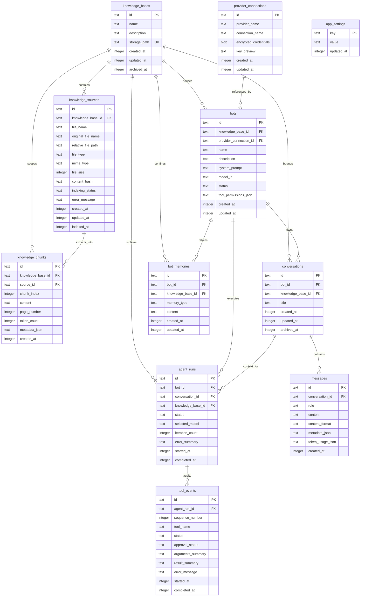

# CORE SCHEMA SPECIFICATION: 11 RELATIONAL TABLES

**Document Version:** 1.0.0  
**Phase:** Phase 2 — Step 2.4A  
**Status:** Approved Technical Specification for Migration 001  
**Target Platform:** Electron 44.10.2, Node.js 24.21.0, better-sqlite3 13.0.3, SQLite 3.53.4  
**Authoritative Sources:** [`docs/database/PHASE_2_DATABASE_DESIGN.md`](./PHASE_2_DATABASE_DESIGN.md), [`PRODUCT_SPEC.md`](../../PRODUCT_SPEC.md), [`MVP_SCOPE.md`](../../MVP_SCOPE.md), [`ARCHITECTURE.md`](../../ARCHITECTURE.md), [`DATA_MODEL.md`](../../DATA_MODEL.md), [`SECURITY.md`](../../SECURITY.md), [`AGENTS.md`](../../AGENTS.md)  
**Last Updated:** November 2026  

---

## 1. Schema Design Overview

This document specifies the authoritative, implementation-ready relational schema for the **11 core application tables** of the **Local-First Multi-Model AI Agent Workspace**. This specification serves as the direct technical blueprint for the initial database schema migration (`001_initial_schema.sql` in Step 2.4B).

### 1.1 Architectural Purpose & Boundaries
1. **Single-Node Desktop Custody:** All entities reside in `<userData>/database/app.sqlite`, owned exclusively by the Electron Main process.
2. **Immutable Product Tree:** Enforces the one-to-many relationship:
   ```
   LOCAL USER PROFILE
       │
       └── MULTIPLE KNOWLEDGE BASES
               │
               ├── KNOWLEDGE BASE 1
               │       ├── BOT 1 (e.g., Lead Developer)
               │       ├── BOT 2 (e.g., Code Reviewer)
               │       └── BOT N
               │
               └── KNOWLEDGE BASE 2
                       └── BOT 1 (e.g., Compliance Officer)
   ```
3. **Database-Enforced Knowledge Base Isolation:** Structural cross-KB firewalls are built directly into SQLite foreign keys using composite constraints `(parent_id, knowledge_base_id)`.
4. **Decoupled Physical Storage:** Document file bytes (`.pdf`, `.md`, `.txt`) reside in `<userData>/documents/<knowledge_base_id>/`. SQLite manages relational metadata, extracted token-bounded chunks, configurations, and agent execution audit logs.
5. **Hardware-Backed Credential Security:** Zero plaintext API keys in SQLite. Credentials exist at rest as binary `BLOB` ciphertext produced by Electron `safeStorage`.

---

## 2. Open Decisions and Architectural Confirmations

The four open decisions identified in Step 2.0 ([`docs/database/PHASE_2_DATABASE_DESIGN.md`](./PHASE_2_DATABASE_DESIGN.md)) are resolved as follows:

| Open Decision ID | Topic | Resolution for MVP | Architectural Rationale |
|---|---|---|---|
| **OD-2.0-1** | **Timestamp Format** | **UTC Unix Milliseconds (`INTEGER NOT NULL`)** | Compact 8-byte storage (vs 24–27 bytes for ISO text), ultra-fast numeric B-tree comparisons/sorting, direct alignment with JavaScript `Date.now()` and typed IPC contracts (`timestamp: number`), timezone-independent UTC instants. Converted to localized ISO-8601 strings in UI presentation layers. |
| **OD-2.0-2** | **Bot Tool Permissions** | **JSON Array Column (`tool_permissions_json TEXT`)** | Simplifies Bot CRUD operations for the fixed 6-tool MVP suite without multi-table joins. Enforces `CHECK (json_valid(tool_permissions_json))` at SQLite level and strict Zod validation in Main. A normalized `bot_tool_permissions` table can be introduced in a future migration if relational joins become necessary. |
| **OD-2.0-3** | **Native Vitest Testing** | **Host Node.js with Prebuilt N-API Binaries** | `better-sqlite3@13.0.3` ships with official prebuilt N-API binaries (`node-addon-api@8.9.2`) that execute seamlessly under host Node.js (`v24.21.0`) and Electron (`44.10.2`). All unit tests run fast in host Node.js without requiring mock wrappers. Packaged binary verification is reserved for Step 2.8. |
| **OD-2.0-4** | **FTS5 Deferral** | **Deferred to Phase 7 (Document Ingestion)** | The FTS5 virtual table (`knowledge_fts`) and its synchronization triggers are omitted from Migration 001. Document parsing and RAG ingestion do not activate until Phase 7. Deferring FTS5 simplifies initial migrations, isolates testing, and enables forward migration `002_add_fts5.sql` in Phase 7. |

---

## 3. Complete Specifications for All 11 Core Tables

### 3.1 Table 1: `knowledge_bases`
**Purpose:** Root container for an isolated knowledge domain, document repository, and resident Bots.

```sql
CREATE TABLE knowledge_bases (
    id TEXT PRIMARY KEY NOT NULL,
    name TEXT NOT NULL CHECK (length(trim(name)) > 0),
    description TEXT NOT NULL DEFAULT '',
    storage_path TEXT NOT NULL UNIQUE CHECK (length(trim(storage_path)) > 0),
    created_at INTEGER NOT NULL CHECK (created_at > 0),
    updated_at INTEGER NOT NULL CHECK (updated_at >= created_at),
    archived_at INTEGER CHECK (archived_at IS NULL OR archived_at >= created_at)
);
```

#### Column Details
| Column Name | SQLite Type | Nullable | Default | Constraints | Description |
|---|---|---|---|---|---|
| `id` | `TEXT` | `NOT NULL` | None | `PRIMARY KEY` | RFC 4122 canonical UUIDv4 string. |
| `name` | `TEXT` | `NOT NULL` | None | `CHECK (length(trim(name)) > 0)` | Human-readable workspace display name. |
| `description`| `TEXT` | `NOT NULL` | `''` | None | Optional description of the Knowledge Base. |
| `storage_path`| `TEXT` | `NOT NULL` | None | `UNIQUE`, `CHECK (length(trim(storage_path)) > 0)` | Relative directory path (e.g. `documents/kb_<uuid>`). |
| `created_at` | `INTEGER` | `NOT NULL` | None | `CHECK (created_at > 0)` | UTC Unix timestamp (ms) of creation. |
| `updated_at` | `INTEGER` | `NOT NULL` | None | `CHECK (updated_at >= created_at)` | UTC Unix timestamp (ms) of latest update. |
| `archived_at` | `INTEGER` | `NULLABLE` | `NULL` | `CHECK (archived_at >= created_at)` | Soft-archival timestamp (ms); active if `NULL`. |

- **Indexes:**
  - `idx_knowledge_bases_created_at ON knowledge_bases(created_at DESC)`
- **Deletion Policy:** Deleting a Knowledge Base initiates cascading deletion across all child sources, chunks, bots, conversations, messages, agent runs, tool events, and memories. Document filesystem directory is removed by Main process service.

---

### 3.2 Table 2: `knowledge_sources`
**Purpose:** Metadata for physical source files (`.txt`, `.md`, `.pdf`) ingested into a Knowledge Base.

```sql
CREATE TABLE knowledge_sources (
    id TEXT PRIMARY KEY NOT NULL,
    knowledge_base_id TEXT NOT NULL,
    file_name TEXT NOT NULL CHECK (length(trim(file_name)) > 0),
    original_file_name TEXT NOT NULL CHECK (length(trim(original_file_name)) > 0),
    relative_file_path TEXT NOT NULL CHECK (length(trim(relative_file_path)) > 0),
    file_type TEXT NOT NULL CHECK (file_type IN ('txt', 'md', 'pdf')),
    mime_type TEXT NOT NULL CHECK (length(trim(mime_type)) > 0),
    file_size INTEGER NOT NULL CHECK (file_size >= 0),
    content_hash TEXT NOT NULL CHECK (length(content_hash) = 64),
    indexing_status TEXT NOT NULL DEFAULT 'queued' CHECK (indexing_status IN ('queued', 'parsing', 'indexing', 'ready', 'failed')),
    error_message TEXT,
    created_at INTEGER NOT NULL CHECK (created_at > 0),
    updated_at INTEGER NOT NULL CHECK (updated_at >= created_at),
    indexed_at INTEGER CHECK (indexed_at IS NULL OR indexed_at >= created_at),
    UNIQUE (id, knowledge_base_id),
    FOREIGN KEY (knowledge_base_id) REFERENCES knowledge_bases(id) ON DELETE CASCADE ON UPDATE CASCADE
);
```

#### Column Details
| Column Name | SQLite Type | Nullable | Default | Constraints | Description |
|---|---|---|---|---|---|
| `id` | `TEXT` | `NOT NULL` | None | `PRIMARY KEY` | RFC 4122 UUIDv4 document source identifier. |
| `knowledge_base_id` | `TEXT` | `NOT NULL` | None | FK to `knowledge_bases(id)` | Parent Knowledge Base identifier. |
| `file_name` | `TEXT` | `NOT NULL` | None | `CHECK (length(trim(file_name)) > 0)` | Internal filename inside KB document folder. |
| `original_file_name` | `TEXT` | `NOT NULL` | None | `CHECK (length(trim(original_file_name)) > 0)` | User's original uploaded filename. |
| `relative_file_path` | `TEXT` | `NOT NULL` | None | `CHECK (length(trim(relative_file_path)) > 0)` | Sandboxed relative path within `<userData>/documents/`. |
| `file_type` | `TEXT` | `NOT NULL` | None | `CHECK (file_type IN ('txt', 'md', 'pdf'))` | Whitelisted file extension. |
| `mime_type` | `TEXT` | `NOT NULL` | None | `CHECK (length(trim(mime_type)) > 0)` | MIME content type (e.g. `application/pdf`). |
| `file_size` | `INTEGER` | `NOT NULL` | None | `CHECK (file_size >= 0)` | File byte length on disk. |
| `content_hash` | `TEXT` | `NOT NULL` | None | `CHECK (length(content_hash) = 64)` | SHA-256 digest of original raw file content. |
| `indexing_status` | `TEXT` | `NOT NULL` | `'queued'` | `CHECK (indexing_status IN ('queued', 'parsing', 'indexing', 'ready', 'failed'))` | Ingestion state machine status. |
| `error_message` | `TEXT` | `NULLABLE` | `NULL` | None | Error log details if indexing failed. |
| `created_at` | `INTEGER` | `NOT NULL` | None | `CHECK (created_at > 0)` | UTC Unix timestamp (ms) of registration. |
| `updated_at` | `INTEGER` | `NOT NULL` | None | `CHECK (updated_at >= created_at)` | UTC Unix timestamp (ms) of latest status update. |
| `indexed_at` | `INTEGER` | `NULLABLE` | `NULL` | `CHECK (indexed_at >= created_at)` | UTC Unix timestamp (ms) when indexing reached `ready`. |

- **Table Constraints:**
  - `UNIQUE (id, knowledge_base_id)`: **Mandatory** parent target for composite foreign keys from `knowledge_chunks`.
- **Indexes:**
  - `idx_knowledge_sources_kb ON knowledge_sources(knowledge_base_id)`
  - `idx_knowledge_sources_status ON knowledge_sources(knowledge_base_id, indexing_status)`
  - `idx_knowledge_sources_hash ON knowledge_sources(knowledge_base_id, content_hash)`

---

### 3.3 Table 3: `knowledge_chunks`
**Purpose:** Token-bounded parsed text excerpts extracted from a knowledge source.

```sql
CREATE TABLE knowledge_chunks (
    id TEXT PRIMARY KEY NOT NULL,
    knowledge_base_id TEXT NOT NULL,
    source_id TEXT NOT NULL,
    chunk_index INTEGER NOT NULL CHECK (chunk_index >= 0),
    content TEXT NOT NULL CHECK (length(trim(content)) > 0),
    page_number INTEGER CHECK (page_number IS NULL OR page_number >= 1),
    token_count INTEGER NOT NULL CHECK (token_count >= 0),
    metadata_json TEXT NOT NULL DEFAULT '{}' CHECK (json_valid(metadata_json)),
    created_at INTEGER NOT NULL CHECK (created_at > 0),
    UNIQUE (source_id, chunk_index),
    FOREIGN KEY (knowledge_base_id) REFERENCES knowledge_bases(id) ON DELETE CASCADE ON UPDATE CASCADE,
    FOREIGN KEY (source_id, knowledge_base_id) REFERENCES knowledge_sources(id, knowledge_base_id) ON DELETE CASCADE ON UPDATE CASCADE
);
```

#### Column Details
| Column Name | SQLite Type | Nullable | Default | Constraints | Description |
|---|---|---|---|---|---|
| `id` | `TEXT` | `NOT NULL` | None | `PRIMARY KEY` | RFC 4122 UUIDv4 chunk identifier. |
| `knowledge_base_id` | `TEXT` | `NOT NULL` | None | FK to `knowledge_bases(id)` | Authoritative parent KB identifier. |
| `source_id` | `TEXT` | `NOT NULL` | None | Composite FK to `knowledge_sources` | Parent document source identifier. |
| `chunk_index` | `INTEGER` | `NOT NULL` | None | `CHECK (chunk_index >= 0)` | 0-indexed sequential order within the source file. |
| `content` | `TEXT` | `NOT NULL` | None | `CHECK (length(trim(content)) > 0)` | Raw extracted text excerpt. |
| `page_number` | `INTEGER` | `NULLABLE` | `NULL` | `CHECK (page_number >= 1)` | Physical page number for PDF sources. |
| `token_count` | `INTEGER` | `NOT NULL` | None | `CHECK (token_count >= 0)` | Estimated token length for prompt budget calculation. |
| `metadata_json` | `TEXT` | `NOT NULL` | `'{}'` | `CHECK (json_valid(metadata_json))` | JSON metadata (headings, bounding boxes). |
| `created_at` | `INTEGER` | `NOT NULL` | None | `CHECK (created_at > 0)` | UTC Unix timestamp (ms) of chunk extraction. |

- **Table Constraints:**
  - `UNIQUE (source_id, chunk_index)`: Guarantees unique chunk sequence per source document.
  - `FOREIGN KEY (source_id, knowledge_base_id) REFERENCES knowledge_sources(id, knowledge_base_id) ON DELETE CASCADE ON UPDATE CASCADE`: **Composite Foreign Key** preventing cross-KB chunk assignment.
- **Indexes:**
  - `idx_knowledge_chunks_kb ON knowledge_chunks(knowledge_base_id)`
  - `idx_knowledge_chunks_source ON knowledge_chunks(source_id)`

---

### 3.4 Table 4: `provider_connections`
**Purpose:** Reusable Bring-Your-Own-Key (BYOK) AI provider connections holding OS-encrypted credentials. Managed at the user/application scope.

```sql
CREATE TABLE provider_connections (
    id TEXT PRIMARY KEY NOT NULL,
    provider_name TEXT NOT NULL CHECK (provider_name IN ('openai', 'anthropic', 'google', 'xai', 'openrouter')),
    connection_name TEXT NOT NULL CHECK (length(trim(connection_name)) > 0),
    encrypted_credentials BLOB NOT NULL,
    key_preview TEXT NOT NULL DEFAULT '',
    created_at INTEGER NOT NULL CHECK (created_at > 0),
    updated_at INTEGER NOT NULL CHECK (updated_at >= created_at)
);
```

#### Column Details
| Column Name | SQLite Type | Nullable | Default | Constraints | Description |
|---|---|---|---|---|---|
| `id` | `TEXT` | `NOT NULL` | None | `PRIMARY KEY` | RFC 4122 UUIDv4 connection identifier. |
| `provider_name` | `TEXT` | `NOT NULL` | None | `CHECK (provider_name IN ('openai', 'anthropic', 'google', 'xai', 'openrouter'))` | Supported provider identifier. |
| `connection_name`| `TEXT` | `NOT NULL` | None | `CHECK (length(trim(connection_name)) > 0)` | User-defined label (e.g. "Work Anthropic Key"). |
| `encrypted_credentials`| `BLOB` | `NOT NULL` | None | None | OS-encrypted ciphertext from Electron `safeStorage`. |
| `key_preview` | `TEXT` | `NOT NULL` | `''` | None | Non-sensitive preview (e.g. `sk-...4a89`) for UI display. |
| `created_at` | `INTEGER` | `NOT NULL` | None | `CHECK (created_at > 0)` | UTC Unix timestamp (ms) of key creation. |
| `updated_at` | `INTEGER` | `NOT NULL` | None | `CHECK (updated_at >= created_at)` | UTC Unix timestamp (ms) of latest update. |

- **Indexes:**
  - `idx_provider_connections_provider ON provider_connections(provider_name)`
- **Deletion Policy:** Referenced by `bots` via `ON DELETE RESTRICT`. A connection cannot be deleted if active Bots still reference it.

---

### 3.5 Table 5: `bots`
**Purpose:** Persistent, specialized AI reasoning persona configured within a single Knowledge Base.

```sql
CREATE TABLE bots (
    id TEXT PRIMARY KEY NOT NULL,
    knowledge_base_id TEXT NOT NULL,
    provider_connection_id TEXT,
    name TEXT NOT NULL CHECK (length(trim(name)) > 0),
    description TEXT NOT NULL DEFAULT '',
    system_prompt TEXT NOT NULL DEFAULT '',
    model_id TEXT NOT NULL CHECK (length(trim(model_id)) > 0),
    status TEXT NOT NULL DEFAULT 'active' CHECK (status IN ('active', 'archived')),
    tool_permissions_json TEXT NOT NULL DEFAULT '[]' CHECK (json_valid(tool_permissions_json)),
    created_at INTEGER NOT NULL CHECK (created_at > 0),
    updated_at INTEGER NOT NULL CHECK (updated_at >= created_at),
    UNIQUE (id, knowledge_base_id),
    FOREIGN KEY (knowledge_base_id) REFERENCES knowledge_bases(id) ON DELETE CASCADE ON UPDATE CASCADE,
    FOREIGN KEY (provider_connection_id) REFERENCES provider_connections(id) ON DELETE RESTRICT ON UPDATE CASCADE
);
```

#### Column Details
| Column Name | SQLite Type | Nullable | Default | Constraints | Description |
|---|---|---|---|---|---|
| `id` | `TEXT` | `NOT NULL` | None | `PRIMARY KEY` | RFC 4122 UUIDv4 Bot persona identifier. |
| `knowledge_base_id` | `TEXT` | `NOT NULL` | None | FK to `knowledge_bases(id)` | Authoritative parent Knowledge Base. |
| `provider_connection_id` | `TEXT` | `NULLABLE` | `NULL` | FK to `provider_connections(id)` | Assigned BYOK provider key. |
| `name` | `TEXT` | `NOT NULL` | None | `CHECK (length(trim(name)) > 0)` | Display name of the Bot. |
| `description` | `TEXT` | `NOT NULL` | `''` | None | Purpose and specialization notes. |
| `system_prompt` | `TEXT` | `NOT NULL` | `''` | None | Base system instructions defining persona. |
| `model_id` | `TEXT` | `NOT NULL` | None | `CHECK (length(trim(model_id)) > 0)` | Target LLM model string (e.g. `claude-3-5-sonnet-20241022`). |
| `status` | `TEXT` | `NOT NULL` | `'active'` | `CHECK (status IN ('active', 'archived'))` | Operational state. |
| `tool_permissions_json`| `TEXT` | `NOT NULL` | `'[]'` | `CHECK (json_valid(tool_permissions_json))` | JSON array of granted tool identifiers. |
| `created_at` | `INTEGER` | `NOT NULL` | None | `CHECK (created_at > 0)` | UTC Unix timestamp (ms) of creation. |
| `updated_at` | `INTEGER` | `NOT NULL` | None | `CHECK (updated_at >= created_at)` | UTC Unix timestamp (ms) of latest update. |

- **Table Constraints:**
  - `UNIQUE (id, knowledge_base_id)`: **Mandatory** parent target for composite foreign keys from `conversations`, `agent_runs`, and `bot_memories`.
- **Indexes:**
  - `idx_bots_kb ON bots(knowledge_base_id)`
  - `idx_bots_provider ON bots(provider_connection_id)`

---

### 3.6 Table 6: `conversations`
**Purpose:** Dedicated chat session thread belonging to a Bot.

```sql
CREATE TABLE conversations (
    id TEXT PRIMARY KEY NOT NULL,
    bot_id TEXT NOT NULL,
    knowledge_base_id TEXT NOT NULL,
    title TEXT NOT NULL DEFAULT 'New Conversation' CHECK (length(trim(title)) > 0),
    created_at INTEGER NOT NULL CHECK (created_at > 0),
    updated_at INTEGER NOT NULL CHECK (updated_at >= created_at),
    archived_at INTEGER CHECK (archived_at IS NULL OR archived_at >= created_at),
    UNIQUE (id, knowledge_base_id),
    FOREIGN KEY (knowledge_base_id) REFERENCES knowledge_bases(id) ON DELETE CASCADE ON UPDATE CASCADE,
    FOREIGN KEY (bot_id, knowledge_base_id) REFERENCES bots(id, knowledge_base_id) ON DELETE CASCADE ON UPDATE CASCADE
);
```

#### Column Details
| Column Name | SQLite Type | Nullable | Default | Constraints | Description |
|---|---|---|---|---|---|
| `id` | `TEXT` | `NOT NULL` | None | `PRIMARY KEY` | RFC 4122 UUIDv4 conversation thread identifier. |
| `bot_id` | `TEXT` | `NOT NULL` | None | Composite FK to `bots` | Owning Bot identifier. |
| `knowledge_base_id` | `TEXT` | `NOT NULL` | None | Composite FK to `bots` & FK to `knowledge_bases` | Authoritative parent KB identifier. |
| `title` | `TEXT` | `NOT NULL` | `'New Conversation'` | `CHECK (length(trim(title)) > 0)` | Display title of the chat thread. |
| `created_at` | `INTEGER` | `NOT NULL` | None | `CHECK (created_at > 0)` | UTC Unix timestamp (ms) when thread was started. |
| `updated_at` | `INTEGER` | `NOT NULL` | None | `CHECK (updated_at >= created_at)` | UTC Unix timestamp (ms) of latest message. |
| `archived_at` | `INTEGER` | `NULLABLE` | `NULL` | `CHECK (archived_at >= created_at)` | Soft-archival timestamp (ms). |

- **Table Constraints:**
  - `UNIQUE (id, knowledge_base_id)`: Guarantees unique thread ID within KB scope and anchors downstream runs.
  - `FOREIGN KEY (bot_id, knowledge_base_id) REFERENCES bots(id, knowledge_base_id) ON DELETE CASCADE ON UPDATE CASCADE`: **Composite Foreign Key** ensuring a thread cannot cross Bot or KB boundaries.
- **Indexes:**
  - `idx_conversations_bot ON conversations(bot_id)`
  - `idx_conversations_kb ON conversations(knowledge_base_id)`
  - `idx_conversations_updated ON conversations(bot_id, updated_at DESC)`

---

### 3.7 Table 7: `messages`
**Purpose:** Individual chat message within a conversation thread.

```sql
CREATE TABLE messages (
    id TEXT PRIMARY KEY NOT NULL,
    conversation_id TEXT NOT NULL,
    role TEXT NOT NULL CHECK (role IN ('user', 'assistant', 'system', 'tool')),
    content TEXT NOT NULL DEFAULT '',
    content_format TEXT NOT NULL DEFAULT 'markdown' CHECK (content_format IN ('text', 'markdown', 'json')),
    metadata_json TEXT NOT NULL DEFAULT '{}' CHECK (json_valid(metadata_json)),
    token_usage_json TEXT NOT NULL DEFAULT '{}' CHECK (json_valid(token_usage_json)),
    created_at INTEGER NOT NULL CHECK (created_at > 0),
    FOREIGN KEY (conversation_id) REFERENCES conversations(id) ON DELETE CASCADE ON UPDATE CASCADE
);
```

#### Column Details
| Column Name | SQLite Type | Nullable | Default | Constraints | Description |
|---|---|---|---|---|---|
| `id` | `TEXT` | `NOT NULL` | None | `PRIMARY KEY` | RFC 4122 UUIDv4 message identifier. |
| `conversation_id` | `TEXT` | `NOT NULL` | None | FK to `conversations(id)` | Owning conversation thread identifier. |
| `role` | `TEXT` | `NOT NULL` | None | `CHECK (role IN ('user', 'assistant', 'system', 'tool'))` | Message author role. |
| `content` | `TEXT` | `NOT NULL` | `''` | None | Message body text or serialized tool response. |
| `content_format` | `TEXT` | `NOT NULL` | `'markdown'` | `CHECK (content_format IN ('text', 'markdown', 'json'))` | Body format. |
| `metadata_json` | `TEXT` | `NOT NULL` | `'{}'` | `CHECK (json_valid(metadata_json))` | Citations, search excerpts, UI metadata. |
| `token_usage_json`| `TEXT` | `NOT NULL` | `'{}'` | `CHECK (json_valid(token_usage_json))` | Prompt/completion token consumption metrics. |
| `created_at` | `INTEGER` | `NOT NULL` | None | `CHECK (created_at > 0)` | UTC Unix timestamp (ms) when message was sent. |

- **Indexes:**
  - `idx_messages_conversation ON messages(conversation_id, created_at ASC)`

---

### 3.8 Table 8: `agent_runs`
**Purpose:** Execution task instance tracking a multi-step agent reasoning turn.

```sql
CREATE TABLE agent_runs (
    id TEXT PRIMARY KEY NOT NULL,
    bot_id TEXT NOT NULL,
    conversation_id TEXT NOT NULL,
    knowledge_base_id TEXT NOT NULL,
    status TEXT NOT NULL DEFAULT 'pending' CHECK (status IN ('pending', 'running', 'awaiting_approval', 'completed', 'failed', 'cancelled')),
    selected_model TEXT NOT NULL CHECK (length(trim(selected_model)) > 0),
    iteration_count INTEGER NOT NULL DEFAULT 0 CHECK (iteration_count >= 0 AND iteration_count <= 5),
    error_summary TEXT,
    started_at INTEGER NOT NULL CHECK (started_at > 0),
    completed_at INTEGER CHECK (completed_at IS NULL OR completed_at >= started_at),
    FOREIGN KEY (knowledge_base_id) REFERENCES knowledge_bases(id) ON DELETE CASCADE ON UPDATE CASCADE,
    FOREIGN KEY (bot_id, knowledge_base_id) REFERENCES bots(id, knowledge_base_id) ON DELETE CASCADE ON UPDATE CASCADE,
    FOREIGN KEY (conversation_id) REFERENCES conversations(id) ON DELETE CASCADE ON UPDATE CASCADE
);
```

#### Column Details
| Column Name | SQLite Type | Nullable | Default | Constraints | Description |
|---|---|---|---|---|---|
| `id` | `TEXT` | `NOT NULL` | None | `PRIMARY KEY` | RFC 4122 UUIDv4 execution run identifier. |
| `bot_id` | `TEXT` | `NOT NULL` | None | Composite FK to `bots` | Executing Bot persona identifier. |
| `conversation_id` | `TEXT` | `NOT NULL` | None | FK to `conversations(id)` | Parent chat session identifier. |
| `knowledge_base_id` | `TEXT` | `NOT NULL` | None | Composite FK to `bots` & FK to `knowledge_bases` | Authoritative parent KB identifier. |
| `status` | `TEXT` | `NOT NULL` | `'pending'` | `CHECK (status IN ('pending', 'running', 'awaiting_approval', 'completed', 'failed', 'cancelled'))` | Lifecycle execution state. |
| `selected_model` | `TEXT` | `NOT NULL` | None | `CHECK (length(trim(selected_model)) > 0)` | Exact model invoked for this run. |
| `iteration_count` | `INTEGER` | `NOT NULL` | `0` | `CHECK (iteration_count >= 0 AND iteration_count <= 5)` | **Bounded Agency Invariant**: max 5 iterations per turn. |
| `error_summary` | `TEXT` | `NULLABLE` | `NULL` | None | Normalized error message if run failed. |
| `started_at` | `INTEGER` | `NOT NULL` | None | `CHECK (started_at > 0)` | UTC Unix timestamp (ms) of execution start. |
| `completed_at` | `INTEGER` | `NULLABLE` | `NULL` | `CHECK (completed_at >= started_at)` | UTC Unix timestamp (ms) of completion. |

- **Indexes:**
  - `idx_agent_runs_bot ON agent_runs(bot_id, started_at DESC)`
  - `idx_agent_runs_conversation ON agent_runs(conversation_id)`
  - `idx_agent_runs_status ON agent_runs(status)`

---

### 3.9 Table 9: `tool_events`
**Purpose:** Granular, chronologically ordered audit log of tool calls requested or executed within an agent run.

```sql
CREATE TABLE tool_events (
    id TEXT PRIMARY KEY NOT NULL,
    agent_run_id TEXT NOT NULL,
    sequence_number INTEGER NOT NULL CHECK (sequence_number >= 1),
    tool_name TEXT NOT NULL CHECK (length(trim(tool_name)) > 0),
    status TEXT NOT NULL DEFAULT 'pending' CHECK (status IN ('pending', 'running', 'completed', 'failed', 'cancelled')),
    approval_status TEXT NOT NULL DEFAULT 'auto_approved' CHECK (approval_status IN ('not_required', 'auto_approved', 'pending_approval', 'user_approved', 'user_rejected')),
    arguments_summary TEXT NOT NULL DEFAULT '{}' CHECK (json_valid(arguments_summary)),
    result_summary TEXT NOT NULL DEFAULT '',
    error_message TEXT,
    started_at INTEGER NOT NULL CHECK (started_at > 0),
    completed_at INTEGER CHECK (completed_at IS NULL OR completed_at >= started_at),
    UNIQUE (agent_run_id, sequence_number),
    FOREIGN KEY (agent_run_id) REFERENCES agent_runs(id) ON DELETE CASCADE ON UPDATE CASCADE
);
```

#### Column Details
| Column Name | SQLite Type | Nullable | Default | Constraints | Description |
|---|---|---|---|---|---|
| `id` | `TEXT` | `NOT NULL` | None | `PRIMARY KEY` | RFC 4122 UUIDv4 tool event identifier. |
| `agent_run_id` | `TEXT` | `NOT NULL` | None | FK to `agent_runs(id)` | Parent agent run identifier. |
| `sequence_number` | `INTEGER` | `NOT NULL` | None | `CHECK (sequence_number >= 1)` | 1-indexed execution order within the run. |
| `tool_name` | `TEXT` | `NOT NULL` | None | `CHECK (length(trim(tool_name)) > 0)` | Name of the tool invoked. |
| `status` | `TEXT` | `NOT NULL` | `'pending'` | `CHECK (status IN ('pending', 'running', 'completed', 'failed', 'cancelled'))` | Tool execution status. |
| `approval_status` | `TEXT` | `NOT NULL` | `'auto_approved'` | `CHECK (approval_status IN ('not_required', 'auto_approved', 'pending_approval', 'user_approved', 'user_rejected'))` | Human-in-the-loop gate status. |
| `arguments_summary`| `TEXT` | `NOT NULL` | `'{}'` | `CHECK (json_valid(arguments_summary))` | Redacted JSON summary of tool inputs. |
| `result_summary` | `TEXT` | `NOT NULL` | `''` | None | Summary of tool output or return values. |
| `error_message` | `TEXT` | `NULLABLE` | `NULL` | None | Error details if tool failed or timed out. |
| `started_at` | `INTEGER` | `NOT NULL` | None | `CHECK (started_at > 0)` | UTC Unix timestamp (ms) when tool was called. |
| `completed_at` | `INTEGER` | `NULLABLE` | `NULL` | `CHECK (completed_at >= started_at)` | UTC Unix timestamp (ms) when tool finished. |

- **Table Constraints:**
  - `UNIQUE (agent_run_id, sequence_number)`: Enforces deterministic sequential ordering per agent run.
- **Indexes:**
  - `idx_tool_events_run ON tool_events(agent_run_id, sequence_number ASC)`

---

### 3.10 Table 10: `bot_memories`
**Purpose:** User-approved persistent reference notes and pinned facts for a Bot.

```sql
CREATE TABLE bot_memories (
    id TEXT PRIMARY KEY NOT NULL,
    bot_id TEXT NOT NULL,
    knowledge_base_id TEXT NOT NULL,
    memory_type TEXT NOT NULL DEFAULT 'user_note' CHECK (memory_type IN ('user_note', 'pinned_instruction')),
    content TEXT NOT NULL CHECK (length(trim(content)) > 0),
    created_at INTEGER NOT NULL CHECK (created_at > 0),
    updated_at INTEGER NOT NULL CHECK (updated_at >= created_at),
    FOREIGN KEY (knowledge_base_id) REFERENCES knowledge_bases(id) ON DELETE CASCADE ON UPDATE CASCADE,
    FOREIGN KEY (bot_id, knowledge_base_id) REFERENCES bots(id, knowledge_base_id) ON DELETE CASCADE ON UPDATE CASCADE
);
```

#### Column Details
| Column Name | SQLite Type | Nullable | Default | Constraints | Description |
|---|---|---|---|---|---|
| `id` | `TEXT` | `NOT NULL` | None | `PRIMARY KEY` | RFC 4122 UUIDv4 memory item identifier. |
| `bot_id` | `TEXT` | `NOT NULL` | None | Composite FK to `bots` | Owning Bot identifier. |
| `knowledge_base_id` | `TEXT` | `NOT NULL` | None | Composite FK to `bots` & FK to `knowledge_bases` | Authoritative parent KB identifier. |
| `memory_type` | `TEXT` | `NOT NULL` | `'user_note'` | `CHECK (memory_type IN ('user_note', 'pinned_instruction'))` | Memory classification. |
| `content` | `TEXT` | `NOT NULL` | None | `CHECK (length(trim(content)) > 0)` | Text content of the approved memory note. |
| `created_at` | `INTEGER` | `NOT NULL` | None | `CHECK (created_at > 0)` | UTC Unix timestamp (ms) of note creation. |
| `updated_at` | `INTEGER` | `NOT NULL` | None | `CHECK (updated_at >= created_at)` | UTC Unix timestamp (ms) of latest update. |

- **Indexes:**
  - `idx_bot_memories_bot ON bot_memories(bot_id)`
  - `idx_bot_memories_kb ON bot_memories(knowledge_base_id)`

---

### 3.11 Table 11: `app_settings`
**Purpose:** Global desktop application preferences decoupled from Bot or Knowledge Base business state.

```sql
CREATE TABLE app_settings (
    key TEXT PRIMARY KEY NOT NULL CHECK (length(trim(key)) > 0),
    value TEXT NOT NULL,
    updated_at INTEGER NOT NULL CHECK (updated_at > 0)
);
```

#### Column Details
| Column Name | SQLite Type | Nullable | Default | Constraints | Description |
|---|---|---|---|---|---|
| `key` | `TEXT` | `NOT NULL` | None | `PRIMARY KEY`, `CHECK (length(trim(key)) > 0)` | Unique setting key string (e.g. `theme`). |
| `value` | `TEXT` | `NOT NULL` | None | None | Value string or serialized JSON configuration. |
| `updated_at` | `INTEGER` | `NOT NULL` | None | `CHECK (updated_at > 0)` | UTC Unix timestamp (ms) of latest preference update. |

- **Security Prohibition:** API keys, decrypted credentials, or passwords must **never** be stored in `app_settings`.

---

## 4. Entity Relationship Diagram



---

## 5. Composite Foreign-Key Design & Knowledge Base Isolation

### 5.1 The Mathematical Firewall
In a local-first multi-agent cockpit, cross-domain contamination is prevented at two independent layers:
1. **Application Layer:** Main process queries authoritative `knowledge_base_id` from `bots` using authenticated `bot_id`, ignoring any client-supplied `knowledge_base_id`.
2. **Database Engine Layer:** SQLite rejects any row insertion or update whose parent reference belongs to a different Knowledge Base.

### 5.2 Composite Constraints Matrix

```
┌────────────────────────────────────────────────────────────────────────┐
│                        COMPOSITE INTEGRITY CHAIN                       │
├──────────────────────────┬──────────────────────────┬──────────────────┤
│ Child Table              │ Foreign Key Expression   │ Referenced Table │
├──────────────────────────┼──────────────────────────┼──────────────────┤
│ `knowledge_chunks`       │ `(source_id,             │ `knowledge_      │
│                          │   knowledge_base_id)`    │   sources(id,    │
│                          │                          │   kb_id)`        │
├──────────────────────────┼──────────────────────────┼──────────────────┤
│ `conversations`          │ `(bot_id,                │ `bots(id,        │
│                          │   knowledge_base_id)`    │   kb_id)`        │
├──────────────────────────┼──────────────────────────┼──────────────────┤
│ `agent_runs`             │ `(bot_id,                │ `bots(id,        │
│                          │   knowledge_base_id)`    │   kb_id)`        │
├──────────────────────────┼──────────────────────────┼──────────────────┤
│ `bot_memories`           │ `(bot_id,                │ `bots(id,        │
│                          │   knowledge_base_id)`    │   kb_id)`        │
└──────────────────────────┴──────────────────────────┴──────────────────┘
```

- To anchor these composite foreign keys, the parent tables explicitly enforce:
  - `knowledge_sources`: `UNIQUE (id, knowledge_base_id)`
  - `bots`: `UNIQUE (id, knowledge_base_id)`
- **Assertion:** If an adversarial or erroneous query attempts to insert a chunk with `source_id = 'src_A'` and `knowledge_base_id = 'kb_B'`, SQLite throws `SQLITE_CONSTRAINT_FOREIGNKEY` and rolls back immediately.

---

## 6. Provider Connection Scope and Credential Handling

1. **Global User Scope:** Provider connections (`provider_connections`) are managed at the user/application level, independent of Knowledge Bases.
2. **Reusability Without Duplication:** A single provider connection (e.g., "Personal OpenAI Key") can be assigned to multiple Bots across different Knowledge Bases via `bots.provider_connection_id`.
3. **Hardware-Backed Encryption:**
   - Keys are encrypted via Electron `safeStorage.encryptString()` and stored as raw bytes in `encrypted_credentials BLOB`.
   - On Windows, protected by DPAPI.
   - Decrypted keys exist only ephemerally in Main process memory during outgoing HTTPS requests.
4. **Key Previews:** `key_preview TEXT` stores masked strings (e.g. `sk-...4a89`) for UI identification. Plaintext keys never cross IPC into Renderer.
5. **Deletion Restriction:**
   ```sql
   FOREIGN KEY (provider_connection_id) REFERENCES provider_connections(id) ON DELETE RESTRICT
   ```
   If a user attempts to delete a provider connection still assigned to one or more Bots, SQLite raises a constraint failure. The UI prompts the user to reassign active Bots first.

---

## 7. Deletion Policy and Physical Cleanup Distinction

### 7.1 Relational Cascades vs. Physical Cleanup

| Target Entity | SQLite Relational Action | Physical Filesystem Action |
|---|---|---|
| **Knowledge Base** | `DELETE FROM knowledge_bases WHERE id = ?` $\rightarrow$ Cascades to all child `knowledge_sources`, `knowledge_chunks`, `bots`, `conversations`, `messages`, `agent_runs`, `tool_events`, `bot_memories`. | Main process service recursively deletes `<userData>/documents/<kb_id>/` from disk. |
| **Knowledge Source** | `DELETE FROM knowledge_sources WHERE id = ?` $\rightarrow$ Cascades to child `knowledge_chunks`. | Main process service deletes physical source file `<userData>/documents/<kb_id>/<file>`. |
| **Bot** | `DELETE FROM bots WHERE id = ?` $\rightarrow$ Cascades to `conversations`, `messages`, `agent_runs`, `tool_events`, `bot_memories`. | None (Bots hold no dedicated disk files). Shared documents and sibling Bots remain untouched. |
| **Conversation** | `DELETE FROM conversations WHERE id = ?` $\rightarrow$ Cascades to child `messages`, `agent_runs`, `tool_events`. | None. |
| **Provider Connection** | `DELETE FROM provider_connections WHERE id = ?` $\rightarrow$ Evaluated with `ON DELETE RESTRICT`. | None. Rejection preserves active Bot configurations. |
| **Application Setting** | `DELETE FROM app_settings WHERE key = ?` $\rightarrow$ Single key removal. | None. |

> [!IMPORTANT]
> **Filesystem Cleanup Invariant:** SQLite foreign key cascades operate strictly inside `app.sqlite`. They **cannot** delete physical disk files in `<userData>/documents/`. Physical file cleanup must be coordinated by an explicit Main-process service (`StorageService`/`OrphanFileSweeper`) wrapped around database deletion transactions.

---

## 8. Index Plan

Explicit B-tree indexes are established for all relational foreign keys, sorting columns, and high-frequency filter expressions. Redundant indexes that duplicate primary keys or existing unique constraints are intentionally omitted:

```sql
-- Knowledge Bases
CREATE INDEX idx_knowledge_bases_created_at ON knowledge_bases(created_at DESC);

-- Knowledge Sources
CREATE INDEX idx_knowledge_sources_kb ON knowledge_sources(knowledge_base_id);
CREATE INDEX idx_knowledge_sources_status ON knowledge_sources(knowledge_base_id, indexing_status);
CREATE INDEX idx_knowledge_sources_hash ON knowledge_sources(knowledge_base_id, content_hash);

-- Knowledge Chunks
CREATE INDEX idx_knowledge_chunks_kb ON knowledge_chunks(knowledge_base_id);
CREATE INDEX idx_knowledge_chunks_source ON knowledge_chunks(source_id);

-- Provider Connections
CREATE INDEX idx_provider_connections_provider ON provider_connections(provider_name);

-- Bots
CREATE INDEX idx_bots_kb ON bots(knowledge_base_id);
CREATE INDEX idx_bots_provider ON bots(provider_connection_id);

-- Conversations
CREATE INDEX idx_conversations_bot ON conversations(bot_id);
CREATE INDEX idx_conversations_kb ON conversations(knowledge_base_id);
CREATE INDEX idx_conversations_updated ON conversations(bot_id, updated_at DESC);

-- Messages
CREATE INDEX idx_messages_conversation ON messages(conversation_id, created_at ASC);

-- Agent Runs
CREATE INDEX idx_agent_runs_bot ON agent_runs(bot_id, started_at DESC);
CREATE INDEX idx_agent_runs_conversation ON agent_runs(conversation_id);
CREATE INDEX idx_agent_runs_status ON agent_runs(status);

-- Tool Events
CREATE INDEX idx_tool_events_run ON tool_events(agent_run_id, sequence_number ASC);

-- Bot Memories
CREATE INDEX idx_bot_memories_bot ON bot_memories(bot_id);
CREATE INDEX idx_bot_memories_kb ON bot_memories(knowledge_base_id);
```

---

## 9. Dependency-Aware Table Creation and Deletion Order

### 9.1 Creation Order (Parents Precede Children)
1. `knowledge_bases`
2. `provider_connections`
3. `app_settings`
4. `knowledge_sources` (references `knowledge_bases`)
5. `knowledge_chunks` (references `knowledge_bases`, `knowledge_sources`)
6. `bots` (references `knowledge_bases`, `provider_connections`)
7. `conversations` (references `knowledge_bases`, `bots`)
8. `messages` (references `conversations`)
9. `agent_runs` (references `knowledge_bases`, `bots`, `conversations`)
10. `tool_events` (references `agent_runs`)
11. `bot_memories` (references `knowledge_bases`, `bots`)

### 9.2 Deletion Order (Children Precede Parents)
1. `tool_events`
2. `messages`
3. `agent_runs`
4. `conversations`
5. `bot_memories`
6. `knowledge_chunks`
7. `bots`
8. `knowledge_sources`
9. `knowledge_bases`
10. `provider_connections`
11. `app_settings`

---

## 10. SQLite Runtime Capability Verification

The target runtime environment has been verified via direct Node.js and Electron execution:

| Feature / Capability | Supported in Runtime | Verification Evidence |
|---|---|---|
| **SQLite Version** | `3.53.4` | Verified via `SELECT sqlite_version()` |
| **`json_valid()` Function** | **Yes** | `SELECT json_valid('{"a": 1}')` returned `1`; `SELECT json_valid('bad json')` returned `0` |
| **CHECK Constraints** | **Yes** | Verified enforcing enum membership and positive integer checks |
| **Composite Foreign Keys** | **Yes** | Verified: cross-KB mismatch throws `SQLITE_CONSTRAINT_FOREIGNKEY` |
| **STRICT Table Mode** | **Yes** (Evaluated) | Supported by SQLite 3.53.4, but **not recommended** for MVP schema to maintain dynamic JSON validation flexibility and standard migration ergonomics |
| **Foreign Key Enforcement** | **Yes** | `PRAGMA foreign_keys = ON` verified returning `1` on every connection |

---

## 11. Human Approval Checklist for Migration 001

Before executing Step 2.4B (`001_initial_schema.sql`), confirm:
- [x] All 11 table definitions use `INTEGER` UTC Unix millisecond timestamps.
- [x] Composite foreign keys enforce mathematical Knowledge Base isolation.
- [x] `provider_connections` enforces `ON DELETE RESTRICT` for active Bot references.
- [x] `tool_permissions_json` in `bots` is validated with `CHECK (json_valid(...))`.
- [x] `agent_runs` enforces `CHECK (iteration_count <= 5)`.
- [x] FTS5 is deferred to Phase 7.
- [x] Creation order respects all parent-child foreign key dependencies.

