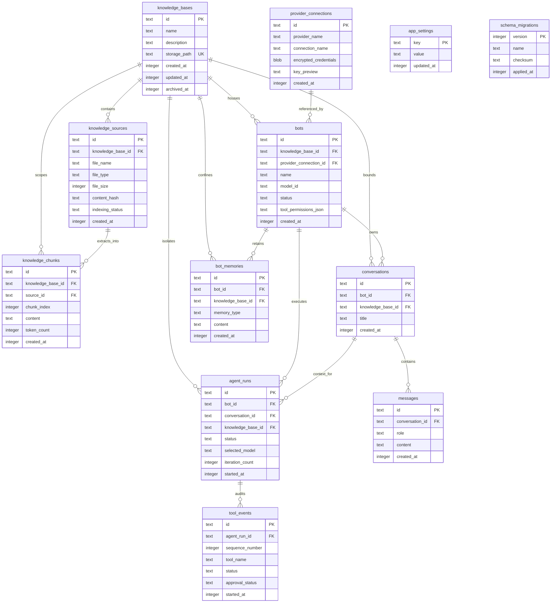
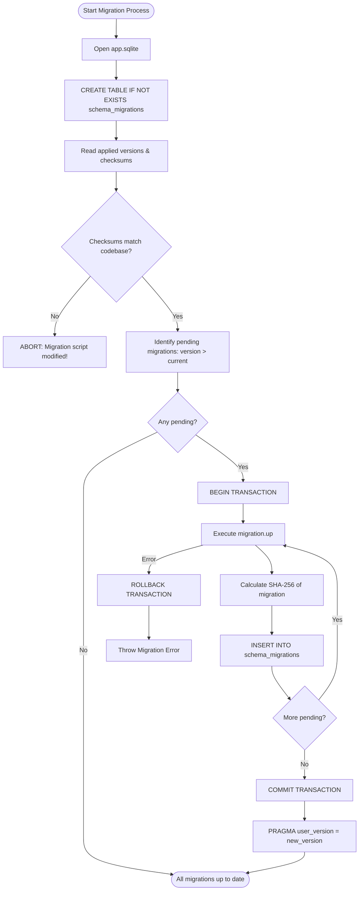

# PHASE 2 — STEP 2.0: DATABASE DESIGN AND PREFLIGHT SPECIFICATION

**Document Version:** 1.0.0  
**Phase:** Phase 2 — Step 2.0  
**Status:** Approved Technical Design  
**Target Platform:** Electron 44.10.2, Node.js 24.21.0, React 19.3.1, TypeScript 5.9.3, Windows x64  
**Database Engine:** SQLite 3 via `better-sqlite3` (Candidate v13.0.3)  
**Database Path:** `app.getPath("userData")/database/app.sqlite`  
**Authoritative Sources:** [`PRODUCT_SPEC.md`](../../PRODUCT_SPEC.md), [`MVP_SCOPE.md`](../../MVP_SCOPE.md), [`ARCHITECTURE.md`](../../ARCHITECTURE.md), [`DATA_MODEL.md`](../../DATA_MODEL.md), [`SECURITY.md`](../../SECURITY.md), [`PHASE_PLAN.md`](../../PHASE_PLAN.md), [`AGENTS.md`](../../AGENTS.md), [`docs/adr/`](../adr/README.md)  
**Last Updated:** November 2026  

---

## 1. Database Architecture Overview

The **Local-First Multi-Model AI Agent Workspace** persists all application state, domain metadata, conversation history, agent logs, and retrieval indices locally on the user's workstation. 

### 1.1 Architectural Foundations

1. **Embedded Single-Process Ownership:**  
   The database engine is embedded directly inside the **Electron Main process**. The Renderer process (React UI) possesses **zero access** to the filesystem, zero access to `better-sqlite3`, and cannot execute raw SQL queries under any circumstances. All database interactions occur across strongly typed, validated IPC channels.
2. **Immutable Domain Hierarchy:**  
   The application strictly maps the one-to-many domain tree:
   ```
   LOCAL USER PROFILE
       │
       └── MULTIPLE KNOWLEDGE BASES
               │
               ├── KNOWLEDGE BASE 1
               │       ├── BOT 1 (e.g., Senior Developer)
               │       ├── BOT 2 (e.g., Code Reviewer)
               │       └── BOT N
               │
               └── KNOWLEDGE BASE 2
                       └── BOT 1 (e.g., Financial Analyst)
   ```
3. **Knowledge Base Isolation Invariant:**  
   Knowledge Base boundaries are inviolable. Bots belonging to Knowledge Base $A$ can **never** access, search, or infer knowledge from documents, chunks, or conversations belonging to Knowledge Base $B$. Sibling Bots within the same Knowledge Base share access to that base's document repository.
4. **Decoupled Physical Storage:**  
   Original user documents (`.pdf`, `.md`, `.txt`) reside in dedicated directories on the local filesystem (`<userData>/documents/<knowledge_base_id>/`). SQLite manages relational metadata, extraction metrics, chunk text, token counts, and full-text search tokens.
5. **Hardware-Backed Credential Security:**  
   Plaintext API keys are **never** stored in SQLite tables or JSON files. API keys are encrypted at rest using Electron `safeStorage` (OS DPAPI on Windows) and stored as binary `BLOB` ciphertext.
6. **Zero-Trust Model Boundary:**  
   Retrieval services never accept a client-supplied or LLM-generated `knowledge_base_id`. The Main process queries the database to authoritatively resolve the `knowledge_base_id` from the authenticated `bot_id`, hard-filtering all downstream queries.

---

## 2. Database File Location and Storage Sandboxing

### 2.1 File Path Specification
The production database file must be located at:
```typescript
path.join(app.getPath('userData'), 'database', 'app.sqlite')
```

### 2.2 Architectural Comparison & Deviation from Phase 0 Draft
- **Phase 0 Draft:** [`DATA_MODEL.md`](../../DATA_MODEL.md) and [`ADR-0004`](../adr/ADR-0004-sqlite-local-storage.md) initially referenced `<userData>/workspace.db`.
- **Phase 2 Specification:** The database path is updated to `app.getPath("userData")/database/app.sqlite`.
- **Rationale for Change:** Isolating database files inside a dedicated `database/` subfolder prevents SQLite temporary files, lock files, journal files, and future WAL/SHM sidecars (`app.sqlite-wal`, `app.sqlite-shm`) from cluttering the top-level Electron `userData` folder (which also contains Chromium cache, GPU cache, and preferences).

### 2.3 Storage Sandboxing Rules
- **No In-Tree Databases:** The database file must **never** be stored within the installed application directory or Git repository root.
- **Directory Creation:** The Electron Main process verifies or creates `<userData>/database/` during startup prior to instantiating the database driver.
- **Filesystem Permissions:** On Unix/macOS, permissions are restricted to `0700`. On Windows, the folder inherits standard user profile access control lists (ACLs).

---

## 3. Database Connection Lifecycle

### 3.1 Single Connection Invariant
The Electron Main process maintains **exactly one** open `better-sqlite3` `Database` instance per application execution session, managed by a singleton `DatabaseManager`.
- The Main process owns this connection exclusively.
- Node.js Worker Threads and `utilityProcess` instances do **not** maintain write connections to `app.sqlite`.
- The React Renderer process is sandboxed and never imports or connects to SQLite.

### 3.2 Startup Initialization Sequence
The database initialization occurs during the `app.whenReady()` lifecycle before the primary `BrowserWindow` is shown:

```mermaid
sequenceDiagram
    participant App as Electron app
    participant Main as Main Process Lifecycle
    participant DB as DatabaseManager
    participant Migrator as MigrationManager
    participant FS as File System
    participant Window as MainWindow

    App->>Main: app.whenReady()
    Main->>DB: initialize()
    DB->>FS: ensureDirSync("<userData>/database")
    DB->>DB: new Database("app.sqlite")
    DB->>DB: PRAGMA foreign_keys = ON;
    DB->>DB: PRAGMA busy_timeout = 5000;
    DB->>DB: PRAGMA journal_mode = DELETE; (Safe default)
    DB->>Migrator: applyPendingMigrations()
    Migrator->>DB: Execute pending schema migrations in transaction
    DB->>DB: PRAGMA integrity_check;
    DB-->>Main: Database Ready
    Main->>Window: createWindow()
    Window-->>App: UI Shell Rendered
```

1. **Directory Preparation:** Check if `<userData>/database/` exists; if not, create it recursively via `fs.mkdirSync(dir, { recursive: true })`.
2. **Driver Instantiation:** Open connection via `new Database(dbPath, { timeout: 5000 })`.
3. **Foreign Key Enforcement:** Execute `PRAGMA foreign_keys = ON;`. Immediately assert that `PRAGMA foreign_keys;` returns `1`. If foreign keys cannot be enabled, halt startup immediately.
4. **Busy Timeout:** Execute `PRAGMA busy_timeout = 5000;` to prevent transient `SQLITE_BUSY` errors during filesystem I/O bursts.
5. **Journal Mode Configuration:** Set safer default journal mode (`PRAGMA journal_mode = DELETE;` or `TRUNCATE`). **Do not enable WAL mode yet.** WAL mode evaluation is deferred to Step 2.7.
6. **Transactional Migration:** Run `MigrationManager.applyPendingMigrations()`.
7. **Startup Integrity Verification:** Execute `PRAGMA integrity_check;`. If the check returns anything other than `ok`, abort launch and trigger disaster recovery.
8. **Repository Initialization:** Instantiate typed repositories passing the authenticated database instance.

### 3.3 Shutdown Sequence
- Clean shutdown is hooked into Electron's `before-quit` event.
- The `DatabaseManager.close()` method is invoked:
  1. Closes any prepared statements.
  2. Executes `db.close()`.
  3. Sets the internal database reference to `null`.
- Prevents database file locking, truncated journals, or corrupted state during application updates or system shutdown.

### 3.4 Startup Failure & Corruption Handling
If the database cannot be opened or fails `PRAGMA integrity_check`:
1. The error is logged to the redacting logger.
2. A native Electron error modal is displayed (`dialog.showErrorBox`) informing the user of the storage failure.
3. The corrupt file is preserved with a timestamped suffix (`app.sqlite.corrupt.<timestamp>`).
4. The application halts or prompts the user for clean initialization, avoiding unhandled crashes.

---

## 4. Native Module and Packaging Compatibility Plan

### 4.1 Candidate Evaluation: `better-sqlite3@13.0.3`
- **Candidate:** `better-sqlite3` version `13.0.3` (latest stable).
- **Driver Architecture:** Native C++ Node.js addon leveraging `node-addon-api: ^8.0.0` and embedded SQLite 3.
- **Node-API (N-API) Support:** `node-addon-api` provides a C++ abstraction over Node-API (N-API version 10 supported by Electron 44).

### 4.2 Runtime & ABI Compatibility Matrix

| Environment | Version | Node ABI (`modules`) | N-API Version | Notes |
|---|---|---|---|---|
| **Host System Node.js** | `v24.21.0` | `137` | `10` | Used for development tooling, npm scripts. |
| **Electron Runtime** | `44.10.2` | `149` | `10` | Embedded Node `v24.22.2` within Chromium shell. |
| **Electron-Builder** | `26.18.0` | N/A | N/A | Handles packaging, ASAR bundling, and native rebuilds. |

> [!WARNING]
> **ABI Mismatch Risk:**  
> The host Node.js ABI is **137**, while Electron 44.10.2 uses ABI **149**. Native modules compiled for host Node.js will throw `NODE_MODULE_VERSION 137 vs 149 mismatch` when loaded inside Electron unless compiled specifically against Electron headers. Conversely, modules rebuilt against Electron headers may throw mismatch errors when executed directly under host Node.js during CLI testing.

### 4.3 Rebuild & Packaging Pipeline
1. **Compilation for Electron:**  
   `package.json` contains:
   ```json
   "postinstall": "install-electron && electron-builder install-app-deps"
   ```
   Executing `electron-builder install-app-deps` invokes `@electron/rebuild` targeting `electronVersion: 44.10.2, arch: x64`, compiling `better_sqlite3.node` against Electron's embedded Node ABI.
2. **Bundler Externalization (`electron.vite.config.ts`):**  
   Vite/Rollup must not attempt to bundle `better-sqlite3` JavaScript or native binaries. It must be explicitly configured as external in the Main process configuration:
   ```typescript
   export default defineConfig({
     main: {
       build: {
         rollupOptions: {
           external: ['better-sqlite3']
         }
       }
     }
   })
   ```
3. **ASAR Packaging Rule (`electron-builder.yml`):**  
   Because Node.js cannot load native C++ `.node` libraries directly from inside an ASAR archive via `dlopen`/`LoadLibraryW`, `better-sqlite3` must be unpacked:
   ```yaml
   asarUnpack:
     - resources/**
     - '**/node_modules/better-sqlite3/**'
   ```
4. **Windows x64 Native Toolchain:**  
   Compilation on Windows requires the Microsoft Visual C++ Build Tools (MSVC 2022 / v143 toolset) and Python 3.10+ in the OS PATH for `node-gyp`.

---

## 5. Complete Table Specifications (12 Tables)

The database schema comprises **11 core application tables** plus the system **`schema_migrations`** table.

### 5.1 Primary Key and Timestamp Conventions

- **Primary Keys:** RFC 4122 canonical UUIDv4 text strings (`TEXT PRIMARY KEY NOT NULL`). Guarantees global collision-free uniqueness during export/import, prevents predictable sequence enumeration, and enables offline entity generation.
- **Timestamps:** UTC Unix millisecond timestamps stored as 64-bit integers (`INTEGER NOT NULL`).
  - *Rationale:* Integer timestamps take 8 bytes on disk (vs 24-27 bytes for ISO strings), map directly to JavaScript `Date.now()`, provide ultra-fast numeric comparisons and B-Tree indexing, and match existing IPC contracts (`PingResponse.timestamp: number`).
  - *Default Value:* Generated via `(CAST((julianday('now') - 2440587.5) * 86400000 AS INTEGER))` or supplied directly by the application layer.

---

### 5.2 Table 1: `knowledge_bases`
**Purpose:** Root container for an isolated knowledge domain, document repository, and resident Bots.

```sql
CREATE TABLE knowledge_bases (
    id TEXT PRIMARY KEY NOT NULL,
    name TEXT NOT NULL CHECK (length(trim(name)) > 0),
    description TEXT NOT NULL DEFAULT '',
    storage_path TEXT NOT NULL UNIQUE,
    created_at INTEGER NOT NULL,
    updated_at INTEGER NOT NULL,
    archived_at INTEGER
);

CREATE INDEX idx_knowledge_bases_created_at ON knowledge_bases(created_at);
```
- **Constraints:** `UNIQUE (storage_path)` guarantees filesystem directory isolation per Knowledge Base.
- **Deletion:** Deleting a Knowledge Base initiates cascading deletion across all associated documents, chunks, bots, conversations, and agent runs.

---

### 5.3 Table 2: `knowledge_sources`
**Purpose:** Metadata for physical source files (`.txt`, `.md`, `.pdf`) ingested into a Knowledge Base.

```sql
CREATE TABLE knowledge_sources (
    id TEXT PRIMARY KEY NOT NULL,
    knowledge_base_id TEXT NOT NULL,
    file_name TEXT NOT NULL,
    original_file_name TEXT NOT NULL,
    relative_file_path TEXT NOT NULL,
    file_type TEXT NOT NULL CHECK (file_type IN ('txt', 'md', 'pdf')),
    mime_type TEXT NOT NULL,
    file_size INTEGER NOT NULL CHECK (file_size >= 0),
    content_hash TEXT NOT NULL,
    indexing_status TEXT NOT NULL DEFAULT 'queued' CHECK (indexing_status IN ('queued', 'parsing', 'indexing', 'ready', 'failed')),
    error_message TEXT,
    created_at INTEGER NOT NULL,
    updated_at INTEGER NOT NULL,
    indexed_at INTEGER,
    UNIQUE (id, knowledge_base_id),
    FOREIGN KEY (knowledge_base_id) REFERENCES knowledge_bases(id) ON DELETE CASCADE ON UPDATE CASCADE
);

CREATE INDEX idx_knowledge_sources_kb ON knowledge_sources(knowledge_base_id);
CREATE INDEX idx_knowledge_sources_status ON knowledge_sources(knowledge_base_id, indexing_status);
CREATE INDEX idx_knowledge_sources_hash ON knowledge_sources(knowledge_base_id, content_hash);
```
- **Constraints:** `UNIQUE (id, knowledge_base_id)` is **architecturally mandatory** to serve as the parent target for the composite foreign key from `knowledge_chunks`.
- **Foreign Keys:** `FOREIGN KEY (knowledge_base_id) REFERENCES knowledge_bases(id) ON DELETE CASCADE`.

---

### 5.4 Table 3: `knowledge_chunks`
**Purpose:** Token-bounded parsed text excerpts extracted from a knowledge source.

```sql
CREATE TABLE knowledge_chunks (
    id TEXT PRIMARY KEY NOT NULL,
    knowledge_base_id TEXT NOT NULL,
    source_id TEXT NOT NULL,
    chunk_index INTEGER NOT NULL CHECK (chunk_index >= 0),
    content TEXT NOT NULL CHECK (length(trim(content)) > 0),
    page_number INTEGER CHECK (page_number IS NULL OR page_number >= 1),
    token_count INTEGER NOT NULL CHECK (token_count >= 0),
    metadata_json TEXT NOT NULL DEFAULT '{}' CHECK (json_valid(metadata_json)),
    created_at INTEGER NOT NULL,
    UNIQUE (source_id, chunk_index),
    FOREIGN KEY (knowledge_base_id) REFERENCES knowledge_bases(id) ON DELETE CASCADE ON UPDATE CASCADE,
    FOREIGN KEY (source_id, knowledge_base_id) REFERENCES knowledge_sources(id, knowledge_base_id) ON DELETE CASCADE ON UPDATE CASCADE
);

CREATE INDEX idx_knowledge_chunks_kb ON knowledge_chunks(knowledge_base_id);
CREATE INDEX idx_knowledge_chunks_source ON knowledge_chunks(source_id);
```
- **Composite Isolation Invariant:**  
  `FOREIGN KEY (source_id, knowledge_base_id) REFERENCES knowledge_sources(id, knowledge_base_id) ON DELETE CASCADE`  
  Guarantees that a chunk can never reference a source belonging to a different Knowledge Base.

---

### 5.5 Table 4: `provider_connections`
**Purpose:** Reusable Bring-Your-Own-Key (BYOK) AI provider connections holding OS-encrypted credentials. Managed at the user/application scope.

```sql
CREATE TABLE provider_connections (
    id TEXT PRIMARY KEY NOT NULL,
    provider_name TEXT NOT NULL CHECK (provider_name IN ('openai', 'anthropic', 'google', 'xai', 'openrouter')),
    connection_name TEXT NOT NULL CHECK (length(trim(connection_name)) > 0),
    encrypted_credentials BLOB NOT NULL,
    key_preview TEXT NOT NULL DEFAULT '',
    created_at INTEGER NOT NULL,
    updated_at INTEGER NOT NULL
);

CREATE INDEX idx_provider_connections_provider ON provider_connections(provider_name);
```
- **Security Invariant:** Plaintext API keys must **never** be stored in SQLite. `encrypted_credentials` stores binary ciphertext produced by Electron `safeStorage`. `key_preview` stores only a masked prefix/suffix (e.g. `sk-...4a89`) for UI identification.
- **Deletion Policy:** Referenced by `bots` via `ON DELETE RESTRICT`. A connection cannot be deleted if active Bots still reference it.

---

### 5.6 Table 5: `bots`
**Purpose:** Persistent, specialized AI reasoning persona configured within a Knowledge Base.

```sql
CREATE TABLE bots (
    id TEXT PRIMARY KEY NOT NULL,
    knowledge_base_id TEXT NOT NULL,
    provider_connection_id TEXT,
    name TEXT NOT NULL CHECK (length(trim(name)) > 0),
    description TEXT NOT NULL DEFAULT '',
    system_prompt TEXT NOT NULL DEFAULT '',
    model_id TEXT NOT NULL CHECK (length(trim(model_id)) > 0),
    status TEXT NOT NULL DEFAULT 'active' CHECK (status IN ('active', 'archived')),
    tool_permissions_json TEXT NOT NULL DEFAULT '[]' CHECK (json_valid(tool_permissions_json)),
    created_at INTEGER NOT NULL,
    updated_at INTEGER NOT NULL,
    UNIQUE (id, knowledge_base_id),
    FOREIGN KEY (knowledge_base_id) REFERENCES knowledge_bases(id) ON DELETE CASCADE ON UPDATE CASCADE,
    FOREIGN KEY (provider_connection_id) REFERENCES provider_connections(id) ON DELETE RESTRICT ON UPDATE CASCADE
);

CREATE INDEX idx_bots_kb ON bots(knowledge_base_id);
CREATE INDEX idx_bots_provider ON bots(provider_connection_id);
```
- **Constraints:** `UNIQUE (id, knowledge_base_id)` enables child tables (`conversations`, `bot_memories`, `agent_runs`) to enforce composite Knowledge Base isolation at the database engine level.
- **Single Parent Invariant:** `knowledge_base_id` is `NOT NULL`. Orphaned Bots cannot exist.

---

### 5.7 Table 6: `conversations`
**Purpose:** Dedicated chat session thread belonging to a Bot.

```sql
CREATE TABLE conversations (
    id TEXT PRIMARY KEY NOT NULL,
    bot_id TEXT NOT NULL,
    knowledge_base_id TEXT NOT NULL,
    title TEXT NOT NULL DEFAULT 'New Conversation',
    created_at INTEGER NOT NULL,
    updated_at INTEGER NOT NULL,
    archived_at INTEGER,
    UNIQUE (id, knowledge_base_id),
    FOREIGN KEY (knowledge_base_id) REFERENCES knowledge_bases(id) ON DELETE CASCADE ON UPDATE CASCADE,
    FOREIGN KEY (bot_id, knowledge_base_id) REFERENCES bots(id, knowledge_base_id) ON DELETE CASCADE ON UPDATE CASCADE
);

CREATE INDEX idx_conversations_bot ON conversations(bot_id);
CREATE INDEX idx_conversations_kb ON conversations(knowledge_base_id);
CREATE INDEX idx_conversations_updated ON conversations(bot_id, updated_at DESC);
```
- **Composite Isolation Invariant:** Stores `knowledge_base_id` and enforces `FOREIGN KEY (bot_id, knowledge_base_id) REFERENCES bots(id, knowledge_base_id)`. Prevents conversation threads from ever bridging across Knowledge Bases.

---

### 5.8 Table 7: `messages`
**Purpose:** Individual chat message within a conversation thread.

```sql
CREATE TABLE messages (
    id TEXT PRIMARY KEY NOT NULL,
    conversation_id TEXT NOT NULL,
    role TEXT NOT NULL CHECK (role IN ('user', 'assistant', 'system', 'tool')),
    content TEXT NOT NULL DEFAULT '',
    content_format TEXT NOT NULL DEFAULT 'markdown' CHECK (content_format IN ('text', 'markdown', 'json')),
    metadata_json TEXT NOT NULL DEFAULT '{}' CHECK (json_valid(metadata_json)),
    token_usage_json TEXT NOT NULL DEFAULT '{}' CHECK (json_valid(token_usage_json)),
    created_at INTEGER NOT NULL,
    FOREIGN KEY (conversation_id) REFERENCES conversations(id) ON DELETE CASCADE ON UPDATE CASCADE
);

CREATE INDEX idx_messages_conversation ON messages(conversation_id, created_at ASC);
```
- **Foreign Keys:** Cascades automatically on conversation deletion.

---

### 5.9 Table 8: `agent_runs`
**Purpose:** Execution task instance tracking a multi-step agent reasoning turn.

```sql
CREATE TABLE agent_runs (
    id TEXT PRIMARY KEY NOT NULL,
    bot_id TEXT NOT NULL,
    conversation_id TEXT NOT NULL,
    knowledge_base_id TEXT NOT NULL,
    status TEXT NOT NULL DEFAULT 'pending' CHECK (status IN (
        'pending',
        'running',
        'awaiting_approval',
        'completed',
        'failed',
        'cancelled'
    )),
    selected_model TEXT NOT NULL,
    iteration_count INTEGER NOT NULL DEFAULT 0 CHECK (iteration_count >= 0 AND iteration_count <= 5),
    error_summary TEXT,
    started_at INTEGER NOT NULL,
    completed_at INTEGER,
    FOREIGN KEY (knowledge_base_id) REFERENCES knowledge_bases(id) ON DELETE CASCADE ON UPDATE CASCADE,
    FOREIGN KEY (bot_id, knowledge_base_id) REFERENCES bots(id, knowledge_base_id) ON DELETE CASCADE ON UPDATE CASCADE,
    FOREIGN KEY (conversation_id) REFERENCES conversations(id) ON DELETE CASCADE ON UPDATE CASCADE
);

CREATE INDEX idx_agent_runs_bot ON agent_runs(bot_id);
CREATE INDEX idx_agent_runs_conversation ON agent_runs(conversation_id);
CREATE INDEX idx_agent_runs_status ON agent_runs(status);
```
- **Bounded Agency:** `CHECK (iteration_count >= 0 AND iteration_count <= 5)` strictly enforces the 5-iteration limit at the database schema layer.

---

### 5.10 Table 9: `tool_events`
**Purpose:** Granular, chronologically ordered audit log of tool calls requested or executed within an agent run.

```sql
CREATE TABLE tool_events (
    id TEXT PRIMARY KEY NOT NULL,
    agent_run_id TEXT NOT NULL,
    sequence_number INTEGER NOT NULL CHECK (sequence_number >= 1),
    tool_name TEXT NOT NULL,
    status TEXT NOT NULL DEFAULT 'pending' CHECK (status IN ('pending', 'running', 'completed', 'failed', 'cancelled')),
    approval_status TEXT NOT NULL DEFAULT 'auto_approved' CHECK (approval_status IN (
        'not_required',
        'auto_approved',
        'pending_approval',
        'user_approved',
        'user_rejected'
    )),
    arguments_summary TEXT NOT NULL DEFAULT '{}' CHECK (json_valid(arguments_summary)),
    result_summary TEXT NOT NULL DEFAULT '',
    error_message TEXT,
    started_at INTEGER NOT NULL,
    completed_at INTEGER,
    UNIQUE (agent_run_id, sequence_number),
    FOREIGN KEY (agent_run_id) REFERENCES agent_runs(id) ON DELETE CASCADE ON UPDATE CASCADE
);

CREATE INDEX idx_tool_events_run ON tool_events(agent_run_id, sequence_number ASC);
```
- **Ordering Constraint:** `UNIQUE (agent_run_id, sequence_number)` guarantees deterministic audit sequences.

---

### 5.11 Table 10: `bot_memories`
**Purpose:** User-approved persistent reference notes and pinned facts for a Bot.

```sql
CREATE TABLE bot_memories (
    id TEXT PRIMARY KEY NOT NULL,
    bot_id TEXT NOT NULL,
    knowledge_base_id TEXT NOT NULL,
    memory_type TEXT NOT NULL DEFAULT 'user_note' CHECK (memory_type IN ('user_note', 'pinned_instruction')),
    content TEXT NOT NULL CHECK (length(trim(content)) > 0),
    created_at INTEGER NOT NULL,
    updated_at INTEGER NOT NULL,
    FOREIGN KEY (knowledge_base_id) REFERENCES knowledge_bases(id) ON DELETE CASCADE ON UPDATE CASCADE,
    FOREIGN KEY (bot_id, knowledge_base_id) REFERENCES bots(id, knowledge_base_id) ON DELETE CASCADE ON UPDATE CASCADE
);

CREATE INDEX idx_bot_memories_bot ON bot_memories(bot_id);
CREATE INDEX idx_bot_memories_kb ON bot_memories(knowledge_base_id);
```
- **Scoping Invariant:** Holds both `bot_id` and `knowledge_base_id` with composite foreign key constraint, structurally barring cross-KB memory reads.

---

### 5.12 Table 11: `app_settings`
**Purpose:** Global desktop application preferences decoupled from Bot or Knowledge Base business state.

```sql
CREATE TABLE app_settings (
    key TEXT PRIMARY KEY NOT NULL CHECK (length(trim(key)) > 0),
    value TEXT NOT NULL,
    updated_at INTEGER NOT NULL
);
```
- **Allowed Keys:** `theme` (`'system' | 'dark' | 'light'`), `telemetry_opt_in` (`'0' | '1'`), `last_active_knowledge_base_id`, `window_bounds`.
- **Security Guardrail:** Plaintext credentials, passwords, or API keys are **strictly forbidden** from residing in `app_settings`.

---

### 5.13 Table 12: `schema_migrations`
**Purpose:** System table tracking forward migration scripts applied to `app.sqlite`.

```sql
CREATE TABLE schema_migrations (
    version INTEGER PRIMARY KEY NOT NULL CHECK (version > 0),
    name TEXT NOT NULL CHECK (length(trim(name)) > 0),
    checksum TEXT NOT NULL CHECK (length(checksum) = 64),
    applied_at INTEGER NOT NULL
);
```

---

## 6. Entity Relationship Diagram



---

## 7. Foreign-Key Strategy and Referential Integrity

All connections enforce `PRAGMA foreign_keys = ON;`. SQLite verifies that foreign keys are satisfied before committing any write.

| Child Table | Foreign Key Column(s) | Parent Table & Target Column(s) | ON DELETE | ON UPDATE | Rationale |
|---|---|---|---|---|---|
| `knowledge_sources` | `knowledge_base_id` | `knowledge_bases(id)` | `CASCADE` | `CASCADE` | Purging a KB removes its documents. |
| `knowledge_chunks` | `knowledge_base_id` | `knowledge_bases(id)` | `CASCADE` | `CASCADE` | Direct KB cascade. |
| `knowledge_chunks` | `(source_id, knowledge_base_id)` | `knowledge_sources(id, knowledge_base_id)` | `CASCADE` | `CASCADE` | Composite key prevents cross-KB chunk assignment. |
| `bots` | `knowledge_base_id` | `knowledge_bases(id)` | `CASCADE` | `CASCADE` | Purging a KB purges its bots. |
| `bots` | `provider_connection_id` | `provider_connections(id)` | `RESTRICT` | `CASCADE` | Blocks deleting API keys currently in active use. |
| `conversations` | `knowledge_base_id` | `knowledge_bases(id)` | `CASCADE` | `CASCADE` | Direct KB cascade. |
| `conversations` | `(bot_id, knowledge_base_id)` | `bots(id, knowledge_base_id)` | `CASCADE` | `CASCADE` | Composite key binds conversation strictly to Bot's KB. |
| `messages` | `conversation_id` | `conversations(id)` | `CASCADE` | `CASCADE` | Purging a thread cleans up all messages. |
| `agent_runs` | `knowledge_base_id` | `knowledge_bases(id)` | `CASCADE` | `CASCADE` | Direct KB cascade. |
| `agent_runs` | `(bot_id, knowledge_base_id)` | `bots(id, knowledge_base_id)` | `CASCADE` | `CASCADE` | Composite key verifies Bot and KB alignment. |
| `agent_runs` | `conversation_id` | `conversations(id)` | `CASCADE` | `CASCADE` | Purging thread removes associated runs. |
| `tool_events` | `agent_run_id` | `agent_runs(id)` | `CASCADE` | `CASCADE` | Run deletion purges all audit events. |
| `bot_memories` | `knowledge_base_id` | `knowledge_bases(id)` | `CASCADE` | `CASCADE` | Direct KB cascade. |
| `bot_memories` | `(bot_id, knowledge_base_id)` | `bots(id, knowledge_base_id)` | `CASCADE` | `CASCADE` | Composite key prevents cross-KB memory leakage. |

---

## 8. Composite Constraints and Knowledge Base Isolation Guardrails

### 8.1 The Threat Model
Context contamination can occur if an entity references a parent in Knowledge Base $A$ while claiming association with Knowledge Base $B$. In a desktop system running agentic tool loops, prompt injection or logic bugs could forge identifiers.

### 8.2 Database-Engine Enforcement via Composite Keys
Standard single-column foreign keys (`source_id REFERENCES knowledge_sources(id)`) only verify that the source exists anywhere in the database. They do **not** verify that the source belongs to the same Knowledge Base.

To close this vulnerability, our schema requires composite foreign keys:
```sql
-- In knowledge_sources:
UNIQUE (id, knowledge_base_id);

-- In knowledge_chunks:
FOREIGN KEY (source_id, knowledge_base_id) 
    REFERENCES knowledge_sources(id, knowledge_base_id) 
    ON DELETE CASCADE ON UPDATE CASCADE;

-- In bots:
UNIQUE (id, knowledge_base_id);

-- In conversations:
FOREIGN KEY (bot_id, knowledge_base_id) 
    REFERENCES bots(id, knowledge_base_id) 
    ON DELETE CASCADE ON UPDATE CASCADE;

-- In bot_memories:
FOREIGN KEY (bot_id, knowledge_base_id) 
    REFERENCES bots(id, knowledge_base_id) 
    ON DELETE CASCADE ON UPDATE CASCADE;
```

### 8.3 Enforcement Guarantee
If an insert attempts to create a chunk with `source_id` belonging to KB $A$ and `knowledge_base_id` belonging to KB $B$, SQLite rejects the transaction immediately:
```
Error: SQLITE_CONSTRAINT_FOREIGNKEY: FOREIGN KEY constraint failed
```
This guarantees mathematical domain isolation enforced directly by the database engine.

---

## 9. Comprehensive Deletion Policy

| Operation | Database Action | Filesystem Action | Boundary Invariant Preserved |
|---|---|---|---|
| **Delete Knowledge Base** | `DELETE FROM knowledge_bases WHERE id = ?` $\rightarrow$ Cascades to all child sources, chunks, bots, conversations, messages, agent runs, tool events, memories. | Electron Main recursively deletes `<userData>/documents/<kb_id>/`. | Total eradication of that Knowledge Base. All other Knowledge Bases and global provider keys remain completely unaffected. |
| **Delete Knowledge Source** | `DELETE FROM knowledge_sources WHERE id = ?` $\rightarrow$ Cascades to `knowledge_chunks`. | Physical file deleted from disk (`<userData>/documents/<kb_id>/<file>`). | All chunk text and citations vanish. Sibling sources in the same KB remain unaffected. |
| **Delete Bot** | `DELETE FROM bots WHERE id = ?` $\rightarrow$ Cascades to `conversations`, `messages`, `agent_runs`, `tool_events`, `bot_memories`. | None (Bots hold no dedicated disk files). | Shared Knowledge Base documents and sibling Bots remain 100% untouched. |
| **Delete Conversation** | `DELETE FROM conversations WHERE id = ?` $\rightarrow$ Cascades to `messages`, `agent_runs`, `tool_events`. | None. | Bot configuration, memories, and other conversation threads remain intact. |
| **Delete Provider Connection** | `DELETE FROM provider_connections WHERE id = ?` | Encrypted blob deleted from SQLite. | `ON DELETE RESTRICT` raises constraint failure if any Bot still references this connection. UI instructs user to reassign Bots first. |

---

## 10. Migration Architecture

### 10.1 Versioned Migration Algorithm
The migration system executes sequentially inside an atomic transaction:

```typescript
export interface Migration {
  version: number
  name: string
  up: (db: Database.Database) => void
}
```



### 10.2 Safety Rules
1. **Atomic Execution:** All pending statements run inside `db.transaction()`. If any statement fails, zero changes persist.
2. **Checksum Integrity:** SHA-256 checksums verify that historical migration scripts have not been modified after being applied.
3. **Immutability Invariant:** Applied migrations are never edited in git. All future changes require a new incrementing version (e.g., `002_add_fts5.ts`).

---

## 11. Typed Repository Interfaces

Repositories encapsulate all raw SQL. React components never call database queries directly.

### 11.1 Knowledge Base Repository Contract
```typescript
export interface CreateKnowledgeBaseDto {
  id?: string
  name: string
  description?: string
  storagePath: string
}

export interface UpdateKnowledgeBaseDto {
  name?: string
  description?: string
  archivedAt?: number | null
}

export interface KnowledgeBaseEntity {
  id: string
  name: string
  description: string
  storagePath: string
  createdAt: number
  updatedAt: number
  archivedAt: number | null
}

export interface IKnowledgeBaseRepository {
  create(dto: CreateKnowledgeBaseDto): KnowledgeBaseEntity
  getById(id: string): KnowledgeBaseEntity | null
  list(includeArchived?: boolean): KnowledgeBaseEntity[]
  update(id: string, dto: UpdateKnowledgeBaseDto): KnowledgeBaseEntity
  delete(id: string): boolean
}
```

### 11.2 Bot Repository Contract
```typescript
export interface CreateBotDto {
  id?: string
  knowledgeBaseId: string
  providerConnectionId?: string | null
  name: string
  description?: string
  systemPrompt?: string
  modelId: string
  toolPermissions?: string[]
}

export interface UpdateBotDto {
  name?: string
  description?: string
  systemPrompt?: string
  modelId?: string
  providerConnectionId?: string | null
  status?: 'active' | 'archived'
  toolPermissions?: string[]
}

export interface BotEntity {
  id: string
  knowledgeBaseId: string
  providerConnectionId: string | null
  name: string
  description: string
  systemPrompt: string
  modelId: string
  status: 'active' | 'archived'
  toolPermissions: string[]
  createdAt: number
  updatedAt: number
}

export interface IBotRepository {
  create(dto: CreateBotDto): BotEntity
  getById(id: string): BotEntity | null
  listByKnowledgeBase(knowledgeBaseId: string, includeArchived?: boolean): BotEntity[]
  update(id: string, dto: UpdateBotDto): BotEntity
  delete(id: string): boolean
}
```

### 11.3 Bound Parameter Rule
All repository queries must utilize parameter binding to prevent SQL injection:
```typescript
// MANDATORY PATTERN
const stmt = db.prepare('SELECT * FROM bots WHERE knowledge_base_id = ? AND status = ?')
const rows = stmt.all(knowledgeBaseId, 'active')

// FORBIDDEN PATTERN
// const rows = db.prepare(`SELECT * FROM bots WHERE knowledge_base_id = '${knowledgeBaseId}'`).all()
```

---

## 12. Security Requirements and Verification

1. **Zero Plaintext Secrets:** Plaintext API keys must never appear in SQLite columns, logs, or IPC payloads. `encrypted_credentials` stores OS-encrypted `BLOB` ciphertext.
2. **Sandboxed Renderer:** React components communicate with Main via typed IPC invoking repository methods.
3. **IPC Frame Sender Validation:**
   ```typescript
   if (event.senderFrame !== mainWindow.webContents.mainFrame) {
     throw new Error('Unauthorized IPC sender frame')
   }
   ```
4. **Input Validation:** All IPC arguments must pass Zod schema validation before repository execution.
5. **Authoritative Scoping:** Retrieval queries always look up the authoritative `knowledge_base_id` from the `bots` table, rejecting any client-supplied `knowledge_base_id`.

---

## 13. Development Testing and Reset Strategy

### 13.1 Test Helpers
- **In-Memory Database (`:memory:`):**  
  Fast unit tests instantiate `new Database(':memory:')` and apply migrations. No disk I/O, isolated per test suite.
- **Temporary File Database:**  
  Integration tests testing file locks, persistence across re-opens, or backups create a unique file in `path.join(os.tmpdir(), `test-${UUID()}.sqlite`)`, cleaned up in `afterAll()`.
- **Migration Test Suite:**  
  Tests applying migrations from version 0 to latest, asserting constraint enforcement and schema state.
- **Deterministic Seed Fixtures:**  
  Helper generating canonical multi-KB test data (e.g. Voyaro KB with 3 Bots, Dispatcher KB with 2 Bots).

### 13.2 Development-Only Database Reset Helper
A reset helper will be designed for Phase 2 integration testing:
- **Strict Guard:** Requires `process.env.NODE_ENV !== 'production' && !app.isPackaged`.
- **Path Whitelist:** Only permitted to delete `<userData>/database/app.sqlite*` and `<userData>/documents/`.
- **Safety Invariant:** Production builds exclude reset IPC channels completely.

---

## 14. WAL and Backup Evaluation Plan

### 14.1 Initial Journal Mode (Safe Default)
For Step 2.0 through 2.6, the database operates in standard rollback journal mode (`PRAGMA journal_mode = DELETE;` or `TRUNCATE`).
- Avoids complications with `-wal` and `-shm` sidecar files during initial repository and migration testing.
- Simpler single-file verification across restarts.

### 14.2 Step 2.7 WAL Evaluation Plan
In Step 2.7, Write-Ahead Logging (`WAL`) will be systematically benchmarked and evaluated:
1. **Concurrency Benchmark:** Compare write latency and non-blocking read throughput under simulated background document ingestion while an agent reads conversation history.
2. **Sidecar Handling:** Verify clean shutdown and checkpointing (`PRAGMA wal_checkpoint(TRUNCATE);`) to ensure `-wal` and `-shm` sidecars merge back into `app.sqlite`.
3. **Crash Recovery:** Simulate sudden process termination (`process.kill()`) and verify that WAL replay recovers all committed transactions cleanly on subsequent launch.

### 14.3 Online Backup Strategy
Manual file copying of an open SQLite database risks capturing an inconsistent state. The application uses `better-sqlite3`'s native backup API:
```typescript
await db.backup(backupFilePath, {
  progress({ totalPages, remainingPages }) {
    logger.debug(`Backup progress: ${totalPages - remainingPages}/${totalPages}`)
  }
})
```
- Operates concurrently with active readers.
- Creates a consistent, verified snapshot.
- Restored backups must pass `PRAGMA integrity_check` before use.

---

## 15. Packaging Verification Plan

Native C++ modules require explicit verification in packaged builds:

1. **Unpacked Inspection (`npm run build:unpack`):**  
   Inspect `release/win-unpacked/resources/app.asar.unpacked/node_modules/better-sqlite3/build/Release/better_sqlite3.node` to ensure binary inclusion.
2. **Packaged Binary Launch:**  
   Launch the packaged `.exe` on Windows x64. Confirm:
   - Window opens without native library missing errors.
   - Database creates at `%APPDATA%/<productName>/database/app.sqlite`.
   - Migrations apply successfully.
   - CRUD IPC operations succeed.

---

## 16. Open Decisions and Architectural Risks

| Decision ID | Topic | Current Recommendation | Trade-off / Considerations |
|---|---|---|---|
| **OD-2.0-1** | **Timestamp Convention: `INTEGER` (Unix ms) vs `TEXT` (ISO-8601)** | `INTEGER NOT NULL` (Unix ms) | `INTEGER` provides faster indexing and direct mapping to JS `number` timestamps (`Date.now()`), while `TEXT` ISO-8601 is human-readable in external SQLite viewers. Recommend `INTEGER` in DB, formatted to ISO string in presentation DTOs. |
| **OD-2.0-2** | **Tool Permissions: Normalized Table vs JSON Column in `bots`** | `tool_permissions_json TEXT NOT NULL DEFAULT '[]'` | [`DATA_MODEL.md`](../../DATA_MODEL.md) had a `bot_tool_permissions` table. A JSON column in `bots` simplifies CRUD operations and matches the fixed 6-tool suite for MVP without extra joins, while a separate table allows SQL-level foreign keys per tool. |
| **OD-2.0-3** | **Vitest Execution Environment with Native Electron Module** | Host Node.js with prebuilds or dual build | Host Node is ABI 137; Electron 44 is ABI 149. If `@electron/rebuild` builds for 149, running `vitest run` under Node 24 will fail with an ABI mismatch unless Vitest runs via Electron or uses Node-compatible binaries. |
| **OD-2.0-4** | **FTS5 Table Structure for Chunk Indexing** | Defer to Phase 7 | FTS5 virtual table (`knowledge_fts`) and synchronization triggers will be introduced in Phase 7 during document ingestion setup. |

