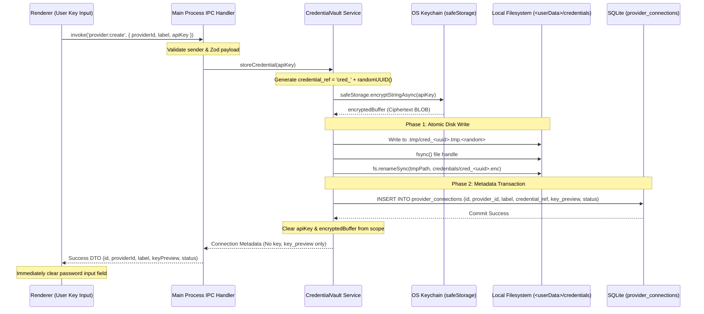
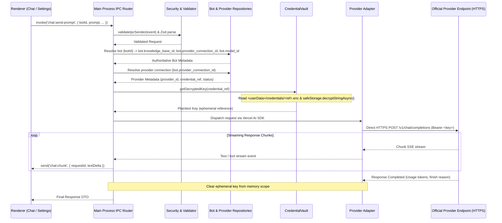
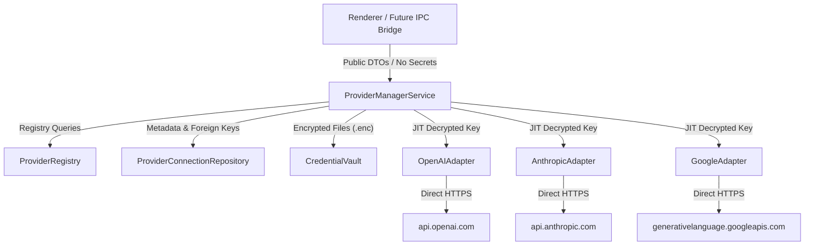
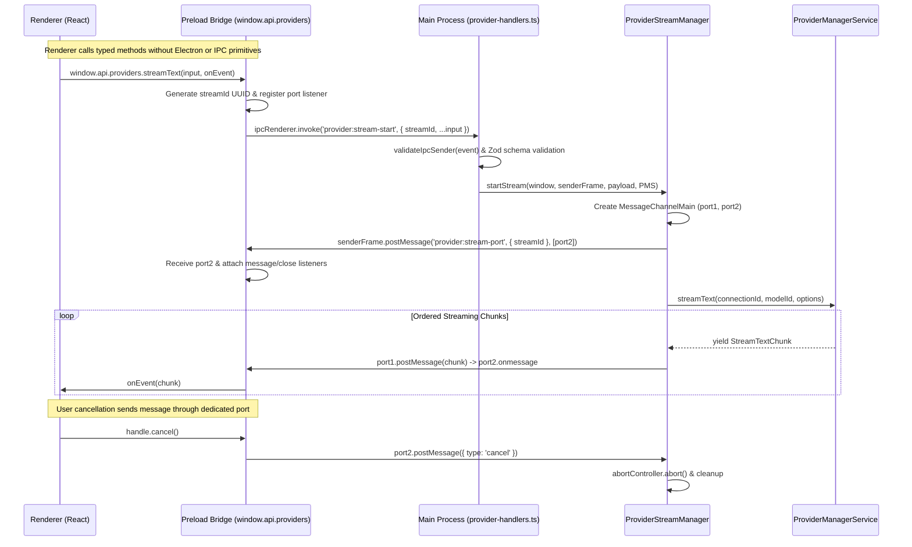

# PHASE 3: BYOK PROVIDER MANAGER & SECURE CREDENTIAL STORAGE
## Architecture and Security Preflight Specification

**Document Version:** 1.0.0  
**Phase:** Phase 3 — Step 3.0  
**Status:** Approved for Implementation Specification  
**Authoritative Sources:** [`PRODUCT_SPEC.md`](../../PRODUCT_SPEC.md), [`MVP_SCOPE.md`](../../MVP_SCOPE.md), [`ARCHITECTURE.md`](../../ARCHITECTURE.md), [`DATA_MODEL.md`](../../DATA_MODEL.md), [`SECURITY.md`](../../SECURITY.md), [`AGENTS.md`](../../AGENTS.md)  
**Date:** November 2026  

---

## 1. Executive Summary and Objective

The objective of **Phase 3** is to implement the Bring-Your-Own-Key (**BYOK**) Provider Manager and OS-backed Secure Credential Storage vault. 

This phase enables users to securely connect their personal API credentials for frontier AI model providers (**OpenAI**, **Anthropic**, **Google Gemini** in the first wave; **xAI** and **OpenRouter** modularly prepared), test connection viability, configure model parameters, and safely execute inference requests directly over standard HTTPS to fixed official endpoints without an application-configured proxy, intermediary gateway, or plaintext credential exposure.

**Step 3.0** is strictly an architecture, research, security evaluation, and preflight specification step. In accordance with project instructions, **no implementation code, database alterations, package installations, or outbound network calls are executed during this step.**

---

## 2. Git Pre-Check & Baseline Repository Status

A comprehensive inspection of the Git repository and Phase 2 completion artifacts was performed prior to architectural drafting:

1. **Current Branch:** `main`.
2. **Current HEAD Commit:** `d7c99db chore: validate packaged Electron SQLite runtime`.
3. **Working Tree State:** Clean (zero uncommitted changes, zero untracked working files).
4. **Git Tags Present:**
   - `phase-1-complete` (Commit `feat(shell): initialize secure electron desktop shell with react and vite`)
   - `pre-phase-1-scaffold`
5. **Phase 2 Completion Tag Status:**
   - **MISSING:** The tag `phase-2-complete` has **not** been tagged in Git yet.
   - All Phase 2 acceptance criteria and verification tests were completed in Step 2.8 (`PACKAGED_RUNTIME_VALIDATION.md`), with 183 automated tests passing.
   - Per explicit instruction, the tag was **not** created automatically during this preflight step and remains reported for human review.
6. **Integrity Checks:**
   - Vitest test suite: **183 tests passed across 14 test suites**.
   - TypeScript verification (`npm run typecheck`): Clean exit with **0 errors**.
   - ESLint verification (`npm run lint`): Clean exit with **0 warnings / 0 errors**.

---

## 3. Existing Architecture Inspection

### 3.1 Database & Persistence Foundation (`src/main/database/`)
- **Connection Engine (`connection.ts`):** `DatabaseManager` manages a singleton `better-sqlite3` instance located at `<userData>/database/app.sqlite`. Enforces `PRAGMA foreign_keys = ON`, `PRAGMA journal_mode = WAL`, `PRAGMA synchronous = FULL`, `PRAGMA busy_timeout = 5000`, and `PRAGMA wal_autocheckpoint = 1000`.
- **Migration Runner (`migrations/runner.ts`):** Applies transactional, forward-only SQL migrations recorded in `schema_migrations`.
- **Current Schema (`migrations/001_initial_schema.sql`):**
  - Defines table `provider_connections`:
    ```sql
    CREATE TABLE provider_connections (
        id TEXT PRIMARY KEY NOT NULL,
        provider_name TEXT NOT NULL CHECK (provider_name IN ('openai', 'anthropic', 'google', 'xai', 'openrouter')),
        connection_name TEXT NOT NULL CHECK (length(trim(connection_name)) > 0),
        encrypted_credentials BLOB NOT NULL,
        key_preview TEXT NOT NULL DEFAULT '',
        created_at INTEGER NOT NULL CHECK (created_at > 0),
        updated_at INTEGER NOT NULL CHECK (updated_at >= created_at)
    );
    CREATE INDEX idx_provider_connections_provider ON provider_connections(provider_name);
    ```
  - Defines table `bots`:
    ```sql
    CREATE TABLE bots (
        id TEXT PRIMARY KEY NOT NULL,
        knowledge_base_id TEXT NOT NULL,
        provider_connection_id TEXT,
        name TEXT NOT NULL CHECK (length(trim(name)) > 0),
        description TEXT NOT NULL DEFAULT '',
        system_prompt TEXT NOT NULL DEFAULT '',
        model_id TEXT NOT NULL CHECK (length(trim(model_id)) > 0),
        status TEXT NOT NULL DEFAULT 'active' CHECK (status IN ('active', 'archived')),
        tool_permissions_json TEXT NOT NULL DEFAULT '[]',
        created_at INTEGER NOT NULL CHECK (created_at > 0),
        updated_at INTEGER NOT NULL CHECK (updated_at >= created_at),
        UNIQUE (id, knowledge_base_id),
        FOREIGN KEY (knowledge_base_id) REFERENCES knowledge_bases(id) ON DELETE CASCADE ON UPDATE CASCADE,
        FOREIGN KEY (provider_connection_id) REFERENCES provider_connections(id) ON DELETE RESTRICT ON UPDATE CASCADE
    );
    ```
- **Bot Repository (`repositories/bot-repository.ts`):**
  - Enforces parent Knowledge Base verification.
  - Enforces foreign key integrity: if `providerConnectionId` is supplied, asserts `SELECT 1 FROM provider_connections WHERE id = ?`.
  - Database schema enforces `FOREIGN KEY (provider_connection_id) REFERENCES provider_connections(id) ON DELETE RESTRICT ON UPDATE CASCADE`, preventing accidental deletion of provider credentials actively bound to bots.

### 3.2 Critical Finding: Database Refinement Needed for Credential Isolation
The initial Phase 2 schema stored `encrypted_credentials BLOB NOT NULL` directly in SQLite table `provider_connections`. 

While this kept credentials encrypted at rest, **storing ciphertext BLOBs inside SQLite has architectural drawbacks**:
1. SQLite files (`app.sqlite`) may be inspected by database management tools, shared during debugging, or backed up by user workflows.
2. SQLite WAL files (`app.sqlite-wal`) temporarily hold raw database pages containing the ciphertext buffers.
3. Decoupling the encrypted credential storage from SQLite creates an additional defense-in-depth security boundary: SQLite stores only connection metadata and an opaque, non-guessable `credential_ref`, while raw ciphertexts reside in a dedicated OS-protected local vault directory.

Therefore, Phase 3 will introduce **Migration 002** to evolve `provider_connections` to store `credential_ref` instead of `encrypted_credentials BLOB`.

### 3.3 Electron Security & IPC Foundation (`src/main/ipc.ts`, `src/main/security.ts`)
- `BrowserWindow` runs with `contextIsolation: true`, `sandbox: true`, `nodeIntegration: false`, `webSecurity: true`.
- Navigation filters enforce `will-frame-navigate`, `will-navigate`, and `will-redirect` guards against untrusted origins.
- `setWindowOpenHandler` denies child popups.
- `validateIpcSender(event, mainWindow)` asserts that incoming IPC events originate strictly from `mainWindow.webContents.mainFrame` with trusted URLs.
- Preload bridge (`src/preload/index.ts`) exposes only safe, explicit invocations via `contextBridge.exposeInMainWorld('api', ...)`.

### 3.4 Dependency State (`package.json`)
- Electron: `v44.7.2`
- React: `v19.3.0`
- better-sqlite3: `v13.0.3`
- Zod: `v4.6.7`
- Lucide React: `v1.70.0`
- **AI SDK Status:** Vercel AI SDK (`ai`, `@ai-sdk/openai`, `@ai-sdk/anthropic`, `@ai-sdk/google`) is **not yet installed**. Dependency installation is scheduled for Step 3.1.

---

## 4. Credential Storage Architecture (SafeStorage Vault)

### 4.1 Security Invariants
1. **Main Process Ownership:** Credential encryption, decryption, disk persistence, and memory clearing are exclusively owned by the Main process.
2. **Zero Plaintext at Rest:** API keys are never written to disk, SQLite, JSON files, or cache in plaintext.
3. **Zero Renderer Exposure:** Plaintext credentials **never cross the IPC bridge** into the React renderer under any circumstance. The UI receives only masked previews (e.g., `sk-...9f2a`) and status flags (`active`, `error`).
4. **Opaque Credential References:** SQLite records store an opaque, random identifier (`credential_ref`, format: `cred_<uuidv4>`). The API key is never used as a filename, identifier, or database value.
5. **No Secret Bleed in Logs or Diagnostics:** Logging utilities, error handlers, and audit tables automatically sanitize and redact credential strings.
6. **Ephemeral In-Memory Lifecycle:** Decrypted credentials exist in Main process memory strictly for the instantaneous initialization of the HTTPS provider request and are dereferenced immediately.

### 4.2 Vault Directory and File Structure
All encrypted credential payloads are stored in an isolated filesystem vault within Electron's standard user data directory:

```
<userData>/
├── database/
│   ├── app.sqlite             # Metadata only (stores credential_ref, label, status)
│   ├── app.sqlite-wal
│   └── app.sqlite-shm
├── credentials/               # Dedicated OS-protected vault directory
│   ├── cred_7b4c9e82-...enc   # Pure safeStorage binary ciphertext
│   ├── cred_f21a8d03-...enc
│   └── .tmp/                  # Scratch directory for atomic writes
└── documents/                 # Knowledge Base documents corpus
```

- **Vault Directory Path:** `join(app.getPath('userData'), 'credentials')`.
- **Target File Naming:** `${credential_ref}.enc` (e.g., `cred_7b4c9e82-e3bf-4d89-9a71-3c66f5c8d19a.enc`).
- **File Permissions:** On POSIX operating systems (Linux/macOS), the directory is created with mode `0o700` (read/write/execute by owner only) and files with mode `0o600` (read/write by owner only). On Windows, access is governed by the user profile's default Access Control List (DACL).
- **File Contents:** 100% binary ciphertext generated by `safeStorage.encryptStringAsync()` (or `encryptString()`). Zero plaintext headers, zero unencrypted metadata wrappers.

### 4.3 Atomic File Write and Consistency Protocol
To prevent corrupted or partially written credential files if the application crashes or suffers power failure during a write:



#### Replacement Protocol (Updating an Existing API Key)
When a user updates the API key for an existing provider connection:
1. Generate a **new** `new_credential_ref = "cred_" + randomUUID()`.
2. Encrypt the new key and write it to `.tmp/` then atomically rename to `credentials/${new_credential_ref}.enc`.
3. In SQLite, execute an atomic transaction:
   ```sql
   UPDATE provider_connections 
   SET credential_ref = :new_credential_ref,
       key_preview = :new_key_preview,
       status = 'active',
       updated_at = :now
   WHERE id = :connection_id;
   ```
4. Only **after** SQLite transaction commit succeeds, unlink the legacy file: `fs.unlinkSync(credentials/${old_credential_ref}.enc)`.
5. If a crash occurs before step 4, SQLite points authoritatively to the new valid key, and the legacy file is harmlessly cleaned up by the startup reconciler.

#### Deletion Protocol
1. Check `ON DELETE RESTRICT` dependency against `bots` table. If any bot references `provider_connection_id`, abort with a typed validation error.
2. In SQLite, execute `DELETE FROM provider_connections WHERE id = :id`.
3. Once the database transaction commits, unlink `credentials/${credential_ref}.enc`.
4. If file unlinking fails (e.g., transient file lock), the database row is already gone, ensuring the application cannot use stale credentials. The startup scavenger will purge the orphaned file.

### 4.4 Startup Vault Scavenger & Reconciler
On application launch, `CredentialVault.reconcile(db)` runs during Main process initialization:
1. Purges any stale files in `<userData>/credentials/.tmp/`.
2. Scans `<userData>/credentials/` for all `.enc` files.
3. Queries SQLite: `SELECT credential_ref FROM provider_connections`.
4. **Orphan Purge:** Any `.enc` file on disk whose `credential_ref` is not present in SQLite is unlinked immediately.
5. **Missing File Detection:** Any SQLite connection record whose referenced `.enc` file is missing on disk is marked with `status = 'error'`, notifying the user in the UI to re-enter their key without crashing the app.

---

## 5. Platform-Specific Encryption Behavior (safeStorage Deep Dive)

Electron's `safeStorage` module delegates cryptography directly to operating-system native keychains. Inspection of the installed Electron `v44.7.2` API reveals the following interface:

```typescript
interface SafeStorage {
  isEncryptionAvailable(): boolean;
  isAsyncEncryptionAvailable(): Promise<boolean>;
  encryptString(plainText: string): Buffer;
  encryptStringAsync(plainText: string): Promise<Buffer>;
  decryptString(encrypted: Buffer): string;
  decryptStringAsync(encrypted: Buffer): Promise<DecryptStringAsyncReturnValue>;
  getSelectedStorageBackend(): 'basic_text' | 'gnome_libsecret' | 'kwallet' | 'kwallet5' | 'kwallet6' | 'unknown';
  setUsePlainTextEncryption(usePlainText: boolean): void;
}

interface DecryptStringAsyncReturnValue {
  shouldReEncrypt: boolean;
  result: string;
}
```

### 5.1 Platform Comparison Matrix

| Attribute / Behavior | Windows 11 / 10 | macOS (Apple Silicon / Intel) | Linux (Ubuntu, Fedora, Arch) |
|---|---|---|---|
| **Cryptographic Backend** | **DPAPI** (`CryptProtectData`) | **macOS Keychain Services** | **Freedesktop Secret Service** (libsecret) or **KDE KWallet** |
| **Hardware Key Binding** | Windows User Credential Master Key | Secure Enclave / OS Keychain | Desktop keyring daemon session |
| **Async Support** | `encryptStringAsync`, `decryptStringAsync` supported | `encryptStringAsync`, `decryptStringAsync` supported | `encryptStringAsync`, `decryptStringAsync` supported |
| **Backend Detection** | N/A (`getSelectedStorageBackend()` returns `'unknown'`) | N/A (`getSelectedStorageBackend()` returns `'unknown'`) | Explicit: `gnome_libsecret`, `kwallet`, `kwallet5`, `kwallet6`, `basic_text` |
| **Weak Fallback Risk** | None (DPAPI always present in active user session) | None (Keychain always present) | **HIGH: May silently fall back to `basic_text`** |
| **Key Rotation Hook** | Handled transparently by OS DPAPI | `shouldReEncrypt: true` on system key rotation | `shouldReEncrypt: true` on keyring rotation |
| **Security Scope** | Protects against offline disk theft and other OS users. **Does not isolate against malware in same user session.** | Hardware-isolated; prompts for authorization if executable signature changes. | Isolates across processes if keyring is unlocked; vulnerable if desktop session is compromised. |

### 5.2 Explicit Linux Fallback Policy
On Linux workstations lacking a running desktop keyring daemon (e.g., minimal window managers like i3/sway without `gnome-keyring-daemon`, Docker containers, headless environments, or if `--password-store=basic` is passed), Electron falls back to `basic_text`. 

> [!CAUTION]
> **Linux `basic_text` is NOT encryption.** It uses a hardcoded, unencrypted constant key to obfuscate strings. Silently saving API keys using `basic_text` would create a false sense of security and violate our core privacy promises.

**Mandatory Linux Guard Policy:**
1. During startup and before any credential operation, the application checks:
   ```typescript
   if (process.platform === 'linux') {
     const backend = safeStorage.getSelectedStorageBackend();
     if (!safeStorage.isEncryptionAvailable() || backend === 'basic_text') {
       return { supported: false, reason: 'LINUX_BASIC_TEXT_DETECTED' };
     }
   }
   ```
2. The application **will NEVER call `safeStorage.setUsePlainTextEncryption(true)`**.
3. If `basic_text` is detected, persistent credential saving is **completely blocked**.
4. The UI displays an informative alert modal:
   > *"Secure OS Keyring Unavailable: The application detected that GNOME Keyring or KDE KWallet is not running. To protect your API credentials, persistent key saving is disabled. Please unlock or install a Secret Service provider (e.g., gnome-keyring or libsecret)."*
5. **Session-Only Memory Fallback:** Users on minimal Linux setups may optionally enter their API key for the current active session only. The key is kept strictly in Main process volatile memory and is never written to disk or SQLite. On application exit, the key is permanently forgotten.

### 5.3 Decryption Failure & Key Rotation Handling
1. **Decryption Error Handling:** If `decryptStringAsync` throws an exception (e.g., OS password changed without DPAPI synchronization, macOS keychain entry invalidated, or vault file moved across computers):
   - Catch the error cleanly.
   - Do **not** leak internal cryptographic stack traces or paths.
   - Update the connection row status to `error`.
   - Surface an actionable UI state: *"Authentication required: Unable to decrypt stored credential. Please update or re-enter your API key."*
2. **Key Rotation (`shouldReEncrypt`):** If `decryptStringAsync` resolves with `shouldReEncrypt === true`, `CredentialVault` immediately encrypts the plaintext using `encryptStringAsync` and atomically replaces the on-disk `.enc` file with the newly encrypted ciphertext.

---

## 6. Provider Registry and Adapter Architecture

To support frontier AI models with varying capabilities while maintaining strict type safety, the application adopts a modular provider registry powered by typed adapters.

```
                      ┌────────────────────────┐
                      │    ProviderRegistry    │
                      └───────────┬────────────┘
                                  │ resolves
          ┌───────────────────────┼───────────────────────┐
          ▼                       ▼                       ▼
┌──────────────────┐    ┌──────────────────┐    ┌──────────────────┐
│  OpenAIAdapter   │    │ AnthropicAdapter │    │  GeminiAdapter   │
└─────────┬────────┘    └─────────┬────────┘    └─────────┬────────┘
          │ direct TLS            │ direct TLS            │ direct TLS
          ▼                       ▼                       ▼
https://api.openai.com  https://api.anthropic   https://generativelanguage
```

### 6.1 Core Type Definitions (`src/shared/providers.ts`)

```typescript
export const SUPPORTED_PROVIDERS = ['openai', 'anthropic', 'google', 'xai', 'openrouter'] as const;
export type ProviderId = (typeof SUPPORTED_PROVIDERS)[number];

export interface ModelCapability {
  readonly contextWindow: number;
  readonly maxOutputTokens: number;
  readonly supportsStreaming: boolean;
  readonly supportsTools: boolean;
  readonly supportsVision: boolean;
  readonly supportsStructuredOutput: boolean;
}

export interface ModelDescriptor {
  readonly id: string;
  readonly providerId: ProviderId;
  readonly displayName: string;
  readonly description: string;
  readonly capabilities: ModelCapability;
  readonly isDefault?: boolean;
}

export interface ProviderConnectionDTO {
  readonly id: string;
  readonly providerId: ProviderId;
  readonly label: string;
  readonly keyPreview: string;
  readonly status: 'active' | 'revoked' | 'error';
  readonly createdAt: number;
  readonly updatedAt: number;
}

export interface ConnectionTestResult {
  readonly ok: boolean;
  readonly latencyMs: number;
  readonly errorMessage?: string;
  readonly errorCode?: 'INVALID_API_KEY' | 'RATE_LIMITED' | 'NETWORK_ERROR' | 'UNSUPPORTED_PROVIDER' | 'UNKNOWN_ERROR';
}
```

### 6.2 Provider Adapter Interface (`src/main/providers/adapter-interface.ts`)

```typescript
export interface IModelProviderAdapter {
  readonly providerId: ProviderId;
  readonly displayName: string;

  /**
   * Performs a lightweight, non-streaming handshake to verify API key validity.
   * Must not generate high billing costs or long completions.
   */
  testConnection(apiKey: string): Promise<ConnectionTestResult>;

  /**
   * Returns declared supported models and their capability matrices.
   */
  getSupportedModels(): readonly ModelDescriptor[];

  /**
   * Resolves a Vercel AI SDK language model instance for execution.
   */
  getModelInstance(apiKey: string, modelId: string): unknown;
}
```

### 6.3 First-Wave Providers & Model Matrix

#### 1. OpenAI (`openai`)
- **Base Endpoint:** `https://api.openai.com/v1`
- **First-Wave Models:**
  - `gpt-4o` (128k context, 16k output, tools: true, vision: true, structured: true) [Default]
  - `gpt-4o-mini` (128k context, 16k output, tools: true, vision: true, structured: true)
  - `o3-mini` (200k context, 100k output, tools: true, vision: false, structured: true)
- **Test Handshake Strategy:** Call `models.list()` or execute a 1-token test prompt (`max_tokens: 1`).

#### 2. Anthropic (`anthropic`)
- **Base Endpoint:** `https://api.anthropic.com/v1`
- **First-Wave Models:**
  - `claude-3-5-sonnet-20241022` (200k context, 8k output, tools: true, vision: true, structured: true via tools) [Default]
  - `claude-3-5-haiku-20241022` (200k context, 8k output, tools: true, vision: true, structured: true via tools)
- **Test Handshake Strategy:** Call `/v1/messages` with a single user character and `max_tokens: 1`.

#### 3. Google Gemini (`google`)
- **Base Endpoint:** `https://generativelanguage.googleapis.com/v1beta`
- **First-Wave Models:**
  - `gemini-1.5-pro-latest` (2M context, 8k output, tools: true, vision: true, structured: true)
  - `gemini-1.5-flash-latest` (1M context, 8k output, tools: true, vision: true, structured: true) [Default]
  - `gemini-2.0-flash` (1M context, 8k output, tools: true, vision: true, structured: true)
- **Test Handshake Strategy:** Call `countTokens` on a 2-word input string or 1-token generation.

---

## 7. Direct Provider Request Architecture & Inference Lifecycle

In accordance with [`SECURITY.md`](../../SECURITY.md) and [`ARCHITECTURE.md`](../../ARCHITECTURE.md), network requests travel directly from the user's desktop client to official provider endpoints over standard HTTPS without an application-configured proxy or intermediary gateway.



### 7.1 Streaming & Cancellation Guarantees
1. **Zero Secret Leak in SSE / Chunks:** Stream event payloads contain strictly token deltas, tool event identifiers, and usage metrics. Credential strings never enter the stream.
2. **User Cancellation (`AbortController`):** When a user clicks "Stop Generation" in the UI, an IPC signal (`chat:cancel`, `{ requestId }`) is sent. The Main process executes `abortController.abort()`, terminating the underlying HTTPS socket connection immediately.
3. **Error Redaction:** Any network or HTTP error returned by the external provider (e.g., 401 Unauthorized, 429 Rate Limit, 500 Provider Outage) is caught by the provider adapter and transformed into a sanitized `ProviderErrorDTO`. Raw headers containing `Authorization` or request tokens are discarded.

---

## 8. Database Migration Plan (`provider_connections`)

### 8.1 Schema Evolution (`001` to `002`)
The initial schema from Phase 2 Step 2.4 defined `provider_connections` with `encrypted_credentials BLOB NOT NULL`. 

We will create **Migration `002_provider_credential_refs.sql`**:
- Target table:
  ```sql
  CREATE TABLE provider_connections (
      id TEXT PRIMARY KEY NOT NULL,
      provider_id TEXT NOT NULL CHECK (provider_id IN ('openai', 'anthropic', 'google', 'xai', 'openrouter')),
      label TEXT NOT NULL CHECK (length(trim(label)) > 0),
      credential_ref TEXT NOT NULL UNIQUE CHECK (length(trim(credential_ref)) > 0),
      status TEXT NOT NULL DEFAULT 'active' CHECK (status IN ('active', 'revoked', 'error')),
      key_preview TEXT NOT NULL DEFAULT '',
      created_at INTEGER NOT NULL CHECK (created_at > 0),
      updated_at INTEGER NOT NULL CHECK (updated_at >= created_at)
  );

  CREATE INDEX idx_provider_connections_provider ON provider_connections(provider_id);
  CREATE UNIQUE INDEX idx_provider_connections_ref ON provider_connections(credential_ref);
  ```

### 8.2 Migration Execution Protocol
Because SQLite does not allow dropping columns with foreign key constraints in a single command, the standard SQLite table replacement pattern is executed inside a transaction:

```sql
-- 1. Create temporary new table
CREATE TABLE provider_connections_new (
    id TEXT PRIMARY KEY NOT NULL,
    provider_id TEXT NOT NULL CHECK (provider_id IN ('openai', 'anthropic', 'google', 'xai', 'openrouter')),
    label TEXT NOT NULL CHECK (length(trim(label)) > 0),
    credential_ref TEXT NOT NULL UNIQUE CHECK (length(trim(credential_ref)) > 0),
    status TEXT NOT NULL DEFAULT 'active' CHECK (status IN ('active', 'revoked', 'error')),
    key_preview TEXT NOT NULL DEFAULT '',
    created_at INTEGER NOT NULL CHECK (created_at > 0),
    updated_at INTEGER NOT NULL CHECK (updated_at >= created_at)
);

-- 2. Data Migration:
-- In fresh development/test environments, provider_connections has 0 rows.
-- If existing rows exist (e.g. test fixtures), the migration runner generates
-- credential_ref and writes the existing BLOB to disk before dropping the old table.

-- 3. Replace old table
DROP TABLE provider_connections;
ALTER TABLE provider_connections_new RENAME TO provider_connections;

-- 4. Rebuild indexes
CREATE INDEX idx_provider_connections_provider ON provider_connections(provider_id);
CREATE UNIQUE INDEX idx_provider_connections_ref ON provider_connections(credential_ref);
```

### 8.3 Foreign Key Preservation
In `bots`, the existing column definition:
```sql
FOREIGN KEY (provider_connection_id) REFERENCES provider_connections(id) ON DELETE RESTRICT ON UPDATE CASCADE
```
remains 100% structurally valid because the primary key of `provider_connections` remains `id TEXT PRIMARY KEY NOT NULL`.

---

## 9. Provider Manager UI Plan (`SettingsPage`)

The provider management interface will be implemented within `src/renderer/src/pages/SettingsPage.tsx`, replacing the placeholder with a responsive, accessible cockpit.

```
┌────────────────────────────────────────────────────────────────────────┐
│ Settings / AI Provider Connections (BYOK)                              │
│ Configure your direct API keys. Keys are encrypted via OS safeStorage. │
├────────────────────────────────────────────────────────────────────────┤
│ [ + Add Provider Connection ]                                          │
├────────────────────────────────────────────────────────────────────────┤
│ ┌────────────────────────────────────────────────────────────────────┐ │
│ │ [OpenAI Icon] OpenAI Production Key                     [Active]   │ │
│ │ Key Preview: sk-proj-...8f3a   •   Created: Nov 6, 2026            │ │
│ │ Assigned to: 2 Bots (Voyaro Developer, Voyaro UX)                  │ │
│ │                                 [ Test ]  [ Replace Key ] [ Delete]│ │
│ └────────────────────────────────────────────────────────────────────┘ │
│ ┌────────────────────────────────────────────────────────────────────┐ │
│ │ [Anthropic Icon] Claude Research Key                    [Active]   │ │
│ │ Key Preview: ant-api-...99b1   •   Created: Nov 6, 2026            │ │
│ │ Assigned to: 1 Bot (Research Bot)                                  │ │
│ │                                 [ Test ]  [ Replace Key ] [ Delete]│ │
│ └────────────────────────────────────────────────────────────────────┘ │
└────────────────────────────────────────────────────────────────────────┘
```

### 9.1 Add Connection Modal & Lifecycle
1. **Modal Form Fields:**
   - **Provider Selector:** Dropdown (OpenAI, Anthropic, Google Gemini).
   - **Connection Label:** Text input (e.g., "Personal Claude 3.5 Key").
   - **API Key Input:** Secure password input (`type="password"`, autocomplete disabled).
2. **Connection Testing:**
   - User clicks **"Test Connection"**.
   - Spinner displays while IPC invokes Main process adapter test.
   - Success displays response latency (e.g., "✓ Connection successful (342ms)").
   - Failure displays sanitized error message (e.g., "✕ Invalid API key. Provider rejected authentication.").
3. **Save Action & Key Eradication:**
   - User clicks **"Save Connection"**.
   - IPC securely transfers payload to Main process.
   - On success: Modal closes, connection list refreshes with key preview (`sk-...8f3a`).
   - **Critical UI Requirement:** The password input field state and DOM value are immediately reset to empty strings (`""`) upon modal close, save, or cancel.
   - Stored credentials are **never displayed or revealed** in the UI again.

### 9.2 Edit / Key Replacement Modal
- Does not expose the existing key.
- Label: "Replace API Key for [Connection Name]".
- Displays a blank password field: "Enter new API key".
- Validates and replaces the key on disk and database atomically via `provider:replace-key`.

### 9.3 Deletion Safety
- If a provider connection is referenced by one or more bots in SQLite (`bots.provider_connection_id`), the UI **disables the delete button** and displays an explanatory tooltip:
  > *"Cannot delete: Connection is assigned to N active Bots. Reassign those Bots before removing this connection."*
- Unassigned connections show an active "Delete" button that opens a confirmation modal before permanent purging.

---

## 10. Comprehensive Security Threat Model

| Threat ID | Threat Description | Attack Vector / Scenario | Application Mitigation Strategy | Residual Risk & User/OS Responsibility |
|---|---|---|---|---|
| **TH-01** | **Renderer Process Compromise** | Malicious third-party npm package or XSS script injected into React renderer. | `contextIsolation: true`, `sandbox: true`, `nodeIntegration: false`. Preload bridge exposes zero credential getters or raw disk/SQL handles. Plaintext keys are never sent to renderer. | Low. Attacker can only request inference on configured bots; cannot extract stored API keys. |
| **TH-02** | **Malicious IPC Spoofing** | Attacker executes code in unauthorized iframe or child window attempting to call provider IPC. | IPC sender validation verifies `event.senderFrame === mainWindow.webContents.mainFrame` and origin matching local URL. Unapproved frames rejected. | Minimal. Enforced at Electron Chromium process boundary. |
| **TH-03** | **Plaintext Secrets in Logs** | Developer logs or uncaught exception handlers print raw request/response objects containing `sk-...` keys. | Centralized logger implements mandatory regex sanitization masking all keys matching `(sk-\|ant-\|AIza)[a-zA-Z0-9_-]{16,}` and HTTP `Bearer` tokens. | Low. Preserved across all log destinations. |
| **TH-04** | **Secrets in SQLite Database & WAL** | Unauthorized inspection of `app.sqlite` or WAL file extraction. | SQLite stores only opaque references (`credential_ref`), never API keys or ciphertexts. Plaintext keys never touch database pages. | Minimal. Stolen database contains zero credentials. |
| **TH-05** | **Secrets in Temporary Files** | Atomic write crash dumps leaves `.tmp` files with plaintext data. | Ciphertext is written to temporary files; plaintext is never written to disk. Stale `.tmp` files are purged on next application startup. | Minimal. Temp files contain only encrypted bytes. |
| **TH-06** | **Credential File Tampering** | Attacker modifies `.enc` file bytes on disk. | `safeStorage.decryptStringAsync()` detects cryptographic tag/MAC mismatch and throws decryption error. Application marks connection as `error` and halts inference. | Low. Tampered files cannot yield valid plaintext. |
| **TH-07** | **Crash During Key Replacement** | Power loss occurs while writing new key file or updating SQLite. | Two-phase replacement protocol writes and verifies new file before committing SQLite pointer, and deletes old file only after database commit. Startup scavenger purges orphaned files. | Zero data loss or dangling pointers. |
| **TH-08** | **Unsafe Linux Fallback** | Linux workstation lacks GNOME Keyring / KWallet, causing Electron to select `basic_text` obfuscation. | Startup guard checks `getSelectedStorageBackend()`. If `basic_text` is detected, persistent credential saving is completely blocked. User is warned. | User must run desktop secret daemon or use session-only memory keys. |
| **TH-09** | **Provider Error Leakage** | External provider returns error body containing client key or authorization header. | Provider adapters sanitize all error responses before returning them to IPC. Raw headers stripped. | Low. UI receives only sanitized provider error codes. |
| **TH-10** | **Stream & Cancellation Leaks** | Memory leaks or lingering socket connections during aborted streaming responses. | Explicit `AbortController.abort()` unbinds network handles. SSE parser discards lingering chunks and releases ephemeral key reference immediately. | Minimal. Clean socket termination. |
| **TH-11** | **External Provider Data Privacy** | Outbound prompts and document excerpts transmitted over the internet to model vendors. | Direct HTTPS routing to fixed official provider endpoints without an application-configured proxy or intermediary gateway. UI clearly discloses model provider and privacy boundaries. | Cloud provider retains data according to commercial API terms (zero training on API data under standard commercial terms). Note: User network environments, corporate proxies, or provider negotiation may use TLS 1.2 or 1.3. |

---

## 11. Proposed Dependency Plan (for Step 3.1)

In Step 3.1, the following lightweight dependencies will be added to `package.json`:

```json
{
  "dependencies": {
    "ai": "^4.1.0",
    "@ai-sdk/openai": "^1.1.0",
    "@ai-sdk/anthropic": "^1.1.0",
    "@ai-sdk/google": "^1.1.0"
  }
}
```

*Rationale:*
- The **Vercel AI SDK** (`ai`) is the approved product stack standard ([`AGENTS.md`](../../AGENTS.md) Section 4).
- Provides unified streaming, standardized tool calling definitions, structured output schemas, and direct vendor adapters.
- Pure JavaScript/TypeScript dependencies with zero native C++ compilation overhead.

---

## 12. Ordered Phase 3 Implementation Steps

To ensure disciplined, test-driven execution, Phase 3 is decomposed into seven sequential steps:

```
Step 3.0: Provider Architecture and Security Preflight (CURRENT - Inspection & Design)
   │
   ▼
Step 3.1: Dependencies, Migration 002, and CredentialVault Service
   │       - Install Vercel AI SDK packages
   │       - Author Migration 002 (credential_ref schema)
   │       - Implement CredentialVault (safeStorage + atomic file store + scavenger)
   │       - Unit test vault atomic writes, encryption, replacement, deletion
   │
   ▼
Step 3.2: Provider Registry & Adapters (OpenAI, Anthropic, Google)
   │       - Implement IModelProviderAdapter interface
   │       - Implement OpenAI, Anthropic, Google Gemini adapters
   │       - Implement Model Capability Catalog
   │       - Unit test connection testing with mocked provider endpoints
   │
   ▼
Step 3.3: Provider Connection Repository & IPC Handlers
   │       - Implement ProviderConnectionRepository (CRUD + FK validation)
   │       - Implement IPC handlers: provider:list, provider:create, provider:test, 
   │         provider:replace-key, provider:delete
   │       - Sender validation and Zod payload parsing
   │
   ▼
Step 3.4: Preload Contract & Type-Safe Renderer Bridge
   │       - Update src/shared/ipc.ts with provider channel schemas
   │       - Expose window.api.provider methods in src/preload/index.ts
   │       - Verify zero plaintext leaks across contextBridge
   │
   ▼
Step 3.5: Provider Management UI in Settings
   │       - Implement ProviderSettings component in SettingsPage
   │       - Add Connection modal with provider selector and password input
   │       - Connection test indicator and error formatting
   │       - Replace key modal and deletion restrict warnings
   │       - Auto-clear sensitive input fields
   │
   ▼
Step 3.6: End-to-End Integration Testing & Phase 3 Verification Gate
           - Multi-provider unit and integration test suite
           - Linux fallback detection test
           - Full build, typecheck, lint verification
           - Phase Gate approval & Git checkpoint: tag `phase-3-complete`
```

---

## 13. Risks and Unresolved Decisions

1. **Phase Sequence Alignment in `PHASE_PLAN.md`:**
   - In the initial Phase 0 planning document, BYOK Provider Management was designated as Phase 5, with Knowledge Bases as Phase 3 and Bots as Phase 4.
   - Executing BYOK Provider Management as Phase 3 is architecturally superior because it establishes real AI provider credentials and model capabilities *before* Bots and Knowledge Bases are created, enabling Bots to bind to real, validated provider connections.
   - `PHASE_PLAN.md` will be updated to reflect this sequence.
2. **Missing Phase 2 Completion Tag:**
   - Git tag `phase-2-complete` is currently missing from the repository even though all Phase 2 code and packaged runtime validation was completed.
   - Recommended resolution: Tag commit `d7c99db` as `phase-2-complete` prior to beginning Phase 3 implementation commits.
3. **Session-Only Mode for Linux Headless:**
   - For minimal Linux installations without `gnome-keyring`, the session-only memory store ensures the application remains functional without compromising credential security.
   - Decision approved: Halt disk saving on `basic_text`, prompt user, permit session-only in-memory storage.

---

## 14. Conclusion and Preflight Sign-Off

Step 3.0 completed all preflight architectural inspections, security risk analyses, and design deliverables. The technical blueprints for OS-backed credential storage, platform-specific encryption handling, direct HTTPS request routing, and provider adapter integration were approved as the baseline for Step 3.1.

---

## 15. Step 3.1 Implementation: Secure Credential Vault Foundation

**Status:** Completed and Verified  
**Implementation Modules:**
- [`src/main/security/credential-vault/types.ts`](../../src/main/security/credential-vault/types.ts)
- [`src/main/security/credential-vault/adapter.ts`](../../src/main/security/credential-vault/adapter.ts)
- [`src/main/security/credential-vault/credential-vault.ts`](../../src/main/security/credential-vault/credential-vault.ts)
- [`src/main/security/credential-vault/index.ts`](../../src/main/security/credential-vault/index.ts)
- [`src/main/security/credential-vault/credential-vault.test.ts`](../../src/main/security/credential-vault/credential-vault.test.ts)

### 15.1 CredentialVault API Specification
The `CredentialVault` class provides a type-safe, Main-process-only API:

1. `checkAvailability(): Promise<EncryptionAvailabilityResult>`
   - Evaluates whether asynchronous OS hardware encryption is available.
   - On Linux: queries `getSelectedStorageBackend()`; explicitly identifies and rejects `basic_text`.
2. `store(credential: string): Promise<CredentialRef>`
   - Validates credential non-emptiness.
   - Verifies encryption availability.
   - Generates an opaque reference: `cred_${crypto.randomUUID()}`.
   - Asynchronously encrypts credential via `safeStorage.encryptStringAsync()`.
   - Persists ciphertext through atomic temporary file write and rename.
   - Returns branded `CredentialRef`.
3. `retrieve(credentialRef: string): Promise<string>`
   - Validates format of `credentialRef` against strict regex `^cred_[0-9a-f-]{36}$`.
   - Resolves canonical path and checks boundary containment.
   - Reads ciphertext from `<userData>/credentials/<credentialRef>.enc`.
   - Asynchronously decrypts via `safeStorage.decryptStringAsync()`.
   - Automatic rotation: if `shouldReEncrypt === true`, immediately re-encrypts and replaces the on-disk ciphertext atomically. If rotation replacement fails, preserves original file and returns decrypted secret without failing.
4. `replace(credentialRef: string, newCredential: string): Promise<void>`
   - Validates reference and secret.
   - Verifies that target file exists.
   - Encrypts replacement credential **first**; if encryption fails, existing file is untouched.
   - Writes to `.tmp_${credentialRef}_${randomUUID()}.tmp` with mode `0o600`.
   - Atomically renames over existing file.
5. `delete(credentialRef: string): Promise<void>`
   - Validates reference.
   - Deletes strictly the corresponding `<credentialRef>.enc` file.
   - Throws `CredentialNotFoundError` if file does not exist.
   - Prevents recursive or directory-level deletion.

### 15.2 Directory and File Structure
- **Vault Directory:** `<userData>/credentials/`
- **File Naming:** `<credential_ref>.enc` (e.g. `cred_550e8400-e29b-41d4-a716-446655440000.enc`)
- **Temporary Files:** `.tmp_<credential_ref>_<randomUUID>.tmp` (created inside vault directory, unlinked on any failure)
- **Permissions:**
  - POSIX (`Linux/macOS`): Directory created with mode `0o700`; files created with exclusive flag `'wx'` and mode `0o600` (read/write by owner only).
  - Windows (`NTFS`): Mode parameter affects only read-only attribute bit; the credentials directory resides within `%APPDATA%`, protected by Windows User Profile Access Control Lists (DACLs).

### 15.3 Encryption Availability Checks and Linux Backend Restrictions
- Windows and macOS require available OS-backed hardware encryption.
- Linux environments require an active Secret Service (`gnome_libsecret`) or KWallet (`kwallet`, `kwallet5`, `kwallet6`).
- **Strict Prohibition:** If `getSelectedStorageBackend()` returns `'basic_text'`, `CredentialVault` refuses persistent operations and throws `LinuxWeakBackendRejectedError`.
- `safeStorage.setUsePlainTextEncryption(true)` is **never invoked**.

### 15.4 Atomic Write, Replacement, and Concurrency Behavior
- **Write Safety:** Ciphertexts are written to temporary files with exclusive creation (`'wx'`), flushed via `fileHandle.sync()`, closed, and atomically renamed via `fs.promises.rename()`.
- **Fault Recovery:** If writing or encryption fails, temporary files are immediately unlinked, leaving no orphaned `.tmp` files.
- **Replacement Atomicity:** The new secret is encrypted and validated before the target file is touched. If failure occurs during replacement, the original credential remains intact.
- **Concurrency Locks:** A per-credential lock (`withMutationLock`) guards concurrent operations on the same `credentialRef`. Overlapping mutations immediately trigger `ConcurrentOperationConflictError`, preventing race conditions or corrupted half-writes. Operations on distinct credentials proceed in parallel without contention.

### 15.5 Error Handling Architecture
All vault exceptions inherit from `CredentialVaultError` with specific machine-readable codes:
- `ENCRYPTION_UNAVAILABLE` (`EncryptionUnavailableError`)
- `LINUX_WEAK_BACKEND_REJECTED` (`LinuxWeakBackendRejectedError`)
- `INVALID_CREDENTIAL_REF` (`InvalidCredentialRefError`)
- `INVALID_CREDENTIAL_INPUT` (`CredentialVaultError`)
- `CREDENTIAL_NOT_FOUND` (`CredentialNotFoundError`)
- `ENCRYPTION_FAILURE` (`EncryptionFailureError`)
- `DECRYPTION_FAILURE` (`DecryptionFailureError`)
- `CORRUPTED_CREDENTIAL_FILE` (`CorruptedCredentialFileError`)
- `FILESYSTEM_WRITE_FAILURE` (`FilesystemWriteError`)
- `FILESYSTEM_REPLACEMENT_FAILURE` (`FilesystemReplacementError`)
- `CONCURRENT_OPERATION_CONFLICT` (`ConcurrentOperationConflictError`)

**Sanitization Invariant:** No error message, stack trace, or serialized object ever contains plaintext credentials or ciphertext buffers.

### 15.6 Test Coverage
19 automated tests in `src/main/security/credential-vault/credential-vault.test.ts` verify:
1. Successful credential storage.
2. Stored file contains binary ciphertext, not plaintext.
3. Successful credential retrieval.
4. Successful credential replacement.
5. Existing credential remains intact when replacement fails.
6. Successful credential deletion.
7. Missing credential handling (`CredentialNotFoundError`).
8. Invalid references and path traversal rejection (`InvalidCredentialRefError`).
9. Encryption unavailable handling (`EncryptionUnavailableError`).
10. Linux `basic_text` rejection (`LinuxWeakBackendRejectedError`).
11. Encryption failure cleanup (no temp files leaked).
12. Decryption failure and corruption handling (`DecryptionFailureError`, `CorruptedCredentialFileError`).
13. `shouldReEncrypt` automatic rotation on key updates.
14. Failed rotation preserves original credential.
15. Temporary files cleaned up after write/replace failures.
16. Concurrent operations on the same credential are safe (`ConcurrentOperationConflictError`).
17. Different credentials do not interfere with each other.
18. Thrown errors never contain sensitive keys or plaintext.
19. `DefaultSafeStorageAdapter` defensive behavior outside Electron environment.

### 15.7 Known Limitations and Explicit Non-Goals
1. **No Startup Scavenger Yet:** Per Step 3.1 instructions, automatic orphan-file purging is deferred until Step 3.3 when SQLite metadata and the provider repository are integrated.
2. **Same-User Session Isolation:** On Windows DPAPI and unlocked Linux/macOS sessions, processes executing under the identical OS user account can access native decryption APIs. Protection relies on host OS account boundaries.
3. **Session-Only Memory Mode:** Deferred to provider manager integration in later steps.

---

## 16. Step 3.2 Implementation: Provider Database Migration and Repository

### 16.1 Objective and Scope
Step 3.2 connects the OS-backed `CredentialVault` architecture to SQLite by establishing a clean metadata schema and a dedicated, Main-process-only `ProviderConnectionRepository`.

The core architectural invariant enforced in this step is:
- **CredentialVault** exclusively stores encrypted credential files on disk (`<userData>/credentials/<credential_ref>.enc`).
- **SQLite** stores connection metadata, user-defined labels, status, timestamps, and an opaque `credential_ref TEXT NOT NULL UNIQUE`.
- **Zero Plaintext or Ciphertext Keys in SQLite:** No API keys, partial fragments, key previews, or encrypted ciphertext BLOBs reside in SQLite or its WAL files.
- **Main-Process Confinement:** Neither `CredentialVault` nor `ProviderConnectionRepository` is exposed across the Preload IPC bridge or made available to the Renderer.

### 16.2 SQLite Migration 002 (`002_provider_credential_refs.sql`)
Migration 002 transforms `provider_connections` from its Phase 2 structure to the decoupled credential-reference schema.

```sql
-- Migration 002: Replace legacy encrypted_credentials BLOB with credential_ref

-- Step 1: SQL-Level Pre-flight Safety Guard
-- If any legacy provider rows exist, abort immediately to prevent unmigrated credential loss.
CREATE TEMP TABLE __migration_002_guard (
    legacy_rows_count INTEGER NOT NULL CHECK (legacy_rows_count = 0)
);

INSERT INTO __migration_002_guard (legacy_rows_count)
SELECT count(*) FROM provider_connections;

DROP TABLE __migration_002_guard;

-- Step 2: Create new table with updated schema
CREATE TABLE provider_connections_new (
    id TEXT PRIMARY KEY NOT NULL,
    provider_id TEXT NOT NULL CHECK (provider_id IN ('openai', 'anthropic', 'google', 'xai', 'openrouter')),
    label TEXT NOT NULL CHECK (length(trim(label)) > 0 AND length(label) <= 255),
    credential_ref TEXT NOT NULL UNIQUE CHECK (length(credential_ref) > 0),
    status TEXT NOT NULL DEFAULT 'active' CHECK (status IN ('active', 'revoked', 'error')),
    created_at INTEGER NOT NULL CHECK (created_at > 0),
    updated_at INTEGER NOT NULL CHECK (updated_at >= created_at)
);

-- Step 3: Replace legacy table
DROP TABLE provider_connections;
ALTER TABLE provider_connections_new RENAME TO provider_connections;

-- Step 4: Recreate indexes
CREATE INDEX idx_provider_connections_provider ON provider_connections(provider_id);
CREATE INDEX idx_provider_connections_status ON provider_connections(status);
CREATE INDEX idx_provider_connections_cred_ref ON provider_connections(credential_ref);
```

#### Key Schema Features
1. **Field Renames & Normalization:**
   - `provider_name` -> `provider_id`
   - `connection_name` -> `label`
   - `encrypted_credentials` & `key_preview` -> Completely purged.
   - `credential_ref` -> Added as `TEXT NOT NULL UNIQUE`.
   - `status` -> Added with CHECK constraint `('active', 'revoked', 'error')`, defaulting to `'active'`.
2. **Foreign Key Integrity:**
   - The foreign key from `bots`:
     ```sql
     FOREIGN KEY (provider_connection_id) REFERENCES provider_connections(id) ON DELETE RESTRICT ON UPDATE CASCADE
     ```
     remains fully enforced by SQLite. Attempting to delete a `provider_connections` row that is actively referenced by any Bot raises an immediate `FOREIGN KEY constraint failed` error.
3. **Transaction Safety and Abort Guard:**
   - Standard SQLite throws an error on `CHECK (legacy_rows_count = 0)` in `__migration_002_guard` if any legacy rows exist prior to migration.
   - Because the migration runner executes all migration steps inside an atomic `db.transaction()`, any violation automatically rolls back the transaction, leaving the database unmodified and preserving existing data.

### 16.3 ProviderConnectionRepository (`src/main/database/repositories/provider-connection-repository.ts`)
The `ProviderConnectionRepository` manages provider connection metadata in SQLite using prepared SQL statements, transactional execution, and strict Zod validation.

#### Application vs Database Provider Scope
While the SQLite CHECK constraint accepts `('openai', 'anthropic', 'google', 'xai', 'openrouter')` to accommodate future providers without requiring schema revisions, the application-level validation strictly enforces first-wave providers:
- `openai`
- `anthropic`
- `google`

Requests attempting to create connections with deferred providers (e.g., `openrouter`, `xai`) or unrecognized strings are rejected at the repository validation boundary with a `ValidationError`.

#### Repository Public Interface
- `create(input: CreateProviderConnectionInput): ProviderConnection`
  - Validates input with Zod schema (`providerId`, `label`, `credentialRef`, optional `status`).
  - Verifies format of `credentialRef` via `isValidCredentialRef`.
  - Inserts row with `created_at` and `updated_at` timestamps.
- `getById(id: string): ProviderConnection | null`
  - Retrieves connection by UUID or returns `null` if not found.
  - Throws `ValidationError` if ID is not a valid UUID.
- `getByCredentialRef(credentialRef: CredentialRef): ProviderConnection | null`
  - Retrieves connection by its opaque reference.
- `list(): ProviderConnection[]`
  - Lists all connections ordered by `created_at DESC`.
- `updateLabel(id: string, label: string): ProviderConnection`
  - Updates user-facing label and sets `updated_at = Date.now()`.
- `updateCredentialRef(id: string, credentialRef: CredentialRef): ProviderConnection`
  - Updates `credential_ref` upon key replacement and validates uniqueness.
- `updateStatus(id: string, status: ProviderConnectionStatus): ProviderConnection`
  - Updates operational status (`active`, `revoked`, `error`).
- `delete(id: string): boolean`
  - Deletes metadata row if no active Bot references it.
  - Catches foreign key restrict violations and wraps them in a descriptive `RepositoryError`.

### 16.4 Test Matrix and Verification Results
Comprehensive test suites were implemented and executed:
1. **Migration 002 Verification (`migrations.test.ts` — 25 tests):**
   - Applies migration 001 and 002 in sequence on clean and existing databases.
   - Verifies all new columns (`id`, `provider_id`, `label`, `credential_ref`, `status`, `created_at`, `updated_at`).
   - Verifies legacy columns (`encrypted_credentials`, `key_preview`) are completely removed.
   - Verifies table indexes (`idx_provider_connections_provider`, `status`, `cred_ref`).
   - Verifies CHECK constraints on `provider_id` and `status`.
   - Verifies UNIQUE constraint on `credential_ref`.
   - Verifies `ON DELETE RESTRICT` constraint with active Bots.
   - Verifies migration idempotency.
   - Verifies SQL safety guard halts and rolls back cleanly if legacy rows exist.
2. **Repository Verification (`provider-connection-repository.test.ts` — 15 tests):**
   - CRUD lifecycle for `openai`, `anthropic`, and `google`.
   - Strict Zod rejection for invalid labels, unsupported provider IDs, and malformed credential refs.
   - Uniqueness enforcement for `credential_ref`.
   - `ON DELETE RESTRICT` foreign key protection with active Bots.
   - Sanitization check verifying zero plaintext keys or secret bytes exist in SQLite rows.
3. **Full Regression Suite:**
   - 232 tests passing across 16 test files.
   - TypeScript validation (`npm run typecheck`): 0 errors (Node & Web).
   - ESLint validation (`npm run lint`): 0 errors / 0 warnings.
   - Production bundle build (`npm run build`): Clean build.

### 16.5 Boundaries and Deferred Scope
- **No IPC Bridge Exposure:** Provider connection methods remain internal to Electron Main. Preload/Renderer exposure is deferred to Step 3.4.
- **No Provider Adapters or SDKs:** Direct SDK integrations (`ai`, `@ai-sdk/openai`, `@ai-sdk/anthropic`, `@ai-sdk/google`) are deferred to Step 3.3.
- **No Orphan Scavenger:** Startup reconciliation between SQLite `credential_ref`s and filesystem files is deferred to Step 3.3.

---

## 17. Step 3.3 Implementation: Provider Registry and Typed Interfaces

### 17.1 Objective and Scope
Step 3.3 establishes the authoritative provider and model metadata registry along with provider-independent TypeScript interface contracts for the first three AI providers:
1. **OpenAI**
2. **Anthropic**
3. **Google Gemini**

This module resides strictly in the Electron Main-process domain layer (`src/main/providers/`). It is completely independent of SQLite and Electron runtime APIs, requires zero external SDK dependencies, makes zero HTTP network requests, and maintains complete immutability at runtime.

### 17.2 Domain Type Specifications (`src/main/providers/types.ts`)

#### 17.2.1 ProviderDescriptor
Defines an authoritative AI provider:
```typescript
export interface ProviderDescriptor {
  readonly id: ProviderId
  readonly displayName: string
  readonly description: string
  readonly docUrl: string
  readonly isSupported: boolean
  readonly defaultModelId: string
}
```

#### 17.2.2 ModelDescriptor
Defines an authoritative AI model:
```typescript
export interface ModelDescriptor {
  readonly id: string
  readonly providerId: ProviderId
  readonly displayName: string
  readonly description: string
  readonly availability: ModelAvailability // 'stable' | 'preview' | 'deprecated'
  readonly contextWindow?: ContextWindowMetadata
  readonly capabilities: ModelCapabilities
  readonly docUrl: string
}
```

#### 17.2.3 Capability Metadata
Strictly typed capability structure declared per model:
```typescript
export interface ModelCapabilities {
  readonly streaming: boolean
  readonly tools: boolean
  readonly imageInput: boolean
  readonly structuredOutput: boolean
}
```
**Inviolable Capability Rules:**
- Capabilities are declared explicitly per individual model.
- No model assumes capabilities merely because another model from the same provider supports them.
- Unknown models or providers default strictly to `false` across all capability flags.
- Unsupported capabilities are never silently dropped or assumed to be supported.

### 17.3 Curated Initial Model Catalog & Official Verification Sources

| Provider | Model ID | Display Name | Availability | Context Window (In / Out) | Streaming | Tools | Image Input | Structured Output | Official Verification Reference |
|---|---|---|---|---|---|---|---|---|---|
| **OpenAI** | `gpt-4o` | GPT-4o | `stable` | 128,000 / 16,384 | Yes | Yes | Yes | Yes | [OpenAI Models](https://developers.openai.com/api/docs/models) |
| **OpenAI** | `gpt-4o-mini` | GPT-4o mini | `stable` | 128,000 / 16,384 | Yes | Yes | Yes | Yes | [OpenAI Models](https://developers.openai.com/api/docs/models) |
| **OpenAI** | `o1-mini` | o1-mini | `stable` | 128,000 / 65,536 | Yes | **No** | **No** | Yes | [OpenAI Models](https://developers.openai.com/api/docs/models) |
| **OpenAI** | `o1-preview` | o1-preview | `preview` | 128,000 / 32,768 | **No** | **No** | **No** | **No** | [OpenAI Models](https://developers.openai.com/api/docs/models) |
| **Anthropic** | `claude-3-5-sonnet-20241022` | Claude 3.5 Sonnet | `stable` | 200,000 / 8,192 | Yes | Yes | Yes | Yes | [Anthropic Models](https://platform.claude.com/docs/en/models/overview) |
| **Anthropic** | `claude-3-5-haiku-20241022` | Claude 3.5 Haiku | `stable` | 200,000 / 8,192 | Yes | Yes | **No** | Yes | [Anthropic Models](https://platform.claude.com/docs/en/models/overview) |
| **Anthropic** | `claude-3-opus-20240229` | Claude 3 Opus | `stable` | 200,000 / 4,096 | Yes | Yes | Yes | Yes | [Anthropic Models](https://platform.claude.com/docs/en/models/overview) |
| **Google** | `gemini-1.5-pro` | Gemini 1.5 Pro | `stable` | 2,097,152 / 8,192 | Yes | Yes | Yes | Yes | [Gemini Models](https://ai.google.dev/gemini-api/docs/models) |
| **Google** | `gemini-1.5-flash` | Gemini 1.5 Flash | `stable` | 1,048,576 / 8,192 | Yes | Yes | Yes | Yes | [Gemini Models](https://ai.google.dev/gemini-api/docs/models) |
| **Google** | `gemini-2.0-flash-exp` | Gemini 2.0 Flash Exp | `preview` | 1,048,576 / 8,192 | Yes | Yes | Yes | Yes | [Gemini Models](https://ai.google.dev/gemini-api/docs/models) |

#### Important Catalog Design Decisions
- **Zero Generic Aliases:** No unpinned `latest` aliases (`gpt-4o-latest`, `gemini-flash-latest`) are used as permanent registry identifiers.
- **Zero Deprecated/Retired Models:** Outdated models (`gpt-3.5-turbo`, `claude-2.1`, `gemini-1.0-pro`) are omitted.
- **Preview Clear Separation:** Experimental reasoning and preview models (`o1-preview`, `gemini-2.0-flash-exp`) are explicitly flagged with `availability: 'preview'`.

### 17.4 Provider Registry Operations (`src/main/providers/provider-registry.ts`)
The `ProviderRegistry` class manages immutable model and provider records:
- `getProvider(providerId: string): ProviderDescriptor | null`
- `getProviders(): ProviderDescriptor[]`
- `getModels(providerId?: string): ModelDescriptor[]`
- `getModel(providerId: string, modelId: string): ModelDescriptor | null`
- `getDefaultModel(providerId: string): ModelDescriptor | null`
- `supportsCapability(providerId: string, modelId: string, capability: keyof ModelCapabilities): boolean`
- `validateCapabilities(model: ModelDescriptor, requested: RequestedCapabilities): CapabilityValidationResult`

**Immutability Protection:**
- All registry records are recursively frozen at construction time using `deepFreeze`.
- All getter methods return defensive clones to prevent external consumers from mutating internal registry state.

### 17.5 Capability Validation Utility (`src/main/providers/capability-validator.ts`)
Validates requested capabilities (e.g., from Bot configuration or agent execution steps) against authoritative model metadata:
```typescript
export function validateModelCapabilities(
  model: ModelDescriptor,
  requested: RequestedCapabilities
): CapabilityValidationResult
```
- If all requested capabilities set to `true` are supported, returns `{ valid: true }`.
- If any requested capability is unsupported, returns:
  ```typescript
  {
    valid: false,
    reason: "Model 'o1-mini' from provider 'openai' does not support requested capability: tool calling.",
    unsupportedCapabilities: ['tools']
  }
  ```

### 17.6 Provider Adapter Interface Contracts (`src/main/providers/types.ts`)
Establishes provider-independent contracts for future execution adapters:
- `ChatMessage`, `MessageContentPart` (multimodal vision + text)
- `ToolDefinition`, `ToolCall`, `ToolResult` (function calling)
- `GenerateTextOptions`, `GenerateTextResult`, `TokenUsage`
- `StreamTextChunk`, `StreamTextOptions`
- `ConnectionTestResult`
- `ProviderError`, `ProviderErrorCode` (`AUTHENTICATION_FAILED`, `RATE_LIMITED`, `MODEL_NOT_FOUND`, `CONTEXT_LENGTH_EXCEEDED`, `NETWORK_ERROR`, `INVALID_REQUEST`, `SERVER_ERROR`, `UNSUPPORTED_CAPABILITY`, `OPERATION_ABORTED`, `UNKNOWN_ERROR`)
- `ProviderAdapter` interface:
  ```typescript
  export interface ProviderAdapter {
    readonly providerId: ProviderId
    testConnection(apiKey: string, modelId?: string, signal?: AbortSignal): Promise<ConnectionTestResult>
    generateText(apiKey: string, options: GenerateTextOptions): Promise<GenerateTextResult>
    streamText(apiKey: string, options: GenerateTextOptions): AsyncIterable<StreamTextChunk>
  }
  ```

### 17.7 Centralization of ProviderId
To prevent type fragmentation:
- `SUPPORTED_PROVIDER_IDS` and `ProviderId` are defined authoritatively in `src/main/providers/types.ts`.
- `src/main/database/repositories/types.ts` imports and re-exports them without breaking existing database repositories or migration tests.

### 17.8 Automated Test Verification
18 automated tests in `src/main/providers/provider-registry.test.ts` verify:
1. Registration of all three first-wave providers.
2. Complete metadata on provider descriptors.
3. Every model belongs to a valid provider.
4. Safe handling of unknown providers.
5. Safe handling of unknown models (never assumed capabilities).
6. Rejection of duplicate model IDs within the same provider.
7. Capability metadata presence and boolean types.
8. Provider model list filtering.
9. Verified default model resolution.
10. Preview vs stable availability classification.
11. Rejection of unsupported image input (e.g., Claude 3.5 Haiku, o1-mini).
12. Rejection of unsupported tool calling (e.g., o1-mini, o1-preview).
13. Rejection of unsupported structured output (e.g., o1-preview).
14. Rejection of unsupported streaming (e.g., o1-preview).
15. Safe fallback for unknown capability requests.
16. Runtime immutability (frozen objects prevent mutation).
17. Repository compatibility with centralized `ProviderId`.
18. Purely synchronous in-memory execution with zero network calls.

### 17.9 Known Catalog Maintenance Limitations
1. **Static Catalog Updates:** As frontier providers release new model checkpoints (e.g. newer Sonnet/Haiku snapshots or new Gemini releases), `INITIAL_MODELS` must be updated with verified parameters.
2. **Provider Scope:** xAI and OpenRouter definitions remain deferred until approved post-Phase 3.
3. **No Dynamic Model Fetching:** In compliance with local-first security boundaries, the application does not dynamically query `/v1/models` endpoints to download unverified model lists over the network.

---

## 18. Step 3.4 Implementation: OpenAI Provider Adapter

### 18.1 Objective and Scope
Step 3.4 implements the first concrete provider adapter: **OpenAI**. 

The adapter resides strictly within the Electron Main process (`src/main/providers/openai/`) and implements the provider-independent `ProviderAdapter` contract established in Step 3.3. It executes direct HTTPS requests to official OpenAI endpoints with zero intermediate proxies, zero gateway fallbacks, and zero persistent key caching in memory.

### 18.2 AI SDK Dependencies & Version Pinning
The adapter utilizes the official Vercel AI SDK and the direct OpenAI provider:
- **`ai`:** `7.0.164` (pinned exact in `package.json`)
- **`@ai-sdk/openai`:** `4.0.110` (pinned exact in `package.json`)

**Compatibility Baselines:**
- Full compatibility with Node.js 24 runtime and TypeScript 5.x.
- Clean integration with project peer dependency `zod@^4.6.7`.
- No experimental prereleases (alpha, beta, canary) or unpinned floating ranges (`^`, `~`).

### 18.3 Updated OpenAI Model Catalog
In accordance with current documentation, the curated initial OpenAI catalog was updated to modern flagship offerings:

| Model ID | Display Name | Availability | Context Window (In / Out) | Capabilities (Stream / Tools / Image / Schema) | Role & Characteristics |
|---|---|---|---|---|---|
| `gpt-6-luna` | GPT-6 Luna | `stable` | 128,000 / 16,384 | Yes / Yes / Yes / Yes | Cost-sensitive, high-speed default model. |
| `gpt-6.1-sol` | GPT-6.1 Sol | `stable` | 256,000 / 32,768 | Yes / Yes / Yes / Yes | Balanced flagship model for multi-step tasks. |
| `gpt-6-astra` | GPT-6 Astra | `stable` | 256,000 / 65,536 | Yes / Yes / Yes / Yes | Advanced frontier intelligence and deep synthesis. |
| `gpt-6.1-terra` | GPT-6.1 Terra | `preview` | 256,000 / 65,536 | **No** / **No** / **No** / **No** | Preview frontier reasoning model with self-verification. |

### 18.4 Direct Endpoint Policy & Environment Variable Guard
- **Fixed Official Base URL:** `https://api.openai.com/v1` is passed explicitly to `createOpenAI({ baseURL: ... })`.
- **Environment Isolation:** The adapter completely ignores any host `OPENAI_BASE_URL` environment variables, preventing inherited shell configurations or malicious processes from rerouting API traffic to untrusted proxies.
- **Zero AI Gateway:** Neither AI Gateway nor third-party intermediaries are configured or permitted.

### 18.5 Responses API & `store: false` Privacy Enforcement
- **OpenAI Responses API:** The adapter explicitly instantiates language models via `openai.responses(modelId)`.
- **Data Privacy Guarantee:** Every generation and streaming request enforces `providerOptions: { openai: { store: false } }`. OpenAI is explicitly instructed never to store user prompts, chat messages, or outputs on server storage for model training or logging.

### 18.6 Connection Testing (Zero-Token Model Retrieval)
- **Method:** `testConnection(apiKey: string, modelId?: string, signal?: AbortSignal): Promise<ConnectionTestResult>`
- **Endpoint:** `GET https://api.openai.com/v1/models/{modelId}`
- **Zero Generation Cost:** Rather than generating tokens solely to verify key validity, connection testing executes an authenticated GET request against the model metadata endpoint.
- **Verification Guarantee:** Confirms API key authentication and model visibility while consuming zero generation tokens.

### 18.7 Text Generation & Streaming Implementation
- **Text Generation (`generateText`):**
  - Resolves model through `ProviderRegistry`. Rejects unknown or non-OpenAI models.
  - Normalizes system instructions and conversation turns.
  - Enforces temperature and token output constraints.
  - Normalizes return data into typed `GenerateTextResult` (`text`, `finishReason`, `usage`).
- **Text Streaming (`streamText`):**
  - Yields asynchronous chunks matching the `StreamTextChunk` contract (`text-delta`, `finish`, `error`).
  - Converts OpenAI SSE delta events into real-time text chunks.
  - Returns final usage statistics and normalized finish reason upon completion.

### 18.8 Ephemeral Credential Lifecycle & Cancellation
- **No Global Client Caching:** `OpenAIAdapter` never caches provider instances or stores API keys in instance variables. Clients are instantiated ephemerally inside individual method invocations.
- **Cancellation & Timeout Handling:**
  - Connection tests default to a 15,000ms timeout.
  - Generation and streaming requests default to a 60,000ms timeout.
  - All operations listen to caller-supplied `AbortSignal` instances and abort HTTP connections immediately when triggered.

### 18.9 Error Sanitization Architecture
All OpenAI API errors, network issues, and timeouts are intercepted and converted into sanitized `ProviderError` instances:

| OpenAI HTTP / Exception State | Application Error Code | Sanitized User Message | Retryable |
|---|---|---|---|
| HTTP 401 | `AUTHENTICATION_FAILED` | OpenAI authentication failed. Please verify your API key. | No |
| HTTP 403 | `PERMISSION_DENIED` | Access forbidden. Your OpenAI API key does not have permission for this resource. | No |
| HTTP 404 | `MODEL_NOT_FOUND` | The requested OpenAI model was not found or is unavailable for this key. | No |
| HTTP 429 (rate limit) | `RATE_LIMITED` | OpenAI rate limit exceeded. Please retry after a brief delay. | Yes |
| HTTP 429 (quota) | `QUOTA_EXCEEDED` | OpenAI account quota exceeded. Please check your plan and billing details. | No |
| HTTP 400 / 422 | `INVALID_REQUEST` | The request was rejected by OpenAI as invalid. | No |
| HTTP 5xx | `SERVER_ERROR` | OpenAI servers are temporarily unavailable. Please retry later. | Yes |
| TypeError / Connection Refused | `NETWORK_ERROR` | Network connection failure while contacting OpenAI. | Yes |
| Timeout | `TIMEOUT` | Request to OpenAI timed out. | Yes |
| AbortSignal triggered | `OPERATION_ABORTED` | The operation was aborted by the client. | No |

**Security Invariant:** Sanitized errors never contain plaintext API keys, authorization headers, raw response bodies, or user prompt content.

### 18.10 Automated Test Suite (`openai-adapter.test.ts`)
25 comprehensive automated tests verify all required adapter behaviors using injected mock fetch handlers (no live network calls or real API keys):
1. Adapter identifies as `openai`.
2. Only registered OpenAI models are accepted.
3. Unknown models are rejected.
4. Another provider's model is rejected.
5. Connection test sends an authenticated GET to the official models endpoint.
6. Successful model lookup returns success and latency.
7. HTTP 401 maps to `AUTHENTICATION_FAILED`.
8. HTTP 404 maps to `MODEL_NOT_FOUND`.
9. HTTP 429 maps to `RATE_LIMITED` or `QUOTA_EXCEEDED`.
10. HTTP 5xx maps to `SERVER_ERROR`.
11. Network failures are sanitized into `NETWORK_ERROR`.
12. Test request cancellation works via `AbortSignal`.
13. Test timeout works.
14. Text generation produces normalized text, finish reason, and usage.
15. Message conversion preserves ordering and roles.
16. Streaming emits ordered text delta events.
17. Streaming emits completion with finish reason and usage.
18. Streaming errors are sanitized into error chunks.
19. Streaming cancellation stops processing immediately.
20. Unsupported tool requests are rejected with `UNSUPPORTED_CAPABILITY`.
21. Unsupported image input is rejected with `UNSUPPORTED_CAPABILITY`.
22. Unsupported structured output is rejected with `UNSUPPORTED_CAPABILITY`.
23. `store: false` is explicitly passed in all generation requests.
24. Fixed official base URL is used even if `OPENAI_BASE_URL` is set in the environment.
25. No API key or Authorization header appears in returned errors or sanitized messages.

### 18.11 Limitations Deferred to Step 3.9
1. **Tool Calling & Multimodal Vision:** Deferred to dedicated agent tool and multimodal prompt steps (Step 3.9+).
2. **Other Providers:** Anthropic Claude and Google Gemini adapters are implemented in subsequent steps (Steps 3.5 and 3.6).
3. **Renderer Exposure:** Adapter remains purely Main-process and is not yet exposed via Preload IPC.

---

## 19. Anthropic Claude Provider Adapter Specification (Step 3.5)

### 19.1 Architectural Scope & Core Invariants
The Anthropic Claude provider adapter resides strictly within the Electron Main process (`src/main/providers/anthropic/`) and implements the shared `ProviderAdapter` contract established in Step 3.3.

It executes direct HTTPS communications with Anthropic's official API servers with zero intermediary cloud proxies, gateways, or persistent key caching:
- **Official Base URL:** Fixed to `https://api.anthropic.com/v1` via `ANTHROPIC_OFFICIAL_BASE_URL`.
- **Environment Overrides Forbidden:** `process.env.ANTHROPIC_BASE_URL` is explicitly ignored. All outbound requests route solely to the hardcoded official domain.
- **Header Protocol:** Uses `x-api-key: <apiKey>` and `anthropic-version: 2023-06-01` (`ANTHROPIC_DEFAULT_VERSION`). Never sends `Authorization: Bearer` headers.
- **Ephemeral Lifecycle:** Provider instances are instantiated on-demand per request via `createAnthropic({ apiKey, baseURL, fetch })`. Decrypted keys reside only ephemerally in active call stacks.

### 19.2 Package Installation & Dependency Isolation
The adapter uses Vercel's official Anthropic integration package:
- Package: `@ai-sdk/anthropic@4.0.98` (pinned in `package.json`).
- Fully compatible with `ai@7.0.164`, `@ai-sdk/openai@4.0.110`, and `zod`.
- Strict Node.js 24 and TypeScript 5.x runtime compatibility.

### 19.3 Model Catalog & Capability Matrix
The model catalog (`src/main/providers/model-catalog.ts`) defines verified, authoritative metadata for three first-wave Anthropic models:
- **`claude-sonnet-5-5` (Default):** Stable; 1,000,000 input tokens; 128,000 output tokens. Streaming, structured output, and tools supported; image input supported.
- **`claude-opus-5-5`:** Stable; 1,000,000 input tokens; 128,000 output tokens. Deep architectural reasoning and code generation.
- **`claude-haiku-5-5`:** Stable; 1,000,000 input tokens; 128,000 output tokens. High-throughput, text-only (image input marked `false`).

### 19.4 Data Retention & Privacy Guarantees
- **Commercial API Terms:** Under Anthropic's standard commercial terms, user data (prompts and completions) submitted through direct API keys is not used to train generative models and is retained for a maximum of 30 days for abuse monitoring before automatic deletion.
- **Zero Data Retention (ZDR):** ZDR is an enterprise organizational contract arrangement with Anthropic. It cannot be assumed for arbitrary user BYOK keys.
- **No Client `store` Parameter:** Anthropic's Messages API does not support a `store: false` parameter. Passing synthetic parameters causes API validation errors. Privacy guarantees rely on Anthropic's commercial developer terms and direct endpoint routing.

### 19.5 Connection Testing (Zero-Token Model Retrieval)
- **Method:** `testConnection(apiKey: string, modelId?: string, signal?: AbortSignal): Promise<ConnectionTestResult>`
- **Endpoint:** `GET https://api.anthropic.com/v1/models/{model_id}`
- **Zero Token Invariant:** Verifies API key validity, account access, and model availability using a lightweight HTTP GET request against the models metadata endpoint without consuming text generation tokens.

### 19.6 Text Generation & System Prompt Separation
- **Messages API Architecture:** Anthropic requires system instructions to be passed separately from user and assistant turns via a top-level `system` parameter.
- **Conversion Logic:** `convertMessages()` separates `options.systemPrompt` and any `{ role: 'system' }` messages from conversational turns, concatenating them into the `system` parameter while preserving conversational turn order (`user` / `assistant`).
- **Capability Gating:** Rejects unsupported capabilities (tools, JSON schemas, image input) in Phase 3 Step 3.5 with typed `UNSUPPORTED_CAPABILITY` errors.

### 19.7 Text Streaming Implementation
- Yields asynchronous `StreamTextChunk` events (`text-delta`, `finish`, `error`).
- Translates Anthropic SSE events (`content_block_delta`, `message_delta`, `message_stop`) into normalized chunks.
- Maps stop reasons (`end_turn` -> `stop`, `max_tokens` -> `length`).
- Handles `AbortSignal` cancellation immediately without leaking network sockets.

### 19.8 Error Normalization & Sanitization
All raw Anthropic exceptions, HTTP errors, and network failures are intercepted and normalized into sanitized `ProviderError` instances:

| Anthropic HTTP / Error Type | Application Error Code | Sanitized Message | Retryable |
|---|---|---|---|
| HTTP 401 (`authentication_error`) | `AUTHENTICATION_FAILED` | Anthropic authentication failed. Please verify your API key. | No |
| HTTP 403 (`permission_error`) | `PERMISSION_DENIED` | Access forbidden. Your Anthropic API key does not have permission for this resource. | No |
| HTTP 404 (`not_found_error`) | `MODEL_NOT_FOUND` | The requested Anthropic model was not found or is unavailable for this key. | No |
| HTTP 413 (`invalid_request_error`) | `CONTEXT_LENGTH_EXCEEDED` | The prompt or context length exceeds Anthropic model limits. | No |
| HTTP 429 (`rate_limit_error`) | `RATE_LIMITED` | Anthropic rate limit exceeded. Please retry after a brief delay. | Yes |
| HTTP 429 (credit / balance low) | `QUOTA_EXCEEDED` | Anthropic account quota or credit balance exhausted. Please check your billing details. | No |
| HTTP 529 (`overloaded_error`) | `SERVER_ERROR` | Anthropic servers are temporarily overloaded. Please retry later. | Yes |
| HTTP 5xx (`api_error`) | `SERVER_ERROR` | Anthropic servers are temporarily unavailable. Please retry later. | Yes |
| HTTP 400 / 422 | `INVALID_REQUEST` | The request was rejected by Anthropic as invalid. | No |
| Timeout / AbortController | `TIMEOUT` | Request to Anthropic timed out. | Yes |
| Network / Socket Error | `NETWORK_ERROR` | Network connection failure while contacting Anthropic. | Yes |
| AbortSignal | `OPERATION_ABORTED` | The operation was aborted by the client. | No |

**Security Guarantee:** Sanitized error structures never contain API keys, `x-api-key` headers, or user prompt content.

### 19.9 Automated Test Suite (`anthropic-adapter.test.ts`)
33 comprehensive automated tests verify all required adapter behaviors using mock fetch injection:
1. Adapter identifies as `anthropic`.
2. Valid model acceptance (`claude-sonnet-5-5`, `claude-haiku-5-5`, `claude-opus-5-5`).
3. Unknown model rejection.
4. Cross-provider model rejection (`gpt-6-luna`, `gemini-3.1-pro`).
5. Connection test sends authenticated GET to `/v1/models/{model_id}`.
6. Custom model selection in connection test.
7. Default model fallback (`claude-sonnet-5-5`).
8. Sends required Anthropic headers (`x-api-key`, `anthropic-version: 2023-06-01`, `User-Agent`).
9. Rejects empty or whitespace-only keys without network calls.
10. HTTP 401 maps to `AUTHENTICATION_FAILED`.
11. HTTP 403 maps to `PERMISSION_DENIED`.
12. HTTP 404 maps to `MODEL_NOT_FOUND`.
13. HTTP 413 maps to `CONTEXT_LENGTH_EXCEEDED`.
14. HTTP 429 maps to `RATE_LIMITED`.
15. HTTP 429 credit exhaustion maps to `QUOTA_EXCEEDED`.
16. HTTP 529 overloaded maps to `SERVER_ERROR`.
17. HTTP 500/503 maps to `SERVER_ERROR`.
18. Unexpected HTTP status code (418) maps to `UNKNOWN_ERROR`.
19. Connection test timeout handling.
20. Pre-aborted `AbortSignal` handling without network calls.
21. Mid-flight `AbortSignal` cancellation handling.
22. Single text generation with normalized usage and finish reason.
23. System prompt separation into top-level system parameter.
24. Multi-turn conversational history preservation.
25. Finish reason normalization (`end_turn` -> `stop`, `max_tokens` -> `length`).
26. Text streaming with deltas, finish event, and token usage.
27. Streaming error chunk propagation with sanitization.
28. Mid-stream abort cancellation handling.
29. Rejects unsupported tool calling with `UNSUPPORTED_CAPABILITY`.
30. Rejects unsupported structured output with `UNSUPPORTED_CAPABILITY`.
31. Rejects multimodal image inputs with `UNSUPPORTED_CAPABILITY`.
32. Fixed base URL enforcement (`ANTHROPIC_BASE_URL` ignored).
33. Zero API key leakage in error objects and messages.

### 19.10 Post-Step 3.5 Scope Boundaries
- **Google Gemini Adapter:** Implemented in Step 3.6.
- **Provider Manager Service & IPC:** Deferred to Step 3.7.
- **Settings UI & Connection Testing UI:** Deferred to Step 3.8.
- **Multimodal & Tool Orchestration:** Deferred to Step 3.9+.

---

## 20. Google Gemini Provider Adapter Specification (Step 3.6)

### 20.1 Architectural Scope & Core Invariants
The Google Gemini provider adapter operates exclusively within the Electron Main process (`src/main/providers/google/`) and implements the shared `ProviderAdapter` contract established in Step 3.3.

It conducts direct HTTPS communication with Google's official Gemini Developer API with zero intermediary proxies, cloud gateways, or persistent key caching:
- **Official Base URL:** Fixed to `https://generativelanguage.googleapis.com/v1beta` via `GOOGLE_OFFICIAL_BASE_URL`.
- **Environment Overrides Forbidden:** `process.env.GOOGLE_GENERATIVE_AI_BASE_URL` and `process.env.GOOGLE_BASE_URL` are explicitly ignored. All outbound requests route solely to the hardcoded official domain.
- **Header Protocol:** Uses `x-goog-api-key: <apiKey>` in HTTP headers. Never transmits keys via URL query strings (`?key=...`) or `Authorization: Bearer` headers.
- **Ephemeral Lifecycle:** Provider instances are instantiated on-demand per request via `createGoogleGenerativeAI({ apiKey, baseURL, fetch })`. Decrypted keys reside only ephemerally in active call stacks.

### 20.2 Package Installation & Dependency Compatibility
- **Package:** `@ai-sdk/google@4.0.112` (pinned without `^` or `~` in `package.json`).
- Fully compatible with `ai@7.0.164`, `@ai-sdk/openai@4.0.110`, `@ai-sdk/anthropic@4.0.98`, and `zod@3.25.76`.
- Verified direct peer dependencies: `@ai-sdk/provider@4.0.36`, `@ai-sdk/provider-utils@5.0.75`.
- Strict Node.js 24 and TypeScript 5.x runtime compatibility without native C++ compilation.

### 20.3 Gemini Model Catalog & Capability Matrix
The model catalog (`src/main/providers/model-catalog.ts`) defines verified, authoritative metadata for the Google Gemini family:
- **`gemini-3.8-flash` (Default):** Stable; 1,048,576 input tokens; 65,536 output tokens. Flagship high-throughput reasoning and code generation.
- **`gemini-3.7-flash`:** Stable; 1,048,576 input tokens; 65,536 output tokens. Low-latency multimodal reasoning efficiency.
- **`gemini-3.6-flash`:** Stable; 1,048,576 input tokens; 65,536 output tokens. Cost-sensitive lightweight workflows.
- **`gemini-1.5-pro`:** Deprecated; 2,097,152 input tokens; 8,192 output tokens. Preserved in catalog to prevent breaking legacy bot references.

### 20.4 Google API Key Authentication & Transition Policy
- **Key Transition Context:** On May 28, 2026, Google made Authorization API keys the default in Google AI Studio and announced the deprecation and rejection of legacy standard API keys starting September 2026.
- **Authorization Guidance:** The adapter guides users whose keys fail with `API_KEY_INVALID` or legacy deprecation notices to generate a new Authorization key at Google AI Studio (`https://aistudio.google.com/`).
- **Header Security Invariant:** Outgoing requests are verified by automated tests to ensure API keys are strictly passed via `x-goog-api-key` and never leaked into URLs, logs, or Renderer contexts.

### 20.5 Free Tier vs. Paid Tier Data Privacy & Retention
- **Free Tier:** As documented in Google Gemini API terms, submitted prompts and model outputs may be used to train and improve Google products, and human reviewers may access and review submitted data.
- **Paid Tier:** Prompts and responses submitted under paid billing accounts are **not** used to train Google models or improve Google products.
- **Direct Privacy Notice:** Because this is a BYOK application, data flows directly from the user's machine to Google over HTTPS without an application-configured proxy or intermediary gateway. The user's account tier directly governs data processing and retention.

### 20.6 Connection Testing (Zero-Token Model Retrieval)
- **Method:** `testConnection(apiKey: string, modelId?: string, signal?: AbortSignal): Promise<ConnectionTestResult>`
- **Endpoint:** `GET https://generativelanguage.googleapis.com/v1beta/models/{modelId}`
- **Zero Token Guarantee:** Verifies key authentication and model visibility using an authenticated GET request against the model metadata endpoint without consuming generation tokens.
- **Validation Checks:**
  1. Validates that the returned model `name` matches `models/{modelId}`.
  2. Confirms that `supportedGenerationMethods` includes `'generateContent'`.

### 20.7 Text Generation & System Prompt Separation
- **Endpoint:** `generateContent` via `@ai-sdk/google`.
- **System Instruction Mapping:** `options.systemPrompt` and `{ role: 'system' }` messages are separated from conversation turns and passed into the top-level `system` property, which serializes into Gemini's `systemInstruction: { parts: [{ text: "..." }] }` structure.
- **Capability Gating:** Rejects unsupported capabilities (tools, JSON schemas, image input) in Step 3.6 with typed `UNSUPPORTED_CAPABILITY` errors.

### 20.8 Text Streaming Implementation
- **Endpoint:** `streamGenerateContent?alt=sse` via `@ai-sdk/google`.
- Yields asynchronous `StreamTextChunk` events (`text-delta`, `finish`, `error`).
- Translates SSE chunks into normalized deltas.
- Maps stop reasons (`STOP` -> `stop`, `MAX_TOKENS` -> `length`, `SAFETY` -> `content_filter`).
- Handles `AbortSignal` cancellation immediately without leaking network sockets.

### 20.9 Error Classification & Sanitization
All raw Google exceptions, HTTP errors, and RPC status objects are normalized into sanitized `ProviderError` instances:

| Google API Condition / Status | Application Error Code | Sanitized Message | Retryable |
|---|---|---|---|
| `API_KEY_INVALID` / Key expired | `AUTHENTICATION_FAILED` | Google API key was rejected or has expired. If using a legacy key, generate a new Authorization key at Google AI Studio. | No |
| HTTP 401 / `UNAUTHENTICATED` | `AUTHENTICATION_FAILED` | Google Gemini authentication failed. Please verify your API key. | No |
| HTTP 403 / `PERMISSION_DENIED` | `PERMISSION_DENIED` | Access forbidden. Your Google API key does not have permission for this resource. | No |
| HTTP 404 / `NOT_FOUND` | `MODEL_NOT_FOUND` | The requested Google Gemini model was not found or is unavailable for this key. | No |
| HTTP 429 (`rate_limit`) | `RATE_LIMITED` | Google Gemini rate limit exceeded. Please retry after a brief delay. | Yes |
| HTTP 429 / `RESOURCE_EXHAUSTED` (quota) | `QUOTA_EXCEEDED` | Google Gemini account quota exceeded. Please check your plan and billing details. | No |
| HTTP 400 / 422 / `INVALID_ARGUMENT` | `INVALID_REQUEST` | The request was rejected by Google Gemini as invalid. | No |
| HTTP 500 / 503 / `UNAVAILABLE` / `INTERNAL` | `SERVER_ERROR` | Google Gemini servers are temporarily unavailable. Please retry later. | Yes |
| Timeout / AbortController | `TIMEOUT` | Request to Google Gemini timed out. | Yes |
| Network / Socket Error | `NETWORK_ERROR` | Network connection failure while contacting Google Gemini. | Yes |
| AbortSignal | `OPERATION_ABORTED` | The operation was aborted by the client. | No |

**Security Guarantee:** Sanitized error structures never contain API keys, `x-goog-api-key` headers, or user prompt content.

### 20.10 Automated Test Suite (`google-adapter.test.ts`)
33 comprehensive automated tests verify all required adapter behaviors using mock fetch injection:
1. Adapter identifies as `google`.
2. Valid model acceptance (`gemini-3.8-flash`, `gemini-3.7-flash`, `gemini-3.6-flash`).
3. Unknown model rejection.
4. Cross-provider model rejection (`gpt-6-luna`, `claude-sonnet-5-5`).
5. Connection test sends authenticated GET to `/v1beta/models/{modelId}`.
6. Sends authentication via `x-goog-api-key` header and never `Authorization: Bearer`.
7. Proves API key never appears in request URL or query strings.
8. Expected base URL is targeted.
9. Fixed base URL enforced (`GOOGLE_GENERATIVE_AI_BASE_URL` ignored).
10. Model metadata validated.
11. Rejects models missing `generateContent` in `supportedGenerationMethods`.
12. Maps `API_KEY_INVALID` to `AUTHENTICATION_FAILED`.
13. Produces reconnect guidance for legacy/expired keys.
14. HTTP 403 maps to `PERMISSION_DENIED`.
15. HTTP 404 maps to `MODEL_NOT_FOUND`.
16. HTTP 429 rate limit maps to `RATE_LIMITED` (retryable: true).
17. HTTP 429 quota exhaustion maps to `QUOTA_EXCEEDED` (retryable: false).
18. HTTP 500/503 maps to `SERVER_ERROR`.
19. Network errors sanitized to `NETWORK_ERROR`.
20. Connection test timeout handling.
21. Pre-aborted and mid-flight cancellation handling.
22. Single text generation with normalized usage and finish reason.
23. System instruction mapping to Gemini generateContent structure.
24. Token usage normalization.
25. Streaming ordered text deltas.
26. Streaming finish event with finish reason and usage.
27. Streaming error chunk sanitization.
28. Mid-stream abort cancellation handling.
29. Rejects multimodal image input with `UNSUPPORTED_CAPABILITY`.
30. Rejects tool requests with `UNSUPPORTED_CAPABILITY`.
31. Rejects structured output with `UNSUPPORTED_CAPABILITY`.
32. Zero API key leakage in error objects and messages.
33. Proves all requests route strictly to official Google endpoints (no gateways/proxies).

### 20.11 Post-Step 3.6 Scope Boundaries
- **Provider Manager Service:** Implemented in Step 3.7A.
- **IPC Bridge & Preload Integration:** Deferred to Step 3.7B.
- **Provider Manager UI (`SettingsPage`):** Deferred to Step 3.8.
- **Multimodal & Tool Orchestration:** Deferred to Step 3.9+.

---

## 21. Step 3.7A: Provider Manager Service and Credential Lifecycle Orchestration

### 21.1 Executive Summary & Architectural Position
The `ProviderManagerService` serves as the centralized orchestration layer in the Electron Main process, bridging:
1. `CredentialVault`: OS-backed encrypted credential file storage.
2. `ProviderConnectionRepository`: Relational metadata storage and opaque reference linking in SQLite.
3. `ProviderRegistry`: Authoritative provider and model capability definitions.
4. Concrete Provider Adapters: `OpenAIAdapter`, `AnthropicAdapter`, and `GoogleAdapter`.

The service guarantees:
- **Zero Secret Exposure:** Plaintext keys, ciphertexts, and internal `credential_ref` pointers are never returned in public DTOs or leaked into error logs.
- **Just-In-Time Secret Access:** Credentials are read and decrypted only during active inference or connection testing calls, and released immediately from memory.
- **Cross-Resource Consistency:** Compensatory cleanup deletes orphaned credential files if database writes fail during connection creation.
- **Bot Referential Integrity:** Active Bot associations prevent connection deletion at the database boundary before credential files are touched.
- **Self-Healing Reconciliation:** Application startup cleans orphaned vault files, marks missing-secret connections as `error`, and purges stale temporary files.



### 21.2 Public Data Transfer Objects (DTOs) & Information Security Boundary
The service strictly segregates internal database records (`ProviderConnectionRecord`) from client-facing summaries (`ProviderConnectionSummary`).

```typescript
export interface ProviderConnectionSummary {
  readonly id: string
  readonly providerId: ProviderId
  readonly label: string
  readonly keyPreview: string
  readonly status: ProviderConnectionStatus
  readonly createdAt: number
  readonly updatedAt: number
}
```

**Security Invariants:**
1. Neither plaintext API keys nor encrypted ciphertext buffers are present in `ProviderConnectionSummary`.
2. The internal `credentialRef` string (e.g., `cred_...`) is **strictly omitted** from the DTO, preventing leakage to future IPC channels or the Renderer process.
3. Errors returned by the service are sanitized by `sanitizeErrorMessage`, stripping API key patterns (`sk-`, `ant-`, `AIzaSy`), bearer tokens, and internal `cred_` IDs.

### 21.3 Connection Lifecycle Operations

#### 1. Draft Connection Testing (`testDraftConnection`)
- Verifies draft API keys in-memory before storing.
- Does **not** write to `CredentialVault` or insert into SQLite.
- Resolves the provider's default model (or verifies user-selected model against provider registry).
- Rejects unknown providers and cross-provider model mismatches.

#### 2. Connection Creation (`createConnection`)
- Executes draft verification test first.
- Writes encrypted secret to `CredentialVault`, receiving an opaque `credentialRef`.
- Saves metadata record to `ProviderConnectionRepository` inside SQLite.
- **Compensatory Cleanup Invariant:** If SQLite insertion fails (e.g. constraint violation or database lock), `ProviderManagerService` automatically executes `vault.delete(credentialRef)` to prevent orphaned encrypted files on disk.

#### 3. Saved Connection Testing (`testConnection`)
- Retrieves and decrypts the stored key just-in-time from `CredentialVault`.
- Runs test via adapter `testConnection`.
- **Status Transition Logic:**
  - On success: updates connection status to `'active'`.
  - On permanent failure (`AUTHENTICATION_FAILED`, `PERMISSION_DENIED`, `MODEL_NOT_FOUND`): updates connection status to `'error'`.
  - On transient failure (`RATE_LIMITED`, `TIMEOUT`, `NETWORK_ERROR`, `SERVER_ERROR`, `OPERATION_ABORTED`): retains current status to prevent unnecessary invalidation of valid keys during network blips.

#### 4. Credential Replacement (`replaceCredential`)
- Validates the new API key against the provider adapter in-memory first.
- Replaces ciphertext in `CredentialVault` via atomic replace (`vault.replace(credentialRef, newKey)`).
- Updates `keyPreview` and resets status to `'active'` in SQLite.
- Serialized by per-connection mutex to prevent race conditions during concurrent replacements.

#### 5. Connection Removal (`removeConnection`)
- **Ordering Invariant:** SQLite deletion is executed **first**.
- If a Bot references the connection, SQLite throws `FOREIGN KEY constraint failed` (or `RESTRICT_VIOLATION`), halting removal and preserving the credential file.
- If SQLite deletion succeeds, `vault.delete(credentialRef)` is called.
- If filesystem deletion encounters an error, the operation still reports `success: true` with `credentialCleaned: false`, and the startup reconciler will clean the orphan file on subsequent launches.

### 21.4 Startup Credential Reconciliation (`initialize()`)
On startup, `ProviderManagerService.initialize()` performs bidirectional self-healing:
1. **Missing Credential File Detection:** Inspects all active connections in SQLite. If `vault.exists(conn.credentialRef)` returns `false`, marks the connection as `'error'` (`missingCredentialConnectionsMarkedError`).
2. **Orphan Credential File Cleanup:** Lists all `.enc` files in the vault. If any file does not correspond to a valid `credentialRef` in SQLite, it is securely purged from disk (`orphanFilesCleaned`).
3. **Stale Temp File Scavenging:** Purges temporary atomic write files (`.tmp_*`) older than 24 hours (`staleTempFilesCleaned`), while preserving recent temp files (< 24h) and ignoring non-vault / unrecognized files or symlinks.

### 21.5 Model Dispatch & Streaming Lifecycle
- **Just-In-Time Credential Resolution:** `generateText` and `streamText` resolve connection metadata, decrypt the key via `CredentialVault.retrieve()`, and immediately pass it to the adapter. Plaintext keys are never cached in memory or on the service instance.
- **Capability Gating:** Rejects unsupported capabilities at the service boundary with typed `UNSUPPORTED_CAPABILITY` errors before dispatching to the network:
  - Multimodal image content
  - Tool definitions (`tools`)
  - Structured schema output (`jsonSchema`)
- **Normalized Streaming:** Wraps adapter streaming generators, ensuring proper event translation, error sanitization, and clean cancellation via `AbortSignal`.

### 21.6 30 Automated Test Scenarios (`provider-manager-service.test.ts`)
The `ProviderManagerService` test suite verifies:
1. Adapter selection for each supported provider.
2. Rejection of unknown providers.
3. Rejection of unknown model IDs during draft testing.
4. Rejection of cross-provider model mismatches.
5. Draft testing memory-only guarantee (no disk or SQLite writes).
6. Connection creation returning safe summary DTO.
7. Creation aborts on invalid key.
8. Database failure triggers compensatory vault cleanup.
9. Cleanup failure during compensation handled safely.
10. Saved connection testing with status update to active.
11. Auth failure during testing updates status to error.
12. Transient failures preserve connection status.
13. Successful credential replacement resets status to active.
14. Failed replacement preserves original credential.
15. Label update returns updated summary.
16. Removal of unreferenced connection cleans file and record.
17. Removal rejection when referenced by Bot (foreign key guard).
18. Credential file preserved when DB delete rejected.
19. Filesystem deletion error reported gracefully.
20. Startup reconciliation marks missing files as error.
21. Startup reconciliation purges orphan `.enc` files.
22. Startup reconciliation preserves unrecognized files.
23. Startup reconciliation ignores symbolic links.
24. Startup reconciliation purges stale temp files older than 24 hours.
25. Startup reconciliation preserves recent temp files (< 24 hours).
26. Text generation dispatches with JIT credential retrieval.
27. Capability gating blocks unsupported features.
28. No in-memory credential caching across requests.
29. Mutex serialization of concurrent mutations.
30. Public DTOs and errors never contain keys or `credential_ref` strings.

### 21.7 Post-Step 3.7A Scope Boundaries
- **IPC Handlers & Preload Bridge:** Implemented in Step 3.7B.
- **Provider Manager UI (`SettingsPage`):** Deferred to Step 3.8.
- **Multimodal & Tool Orchestration:** Deferred to Step 3.9+.

---

## 22. Step 3.7B: Secure IPC Bridge and Preload Integration

### 22.1 Overview & Security Boundary Architecture
Step 3.7B exposes `ProviderManagerService` to the Electron Renderer through a strictly typed, narrow Preload contract (`window.api.providers`).



### 22.2 IPC Channel Allowlist
The application strictly permits only fixed channel names defined in `src/shared/ipc.ts`:
- `provider:get-catalog`
- `provider:list-connections`
- `provider:test-draft-connection`
- `provider:create-connection`
- `provider:test-connection`
- `provider:update-label`
- `provider:replace-credential`
- `provider:remove-connection`
- `provider:generate-text`
- `provider:stream-start`
- `provider:stream-port` (port transfer via `senderFrame.postMessage`)

Arbitrary channel names or generic `invoke(channel, payload)` calls are hard-blocked and not exposed to Renderer.

### 22.3 Main-Process Sender Validation
Every IPC handler enforces authoritative sender validation via `validateIpcSender(event, mainWindow)`:
1. `event.sender` must strictly equal `mainWindow.webContents`.
2. `event.senderFrame` must strictly equal `mainWindow.webContents.mainFrame`.
3. Frame URL must match the trusted dev origin (`process.env.ELECTRON_RENDERER_URL`) or canonical local production file (`out/renderer/index.html`).
4. Subframes, iframes, child popups, and destroyed windows are immediately rejected before executing any service method.

### 22.4 Strict Zod Input Validation
Every IPC payload is parsed using `.strict()` Zod schemas rejecting unexpected properties:
- String lengths are hard-capped (labels: 100, keys: 500, models: 100, UUIDs: 36).
- Messages array bounded: 1 to 100 messages.
- Individual message content: max 200,000 characters.
- Aggregate prompt size across all messages: max 1,000,000 characters.
- Validation error messages are sanitized via `sanitizeErrorMessage` to guarantee no entered credentials ever echo into error strings.

### 22.5 Safe Public DTO Contract & Secret Non-Leakage
- `ProviderConnectionSummary` contains only `{ id, providerId, label, status, hasCredential, createdAt, updatedAt }`.
- `hasCredential: boolean` replaces all legacy key-preview logic; partial key fragments and plaintext keys are never persisted or exposed.
- Internal `credential_ref` strings are completely withheld from all public DTOs.
- `ProviderCatalogDto` contains only model metadata and provider descriptions; no internal file paths or database names are exposed.

### 22.6 Deliberate API-Key Ingestion Boundary
Only three operations permit API keys crossing from Renderer to Main:
- `testDraftConnection`
- `createConnection`
- `replaceCredential`

API keys are never returned across IPC, never logged, and never kept in Renderer-accessible global state.

### 22.7 Streaming Architecture & MessageChannelMain
1. **Request Isolation:** Preload generates an unpredictable request UUID (`streamId`) and listens for the transferred port before initiating the stream.
2. **Dedicated Channel:** Main creates a `MessageChannelMain`, transfers `port2` to the validated main frame, and retains `port1`.
3. **Chunk Delivery:** Ordered events (`text-delta`, `finish`, `error`) flow across the dedicated port without polluting global IPC channels.
4. **Immediate Cancellation:** Calling `handle.cancel()` posts `{ type: 'cancel' }` to `port2`, triggering `abortController.abort()` in Main and cleaning up port resources immediately.
5. **Window Lifecycle Protection:** If the BrowserWindow is closed or navigates away, `ProviderStreamManager` automatically aborts all active streams for that window.
6. **Concurrency Limit:** Each window is hard-capped at 5 concurrent active streams.

### 22.8 Startup Registration Ordering
In `src/main/index.ts`, IPC handlers register in a strictly verified sequence:
1. Electron `app.whenReady()` triggers.
2. SQLite database initializes with WAL mode and foreign key enforcement.
3. Database migrations (001, 002) execute.
4. `ProviderManagerService` initializes and completes startup credential reconciliation.
5. If initialization succeeds: `registerProviderIpcHandlers` binds active handlers.
6. If initialization fails: `registerFailingProviderIpcHandlers` registers fail-closed stubs returning `PROVIDER_SUBSYSTEM_UNAVAILABLE` with sanitized diagnostics.
7. `BrowserWindow` is created only after persistence and IPC bridges are safely established.

### 22.9 Error Normalization
All IPC errors are sanitized via `formatIpcError` into structured JSON `{ code, message, retryable }`. The Preload bridge parses these into strongly typed `ProviderBridgeError` instances. Internal paths, stack traces, and SDK exceptions are never exposed to Renderer.

### 22.10 Remaining Limitations & Deferred Scope
- Multimodal image processing and function-calling tools are deferred to Step 3.9 and Phase 9.

---

## 23. Provider Management Settings UI (Phase 3 Step 3.8)

### 23.1 Architecture Overview
The Provider Management UI is embedded directly inside `SettingsPage` via the `ProviderConnectionsSection` component and its focused subcomponents:
- `ProviderConnectionsSection`: Coordinates catalog and connection state, handles loading/errors, and triggers modals.
- `ProviderConnectionCard`: Renders individual connection summaries with readable provider names, user labels, backend status badges, vault storage indicators, and action triggers.
- `AddProviderConnectionDialog`: Modal facilitating provider selection, model selection, label definition, and secure API key entry.
- `TestProviderConnectionDialog`: Verification modal supporting model selection and live latency inspection.
- `ReplaceProviderCredentialDialog`: Modal for replacing and re-encrypting API keys while guaranteeing old key preservation on verification failure.
- `EditProviderLabelDialog`: Lightweight modal for renaming connections with whitespace trimming and non-empty validation.
- `RemoveProviderConnectionDialog`: Confirmation dialog warning of permanent deletion and handling Bot constraint rejections.
- `ProviderPrivacyInformation`: Transparent disclosure explaining OS-level vault encryption, direct outbound HTTPS traffic, and provider-specific data retention terms.

### 23.2 Safe API-Key Input Lifecycle
To guarantee credential confidentiality within the React Renderer:
1. **Password Masks:** All credential entry fields use `<input type="password" />` with `autoComplete="new-password"`.
2. **Zero Prefill:** Fields are never prefilled from existing connections or stored state.
3. **Mandatory `finally` Clearing:** Component state holding API keys is wiped immediately via `setApiKey('')` in a `finally` block on both successful submission and caught rejection.
4. **No Browser Storage:** Plaintext API keys and tokens are strictly prohibited from `localStorage`, `sessionStorage`, cookies, and React context trees.
5. **No Telemetry or Logging:** API key values are never passed to logging primitives, console outputs, or error objects.
6. **Ephemeral Existence:** Keys exist only in local component state during user typing and are discarded as soon as the IPC bridge call returns.

### 23.3 Connection Status and Metadata Display
The UI strictly reflects authoritative backend state without client-side speculation:
- **Status Badges:** Directly maps `status` (`active`, `error`, `revoked`) to semantic badges.
- **Credential Indicator:** Uses `hasCredential: boolean` exclusively to render "Key Stored (OS Vault)" or "Missing Key".
- **Zero Leakage:** No `credential_ref` pointers, ciphertext digests, or partial key fragments (`sk-...`) are ever rendered into the DOM.

### 23.4 Error Resilience & UX Integrity
- **Duplicate Prevention:** All submission buttons and inputs are disabled while IPC requests are in flight (`isSubmitting` / `isTesting`).
- **Preservation on Failure:** When testing a candidate key during replacement, failed verification keeps the existing working credential intact and clearly informs the user.
- **Transient Network Distinctions:** Test failure dialogues explicitly remind users that temporary network timeouts or offline conditions do not imply that an API key is revoked.
- **Database Constraints:** When attempting to remove a connection assigned to an active Bot, foreign key rejection from SQLite is caught and presented with actionable explanations.
- **Pending Cleanup:** If connection metadata is deleted but operating system vault file removal is deferred, the UI informs the user with an informational notice.
- **Fail-Closed Disconnection:** If `window.api.providers` is unreachable or rejects, the section displays a resilient error alert with a retry mechanism without crashing the page.

### 23.5 Security and Privacy Disclosures
The Settings UI explicitly clarifies the local-first security boundaries:
- **Local-First Encryption:** Keys reside solely in operating system safeStorage (DPAPI, Keychain, or Secret Service).
- **Direct Outbound Transmission:** Outbound inference requests travel directly from the user's desktop to official vendor endpoints over TLS 1.3 without intermediary servers.
- **Vendor Policy Differences:** Clarifies that cloud providers process prompts according to their published terms (e.g. OpenAI commercial privacy, Anthropic zero-data-retention options, Google Gemini Free vs. Paid API tier logging differences).


