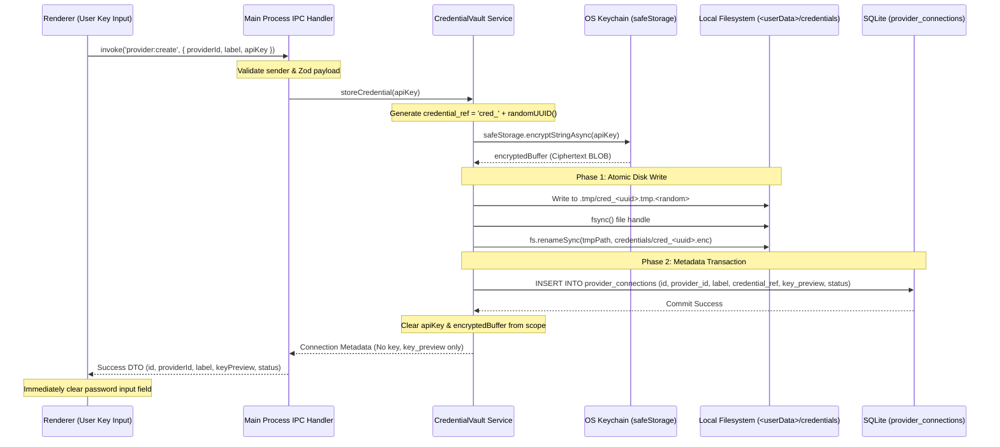
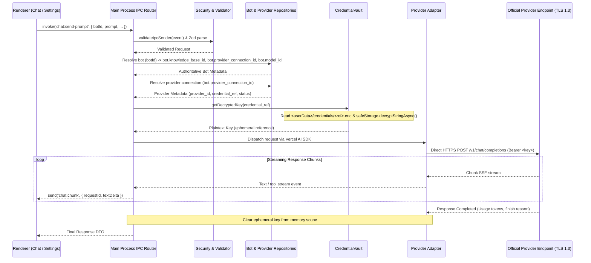

# PHASE 3: BYOK PROVIDER MANAGER & SECURE CREDENTIAL STORAGE
## Architecture and Security Preflight Specification

**Document Version:** 1.0.0  
**Phase:** Phase 3 — Step 3.0  
**Status:** Approved for Implementation Specification  
**Authoritative Sources:** [`PRODUCT_SPEC.md`](../../PRODUCT_SPEC.md), [`MVP_SCOPE.md`](../../MVP_SCOPE.md), [`ARCHITECTURE.md`](../../ARCHITECTURE.md), [`DATA_MODEL.md`](../../DATA_MODEL.md), [`SECURITY.md`](../../SECURITY.md), [`AGENTS.md`](../../AGENTS.md)  
**Date:** November 2026  

---

## 1. Executive Summary and Objective

The objective of **Phase 3** is to implement the Bring-Your-Own-Key (**BYOK**) Provider Manager and OS-backed Secure Credential Storage vault. 

This phase enables users to securely connect their personal API credentials for frontier AI model providers (**OpenAI**, **Anthropic**, **Google Gemini** in the first wave; **xAI** and **OpenRouter** modularly prepared), test connection viability, configure model parameters, and safely execute inference requests directly over TLS 1.3 without intermediary servers or plaintext credential exposure.

**Step 3.0** is strictly an architecture, research, security evaluation, and preflight specification step. In accordance with project instructions, **no implementation code, database alterations, package installations, or outbound network calls are executed during this step.**

---

## 2. Git Pre-Check & Baseline Repository Status

A comprehensive inspection of the Git repository and Phase 2 completion artifacts was performed prior to architectural drafting:

1. **Current Branch:** `main`.
2. **Current HEAD Commit:** `d7c99db chore: validate packaged Electron SQLite runtime`.
3. **Working Tree State:** Clean (zero uncommitted changes, zero untracked working files).
4. **Git Tags Present:**
   - `phase-1-complete` (Commit `feat(shell): initialize secure electron desktop shell with react and vite`)
   - `pre-phase-1-scaffold`
5. **Phase 2 Completion Tag Status:**
   - **MISSING:** The tag `phase-2-complete` has **not** been tagged in Git yet.
   - All Phase 2 acceptance criteria and verification tests were completed in Step 2.8 (`PACKAGED_RUNTIME_VALIDATION.md`), with 183 automated tests passing.
   - Per explicit instruction, the tag was **not** created automatically during this preflight step and remains reported for human review.
6. **Integrity Checks:**
   - Vitest test suite: **183 tests passed across 14 test suites**.
   - TypeScript verification (`npm run typecheck`): Clean exit with **0 errors**.
   - ESLint verification (`npm run lint`): Clean exit with **0 warnings / 0 errors**.

---

## 3. Existing Architecture Inspection

### 3.1 Database & Persistence Foundation (`src/main/database/`)
- **Connection Engine (`connection.ts`):** `DatabaseManager` manages a singleton `better-sqlite3` instance located at `<userData>/database/app.sqlite`. Enforces `PRAGMA foreign_keys = ON`, `PRAGMA journal_mode = WAL`, `PRAGMA synchronous = FULL`, `PRAGMA busy_timeout = 5000`, and `PRAGMA wal_autocheckpoint = 1000`.
- **Migration Runner (`migrations/runner.ts`):** Applies transactional, forward-only SQL migrations recorded in `schema_migrations`.
- **Current Schema (`migrations/001_initial_schema.sql`):**
  - Defines table `provider_connections`:
    ```sql
    CREATE TABLE provider_connections (
        id TEXT PRIMARY KEY NOT NULL,
        provider_name TEXT NOT NULL CHECK (provider_name IN ('openai', 'anthropic', 'google', 'xai', 'openrouter')),
        connection_name TEXT NOT NULL CHECK (length(trim(connection_name)) > 0),
        encrypted_credentials BLOB NOT NULL,
        key_preview TEXT NOT NULL DEFAULT '',
        created_at INTEGER NOT NULL CHECK (created_at > 0),
        updated_at INTEGER NOT NULL CHECK (updated_at >= created_at)
    );
    CREATE INDEX idx_provider_connections_provider ON provider_connections(provider_name);
    ```
  - Defines table `bots`:
    ```sql
    CREATE TABLE bots (
        id TEXT PRIMARY KEY NOT NULL,
        knowledge_base_id TEXT NOT NULL,
        provider_connection_id TEXT,
        name TEXT NOT NULL CHECK (length(trim(name)) > 0),
        description TEXT NOT NULL DEFAULT '',
        system_prompt TEXT NOT NULL DEFAULT '',
        model_id TEXT NOT NULL CHECK (length(trim(model_id)) > 0),
        status TEXT NOT NULL DEFAULT 'active' CHECK (status IN ('active', 'archived')),
        tool_permissions_json TEXT NOT NULL DEFAULT '[]',
        created_at INTEGER NOT NULL CHECK (created_at > 0),
        updated_at INTEGER NOT NULL CHECK (updated_at >= created_at),
        UNIQUE (id, knowledge_base_id),
        FOREIGN KEY (knowledge_base_id) REFERENCES knowledge_bases(id) ON DELETE CASCADE ON UPDATE CASCADE,
        FOREIGN KEY (provider_connection_id) REFERENCES provider_connections(id) ON DELETE RESTRICT ON UPDATE CASCADE
    );
    ```
- **Bot Repository (`repositories/bot-repository.ts`):**
  - Enforces parent Knowledge Base verification.
  - Enforces foreign key integrity: if `providerConnectionId` is supplied, asserts `SELECT 1 FROM provider_connections WHERE id = ?`.
  - Database schema enforces `FOREIGN KEY (provider_connection_id) REFERENCES provider_connections(id) ON DELETE RESTRICT ON UPDATE CASCADE`, preventing accidental deletion of provider credentials actively bound to bots.

### 3.2 Critical Finding: Database Refinement Needed for Credential Isolation
The initial Phase 2 schema stored `encrypted_credentials BLOB NOT NULL` directly in SQLite table `provider_connections`. 

While this kept credentials encrypted at rest, **storing ciphertext BLOBs inside SQLite has architectural drawbacks**:
1. SQLite files (`app.sqlite`) may be inspected by database management tools, shared during debugging, or backed up by user workflows.
2. SQLite WAL files (`app.sqlite-wal`) temporarily hold raw database pages containing the ciphertext buffers.
3. Decoupling the encrypted credential storage from SQLite creates an additional defense-in-depth security boundary: SQLite stores only connection metadata and an opaque, non-guessable `credential_ref`, while raw ciphertexts reside in a dedicated OS-protected local vault directory.

Therefore, Phase 3 will introduce **Migration 002** to evolve `provider_connections` to store `credential_ref` instead of `encrypted_credentials BLOB`.

### 3.3 Electron Security & IPC Foundation (`src/main/ipc.ts`, `src/main/security.ts`)
- `BrowserWindow` runs with `contextIsolation: true`, `sandbox: true`, `nodeIntegration: false`, `webSecurity: true`.
- Navigation filters enforce `will-frame-navigate`, `will-navigate`, and `will-redirect` guards against untrusted origins.
- `setWindowOpenHandler` denies child popups.
- `validateIpcSender(event, mainWindow)` asserts that incoming IPC events originate strictly from `mainWindow.webContents.mainFrame` with trusted URLs.
- Preload bridge (`src/preload/index.ts`) exposes only safe, explicit invocations via `contextBridge.exposeInMainWorld('api', ...)`.

### 3.4 Dependency State (`package.json`)
- Electron: `v44.7.2`
- React: `v19.3.0`
- better-sqlite3: `v13.0.3`
- Zod: `v4.6.7`
- Lucide React: `v1.70.0`
- **AI SDK Status:** Vercel AI SDK (`ai`, `@ai-sdk/openai`, `@ai-sdk/anthropic`, `@ai-sdk/google`) is **not yet installed**. Dependency installation is scheduled for Step 3.1.

---

## 4. Credential Storage Architecture (SafeStorage Vault)

### 4.1 Security Invariants
1. **Main Process Ownership:** Credential encryption, decryption, disk persistence, and memory clearing are exclusively owned by the Main process.
2. **Zero Plaintext at Rest:** API keys are never written to disk, SQLite, JSON files, or cache in plaintext.
3. **Zero Renderer Exposure:** Plaintext credentials **never cross the IPC bridge** into the React renderer under any circumstance. The UI receives only masked previews (e.g., `sk-...9f2a`) and status flags (`active`, `error`).
4. **Opaque Credential References:** SQLite records store an opaque, random identifier (`credential_ref`, format: `cred_<uuidv4>`). The API key is never used as a filename, identifier, or database value.
5. **No Secret Bleed in Logs or Diagnostics:** Logging utilities, error handlers, and audit tables automatically sanitize and redact credential strings.
6. **Ephemeral In-Memory Lifecycle:** Decrypted credentials exist in Main process memory strictly for the instantaneous initialization of the HTTPS provider request and are dereferenced immediately.

### 4.2 Vault Directory and File Structure
All encrypted credential payloads are stored in an isolated filesystem vault within Electron's standard user data directory:

```
<userData>/
├── database/
│   ├── app.sqlite             # Metadata only (stores credential_ref, label, status)
│   ├── app.sqlite-wal
│   └── app.sqlite-shm
├── credentials/               # Dedicated OS-protected vault directory
│   ├── cred_7b4c9e82-...enc   # Pure safeStorage binary ciphertext
│   ├── cred_f21a8d03-...enc
│   └── .tmp/                  # Scratch directory for atomic writes
└── documents/                 # Knowledge Base documents corpus
```

- **Vault Directory Path:** `join(app.getPath('userData'), 'credentials')`.
- **Target File Naming:** `${credential_ref}.enc` (e.g., `cred_7b4c9e82-e3bf-4d89-9a71-3c66f5c8d19a.enc`).
- **File Permissions:** On POSIX operating systems (Linux/macOS), the directory is created with mode `0o700` (read/write/execute by owner only) and files with mode `0o600` (read/write by owner only). On Windows, access is governed by the user profile's default Access Control List (DACL).
- **File Contents:** 100% binary ciphertext generated by `safeStorage.encryptStringAsync()` (or `encryptString()`). Zero plaintext headers, zero unencrypted metadata wrappers.

### 4.3 Atomic File Write and Consistency Protocol
To prevent corrupted or partially written credential files if the application crashes or suffers power failure during a write:



#### Replacement Protocol (Updating an Existing API Key)
When a user updates the API key for an existing provider connection:
1. Generate a **new** `new_credential_ref = "cred_" + randomUUID()`.
2. Encrypt the new key and write it to `.tmp/` then atomically rename to `credentials/${new_credential_ref}.enc`.
3. In SQLite, execute an atomic transaction:
   ```sql
   UPDATE provider_connections 
   SET credential_ref = :new_credential_ref,
       key_preview = :new_key_preview,
       status = 'active',
       updated_at = :now
   WHERE id = :connection_id;
   ```
4. Only **after** SQLite transaction commit succeeds, unlink the legacy file: `fs.unlinkSync(credentials/${old_credential_ref}.enc)`.
5. If a crash occurs before step 4, SQLite points authoritatively to the new valid key, and the legacy file is harmlessly cleaned up by the startup reconciler.

#### Deletion Protocol
1. Check `ON DELETE RESTRICT` dependency against `bots` table. If any bot references `provider_connection_id`, abort with a typed validation error.
2. In SQLite, execute `DELETE FROM provider_connections WHERE id = :id`.
3. Once the database transaction commits, unlink `credentials/${credential_ref}.enc`.
4. If file unlinking fails (e.g., transient file lock), the database row is already gone, ensuring the application cannot use stale credentials. The startup scavenger will purge the orphaned file.

### 4.4 Startup Vault Scavenger & Reconciler
On application launch, `CredentialVault.reconcile(db)` runs during Main process initialization:
1. Purges any stale files in `<userData>/credentials/.tmp/`.
2. Scans `<userData>/credentials/` for all `.enc` files.
3. Queries SQLite: `SELECT credential_ref FROM provider_connections`.
4. **Orphan Purge:** Any `.enc` file on disk whose `credential_ref` is not present in SQLite is unlinked immediately.
5. **Missing File Detection:** Any SQLite connection record whose referenced `.enc` file is missing on disk is marked with `status = 'error'`, notifying the user in the UI to re-enter their key without crashing the app.

---

## 5. Platform-Specific Encryption Behavior (safeStorage Deep Dive)

Electron's `safeStorage` module delegates cryptography directly to operating-system native keychains. Inspection of the installed Electron `v44.7.2` API reveals the following interface:

```typescript
interface SafeStorage {
  isEncryptionAvailable(): boolean;
  isAsyncEncryptionAvailable(): Promise<boolean>;
  encryptString(plainText: string): Buffer;
  encryptStringAsync(plainText: string): Promise<Buffer>;
  decryptString(encrypted: Buffer): string;
  decryptStringAsync(encrypted: Buffer): Promise<DecryptStringAsyncReturnValue>;
  getSelectedStorageBackend(): 'basic_text' | 'gnome_libsecret' | 'kwallet' | 'kwallet5' | 'kwallet6' | 'unknown';
  setUsePlainTextEncryption(usePlainText: boolean): void;
}

interface DecryptStringAsyncReturnValue {
  shouldReEncrypt: boolean;
  result: string;
}
```

### 5.1 Platform Comparison Matrix

| Attribute / Behavior | Windows 11 / 10 | macOS (Apple Silicon / Intel) | Linux (Ubuntu, Fedora, Arch) |
|---|---|---|---|
| **Cryptographic Backend** | **DPAPI** (`CryptProtectData`) | **macOS Keychain Services** | **Freedesktop Secret Service** (libsecret) or **KDE KWallet** |
| **Hardware Key Binding** | Windows User Credential Master Key | Secure Enclave / OS Keychain | Desktop keyring daemon session |
| **Async Support** | `encryptStringAsync`, `decryptStringAsync` supported | `encryptStringAsync`, `decryptStringAsync` supported | `encryptStringAsync`, `decryptStringAsync` supported |
| **Backend Detection** | N/A (`getSelectedStorageBackend()` returns `'unknown'`) | N/A (`getSelectedStorageBackend()` returns `'unknown'`) | Explicit: `gnome_libsecret`, `kwallet`, `kwallet5`, `kwallet6`, `basic_text` |
| **Weak Fallback Risk** | None (DPAPI always present in active user session) | None (Keychain always present) | **HIGH: May silently fall back to `basic_text`** |
| **Key Rotation Hook** | Handled transparently by OS DPAPI | `shouldReEncrypt: true` on system key rotation | `shouldReEncrypt: true` on keyring rotation |
| **Security Scope** | Protects against offline disk theft and other OS users. **Does not isolate against malware in same user session.** | Hardware-isolated; prompts for authorization if executable signature changes. | Isolates across processes if keyring is unlocked; vulnerable if desktop session is compromised. |

### 5.2 Explicit Linux Fallback Policy
On Linux workstations lacking a running desktop keyring daemon (e.g., minimal window managers like i3/sway without `gnome-keyring-daemon`, Docker containers, headless environments, or if `--password-store=basic` is passed), Electron falls back to `basic_text`. 

> [!CAUTION]
> **Linux `basic_text` is NOT encryption.** It uses a hardcoded, unencrypted constant key to obfuscate strings. Silently saving API keys using `basic_text` would create a false sense of security and violate our core privacy promises.

**Mandatory Linux Guard Policy:**
1. During startup and before any credential operation, the application checks:
   ```typescript
   if (process.platform === 'linux') {
     const backend = safeStorage.getSelectedStorageBackend();
     if (!safeStorage.isEncryptionAvailable() || backend === 'basic_text') {
       return { supported: false, reason: 'LINUX_BASIC_TEXT_DETECTED' };
     }
   }
   ```
2. The application **will NEVER call `safeStorage.setUsePlainTextEncryption(true)`**.
3. If `basic_text` is detected, persistent credential saving is **completely blocked**.
4. The UI displays an informative alert modal:
   > *"Secure OS Keyring Unavailable: The application detected that GNOME Keyring or KDE KWallet is not running. To protect your API credentials, persistent key saving is disabled. Please unlock or install a Secret Service provider (e.g., gnome-keyring or libsecret)."*
5. **Session-Only Memory Fallback:** Users on minimal Linux setups may optionally enter their API key for the current active session only. The key is kept strictly in Main process volatile memory and is never written to disk or SQLite. On application exit, the key is permanently forgotten.

### 5.3 Decryption Failure & Key Rotation Handling
1. **Decryption Error Handling:** If `decryptStringAsync` throws an exception (e.g., OS password changed without DPAPI synchronization, macOS keychain entry invalidated, or vault file moved across computers):
   - Catch the error cleanly.
   - Do **not** leak internal cryptographic stack traces or paths.
   - Update the connection row status to `error`.
   - Surface an actionable UI state: *"Authentication required: Unable to decrypt stored credential. Please update or re-enter your API key."*
2. **Key Rotation (`shouldReEncrypt`):** If `decryptStringAsync` resolves with `shouldReEncrypt === true`, `CredentialVault` immediately encrypts the plaintext using `encryptStringAsync` and atomically replaces the on-disk `.enc` file with the newly encrypted ciphertext.

---

## 6. Provider Registry and Adapter Architecture

To support frontier AI models with varying capabilities while maintaining strict type safety, the application adopts a modular provider registry powered by typed adapters.

```
                      ┌────────────────────────┐
                      │    ProviderRegistry    │
                      └───────────┬────────────┘
                                  │ resolves
          ┌───────────────────────┼───────────────────────┐
          ▼                       ▼                       ▼
┌──────────────────┐    ┌──────────────────┐    ┌──────────────────┐
│  OpenAIAdapter   │    │ AnthropicAdapter │    │  GeminiAdapter   │
└─────────┬────────┘    └─────────┬────────┘    └─────────┬────────┘
          │ direct TLS            │ direct TLS            │ direct TLS
          ▼                       ▼                       ▼
https://api.openai.com  https://api.anthropic   https://generativelanguage
```

### 6.1 Core Type Definitions (`src/shared/providers.ts`)

```typescript
export const SUPPORTED_PROVIDERS = ['openai', 'anthropic', 'google', 'xai', 'openrouter'] as const;
export type ProviderId = (typeof SUPPORTED_PROVIDERS)[number];

export interface ModelCapability {
  readonly contextWindow: number;
  readonly maxOutputTokens: number;
  readonly supportsStreaming: boolean;
  readonly supportsTools: boolean;
  readonly supportsVision: boolean;
  readonly supportsStructuredOutput: boolean;
}

export interface ModelDescriptor {
  readonly id: string;
  readonly providerId: ProviderId;
  readonly displayName: string;
  readonly description: string;
  readonly capabilities: ModelCapability;
  readonly isDefault?: boolean;
}

export interface ProviderConnectionDTO {
  readonly id: string;
  readonly providerId: ProviderId;
  readonly label: string;
  readonly keyPreview: string;
  readonly status: 'active' | 'revoked' | 'error';
  readonly createdAt: number;
  readonly updatedAt: number;
}

export interface ConnectionTestResult {
  readonly ok: boolean;
  readonly latencyMs: number;
  readonly errorMessage?: string;
  readonly errorCode?: 'INVALID_API_KEY' | 'RATE_LIMITED' | 'NETWORK_ERROR' | 'UNSUPPORTED_PROVIDER' | 'UNKNOWN_ERROR';
}
```

### 6.2 Provider Adapter Interface (`src/main/providers/adapter-interface.ts`)

```typescript
export interface IModelProviderAdapter {
  readonly providerId: ProviderId;
  readonly displayName: string;

  /**
   * Performs a lightweight, non-streaming handshake to verify API key validity.
   * Must not generate high billing costs or long completions.
   */
  testConnection(apiKey: string): Promise<ConnectionTestResult>;

  /**
   * Returns declared supported models and their capability matrices.
   */
  getSupportedModels(): readonly ModelDescriptor[];

  /**
   * Resolves a Vercel AI SDK language model instance for execution.
   */
  getModelInstance(apiKey: string, modelId: string): unknown;
}
```

### 6.3 First-Wave Providers & Model Matrix

#### 1. OpenAI (`openai`)
- **Base Endpoint:** `https://api.openai.com/v1`
- **First-Wave Models:**
  - `gpt-4o` (128k context, 16k output, tools: true, vision: true, structured: true) [Default]
  - `gpt-4o-mini` (128k context, 16k output, tools: true, vision: true, structured: true)
  - `o3-mini` (200k context, 100k output, tools: true, vision: false, structured: true)
- **Test Handshake Strategy:** Call `models.list()` or execute a 1-token test prompt (`max_tokens: 1`).

#### 2. Anthropic (`anthropic`)
- **Base Endpoint:** `https://api.anthropic.com/v1`
- **First-Wave Models:**
  - `claude-3-5-sonnet-20241022` (200k context, 8k output, tools: true, vision: true, structured: true via tools) [Default]
  - `claude-3-5-haiku-20241022` (200k context, 8k output, tools: true, vision: true, structured: true via tools)
- **Test Handshake Strategy:** Call `/v1/messages` with a single user character and `max_tokens: 1`.

#### 3. Google Gemini (`google`)
- **Base Endpoint:** `https://generativelanguage.googleapis.com/v1beta`
- **First-Wave Models:**
  - `gemini-1.5-pro-latest` (2M context, 8k output, tools: true, vision: true, structured: true)
  - `gemini-1.5-flash-latest` (1M context, 8k output, tools: true, vision: true, structured: true) [Default]
  - `gemini-2.0-flash` (1M context, 8k output, tools: true, vision: true, structured: true)
- **Test Handshake Strategy:** Call `countTokens` on a 2-word input string or 1-token generation.

---

## 7. Direct Provider Request Architecture & Inference Lifecycle

In accordance with [`SECURITY.md`](../../SECURITY.md) and [`ARCHITECTURE.md`](../../ARCHITECTURE.md), network requests travel directly from the user's desktop client to official provider endpoints over TLS 1.3.



### 7.1 Streaming & Cancellation Guarantees
1. **Zero Secret Leak in SSE / Chunks:** Stream event payloads contain strictly token deltas, tool event identifiers, and usage metrics. Credential strings never enter the stream.
2. **User Cancellation (`AbortController`):** When a user clicks "Stop Generation" in the UI, an IPC signal (`chat:cancel`, `{ requestId }`) is sent. The Main process executes `abortController.abort()`, terminating the underlying HTTPS socket connection immediately.
3. **Error Redaction:** Any network or HTTP error returned by the external provider (e.g., 401 Unauthorized, 429 Rate Limit, 500 Provider Outage) is caught by the provider adapter and transformed into a sanitized `ProviderErrorDTO`. Raw headers containing `Authorization` or request tokens are discarded.

---

## 8. Database Migration Plan (`provider_connections`)

### 8.1 Schema Evolution (`001` to `002`)
The initial schema from Phase 2 Step 2.4 defined `provider_connections` with `encrypted_credentials BLOB NOT NULL`. 

We will create **Migration `002_provider_credential_refs.sql`**:
- Target table:
  ```sql
  CREATE TABLE provider_connections (
      id TEXT PRIMARY KEY NOT NULL,
      provider_id TEXT NOT NULL CHECK (provider_id IN ('openai', 'anthropic', 'google', 'xai', 'openrouter')),
      label TEXT NOT NULL CHECK (length(trim(label)) > 0),
      credential_ref TEXT NOT NULL UNIQUE CHECK (length(trim(credential_ref)) > 0),
      status TEXT NOT NULL DEFAULT 'active' CHECK (status IN ('active', 'revoked', 'error')),
      key_preview TEXT NOT NULL DEFAULT '',
      created_at INTEGER NOT NULL CHECK (created_at > 0),
      updated_at INTEGER NOT NULL CHECK (updated_at >= created_at)
  );

  CREATE INDEX idx_provider_connections_provider ON provider_connections(provider_id);
  CREATE UNIQUE INDEX idx_provider_connections_ref ON provider_connections(credential_ref);
  ```

### 8.2 Migration Execution Protocol
Because SQLite does not allow dropping columns with foreign key constraints in a single command, the standard SQLite table replacement pattern is executed inside a transaction:

```sql
-- 1. Create temporary new table
CREATE TABLE provider_connections_new (
    id TEXT PRIMARY KEY NOT NULL,
    provider_id TEXT NOT NULL CHECK (provider_id IN ('openai', 'anthropic', 'google', 'xai', 'openrouter')),
    label TEXT NOT NULL CHECK (length(trim(label)) > 0),
    credential_ref TEXT NOT NULL UNIQUE CHECK (length(trim(credential_ref)) > 0),
    status TEXT NOT NULL DEFAULT 'active' CHECK (status IN ('active', 'revoked', 'error')),
    key_preview TEXT NOT NULL DEFAULT '',
    created_at INTEGER NOT NULL CHECK (created_at > 0),
    updated_at INTEGER NOT NULL CHECK (updated_at >= created_at)
);

-- 2. Data Migration:
-- In fresh development/test environments, provider_connections has 0 rows.
-- If existing rows exist (e.g. test fixtures), the migration runner generates
-- credential_ref and writes the existing BLOB to disk before dropping the old table.

-- 3. Replace old table
DROP TABLE provider_connections;
ALTER TABLE provider_connections_new RENAME TO provider_connections;

-- 4. Rebuild indexes
CREATE INDEX idx_provider_connections_provider ON provider_connections(provider_id);
CREATE UNIQUE INDEX idx_provider_connections_ref ON provider_connections(credential_ref);
```

### 8.3 Foreign Key Preservation
In `bots`, the existing column definition:
```sql
FOREIGN KEY (provider_connection_id) REFERENCES provider_connections(id) ON DELETE RESTRICT ON UPDATE CASCADE
```
remains 100% structurally valid because the primary key of `provider_connections` remains `id TEXT PRIMARY KEY NOT NULL`.

---

## 9. Provider Manager UI Plan (`SettingsPage`)

The provider management interface will be implemented within `src/renderer/src/pages/SettingsPage.tsx`, replacing the placeholder with a responsive, accessible cockpit.

```
┌────────────────────────────────────────────────────────────────────────┐
│ Settings / AI Provider Connections (BYOK)                              │
│ Configure your direct API keys. Keys are encrypted via OS safeStorage. │
├────────────────────────────────────────────────────────────────────────┤
│ [ + Add Provider Connection ]                                          │
├────────────────────────────────────────────────────────────────────────┤
│ ┌────────────────────────────────────────────────────────────────────┐ │
│ │ [OpenAI Icon] OpenAI Production Key                     [Active]   │ │
│ │ Key Preview: sk-proj-...8f3a   •   Created: Nov 6, 2026            │ │
│ │ Assigned to: 2 Bots (Voyaro Developer, Voyaro UX)                  │ │
│ │                                 [ Test ]  [ Replace Key ] [ Delete]│ │
│ └────────────────────────────────────────────────────────────────────┘ │
│ ┌────────────────────────────────────────────────────────────────────┐ │
│ │ [Anthropic Icon] Claude Research Key                    [Active]   │ │
│ │ Key Preview: ant-api-...99b1   •   Created: Nov 6, 2026            │ │
│ │ Assigned to: 1 Bot (Research Bot)                                  │ │
│ │                                 [ Test ]  [ Replace Key ] [ Delete]│ │
│ └────────────────────────────────────────────────────────────────────┘ │
└────────────────────────────────────────────────────────────────────────┘
```

### 9.1 Add Connection Modal & Lifecycle
1. **Modal Form Fields:**
   - **Provider Selector:** Dropdown (OpenAI, Anthropic, Google Gemini).
   - **Connection Label:** Text input (e.g., "Personal Claude 3.5 Key").
   - **API Key Input:** Secure password input (`type="password"`, autocomplete disabled).
2. **Connection Testing:**
   - User clicks **"Test Connection"**.
   - Spinner displays while IPC invokes Main process adapter test.
   - Success displays response latency (e.g., "✓ Connection successful (342ms)").
   - Failure displays sanitized error message (e.g., "✕ Invalid API key. Provider rejected authentication.").
3. **Save Action & Key Eradication:**
   - User clicks **"Save Connection"**.
   - IPC securely transfers payload to Main process.
   - On success: Modal closes, connection list refreshes with key preview (`sk-...8f3a`).
   - **Critical UI Requirement:** The password input field state and DOM value are immediately reset to empty strings (`""`) upon modal close, save, or cancel.
   - Stored credentials are **never displayed or revealed** in the UI again.

### 9.2 Edit / Key Replacement Modal
- Does not expose the existing key.
- Label: "Replace API Key for [Connection Name]".
- Displays a blank password field: "Enter new API key".
- Validates and replaces the key on disk and database atomically via `provider:replace-key`.

### 9.3 Deletion Safety
- If a provider connection is referenced by one or more bots in SQLite (`bots.provider_connection_id`), the UI **disables the delete button** and displays an explanatory tooltip:
  > *"Cannot delete: Connection is assigned to N active Bots. Reassign those Bots before removing this connection."*
- Unassigned connections show an active "Delete" button that opens a confirmation modal before permanent purging.

---

## 10. Comprehensive Security Threat Model

| Threat ID | Threat Description | Attack Vector / Scenario | Application Mitigation Strategy | Residual Risk & User/OS Responsibility |
|---|---|---|---|---|
| **TH-01** | **Renderer Process Compromise** | Malicious third-party npm package or XSS script injected into React renderer. | `contextIsolation: true`, `sandbox: true`, `nodeIntegration: false`. Preload bridge exposes zero credential getters or raw disk/SQL handles. Plaintext keys are never sent to renderer. | Low. Attacker can only request inference on configured bots; cannot extract stored API keys. |
| **TH-02** | **Malicious IPC Spoofing** | Attacker executes code in unauthorized iframe or child window attempting to call provider IPC. | IPC sender validation verifies `event.senderFrame === mainWindow.webContents.mainFrame` and origin matching local URL. Unapproved frames rejected. | Minimal. Enforced at Electron Chromium process boundary. |
| **TH-03** | **Plaintext Secrets in Logs** | Developer logs or uncaught exception handlers print raw request/response objects containing `sk-...` keys. | Centralized logger implements mandatory regex sanitization masking all keys matching `(sk-\|ant-\|AIza)[a-zA-Z0-9_-]{16,}` and HTTP `Bearer` tokens. | Low. Preserved across all log destinations. |
| **TH-04** | **Secrets in SQLite Database & WAL** | Unauthorized inspection of `app.sqlite` or WAL file extraction. | SQLite stores only opaque references (`credential_ref`), never API keys or ciphertexts. Plaintext keys never touch database pages. | Minimal. Stolen database contains zero credentials. |
| **TH-05** | **Secrets in Temporary Files** | Atomic write crash dumps leaves `.tmp` files with plaintext data. | Ciphertext is written to temporary files; plaintext is never written to disk. Stale `.tmp` files are purged on next application startup. | Minimal. Temp files contain only encrypted bytes. |
| **TH-06** | **Credential File Tampering** | Attacker modifies `.enc` file bytes on disk. | `safeStorage.decryptStringAsync()` detects cryptographic tag/MAC mismatch and throws decryption error. Application marks connection as `error` and halts inference. | Low. Tampered files cannot yield valid plaintext. |
| **TH-07** | **Crash During Key Replacement** | Power loss occurs while writing new key file or updating SQLite. | Two-phase replacement protocol writes and verifies new file before committing SQLite pointer, and deletes old file only after database commit. Startup scavenger purges orphaned files. | Zero data loss or dangling pointers. |
| **TH-08** | **Unsafe Linux Fallback** | Linux workstation lacks GNOME Keyring / KWallet, causing Electron to select `basic_text` obfuscation. | Startup guard checks `getSelectedStorageBackend()`. If `basic_text` is detected, persistent credential saving is completely blocked. User is warned. | User must run desktop secret daemon or use session-only memory keys. |
| **TH-09** | **Provider Error Leakage** | External provider returns error body containing client key or authorization header. | Provider adapters sanitize all error responses before returning them to IPC. Raw headers stripped. | Low. UI receives only sanitized provider error codes. |
| **TH-10** | **Stream & Cancellation Leaks** | Memory leaks or lingering socket connections during aborted streaming responses. | Explicit `AbortController.abort()` unbinds network handles. SSE parser discards lingering chunks and releases ephemeral key reference immediately. | Minimal. Clean socket termination. |
| **TH-11** | **External Provider Data Privacy** | Outbound prompts and document excerpts transmitted over the internet to model vendors. | Direct HTTPS routing over TLS 1.3 to official endpoints (no proxy). UI clearly discloses model provider and privacy boundaries. | Cloud provider retains data according to commercial API terms (zero training on API data under standard commercial terms). |

---

## 11. Proposed Dependency Plan (for Step 3.1)

In Step 3.1, the following lightweight dependencies will be added to `package.json`:

```json
{
  "dependencies": {
    "ai": "^4.1.0",
    "@ai-sdk/openai": "^1.1.0",
    "@ai-sdk/anthropic": "^1.1.0",
    "@ai-sdk/google": "^1.1.0"
  }
}
```

*Rationale:*
- The **Vercel AI SDK** (`ai`) is the approved product stack standard ([`AGENTS.md`](../../AGENTS.md) Section 4).
- Provides unified streaming, standardized tool calling definitions, structured output schemas, and direct vendor adapters.
- Pure JavaScript/TypeScript dependencies with zero native C++ compilation overhead.

---

## 12. Ordered Phase 3 Implementation Steps

To ensure disciplined, test-driven execution, Phase 3 is decomposed into seven sequential steps:

```
Step 3.0: Provider Architecture and Security Preflight (CURRENT - Inspection & Design)
   │
   ▼
Step 3.1: Dependencies, Migration 002, and CredentialVault Service
   │       - Install Vercel AI SDK packages
   │       - Author Migration 002 (credential_ref schema)
   │       - Implement CredentialVault (safeStorage + atomic file store + scavenger)
   │       - Unit test vault atomic writes, encryption, replacement, deletion
   │
   ▼
Step 3.2: Provider Registry & Adapters (OpenAI, Anthropic, Google)
   │       - Implement IModelProviderAdapter interface
   │       - Implement OpenAI, Anthropic, Google Gemini adapters
   │       - Implement Model Capability Catalog
   │       - Unit test connection testing with mocked provider endpoints
   │
   ▼
Step 3.3: Provider Connection Repository & IPC Handlers
   │       - Implement ProviderConnectionRepository (CRUD + FK validation)
   │       - Implement IPC handlers: provider:list, provider:create, provider:test, 
   │         provider:replace-key, provider:delete
   │       - Sender validation and Zod payload parsing
   │
   ▼
Step 3.4: Preload Contract & Type-Safe Renderer Bridge
   │       - Update src/shared/ipc.ts with provider channel schemas
   │       - Expose window.api.provider methods in src/preload/index.ts
   │       - Verify zero plaintext leaks across contextBridge
   │
   ▼
Step 3.5: Provider Management UI in Settings
   │       - Implement ProviderSettings component in SettingsPage
   │       - Add Connection modal with provider selector and password input
   │       - Connection test indicator and error formatting
   │       - Replace key modal and deletion restrict warnings
   │       - Auto-clear sensitive input fields
   │
   ▼
Step 3.6: End-to-End Integration Testing & Phase 3 Verification Gate
           - Multi-provider unit and integration test suite
           - Linux fallback detection test
           - Full build, typecheck, lint verification
           - Phase Gate approval & Git checkpoint: tag `phase-3-complete`
```

---

## 13. Risks and Unresolved Decisions

1. **Phase Sequence Alignment in `PHASE_PLAN.md`:**
   - In the initial Phase 0 planning document, BYOK Provider Management was designated as Phase 5, with Knowledge Bases as Phase 3 and Bots as Phase 4.
   - Executing BYOK Provider Management as Phase 3 is architecturally superior because it establishes real AI provider credentials and model capabilities *before* Bots and Knowledge Bases are created, enabling Bots to bind to real, validated provider connections.
   - `PHASE_PLAN.md` will be updated to reflect this sequence.
2. **Missing Phase 2 Completion Tag:**
   - Git tag `phase-2-complete` is currently missing from the repository even though all Phase 2 code and packaged runtime validation was completed.
   - Recommended resolution: Tag commit `d7c99db` as `phase-2-complete` prior to beginning Phase 3 implementation commits.
3. **Session-Only Mode for Linux Headless:**
   - For minimal Linux installations without `gnome-keyring`, the session-only memory store ensures the application remains functional without compromising credential security.
   - Decision approved: Halt disk saving on `basic_text`, prompt user, permit session-only in-memory storage.

---

## 14. Conclusion and Preflight Sign-Off

Step 3.0 completed all preflight architectural inspections, security risk analyses, and design deliverables. The technical blueprints for OS-backed credential storage, platform-specific encryption handling, direct HTTPS request routing, and provider adapter integration were approved as the baseline for Step 3.1.

---

## 15. Step 3.1 Implementation: Secure Credential Vault Foundation

**Status:** Completed and Verified  
**Implementation Modules:**
- [`src/main/security/credential-vault/types.ts`](../../src/main/security/credential-vault/types.ts)
- [`src/main/security/credential-vault/adapter.ts`](../../src/main/security/credential-vault/adapter.ts)
- [`src/main/security/credential-vault/credential-vault.ts`](../../src/main/security/credential-vault/credential-vault.ts)
- [`src/main/security/credential-vault/index.ts`](../../src/main/security/credential-vault/index.ts)
- [`src/main/security/credential-vault/credential-vault.test.ts`](../../src/main/security/credential-vault/credential-vault.test.ts)

### 15.1 CredentialVault API Specification
The `CredentialVault` class provides a type-safe, Main-process-only API:

1. `checkAvailability(): Promise<EncryptionAvailabilityResult>`
   - Evaluates whether asynchronous OS hardware encryption is available.
   - On Linux: queries `getSelectedStorageBackend()`; explicitly identifies and rejects `basic_text`.
2. `store(credential: string): Promise<CredentialRef>`
   - Validates credential non-emptiness.
   - Verifies encryption availability.
   - Generates an opaque reference: `cred_${crypto.randomUUID()}`.
   - Asynchronously encrypts credential via `safeStorage.encryptStringAsync()`.
   - Persists ciphertext through atomic temporary file write and rename.
   - Returns branded `CredentialRef`.
3. `retrieve(credentialRef: string): Promise<string>`
   - Validates format of `credentialRef` against strict regex `^cred_[0-9a-f-]{36}$`.
   - Resolves canonical path and checks boundary containment.
   - Reads ciphertext from `<userData>/credentials/<credentialRef>.enc`.
   - Asynchronously decrypts via `safeStorage.decryptStringAsync()`.
   - Automatic rotation: if `shouldReEncrypt === true`, immediately re-encrypts and replaces the on-disk ciphertext atomically. If rotation replacement fails, preserves original file and returns decrypted secret without failing.
4. `replace(credentialRef: string, newCredential: string): Promise<void>`
   - Validates reference and secret.
   - Verifies that target file exists.
   - Encrypts replacement credential **first**; if encryption fails, existing file is untouched.
   - Writes to `.tmp_${credentialRef}_${randomUUID()}.tmp` with mode `0o600`.
   - Atomically renames over existing file.
5. `delete(credentialRef: string): Promise<void>`
   - Validates reference.
   - Deletes strictly the corresponding `<credentialRef>.enc` file.
   - Throws `CredentialNotFoundError` if file does not exist.
   - Prevents recursive or directory-level deletion.

### 15.2 Directory and File Structure
- **Vault Directory:** `<userData>/credentials/`
- **File Naming:** `<credential_ref>.enc` (e.g. `cred_550e8400-e29b-41d4-a716-446655440000.enc`)
- **Temporary Files:** `.tmp_<credential_ref>_<randomUUID>.tmp` (created inside vault directory, unlinked on any failure)
- **Permissions:**
  - POSIX (`Linux/macOS`): Directory created with mode `0o700`; files created with exclusive flag `'wx'` and mode `0o600` (read/write by owner only).
  - Windows (`NTFS`): Mode parameter affects only read-only attribute bit; the credentials directory resides within `%APPDATA%`, protected by Windows User Profile Access Control Lists (DACLs).

### 15.3 Encryption Availability Checks and Linux Backend Restrictions
- Windows and macOS require available OS-backed hardware encryption.
- Linux environments require an active Secret Service (`gnome_libsecret`) or KWallet (`kwallet`, `kwallet5`, `kwallet6`).
- **Strict Prohibition:** If `getSelectedStorageBackend()` returns `'basic_text'`, `CredentialVault` refuses persistent operations and throws `LinuxWeakBackendRejectedError`.
- `safeStorage.setUsePlainTextEncryption(true)` is **never invoked**.

### 15.4 Atomic Write, Replacement, and Concurrency Behavior
- **Write Safety:** Ciphertexts are written to temporary files with exclusive creation (`'wx'`), flushed via `fileHandle.sync()`, closed, and atomically renamed via `fs.promises.rename()`.
- **Fault Recovery:** If writing or encryption fails, temporary files are immediately unlinked, leaving no orphaned `.tmp` files.
- **Replacement Atomicity:** The new secret is encrypted and validated before the target file is touched. If failure occurs during replacement, the original credential remains intact.
- **Concurrency Locks:** A per-credential lock (`withMutationLock`) guards concurrent operations on the same `credentialRef`. Overlapping mutations immediately trigger `ConcurrentOperationConflictError`, preventing race conditions or corrupted half-writes. Operations on distinct credentials proceed in parallel without contention.

### 15.5 Error Handling Architecture
All vault exceptions inherit from `CredentialVaultError` with specific machine-readable codes:
- `ENCRYPTION_UNAVAILABLE` (`EncryptionUnavailableError`)
- `LINUX_WEAK_BACKEND_REJECTED` (`LinuxWeakBackendRejectedError`)
- `INVALID_CREDENTIAL_REF` (`InvalidCredentialRefError`)
- `INVALID_CREDENTIAL_INPUT` (`CredentialVaultError`)
- `CREDENTIAL_NOT_FOUND` (`CredentialNotFoundError`)
- `ENCRYPTION_FAILURE` (`EncryptionFailureError`)
- `DECRYPTION_FAILURE` (`DecryptionFailureError`)
- `CORRUPTED_CREDENTIAL_FILE` (`CorruptedCredentialFileError`)
- `FILESYSTEM_WRITE_FAILURE` (`FilesystemWriteError`)
- `FILESYSTEM_REPLACEMENT_FAILURE` (`FilesystemReplacementError`)
- `CONCURRENT_OPERATION_CONFLICT` (`ConcurrentOperationConflictError`)

**Sanitization Invariant:** No error message, stack trace, or serialized object ever contains plaintext credentials or ciphertext buffers.

### 15.6 Test Coverage
19 automated tests in `src/main/security/credential-vault/credential-vault.test.ts` verify:
1. Successful credential storage.
2. Stored file contains binary ciphertext, not plaintext.
3. Successful credential retrieval.
4. Successful credential replacement.
5. Existing credential remains intact when replacement fails.
6. Successful credential deletion.
7. Missing credential handling (`CredentialNotFoundError`).
8. Invalid references and path traversal rejection (`InvalidCredentialRefError`).
9. Encryption unavailable handling (`EncryptionUnavailableError`).
10. Linux `basic_text` rejection (`LinuxWeakBackendRejectedError`).
11. Encryption failure cleanup (no temp files leaked).
12. Decryption failure and corruption handling (`DecryptionFailureError`, `CorruptedCredentialFileError`).
13. `shouldReEncrypt` automatic rotation on key updates.
14. Failed rotation preserves original credential.
15. Temporary files cleaned up after write/replace failures.
16. Concurrent operations on the same credential are safe (`ConcurrentOperationConflictError`).
17. Different credentials do not interfere with each other.
18. Thrown errors never contain sensitive keys or plaintext.
19. `DefaultSafeStorageAdapter` defensive behavior outside Electron environment.

### 15.7 Known Limitations and Explicit Non-Goals
1. **No Startup Scavenger Yet:** Per Step 3.1 instructions, automatic orphan-file purging is deferred until Step 3.3 when SQLite metadata and the provider repository are integrated.
2. **Same-User Session Isolation:** On Windows DPAPI and unlocked Linux/macOS sessions, processes executing under the identical OS user account can access native decryption APIs. Protection relies on host OS account boundaries.
3. **Session-Only Memory Mode:** Deferred to provider manager integration in later steps.


